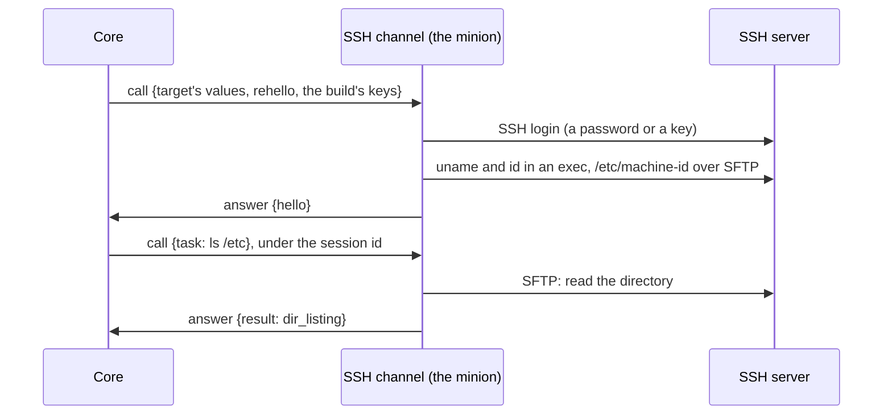

A channel normally carries a minion's sealed messages without reading them:
the minion runs on the target, and core is its peer. An SSH server runs no
minion and speaks no Logos. An **agentless** channel acts as the minion
itself: it takes core's messages, does their work over the target's own
protocol (for SSH: commands in exec channels, files over SFTP), and answers
as a minion would. Core sees a minion behind a `bind` channel, the server
sees a client of its own protocol, and nothing is installed on the server.



| Part | What changes |
|---|---|
| Protocol | `agentless` on a `bind` kind of a connection schema; `keys` (key 11) on a call or an open to such a kind: the keys of its id; `acting` (key 14) on them too: the task that made the session's acting identity; an `open`'s `under` (key 10): the id the minion speaks under; the link failure kinds `login` (5) and `host_key` (6); the machine id source `ssh-host-key` (11); a hello's `pid` optional (0: no process of its own) |
| Core | a call or an open to an agentless kind carries its id's keys (the build's under the build id, the session's under the session id), and the task that made its session's acting identity while it has one; an `open` says the id the minion speaks under (core never speaks first); the session's connection taken from its target; the failures `login` and `host_key` shown as refused, not retried, for calls and opens |
| SSH module | `logos-ssh`: the `ssh` factory, and the `ssh` channel with its own minion (for calls as the Dumbo page answers, for a persistent connection as a listening minion): [The SSH Module](../../modules/ssh/) |
| Unchanged | Targets and their states, sessions, tasks, results, file transfers, streams, the file browser, the console |

## Keys for the channel

Every build is sealed the same way, whatever its channel: a factory
declares its suite (`aes-256-cbc-hmac-sha256`), core generates each build's
keys, and core seals every message with the keys of the id it goes under.
What an agentless kind changes is who opens the messages at the other end:

- **The keys go with every call and open.** A `call` or an `open` to an
  [agentless kind](#agentless-kinds) carries `keys` (key 11): the suite and
  the keys of its id (the build's under the build id, the session's under
  the session id; an `open`'s are those of its `under`). The channel opens
  core's message and seals the minion's answer with them, as a minion
  would. It keeps nothing between calls, so they come every time.
- **Only to agentless kinds.** Any other channel never sees a key, and
  relays sealed frames it cannot read, as channels do. A channel from
  before `keys` decodes the frame and skips the key.
- **A minion that does not stage keeps its build's keys** as its
  session's: the SSH minion's session keys are its build's, and the
  factory's artifact holds none of them (core keeps them).
- **Everything else is unchanged in core**: the same sealing, the same
  sessions, the same checks, for a page and for an SSH server alike.

The seal does two things: it hides a message, and its HMAC shows that the
minion sent it, since ids travel in the clear. Between core and an
agentless channel, which holds the keys, the seal hides nothing from the
channel; it still means only a holder of the keys (core and that channel)
can speak under a build's or a session's id.

## The acting task

A minion keeps who its work runs as: after a become, its shells run as the
user until it goes back ([Identity](../minion-messages/identity/)). A
channel acting as the minion keeps nothing between calls, nor past a
connection, so core gives it back, with every call and open, the task that
made the session's identity, beside the keys:

- **`acting`** (key 14) on a `call` or an `open` to an agentless kind:
  `{1: task id, 2: cmd, ? 3: args}`, the task that made the session's
  acting identity (the `identity` that set it names its task), with its
  command and args as its [task item](../minion-messages/tasks-and-results/#tasks)
  carried them. Its credentials are in its args, as core resolved them
  when the task was queued ([Credentials](../credentials/#what-core-checks)):
  a become's password goes with every call and open while it holds.
- **While the session has one.** From the `identity` that sets it to the
  one that clears it (back to the process's own: an `unbecome`), every
  call and open under the session's id carries the task. A change replaces
  it, so it is always the last. None while the session runs as its
  process, for an acting identity that names no task, and under a build
  id, where there is no session yet: a new target's first call, an open for
  a target with no open session.
- **Only beside `keys`.** `LinkFrame.Validate` refuses `acting` on a call
  or an open without `keys`, and on an answer. A channel from before
  `acting` decodes the frame and skips the key.
- **The channel takes it up again** as its minion would have kept it: the
  command is its own, so it reads the task as when it ran it (the SSH
  channel: [Become](../../modules/ssh/#become)). An open's is where the connection starts:
  on it, the minion keeps its identity itself, as any persistent minion
  does, until the connection closes.
- **Core still records what the minion says**: a task runs as the session's
  identity said when the task's ack came, whatever the channel made of
  `acting`, and one that ran as another says so itself ([Message
  order](../minion-messages/identity/#message-order)).

## Agentless kinds

A channel says it per kind, in its [connection schema](../minion-connection/#the-schema):

```json
"bind-call": { "agentless": true, "fields": [ "call_reuse" ], "target": [ "host", "port", "user", "…" ] }
```

- **`agentless`**: optional, `false` by default, for `bind-call` and
  `bind-persistent` only (core refuses it on a `reverse` kind). It means
  the channel answers for the minion: no minion runs on the target, and the
  channel reads and writes the messages of that kind. Core therefore gives
  it what a minion would keep: the keys of each call's and open's id
  ([keys](#keys-for-the-channel)), and the task that made its session's
  identity ([the acting task](#the-acting-task)). That is all `agentless`
  changes in what core does.
- **`fields`** are what a build's connection gives the channel (how it
  calls), kept in endpoints as for any `bind` kind; nothing is built into
  a minion, as there is none. **`target`** is what each target gives it.

On such a kind:

- **`bind-call`** goes as for a page ([targets and sessions](../channel-core-connections/#bind-call-minions-targets-and-sessions),
  [when core calls](../channel-core-connections/#bind-call-minions-when-core-calls)):
  core calls a new target with `rehello` under the build id, and under the
  session id after; the channel answers under the id it was given and keeps
  nothing between calls; walks and transfers resume through their `ctx`;
  a task ends within the call's deadline.
- **`bind-persistent`** goes as for a listening minion ([opening and closing](../channel-core-connections/#bind-persistent-connections-opening-and-closing)),
  opened by the target's policy, the minion speaking first: the target is
  connected once it has, within the open's time. It keeps no ids
  of its own, so the `open` says the id it speaks under (`under`, key 10):
  the target's open session's id, else the build's. Its first message is
  its `hello`, alone: under a build id core takes one `hello` or one
  `stage` and nothing else (`protocol.ValidateBuildMessage`), and refuses
  more with an `err`. A hello under the build id opens a session; under
  the session id it says the session's host again. The next message, under
  the session id, carries `get_tasks`, which sets the allowance, and core
  pushes from then on, as on any persistent connection. Back over a new
  connection under the session's id, the minion is asked which tasks it
  still has (a [`reack`](../minion-messages/tasks-and-results/#tasks-the-minion-lost)):
  its commands ran inside the connection that went, so it answers
  `unknown_task` for each, and core ends them. A minion whose
  hello core refuses closes the connection, saying why: it has nothing to
  do on it. The connection to the server lives as long as the
  socket: when either closes, so does the other.
- **The session's connection** is its target's: the minion knows no build,
  so its `hello` says no `conn`, and core records the target's.
- **No `at` check** ([Freshness and replay](../minion-messages/wire-format/#freshness-and-replay)):
  nothing but core reaches the channel's minion.
- **A target keeps one connection**, as every target does: moving a server
  to the other kind is adding a target on the build's other connection,
  which opens a new session.

## Acting as the minion

A channel acting as the minion opens and seals messages as core does,
with the protocol's own functions (`logos-golang-protocol`) and the ids and
keys channel-core's `linkclient` hands it: a call's `ID` and `Keys`, an
open's `Under` and `Keys`.

| Step | With |
|---|---|
| Open core's message | `protocol.OpenFrame(keys.Material, id, protocol.FrameCoreToMinion, data)`, then `protocol.UnmarshalCBOR` into a `protocol.CoreMessage`, checked with `protocol.ValidateMessageHead` |
| Write the minion's | a `protocol.MinionMessage{V: protocol.MinionMessageV3}` with `Re`, the id of core's message it answers, or `ID` (`protocol.NewMessageID()`) for one it starts; each item (`protocol.HelloItem`, `AckItem`, `ResultItem`, `ErrItem`) through `protocol.MarshalCBOR` |
| Seal it | `protocol.SealFrame(keys.Material, id, protocol.FrameMinionToCore, plain)`, under the id it goes under |
| Check it as core will | `protocol.ValidateBuildMessage` for a message under a build id, and each item's `Validate` (`HelloItem.Validate`, …), which core runs too |

The direction byte keeps the two apart: a frame sealed for the other
direction does not open ([Sealed frame](../minion-messages/wire-format/#sealed-frame)).
`logos-ssh` does all of it (`internal/agent`, `internal/minion`), and its
tests run every item it sends through those checks.

### What it must answer

The least core needs of a channel acting as the minion:

- **Every call, under the call's id.** The answer is a message sealed
  under the call's `ID` with its keys, whose `re` is the id of core's
  message. An answer under another id, one that does not open, or one that
  answers another message makes the target *not the minion*.
- **A `rehello` with its `hello`.** A new target's first call comes under
  the build id with a `rehello`: the answer's `hello` opens the session, and
  core takes the rest of that answer under it. A message the minion starts
  under a build id takes one `hello` or one `stage`, alone
  (`protocol.ValidateBuildMessage`). A `hello` says at least `os` and
  `arch` (`HelloItem.Validate`); `pid` 0 says there is no process of its
  own.
- **On a `bind-persistent` connection, the first word.** The channel
  speaks first, under the open's `under`: its `hello`, alone under a build
  id. Under the session id the `hello_response` gives, a message with
  `get_tasks` sets the allowance: without one, core sends no tasks over the
  connection. In a call's answer, `get_tasks` says how many tasks the next
  call may bring: one a call until an answer says.
- **A `reack` with `unknown_task`.** Core asks, over each new connection
  under the session's id, which of the session's tasks the minion still
  has. Each task that ran in the connection that went gets an `err`
  `unknown_task` naming it (`task`), and core ends it; one it still has
  gets an `ack`.
- **An item it does not take with `unknown_item`.** It skips the item,
  takes the rest of the message, and answers with an `err` `unknown_item`
  naming it (`item`, its place in core's message), which core logs.

## The SSH module

`logos-ssh` is the agentless channel built so far, with its own factory:
its build schema, its connection schema, how its minion does each command
over SSH, `become`, tunnels and Windows servers are on [The SSH
Module](../../modules/ssh/).

## Trust

An agentless channel is not blind:

- it holds the keys of the builds it serves, which core gives it with
  every `call` and `open`, and so reads what it carries: commands, their
  output, files;
- it holds the targets' credentials, which core gives it with every `call`
  and `open`, as it gives any `bind` channel its target's
  [secrets](../channel-core-connections/#the-connection-schema-by-kind).

Run one where you would run an agent. Its link to core carries those keys
and credentials, so it needs TLS (core behind nginx) and
channel authentication: mTLS or a shared secret, planned, not built
([HTTP Sync](../channel-core-sync/)). Until channel authentication is
built, run an agentless channel only where its link to core is private:
core's Docker network, or a VPN.

## Open questions

- **Channel authentication**: mTLS or a shared secret, needed before an
  agentless channel runs outside core's own network.

## Design notes

- **Why the channel acts as the minion.** Something on our side has to,
  since an SSH server speaks no Logos. A second task path (tasks sent to
  the channel in the clear) would repeat tasks, results, transfers, streams
  and cancels outside the minion protocol, and the two would drift apart.
  Core speaking SSH itself would put every agentless protocol (SSH, later
  WinRM or SMB) in core, send every SSH round trip across the link between
  core and the channel, and drop every SSH session when core restarts. In
  the channel, the minion protocol stays the only one, and core changes
  little.
- **Why keys, not a suite of no crypto.** A `none` suite was built first,
  and dropped: it made the SSH factory a special case everywhere in core
  (unsealed messages, no keys, no staging, its own marks in the UI), while
  a page and an SSH server are reached the same way. With keys, core seals
  every message alike, and `agentless` means one thing: the channel gets
  what a minion would keep (the keys, and [the acting task](#the-acting-task)).
  The keys travel with the messages they seal over the link, so
  they hide nothing from whoever reads that link; what they keep is that
  only core and the channel can speak under a build's or a session's id,
  which a suite of no crypto gave to anyone who knew the id.
- **Why core gives back the task, not the identity.** The identity says
  who the session runs as; making it again takes how: the method, the
  user, the password. Only the task says that, and its command is the
  factory's, which core does not read ([Identity](../minion-messages/identity/)).
  So core gives the task back as it came, and the channel, whose command it
  is, reads it as it did the first time.
- **Why still a factory.** A build is a factory's from start to finish:
  offered to one of its instances, made of its schema's commands and flags,
  finished by its artifact, built again from its form. A build that core
  made for a channel would be a second kind of build in every one of those
  places. A factory that builds in seconds keeps one kind, and brings
  command sets per build (a read-only build without `rm`, `upload` or
  `shell`), versions and Build again with it.
- **Why a refused login is a failure, not an `err`.** An `open` is
  answered before its minion says anything (it speaks over the socket the
  open makes), so a refusal there can only be the answer's failure; and a
  refusal reads the same whether a call or an open met it. The channel
  answers either with a failure of its own kind (`login`, `host_key`), and
  core shows the target refused without retrying it.
- **Why a target keeps one connection.** Switching a server between kinds
  would need targets that move between connections and a switch that core
  runs on the minion's behalf. Adding a target on the other connection is
  enough.
