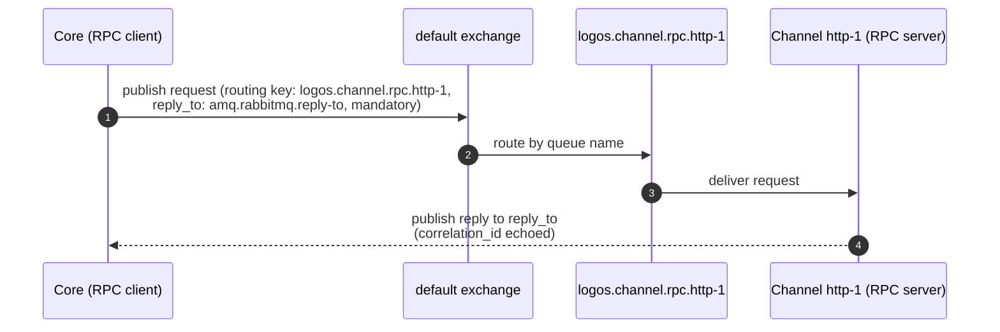

This page freezes the RabbitMQ exchange, queue, and routing-key naming strategy
for the control plane.

All names are lowercase, dot-separated, and prefixed with `logos.` to namespace
the platform on a shared broker.

## Exchanges

| Exchange | Type | Purpose |
|---|---|---|
| `logos.core.rpc` | `direct` | Module → core RPC requests: lifecycle (register, heartbeat, deregister) and a factory's build reports (`factory.build.progress`, `factory.build.result`). |
| `logos.<module-type>.rpc` | `direct` | One per module type: `logos.channel.rpc`, `logos.factory.rpc`. Each module instance binds its request queue to it with routing key `<instance>`; core itself publishes to modules through the default exchange (below). |
| `logos.module.logs` | `direct` | Module → core [live log batches](../module-logs/), routing key = stream id. |
| `logos.events` | `topic` | Core's lifecycle events, for any subscriber. |

RPC uses **direct** routing so a request reaches exactly one target. Events
use a **topic** exchange so a subscriber can pick event classes with
wildcards.

## RPC: request/reply

RPC ownership is **per-operation** — the control plane runs in both directions.
The party that *receives* an operation is the RPC **server** and owns the
request queue; the *caller* is the RPC **client**.

| Operation class | Client | Server (owns queue) |
|---|---|---|
| Lifecycle (`module.*`) | module | **core** — `logos.core.rpc` |
| Build reports (`factory.build.progress`, `.result`) | factory | **core** — `logos.core.rpc` |
| Management and log tail (`mgmt.*`) | core | **module** — `logos.<module-type>.rpc.<instance>` |
| Builds (`factory.build`, `.cancel`) | core | **factory** — `logos.factory.rpc.<instance>` |

A module learns *its own* server queue name by convention (below); core learns a
module's server queue from the `rpc_queue` field the module sends at
[registration](../module-lifecycle/#moduleregister). Both directions reply via
the same direct reply-to mechanism, with the caller setting `reply_to`.

### Core request queue

Core's server uses a single shared queue with competing consumers across core
instances:

```
logos.core.rpc
```

durable, bound to exchange `logos.core.rpc` with routing key `core`. Modules
publish their requests to that exchange with that key.

### Module request queue

Each module instance owns a request queue and consumes from it:

```
logos.<module-type>.rpc.<instance>
```

The queue is **non-durable, exclusive and auto-delete**: it exists exactly as
long as the module's connection. A second process started with the same
`instance` cannot take it over, and requests never pile up for a module that is
gone. The module declares and consumes it **before** `module.register`, since
core may call it as soon as it acknowledges. It handles at most 8 requests at a
time (prefetch 8), so a long action does not hold up state reads.

Core publishes each request to the **default exchange** with routing key = the
`rpc_queue` the instance registered, as *mandatory*, with an expiration equal to
the call timeout: a request to a queue that does not exist comes back at once
instead of timing out, and a request is never handled after its caller gave up.
The module also binds its queue to its type's exchange with routing key
`<instance>`; core does not route through that binding.

Examples:

- `logos.channel.rpc.http-1`, bound to `logos.channel.rpc` with key `http-1`
- `logos.factory.rpc.bob-1`, bound to `logos.factory.rpc` with key `bob-1`

### Replies

Replies use RabbitMQ **direct reply-to** — the client sets the request's
`reply_to` property to the pseudo-queue `amq.rabbitmq.reply-to` and the server
publishes the reply to that address. The reply's `correlation_id` equals the
request's `correlation_id`. No per-call reply queue is declared.



### Timeouts

- Core → module: 10 seconds by default; an operation may ask for more, up to 2
  minutes. The timeout is also the request's `expiration`.
- Module → core: 10 seconds by default (module-core's core client).

### Message properties

In addition to the [envelope](../amqp-envelope/) body, RPC requests set standard
AMQP properties:

| Property | Value |
|---|---|
| `reply_to` | `amq.rabbitmq.reply-to` |
| `correlation_id` | same id as the envelope `correlation_id` |
| `message_id` | same id as the envelope `message_id` |
| `content_type` | `application/json` |
| `type` | the envelope `type` (e.g. `mgmt.config.apply`) |
| `timestamp` | core → module requests: when core sent it |
| `expiration` | core → module requests: the call timeout in milliseconds |

Requests are transient (not persistent): a request lost with the broker is
retried by its caller, or given up.

## Log streams

A module publishes [live log batches](../module-logs/) to `logos.module.logs`
with routing key = the stream id core chose. For each stream core binds one
queue:

```
logos.core.logs.<stream id>
```

exclusive, auto-delete, capped at 200 messages with the oldest dropped first
(`x-max-length`, `x-overflow: drop-head`), so a slow viewer can never make the
broker hold more than that. Batches are transient.

## Events: publish/subscribe

Core publishes its lifecycle events to the `logos.events` topic exchange. Each
is an [envelope](../amqp-envelope/) of type `module.<event>` with payload
`{"module_type", "instance", "event"}`, under the routing key:

```
<module-type>.<instance>.<event>
```

| Event | When |
|---|---|
| `registered` | an instance registered (or registered again) |
| `deregistered` | it deregistered |
| `declared_dead` | its heartbeats stopped |
| `blocked`, `unblocked` | an operator blocked or unblocked it |
| `deleted` | an operator deleted what core kept of it |

Examples: `channel.http-1.registered`, `factory.bob-1.declared_dead`. A
subscriber binds with wildcards: `channel.*.*` for every channel's events,
`*.*.blocked` for every block, `#` for everything. Nothing subscribes yet, and
modules publish no events of their own.

## Reliability

- **Durability**: core's exchanges and its request queue `logos.core.rpc` are
  durable. Module request queues are not (exclusive and short-lived), and
  requests and replies are transient, so a broker restart loses what was in
  flight; callers retry or give up.
- **Dead-letter**: `logos.core.rpc` names the dead-letter exchange `logos.dlx`
  for messages core rejects: requests it cannot parse, or without `reply_to`.
  No component declares `logos.dlx` yet, so for now such messages are dropped.
  Module request queues have none: a request that cannot be delivered is
  returned to core (mandatory) or expires.
- **Per-queue ACLs** (planned, not yet enforced): today core and every module
  share one broker account. The plan restricts a module instance to consuming
  its own RPC queue and publishing only to its reply, event and log exchanges.

## Naming summary

| Kind | Pattern | Example |
|---|---|---|
| RPC exchange | `logos.<surface>.rpc` (`core` or a module type) | `logos.core.rpc`, `logos.channel.rpc`, `logos.factory.rpc` |
| Core RPC queue | `logos.core.rpc` (routing key `core`) | `logos.core.rpc` |
| Module RPC request queue | `logos.<module-type>.rpc.<instance>` | `logos.channel.rpc.http-1` |
| Core → module routing | default exchange, routing key = the queue name | `logos.channel.rpc.http-1` |
| Module queue binding key | `<instance>` on `logos.<module-type>.rpc` | `http-1` |
| Log exchange | `logos.module.logs` (routing key = stream id) | `logos.module.logs` |
| Core log stream queue | `logos.core.logs.<stream id>` | `logos.core.logs.5f0e9c2a-…` |
| Event exchange | `logos.events` | `logos.events` |
| Event routing key | `<module-type>.<instance>.<event>` | `channel.http-1.registered` |
| Dead-letter exchange | `logos.dlx` (named, not declared yet) | `logos.dlx` |
