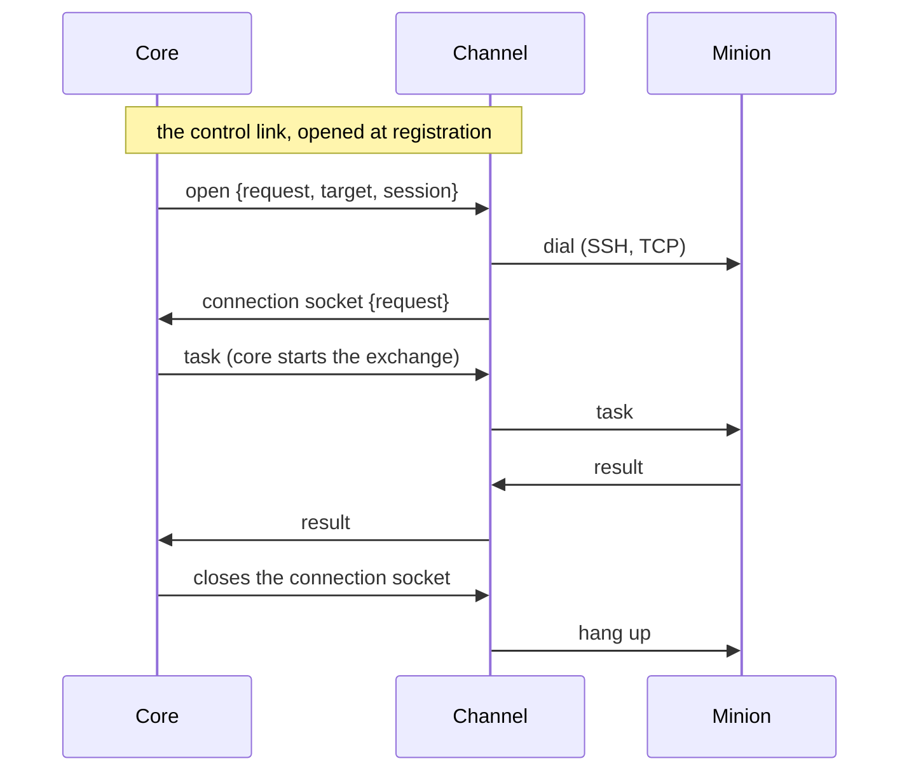
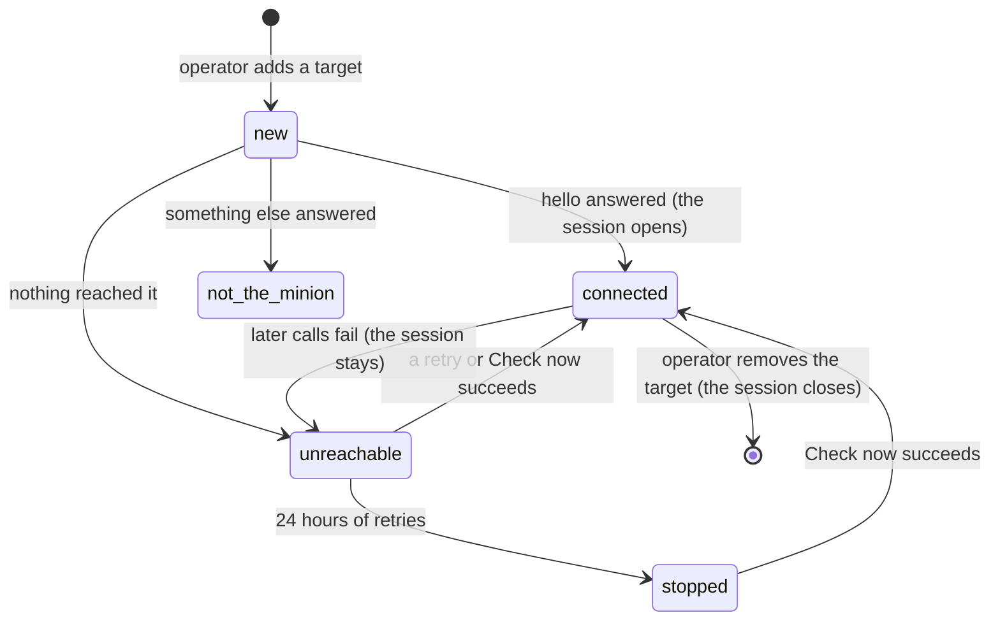

:::caution[Partly built]
Built: `reverse-persistent`, in core, channel-core (`pkg/connclient`), the
HTTP channel and BOB's minion: the connection sockets, pushes within the
`get_tasks` allowance, presence, and the kinds in connection and build
schemas, each kind with its own fields on both sides, and endpoints of a
kind. Connection management is built too: the `hello`'s connection,
`conn_update`, and `switch_connection` (BOB's `connect`). The control link,
the `bind` kinds, targets, fallback after failures and `add_connection` are
an agreed design, not built yet.
:::

How a channel carries the [connection kinds](../../module-types/#connection-kinds)
other than `reverse-call`, where core starts exchanges too: the paths between
channel and core, how `bind` minions are reached, how persistent connections
open, live and close, how channels and factories declare the kinds, and how
operators manage a minion's connections.

| Kind | Opened by | Who starts exchanges | Core can send |
|---|---|---|---|
| `reverse-call` | the minion | the minion; core only answers | when the minion next checks in |
| `reverse-persistent` | the minion | both | while the connection is open |
| `bind-call` | the channel, when core asks | core; the minion only answers | whenever core calls |
| `bind-persistent` | the channel, when core asks | both | while the connection is open, which core can ask for |

## Three paths

A channel reaches core three ways, each for what it suits:

| Path | One per | Carries | For |
|---|---|---|---|
| The [sync call](../channel-core-sync/) (built) | message | one minion message and core's reply, over HTTP | `reverse-call` |
| The **control link**, a WebSocket | channel instance | core's requests to the channel: call a target, open a connection | `bind-call`, and opening `bind-persistent` |
| A **connection socket**, a WebSocket | minion connection | the connection's messages, both ways | `reverse-persistent`, `bind-persistent` |

The channel opens all of them: core never connects to a channel, which may
sit somewhere core cannot reach.

**The control link.** Each channel instance opens one when it registers, and
opens it again whenever it drops. Over it core asks, and the channel answers
each request by its id:

- **`call`**: deliver this sealed message to a target (a page's URL) and
  return the minion's sealed answer, within a deadline, or why it could not.
- **`open`**: open a `bind-persistent` connection to a target, for a session.
  The channel dials, then opens the connection's socket (below), naming the
  request; or it answers why it could not.

A connection is closed by closing its socket, from either side: no request
needed.

It carries requests, not a minion's traffic: one link per instance is enough,
and nothing waits behind a large transfer.

**Connection sockets.** The channel opens one per minion connection that
stays open:

- for `reverse-persistent`, when the minion's connection brings its first
  message (the channel learns its build id from it);
- for `bind-persistent`, once it has dialed the target `open` named.

Each binary frame is one message: the [sync call](../channel-core-sync/)'s
values (message id, the id it is sent under, the peer) and the ciphertext,
raw. Both sides send on it whenever they have something: core starts
exchanges (tasks, `cancel`) as well as answering. The socket is the
connection: while it is open, core shows the session **connected**; when
either side closes it, the connection is gone. If only the socket drops (core
restarts), the channel opens a new one for the minion's connection, which
does not notice.

- **A request over a socket always gets its reply**, empty when core has
  nothing to say (through the sync call that is the 204): the minion knows
  its message arrived. A minion may answer what core starts (`re`), or
  acknowledge in its next message, as BOB's does: core takes either.
- **Pushes** follow every change to a session's tasks (queued, cancelled, a
  part taken), coalesced over a tenth of a second: core sends cancels, and
  tasks within the allowance, on the connection that carried the session's
  latest message.
- **BOB's minion** checks in at once over a new socket, which links the
  connection to its session and sets its allowance, then on its schedule;
  a WebSocket that closes it opens again after a second, doubling up to the
  endpoint's `ws_reconnect_backoff`.

One socket per connection rather than one for everything: each gets TCP's own
flow control, a slow minion or a large transfer holds up nobody else, and a
socket that drops takes one connection with it. Their number is the number
of connections open at once, hundreds to a few thousand.



**Declaring kinds.**

- A channel declares at registration the kinds it supports, in its
  [connection schema](#the-connection-schema-by-kind). The `bind` kinds also
  need **target fields**: where to reach a minion (a page's URL; a host, a
  port and credentials), which operators fill in for a target once the
  minion is in place, not when it is built.
- A factory declares, for each target and channel of its [build
  schema](../minion-build/), the kinds its minions support: a PHP
  page only `bind-call`; BOB's minion `reverse-call` and `reverse-persistent`.
  A build's connection names the kind it uses ([kinds in
  builds](#kinds-in-the-build-schema-and-in-builds)).

**What it changes for core:**

- **Pushing.** Core sends on a connection through one interface (send to a
  session), whatever holds it; core runs as [one
  instance](../../architecture/#one-core-instance).
- **Tasks unasked.** Through a call a minion takes tasks only with
  `get_tasks`. On a persistent connection `get_tasks` becomes a standing
  allowance: core sends tasks as they are queued, within it ([`get_tasks`
  on a persistent connection](#get_tasks-on-a-persistent-connection)).
- **Presence.** A persistent connection shows when it opens and closes; a
  `bind-call` minion is reached when core calls, so "lost" means calls fail,
  not that check-ins stopped.
- **Replays.** A minion need not guard against core's exchanges replayed: a
  captured core message sent to it again would run its tasks again. It may,
  by remembering recent message ids.

## `bind-call` minions: targets and sessions

A page on a web server (a PHP script) only answers, and keeps nothing
between requests: it cannot stage, which needs the minion to speak first and
to keep the keys it is given. It [skips
staging](../minion-messages/sessions/#staging) instead, as any build
may: its session keeps the build's own keys, with the trade-off that comes
with it (anyone with the artifact can read the session). What is new is that
core speaks first, and that core has to be told where the page is:

1. **Build.** The build's connection names the channel and its settings,
   which for `bind-call` say how the channel calls the page (the method, the
   parameter or cookie the message travels in): the page is built to read
   them. The build succeeds when the file is made; nothing is called yet, so
   whether the page is reachable never fails a build.
2. **Deploy.** The operator puts the page on a server, outside Logos.
3. **Add a target.** On the build, or on the Sessions page picking the build,
   the operator fills in the channel's target fields (the URL; a host header
   or a proxy, as the channel offers). Core keeps a **target**: the build, the
   channel, the fields and a state. It is a record, not a session; it can be
   added before the page is deployed.
4. **First call**, at once when the target is added and on **Check now**:
   core seals `rehello` under the build id with the build's keys and asks an
   instance of the channel, over the control link, to call the target.
5. **What came back** decides the target's state:

   | What came back | Core | Target |
   |---|---|---|
   | a sealed `hello` | opens the session, as for any `hello` under a build id, and links the target to it | `connected` |
   | nothing: DNS, refused, timed out, TLS | retries | `unreachable`, with why |
   | something that does not open: an HTTP 404, a WAF's page | does not retry: it rarely helps | `not the minion`, with what answered |
   | a sealed `err` | records it | `refused`, with the code |

   The channel never reads what came back: core tells these apart by opening
   it. **Retries**, on `unreachable` only: 1 minute, 5, 30, then hourly, for
   24 hours, then they stop; Check now any time, and a target can turn
   retries off where every request in the server's log counts.
6. **After.** Calls go under the session id; the page takes the id from what
   the channel delivers, checks the tag with its build keys, and answers
   under the same id, so it needs to remember nothing. `hello_response` is
   not needed. Failed calls leave the session open and show it unreachable
   since then, as missed check-ins show other sessions late.
7. **The end.** Removing the target stops the calls and closes the session
   (its tombstone as for any closed session).



## `bind-call` minions: when core calls

Every exchange with a page is a call core makes, and every call is a line in
the server's log: core calls when there is a reason to. A page usually runs
a task within the call that brings it and answers with its result; one that
runs tasks in the background, keeping their output, is its factory's choice.

Core calls a `bind-call` minion:

1. **When it has something to send**: a task, a `cancel`, a file transfer's
   next step. It waits about a second first, so what is queued together goes
   in one call. This is what sending to a session means for a `bind-call`
   minion.
2. **Again at once while work remains**: a file transfer under way (each
   call carries a chunk or an ack; the ack tells the page where to read
   from, so it needs no memory), or tasks waiting that the last call had no
   room for.
3. **On the minion's schedule, if it has one**: the `sleep` its `hello` says
   (and `sleep_update` changes) means, for a page, call every interval, with
   an empty message, to collect what background tasks produced and to see it
   is still there. Without a schedule core makes no periodic calls: the quiet
   default for a page that finishes its tasks within the call. Late and lost
   count from the last call that succeeded.
4. **On Check now.**

- **Tasks per call**: as with `reverse-call`, the minion says how many it
  takes. An answer's `get_tasks` `max` is how many the next call may bring;
  the `hello` sets the first; without one, one task a call.
- **One call at a time per target.** What comes up meanwhile goes in the
  next call, merged.
- **A call that fails** (the network): what the minion did not acknowledge
  goes again in the next call, as through any connection; calls back off as
  a target's retries do, and the session shows unreachable.
- **A `cancel` for a task inside a call still running** cannot reach the
  process running it: it goes in the next call, by when the task has
  usually ended, which the page then says.
- **A call's deadline** is the channel's request timeout. A task meant to
  run longer belongs in the background on the page.

## The control link and connection sockets: formats

Both are WebSockets the channel opens to core, beside the sync call, behind
the same registration gate: an instance that is not registered, or is dead
or blocked, gets **403** at the handshake. An optional `traceparent` passes as
on the sync call. When [channel
authentication](../channel-core-sync/) comes (mTLS or a shared
secret), it applies to the handshakes: a socket authenticates once, when it
opens.

| Endpoint | Handshake headers |
|---|---|
| `GET /api/channel/link`: the control link | `Logos-Channel-Instance` |
| `GET /api/channel/connection`: a connection socket | `Logos-Channel-Instance`; `Logos-Connection-Kind` (`reverse-persistent` or `bind-persistent`); `Logos-Open-Request` (`bind-persistent`: the `open` it answers) or `Logos-Peer-Address` (`reverse-persistent`, as on the sync call) |

**Frames** are binary messages, each one CBOR map with numbered keys, as the
[minion protocol](../minion-messages/wire-format/#registry) has
them; the ciphertext stays raw bytes. A text frame closes the socket, and so
does one over the message limit (with the overhead of a frame; code 1009).

On a **connection socket**, both ways:

| Key | Value |
|---|---|
| 1 | the id the message is sent under: build id, temporary id or session id, 16 bytes (on a `reverse-persistent` connection it changes as the minion stages and says `hello`) |
| 2 | the ciphertext |

No message id: the sync call's `Logos-Message-Id` lets core drop a request
the channel retried, and a socket sends a frame once.

On the **control link**, key 0 says what the frame is:

| Frame | Direction | Keys |
|---|---|---|
| `call` (1) | core → channel | 1 request id; 2 the values: the build connection's and the target's, in one map by the keys the channel [declared](#the-connection-schema-by-kind); 3 the id the message is sent under; 4 the ciphertext; 5 deadline in milliseconds, optional (the channel keeps to the shorter of it and its own request timeout) |
| `open` (2) | core → channel | 1 request id; 2 the values, as for `call`; 5 deadline, 30 seconds unless core says otherwise |
| `answer` (3) | channel → core | 1 request id; then either 4 the body that came back and 6 the transport's status (the HTTP status, say), or 7 a failure: `{1: kind, 2: message}`, the kind unreachable 1 (DNS, refused), timeout 2, TLS 3, other 4 |

- **Every request gets exactly one `answer`.** An `open` that worked is
  answered once its connection socket is up, the socket naming the request,
  so core knows the session it serves.
- **Request ids** are core's, unique among its requests waiting on that
  link. Answers come in any order: many targets are called at once.
- **The channel never reads the body**: core opens it, and tells the target's
  states apart by the status and by whether it opens.
- **Liveness**: both sides ping every 30 seconds and drop a socket silent for
  90. The proxy in front of core keeps these sockets open past its own idle
  timeouts.
- **The link drops**: its waiting requests fail, and core's rules for a
  failed call apply; the channel opens it again, backing off. Connection
  sockets do not depend on it and stay.
- **An answer lost** (the link dropped after the channel called) leaves core
  resending what the minion did not acknowledge: a page that cannot remember
  task ids runs those tasks again. Only a lost answer does that; it comes
  with a minion that keeps nothing.

## The connection schema by kind

A `bind` connection has values of two kinds: those **built into the minion**
(for an HTTP page: the method, and where the message travels, the body, a
cookie or a header), which the page reads and the channel calls with; and
those of **each target** (the page's URL, a host header, a proxy; for SSH a
host, a port, a user and a password or key), which only the channel uses.
The [connection schema](../minion-connection/) a channel declares
at registration says both, by kind (its `schema_version` `"2"`):

```json
{
  "schema_version": "2",
  "version": 3,
  "kinds": {
    "reverse-call": { "fields": [ "base_url", "checkin_interval", "…" ] },
    "reverse-persistent": { "fields": [ "base_url", "ws_reconnect_backoff", "…" ] },
    "bind-call": {
      "fields": [ "method", "carrier" ],
      "target": [ "url", "host_header", "proxy", "tls_verify" ]
    }
  }
}
```

- **`kinds`'s keys are the kinds the channel supports.**
- **`fields` are built into the minion**, **each kind's in full**: there is
  no shared list. Kinds of one channel mostly repeat the same fields, but
  each can change, gain or drop one on its own, and say what it means for
  that kind.
- **`target`**, for the `bind` kinds only: what an operator fills in for each
  target, never built into a minion.
- **A kind's keys are unique** across its fields and its target's: `call` and `open` give the channel one map of them, under the
  keys it declared.
- **Every field is a field spec**, as now. A target field may be a `secret`
  (an SSH password or key): core keeps it, shows it masked, and gives it to
  the channel, which dials with it, never to a minion.
- **Endpoints** name a connection kind and keep values for its built-in
  fields: an address for a `reverse` kind, a way of calling for a `bind`
  kind, reused across builds. **Targets** stay apart: one per deployment.
- **`version`** covers the built-in fields, as now: changing those changes
  what built minions read. Target fields can change without it: nothing is
  built from them. A target that lacks a value a new target field requires
  shows **needs editing** until an operator fills it in.

## `bind-persistent` connections: opening and closing

A `bind-persistent` minion is a running process (an implant listening on a
port, or reached over SSH), and every dial is a connection its network sees.
Being a process, it stages as any minion does, speaking first once the
channel has dialed, and keeps its session's keys between connections: a
later dial carries on in the same session. Its target links to the session
at the first `hello`, as a [`bind-call`](#bind-call-minions-targets-and-sessions)
target's does.

**Who opens it** is the target's policy:

| Policy | Opens it | Closes it, idle | For |
|---|---|---|---|
| `on-demand` (the default) | core, when the session has something to send (as it calls a `bind-call` page) | after 10 minutes without an exchange | queued tasks go out, and the connection is there only while there is work |
| `manual` | an operator: Connect, Disconnect | after an hour without an exchange, as a safety net | targets where every connection counts; tasks queued meanwhile wait, shown waiting for a connection |
| `always` | core, and again whenever it drops, backing off | never | a minion meant to be reachable at any moment |

The idle times are the target's, these their defaults. Besides, a connection
closes when:

- an operator disconnects it, whatever the policy;
- the network or the minion drops it, or the channel stops or drains: core
  opens it again for `always`, for `on-demand` only while work waits, and
  never for `manual`;
- the target is removed or the session closes;
- core closes its connection socket, which is how any connection is closed.

- **The connection is the session's**, not the operator's who opened it:
  everyone in the operation sees it open and can use it.
- **An open that fails** puts its failure (unreachable, timeout, TLS, other)
  on the target; `on-demand` and `always` retry with a target's backoff,
  `manual` does not.
- **The session shows its connection**, not late or lost: a closed connection
  is closed on purpose. It is `connected`, `connecting`, `not connected`, or
  `unreachable since` when opens fail; while connected, the socket's pings
  say it is alive.

## `get_tasks` on a persistent connection

Through a call, a minion keeps its load in hand by when it asks: a
`get_tasks` brings tasks in that reply only. On a persistent connection core
sends tasks as they are queued, so the minion says once how many it takes:

- **`max N` is a standing allowance**: core keeps up to N of the session's
  tasks unfinished (sent, without their `done` part yet), sending one the
  moment it is queued while there is room, and the next waiting one when a
  task ends. The count is the session's, over all its connections: the
  minion's capacity is its process's.
- **It lasts** until the minion sends another `get_tasks`, which replaces it,
  or the connection closes: a minion that reconnects says it again.
- **Without `max`**: no limit, as through a call.
- **`max 0`** takes none for now: a minion pauses with it. It is valid
  through every kind (through a call it changes nothing).
- **No `get_tasks` on a connection**: core sends no tasks on it. A minion
  opts in, so one that only checks in works as before.
- **`cancel`, acks and chunks** go at once, whatever the allowance; tasks are
  acknowledged on receipt, and those not acknowledged go again first, as
  through any connection.

| Kind | `get_tasks` `max N` |
|---|---|
| `reverse-call` | this reply may bring up to N tasks |
| `bind-call` | the next call may bring up to N tasks |
| `reverse-persistent`, `bind-persistent` | up to N unfinished, sent as they are queued, until said otherwise |

## One session, several connections

A session can have more than one connection open: a minion reconnects while
core's end of its old socket has not timed out yet, polls beside a
WebSocket, or listens and calls back. And one connection can serve several
sessions: a minion that relays others' messages (a pivot) carries them over
its own, each sent under its own id.

- **Core keeps, for each session, the open connections that carried its
  messages**; a connection serves every session it carried a message of.
- **A push goes on the one that carried the session's latest message**; if
  that send fails (its socket is gone), on the one before; if none is left,
  what was to go waits for the next exchange: a check-in's reply, or a call.
- **Sending twice is safe**: tasks run once by their id, results are kept
  once by `(task, seq)`, chunks once by `(xfer, off)`; a task not
  acknowledged goes again on whichever connection comes next.
- **Core does not close a session's older connections**: a dead one goes when
  its pings stop, a live one may be a second path. A session keeps 8 at
  most; a ninth closes the oldest.
- **Calls go on alongside**: a `reverse-call` request is answered as always
  while persistent connections are open, tasks in its reply only with
  `get_tasks`. The [allowance](#get_tasks-on-a-persistent-connection) is a
  connection's, the unfinished tasks it counts the session's.

## `reverse-persistent` connections: lifetime and presence

A minion decides when it connects: some keep a WebSocket open and reconnect
at once when it drops, others connect on their schedule, stay a while and
leave. While a socket is open, the connection itself says the minion is
there, better than check-ins do.

- **Connected.** While a persistent connection serving it is open, a session
  is `connected`, last seen now: the socket's pings say it is alive, and the
  minion need not check in meanwhile.
- **Between connections.** When its last one closes, last seen is when it
  closed, and late and lost run from then by the minion's `sleep`, as they
  run from a check-in: for a persistent minion `sleep` says how soon it will
  be back. One that keeps its socket open says a short one, and shows late,
  then lost, when it does not come back; one that comes every hour says an
  hour.
- **Quiet is not idle.** A channel's idle timeout counts answered pings on a
  connection that carries sessions, so a minion waiting for tasks is not cut
  off. (The HTTP channel's `ws_idle_timeout` counts messages only today.)
- **Disconnect** closes the connection's socket; the minion may connect
  again, as its build does. Closing the session is what stops it: every
  message after gets `session_closed`.

| | Open | Closed |
|---|---|---|
| `reverse-persistent` | `connected` | late and lost from when it closed, by the minion's `sleep` |
| `bind-persistent` | `connected` | `not connected`, on purpose; `unreachable since` when opens fail |

## Connection management

A minion may be built with several connections, of several kinds: BOB's
could poll (`reverse-call`) and keep a WebSocket (`reverse-persistent`) through
the same channel. Which one it uses first is its build's choice; operators
need to see which one it uses, and to move it to another. It goes as the
schedule does: the minion **reports** its connection in the protocol, and an
operator **changes** it with a command.

**Reporting**, new in the protocol:

- The `hello` says **the connection in use** (`conn`, key 16): its place in
  the build's connections, from 1, so a minion carries no connection names;
  core knows each one's name, kind, channel and endpoint from the build.
- **`conn_update`** (item 14, minion → core) says when it changes, whatever
  changed it: an operator's command, a fallback after failures, the
  minion's own logic; and, optionally, why ("fell back after 5 failures").
  It goes over the new connection ([Sessions](../minion-messages/sessions/#connections)).

The session's view lists the build's connections with the one in use, and
the changes it reported.

**Switching** is an [action](../task-results-and-actions/#switch_connection):
**`switch_connection`**, core giving the connection's place (`conn`). A
factory maps it to a command of its own, which may take more: BOB's
`connect` takes `for`, a duration after which the minion goes back. So:

- the session's connection list has a **Switch to** button on each
  connection, which runs the action, and the console has the factory's
  command, `help` listing it;
- it is a task: it ends with a result, "switched to 2" or "failed: TLS
  handshake, staying on 1", a switch to an unreachable endpoint being
  something to report, and who switched what stays on record;
- it is the factory's to offer: a minion built without such a command shows
  no button, and one built with a single connection has nothing to switch to;
- BOB's minion moves only once a check-in through the new connection
  worked, carrying the `conn_update` (on a WebSocket, that check-in also
  sets the allowance, so pushes start at once); one that does not answer
  leaves it where it was, and the task fails saying so. With `for`, it moves
  back when the time is up, with a `conn_update` saying "back after 10m";
- it goes as tasks go, within the [allowance](#get_tasks-on-a-persistent-connection):
  a minion that takes no tasks takes no switch. `cancel` is the one thing that
  always reaches a minion.

**Giving a running minion a new connection** (a fresh redirector when one is
burned) is planned the same way: an action, `add_connection`, with the kind,
the settings and the values, which core checks against the channel's and the
factory's fields as a build's connection.

## Kinds in the build schema and in builds

A factory says which kinds its minions support in its [build
schema](../minion-build/)'s `channels`, as a list, in its order of
preference:

```json
"channels": [
  {
    "module_name": "http", "versions": [3],
    "kinds": [
      { "kind": "reverse-call", "fields": [ "method", "path_prefix" ] },
      { "kind": "reverse-persistent", "fields": [ "path_prefix" ] }
    ]
  }
]
```

- **`kinds` are the kinds the factory's minions support** with that channel,
  at least one, the first the one a build takes when it names none, **each
  with the factory's own parameters for it in full** (BOB's minion picks a
  request method for each call, but a WebSocket has one handshake). A list,
  not a map as a channel's connection schema has, because its order is what
  picks a build's kind. This is the build schema's `schema_version` `"3"`.
- **A target narrows them**, as it narrows the channels: a PHP page's target
  keeps `bind-call`, a binary's `reverse-call` and `reverse-persistent`.
- **A kind is usable** where both sides support it: the channel (its
  connection schema) and the factory, for that target. Core checks it at
  each build.

A build's [connections](../minion-build/#connections) each name
their kind:

- **`kind`**: one usable for the target; the build form asks for it, and the
  API takes the first usable one, in the factory's order, when it is left
  out. The build request gives it to the factory, which builds that in.
- **`settings`** by the channel's fields for that kind; **`values`** by the
  factory's fields for that kind. Another kind's field is refused.
- **Kinds mix** in one build: a WebSocket first and polling after, or a
  listening implant that also calls back. The order is the order the minion
  tries its connections, so it means something for `reverse` ones only: a
  `bind` connection is not tried, it waits to be reached.
- **Endpoints are of a kind**: each holds values for one kind's fields, and
  its export (`logos.channel-endpoint.v2`) carries the `kind`. A build
  connection's `endpoint` is such an export, so the factory reads the kind
  there. Filling a connection from an endpoint takes the endpoint's kind,
  and the build form offers only endpoints of kinds the connection can use.
- **A target belongs to one `bind` connection** of a build: adding a target
  picks the build and, when it has several, the connection, whose channel
  and built-in values the target uses with its own.
