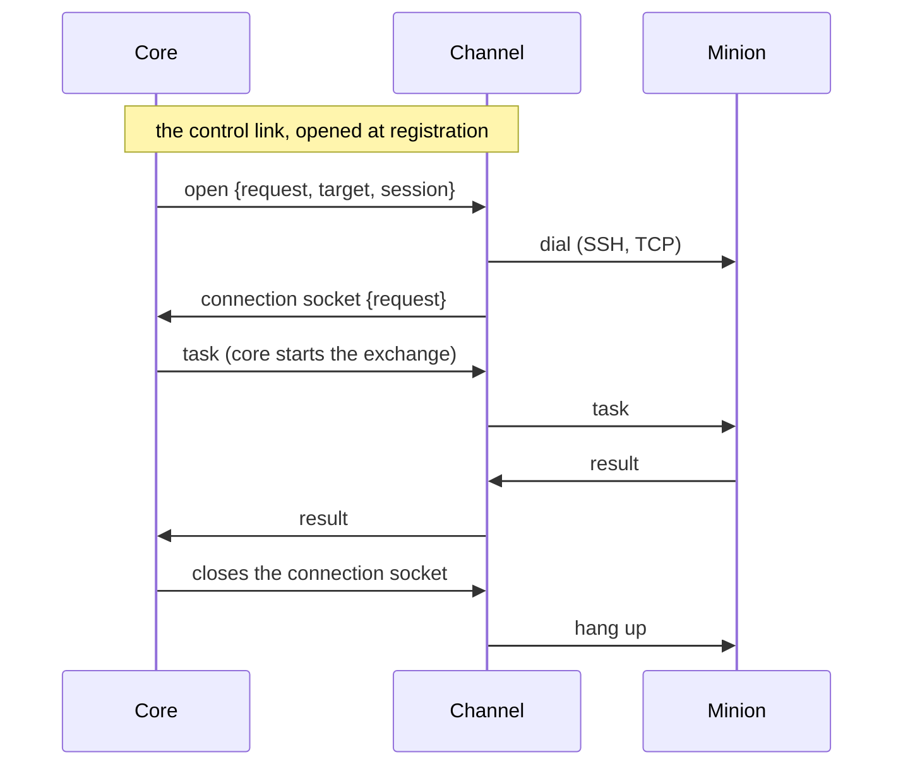
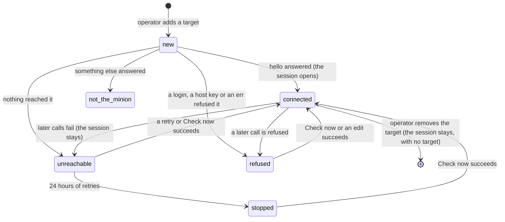

:::caution[Partly built]
Built: `reverse-persistent`, in core, channel-core (`pkg/connclient`), the
HTTP channel and BOB's minion: the connection sockets, pushes within the
`get_tasks` allowance, presence, and the kinds in connection and build
schemas, each kind with its own fields on both sides, and endpoints of a
kind. Connection management is built too: the `hello`'s connection,
`conn_update`, and `switch_connection` (BOB's `switch`). And `bind-call`:
the control link's `call` (channel-core `pkg/linkclient`), targets with
their states, retries and needs editing, calls when there is something to
send, and the `rehello`, in core, the Dumbo channel and the Dumbo
factory's PHP pages. And `bind-persistent`: the link's `open`, the
targets' policies (on demand, manual, always), Connect and Disconnect, idle
closes, in core, channel-core (`linkclient`'s opener, `connclient`'s open
request), the TCP channel and BOB's minion (a listener). Failover (the build's
policy, BOB's minion) is built too, and so are a kind's `max_message` and
`max_call`, core's `poll`, the `at` a page checks, and commands' `kinds`. `add_connection` is an
agreed design, not built yet.
:::

How a channel carries the [connection kinds](../../module-types/#connection-kinds)
other than `reverse-call`, where core starts exchanges too: the paths between
channel and core, how `bind` minions are reached, how persistent connections
open, live and close, how channels and factories declare the kinds, and how
operators manage a minion's connections.

| Kind | Opened by | Who starts exchanges | Core can send |
|---|---|---|---|
| `reverse-call` | the minion | the minion; core only answers | when the minion next checks in |
| `reverse-persistent` | the minion | both | while the connection is open |
| `bind-call` | the channel, when core asks | core; the minion only answers | whenever core calls |
| `bind-persistent` | the channel, when core asks | both | while the connection is open, which core can ask for |

## Three paths

A channel reaches core three ways, each for what it suits:

| Path | One per | Carries | For |
|---|---|---|---|
| The [sync call](../channel-core-sync/) (built) | message | one minion message and core's reply, over HTTP | `reverse-call` |
| The **control link**, a WebSocket | channel instance | core's requests to the channel: call a target, open a connection | `bind-call`, and opening `bind-persistent` |
| A **connection socket**, a WebSocket | minion connection | the connection's messages, both ways | `reverse-persistent`, `bind-persistent` |

The channel opens all of them: core never connects to a channel, which may
sit somewhere core cannot reach.

**The control link.** Each channel instance opens one when it registers, and
opens it again whenever it drops. Over it core asks, and the channel answers
each request by its id:

- **`call`**: deliver this sealed message to a target (a page's URL) and
  return the minion's sealed answer, within a deadline, or why it could not.
- **`open`**: open a `bind-persistent` connection to a target, for a session.
  The channel dials, then opens the connection's socket (below), naming the
  request; or it answers why it could not.

A connection is closed by closing its socket, from either side: no request
needed.

It carries requests, not a minion's traffic: one link per instance is enough,
and nothing waits behind a large transfer.

**Connection sockets.** The channel opens one per minion connection that
stays open:

- for `reverse-persistent`, when the minion's connection brings its first
  message (the channel learns its build id from it);
- for `bind-persistent`, once it has dialed the target `open` named.

Each binary frame is one message: the [sync call](../channel-core-sync/)'s
values (message id, the id it is sent under, the peer) and the ciphertext,
raw. Both sides send on it whenever they have something: core starts
exchanges (tasks, `cancel`) as well as answering. The socket is the
connection: while it is open, core shows the session **connected**; when
either side closes it, the connection is gone. If only the socket drops (core
restarts), the channel opens a new one for the minion's connection, which
does not notice.

- **A request over a socket always gets its reply**, empty when core has
  nothing to say (through the sync call that is the 204): the minion knows
  its message arrived. A minion may answer what core starts (`re`), or
  acknowledge in its next message, as BOB's does: core takes either.
- **Pushes** follow every change to a session's tasks (queued, cancelled, a
  part taken), coalesced over a tenth of a second: core sends cancels, and
  tasks within the allowance, on the connection that carried the session's
  latest message; and a stream's ack when a stream the minion holds may go
  on ([Streaming a file](../minion-messages/file-transfers/#streaming-a-file)).
  What a push carries is what every message core sends a minion carries
  ([Mechanics by connection kind](../minion-messages/#mechanics-by-connection-kind)).
- **BOB's minion** checks in at once over a new socket, which links the
  connection to its session and sets its allowance, then on its schedule;
  a WebSocket that closes it opens again after a second, doubling up to the
  endpoint's `ws_reconnect_backoff`.

One socket per connection rather than one for everything: each gets TCP's own
flow control, a slow minion or a large transfer holds up nobody else, and a
socket that drops takes one connection with it. Their number is the number
of connections open at once, hundreds to a few thousand.



**Declaring kinds.**

- A channel declares at registration the kinds it supports, in its
  [connection schema](#the-connection-schema-by-kind). The `bind` kinds also
  need **target fields**: where to reach a minion (a page's URL; a host, a
  port and credentials), which operators fill in for a target once the
  minion is in place, not when it is built.
- A factory declares, for each target and channel of its [build
  schema](../minion-build/), the kinds its minions support: a PHP
  page only `bind-call`; BOB's minion `reverse-call` and `reverse-persistent`
  through the HTTP channel, and `bind-persistent` through the TCP channel.
  A build's connection names the kind it uses ([kinds in
  builds](#kinds-in-the-build-schema-and-in-builds)).

**What it changes for core:**

- **Pushing.** Core sends on a connection through one interface (send to a
  session), whatever holds it; core runs as [one
  instance](../../architecture/#one-core-instance).
- **Tasks unasked.** Through a call a minion takes tasks only with
  `get_tasks`. On a persistent connection `get_tasks` becomes a standing
  allowance: core sends tasks as they are queued, within it ([`get_tasks`
  on a persistent connection](#get_tasks-on-a-persistent-connection)).
- **Presence.** A persistent connection shows when it opens and closes; a
  `bind-call` minion is reached when core calls, so "lost" means calls fail,
  not that check-ins stopped.
- **Replays.** A minion need not guard against core's exchanges replayed: a
  captured core message sent to it again would run its tasks again. It may,
  by remembering recent message ids, or, when it keeps nothing (a page), by
  the `at` every message core starts says: it refuses one too far from its
  own clock ([Freshness and replay](../minion-messages/wire-format/#freshness-and-replay)).

## `bind-call` minions: targets and sessions

A page on a web server (a PHP script) only answers, and keeps nothing
between requests: it cannot stage, which needs the minion to speak first and
to keep the keys it is given. It [skips
staging](../minion-messages/sessions/#staging) instead, as any build
may: its session keeps the build's own keys, with the trade-off that comes
with it (anyone with the artifact can read the session). What is new is that
core speaks first, and that core has to be told where the page is:

1. **Build.** The build's connection names the channel and its settings,
   which for `bind-call` say how the channel calls the page (the method, the
   parameter or cookie the message travels in): the page is built to read
   them. The build succeeds when the file is made; nothing is called yet, so
   whether the page is reachable never fails a build.
2. **Deploy.** The operator puts the page on a server, outside Logos.
3. **Add a target.** On the build, or on the Sessions page picking the build,
   the operator fills in the channel's target fields (the URL; a host header
   or a proxy, as the channel offers). Core keeps a **target**: the build, the
   channel, the fields and a state. It is a record, not a session; it can be
   added before the page is deployed.
4. **First call**, at once when the target is added and on **Check now**:
   core seals `rehello` under the build id with the build's keys and asks an
   instance of the channel, over the control link, to call the target.
5. **What came back** decides the target's state:

   | What came back | Core | Target |
   |---|---|---|
   | a sealed `hello` | opens the session, as for any `hello` under a build id, links the target to it, and takes the rest of the answer under the session as any later answer's (its `get_tasks`, feedback, a schedule) | `connected` |
   | nothing: DNS, refused, timed out, TLS | retries | `unreachable`, with why |
   | the target refused the channel: a login, a host key (link failures `login`, `host_key`) | does not retry | `refused`, with why |
   | something that does not open: an HTTP 404, a WAF's page | does not retry: it rarely helps | `not the minion`, with what answered |
   | a sealed `err`, no `hello` | records it | `refused`, with the code |
   | a sealed answer with neither | records it | `refused` |

   The channel never reads what came back: core tells these apart by opening
   it. **Retries**, on `unreachable` (and `no channel`) only: 1 minute, 5,
   30, then hourly, for 24 hours, then they stop; Check now any time, and a
   target can turn retries off where every request in the server's log
   counts. A **`refused`** target is called again only on Check now or after
   an edit, not for news (a task queued, a cancel, a stream): where its
   channel logs in, each call would be one more failed login on the target.
6. **After.** Calls go under the session id; the page takes the id from what
   the channel delivers, checks the tag with its build keys, and answers
   under the same id, so it needs to remember nothing. `hello_response` is
   not needed, and the `hello` is the session's first check-in: core holds
   the id. Failed calls leave the session open and show it unreachable
   since then, as missed check-ins show other sessions late.
7. **The end.** Removing the target stops the calls, nothing more: the
   target is an address, not the minion. The session stays with its
   history, shown with no target, until an operator archives or deletes it
   as any other. A page never checks in, so a tombstone would tell it
   nothing.
   - **New tasks are refused** while the session has no target: nothing
     would call the page, so a task would wait for good. Queuing one
     answers why ("session #12 has no target: core cannot reach its page.
     Add a target first"), and no task is kept.
   - **Tasks queued before** stay queued: they go out with the first call
     of a target added to the session (below). Until then each shows why it
     waits: no target.
   - **A target that is there but unreachable** (or stopped, or not the
     minion) takes tasks: core retries it, and Check now may reach it. They
     wait, showing the target's state and since when.
8. **Moving.** A target added to that session takes it over: the page
   keeps nothing and answers anything its build's keys open, so core calls
   it under the session's id, and the session goes on. The target must be
   of the session's build and connection, the session open and without a
   target. Editing a target's URL does the same in place.



## `bind-call` minions: when core calls

Every exchange with a page is a call core makes, and every call is a line in
the server's log: core calls when there is a reason to. A page usually runs
a task within the call that brings it and answers with its result; one that
runs tasks in the background, keeping their output, is its factory's choice.

Core calls a `bind-call` minion:

1. **When it has something to send**: a task, a `cancel`, a file transfer's
   next step. It waits about a second first, so what is queued together goes
   in one call. This is what sending to a session means for a `bind-call`
   minion.
2. **Again at once while work remains**: a file transfer under way (each
   call carries a chunk or an ack, and the transfer's
   [`ctx`](../minion-messages/file-transfers/#chunks), which core echoes,
   tells the page where the file is: it needs no memory), or tasks waiting
   that the last call had no room for. **No count bounds these calls**: a
   file takes a call a chunk, 512 KiB, however many that is. What ends an
   exchange is having nothing to say back, or making no progress: two calls
   in a row that would carry the same items (a page answering the same
   thing over and over) stop it. A `cancel` goes with every call, so
   stopping a transfer takes effect at its next chunk.
3. **When a stream may go on**: a downloader came for a file the page
   streams, or took a chunk and left room for the next; an uploader's bytes
   came for a file streamed to the page. Core calls about a tenth of a
   second later with the stream's ack (and its kept ctx); while every
   stream holds, nothing calls. A page that cannot keep up is held by
   core's buffer as any minion is, and called again as the downloader
   takes what it sent.
4. **While a long task goes on**: a part that says where the page stands
   (a walk's) is answered with a
   [`resume`](../minion-messages/tasks-and-results/#resuming-a-task), at
   once, until a part says done. Each call takes what fits its answer and
   timeout (the Dumbo page: listings up to 600 KB, or 10 seconds); a call
   that fails leaves the walk where it stood, and the next call goes on.
5. **On the minion's schedule, if it has one**: the `sleep` its `hello` says
   (and `sleep_update` changes) means, for a page, call every interval, with
   an empty message, to collect what background tasks produced and to see it
   is still there. Without a schedule core makes no periodic calls: the quiet
   default for a page that finishes its tasks within the call. Late and lost
   count from the last call that succeeded.
6. **On Check now.**

- **Tasks per call**: as with `reverse-call`, the minion says how many it
  takes. An answer's `get_tasks` `max` is how many the next call may bring;
  the `hello` sets the first; without one, one task a call.
- **One call at a time per target.** What comes up meanwhile goes in the
  next call, merged.
- **A call that fails** (the network): what the minion did not acknowledge
  goes again in the next call, as through any connection; calls back off as
  a target's retries do, and the session shows unreachable.
- **A `cancel` for a task inside a call still running** cannot reach the
  process running it: it goes in the next call, by when the task has
  usually ended, which the page then says.
- **A call's deadline** is the shorter of core's and the channel's request
  timeout. Core says on every call what the channel's connection schema
  declares for the kind ([`max_call`](../minion-connection/), 1 s to 1 h)
  within its own cap of 10 minutes, and 2 minutes when it declares none;
  it waits that long for the answer, and a few seconds more. The Dumbo
  channel's `CALL_TIMEOUT` is 30 s by default, the SSH channel's 2 minutes.
  No call goes on past core's wait: one that did would run its tasks for an
  answer core no longer takes, and the next call would carry them again, as
  they were never acknowledged. A task meant to run longer belongs in the
  background on the page, or on a persistent connection.
- **A call sent is always waited for**, up to its deadline: whatever asked
  for it may go first (an operator leaving a Check now, the request that
  added a target), and the call, and the calls after it while work remains,
  go on. An answer not taken would leave the tasks it ran unacknowledged,
  and the next call would run them again.
- **A call core could not make itself** (a lookup or a store failed in
  core, not the channel or the network) leaves the target as it was, says
  why in its detail, and is tried again in a minute, whatever its retries:
  the target's schedule (a retry, its minion's own) is not lost.
- **Every call says core's time** (`at`). A page, which cannot remember
  message ids, refuses a call further than 10 minutes from its own clock (a
  replay, or a clock that is off) with an `err` `stale`, running nothing; the
  target shows *refused*, the page's time in the detail, until the clocks
  agree. The Dumbo page does.
- **What a call carries** is what every message core sends a minion carries
  ([Mechanics by connection kind](../minion-messages/#mechanics-by-connection-kind)),
  with the resumes of every task under way, as the page keeps nothing.

## The control link and connection sockets: formats

Both are WebSockets the channel opens to core, beside the sync call, behind
the same registration gate: an instance that is not registered, or is dead
or blocked, gets **403** at the handshake. An optional `traceparent` passes as
on the sync call. When [channel
authentication](../channel-core-sync/) comes (mTLS or a shared
secret), it applies to the handshakes: a socket authenticates once, when it
opens.

| Endpoint | Handshake headers |
|---|---|
| `GET /api/channel/link`: the control link | `Logos-Channel-Instance` |
| `GET /api/channel/connection`: a connection socket | `Logos-Channel-Instance`; `Logos-Connection-Kind` (`reverse-persistent` or `bind-persistent`); `Logos-Open-Request` (`bind-persistent`: the `open` it answers); `Logos-Peer-Address` (the minion's address: as on the sync call for `reverse-persistent`, the one dialed for `bind-persistent`) |

**Frames** are binary messages, each one CBOR map with numbered keys, as the
[minion protocol](../minion-messages/wire-format/#registry) has
them; the ciphertext stays raw bytes. A text frame closes the socket, and so
does one over the message limit (with the overhead of a frame; code 1009).

On a **connection socket**, both ways:

| Key | Value |
|---|---|
| 1 | the id the message is sent under: build id, temporary id or session id, 16 bytes (on a `reverse-persistent` connection it changes as the minion stages and says `hello`) |
| 2 | the ciphertext |

No message id: the sync call's `Logos-Message-Id` lets core drop a request
the channel retried, and a socket sends a frame once.

On the **control link**, key 0 says what the frame is:

| Frame | Direction | Keys |
|---|---|---|
| `call` (1) | core → channel | 1 request id; 2 the values: the build connection's and the target's, in one map by the keys the channel [declared](#the-connection-schema-by-kind); 3 the id the message is sent under; 4 the ciphertext; 5 deadline in milliseconds (core says the kind's `max_call` within its 10-minute cap, else 2 minutes; the channel keeps to the shorter of it and its own request timeout); 11 keys, to an [agentless](../agentless-channels/) kind only: the keys of the id, `{1: suite, 2: {1: enc key, 2: mac key}}` |
| `open` (2) | core → channel | 1 request id; 2 the values, as for `call`; 5 deadline, 30 seconds unless core says otherwise; 10 under: the id the minion speaks under on the connection, 16 bytes (its target's open session's id, else its build's); 11 keys, to an agentless kind only: under's keys |
| `answer` (3) | channel → core | 1 request id; then one of: 3 the id and 4 the sealed message that came back, unpacked from the channel's transport format, with 6 the transport's status (the HTTP status, say); 6 the status and 8 the first 512 bytes of what answered, when it is not a minion message (a 404, a WAF's page); or 7 a failure: `{1: kind, 2: message}`, the kind unreachable 1 (DNS, refused), timeout 2, TLS 3, other 4. An answer that reached something may carry 9 the peer: the IP address the channel connected to, which core keeps as the session's external address |

- **Every request gets exactly one `answer`.** An `open` that worked is
  answered once its connection socket is up, the socket naming the request,
  so core knows the session it serves.
- **Under** (key 10) is for a minion that keeps no ids of its own, such as
  one a channel acts as: it speaks first, as every persistent minion does,
  under that id. A channel whose minion knows its ids leaves it. It is a
  key of its own, so a channel from before it decodes the `open` as
  before.
- **The peer** (key 9) is the address the channel knows it reached without
  a lookup of its own: the one it connected to when it dials directly; the
  target's host through a proxy when that is an IP address; none for a
  host name a proxy resolves (SOCKS5 in Go's client sends names too). A
  `bind-persistent` socket says the same in `Logos-Peer-Address`. Core
  keeps it as a reverse minion's: the session's external address and its
  list of addresses seen.
- **Request ids** are core's, unique among its requests waiting on that
  link. Answers come in any order: many targets are called at once.
- **The channel never opens the message**: it only takes it out of its
  transport format (for the Dumbo channel: the id's 16 bytes, then the
  sealed message), as it does a reverse minion's. Core opens it, and tells
  the target's states apart by the status, and by whether it opens under
  the id the call went under and answers that call.
- **Liveness**: both sides ping every 30 seconds and drop a socket silent for
  90. The proxy in front of core keeps these sockets open past its own idle
  timeouts.
- **The link drops**: its waiting requests fail, and core's rules for a
  failed call apply; the channel opens it again, backing off. Connection
  sockets do not depend on it and stay.
- **An answer lost** (the link dropped after the channel called) leaves core
  resending what the minion did not acknowledge: a page that cannot remember
  task ids runs those tasks again. Only a lost answer does that; it comes
  with a minion that keeps nothing.

## The connection schema by kind

A `bind` connection has values of two kinds: those **built into the minion**
(for an HTTP page: the method, and where the message travels, the body, a
cookie or a header), which the page reads and the channel calls with; and
those of **each target** (the page's URL, a host header, a proxy; for SSH a
host, a port, a user and a password or key), which only the channel uses.
The [connection schema](../minion-connection/) a channel declares
at registration says both, by kind (its `schema_version` `"2"`):

```json
{
  "schema_version": "2",
  "version": 3,
  "kinds": {
    "reverse-call": { "fields": [ "base_url", "checkin_interval", "…" ] },
    "reverse-persistent": { "fields": [ "base_url", "ws_reconnect_backoff", "…" ] },
    "bind-call": {
      "fields": [ "method", "carrier" ],
      "target": [ "url", "host_header", "proxy", "tls_verify" ],
      "max_message": 65536
    }
  }
}
```

- **`kinds`'s keys are the kinds the channel supports.**
- **`fields` are built into the minion**, **each kind's in full**: there is
  no shared list. Kinds of one channel mostly repeat the same fields, but
  each can change, gain or drop one on its own, and say what it means for
  that kind.
- **`target`**, for the `bind` kinds only: what an operator fills in for each
  target, never built into a minion.
- **`max_message`**, optional: the largest minion message (its CBOR
  plaintext, before sealing) the channel carries each way on a connection
  of the kind, 1 KiB to 768 KiB; left out, 768 KiB. A channel whose
  transport carries little says so here (a DNS channel, a page called with
  a cookie). Core gives it to each build's connection of the kind, and keeps
  what it sends within it; the minion keeps its own messages within it
  ([Limits](../minion-messages/wire-format/#limits)). The built channels
  declare none.
- **A kind's keys are unique** across its fields and its target's: `call` and `open` give the channel one map of them, under the
  keys it declared.
- **Every field is a field spec**, as now. A target field may be a `secret`
  (an SSH password or key): core keeps it, shows it masked, and gives it to
  the channel, which dials with it, never to a minion.
- **Endpoints** name a connection kind and keep values for its built-in
  fields: an address for a `reverse` kind, a way of calling for a `bind`
  kind, reused across builds. **Targets** stay apart: one per deployment.
- **`version`** covers the built-in fields, as now: changing those changes
  what built minions read. Target fields can change without it: nothing is
  built from them. Core checks a target's values against the channel's
  target fields as they are now, whenever it shows the target and before
  each call. A target they no longer fit (a field now required that it
  lacks, a field the channel dropped, a value a field no longer takes, or
  no channel declaring the kind) shows **needs editing**, with what does
  not fit, and is not called: core never sends a channel values it no
  longer reads. Retries stop; tasks for its session wait, saying so. An
  edit that fits calls it again (a dropped field's value goes with it).

## `bind-persistent` connections: opening and closing

A `bind-persistent` minion is a running process (an implant listening on a
port, or reached over SSH), and every dial is a connection its network sees.
Being a process, it stages as any minion does, speaking first once the
channel has dialed, and keeps its session's keys between connections: a
later dial carries on in the same session. The target is **connected once
its minion has spoken** over the connection, and is linked to the session
that speaks there: the one its `hello` opens or claims, the one it checks in
under, and the next one if it stages again.

**Who opens it** is the target's policy:

| Policy | Opens it | Closes it, idle | For |
|---|---|---|---|
| `on-demand` (the default) | core, when the session has something to send (as it calls a `bind-call` page) | after 10 minutes without an exchange | queued tasks go out, and the connection is there only while there is work |
| `manual` | an operator: Connect, Disconnect | after an hour without an exchange, as a safety net | targets where every connection counts; tasks queued meanwhile wait, shown waiting for a connection |
| `always` | core, and again whenever it drops (backing off when it drops at once) | never | a minion meant to be reachable at any moment |

The idle times are the policy's (core's `models.IdleClose`): a connection
idle past them is closed by core's target loop, which looks every few
seconds, but not while a task it carried runs (below). Besides, a
connection closes when:

- an operator disconnects it, whatever the policy (Disconnect closes every
  connection the target has open; one of policy `always` is opened again);
- the network or the minion drops it, or the channel stops: core opens it
  again for `always` (5 seconds later), for `on-demand` only while work waits
  (tasks not sent, or sent and not acknowledged, a cancel to send) or a task
  it carried runs, and never for `manual`. One that drops within 30 seconds
  of its minion's first word is an open that failed (below);
- the target is removed;
- core closes its connection socket, which is how any connection is closed.

**The minion speaks first**, within the open's time, and that is what
connects the target: until then it is `connecting`, and core sends nothing
over the connection. The open's time is 30 seconds, or what the kind says
in [`max_open`](../minion-connection/) (10 minutes at most): the channel has
it to answer (the open's deadline), and the minion as long again for its
first word once the connection's socket is up. What speaks must be the
target's minion: a message that opens with the keys of its id, under an id
of the target's build (its stage, its `hello`, a session of it), the session
the target is linked to (which a later build may have claimed), or a later
build's that claims that session (one built to persist it). Anything else
gives the target a state, not a session:

| Over the new connection | The target | Retried |
|---|---|---|
| The target's minion speaks | `connected` | — |
| A minion of another build speaks (of this operation or another: something else listens where the target points) | `not the minion`; the message is not taken, so no session opens, and the connection closes | no: Connect, Check now or an edit |
| Nothing speaks within the open's time (a service that waits for its client to speak) | `not the minion`, the connection closes | no |
| The connection closes before the minion spoke | `unreachable` | as a failed open |
| The connection drops within 30 seconds of the minion's first word (by the minion, the channel or the network, not by core) | `unreachable`, its failures counted on from before the open | after the target's retry wait (1 minute, 5, 30, then hourly), as its policy reopens it |

So a minion that hangs up at once, or a channel that cannot keep a
connection, is not dialed every 5 seconds: each quick drop waits longer, and
a day of them stops the target, as unreachable targets stop. A connection
that held longer is a drop: its failures start over, and `always` opens it
again in 5 seconds.

**Running tasks keep it open.** A connection is not closed idle while a task
it carried runs: one core sent over it, or one the minion sent a part or an
ack of over it. The minion says that task's result there when it ends, which
for a long command is a quiet while from now. Dropped while such a task runs,
an `on-demand` target is opened again for it. Over each new connection core
asks the minion which of its session's running tasks it still has (a
[`reack`](../minion-messages/tasks-and-results/#tasks-the-minion-lost)), in
the reply to its first message there: a minion that keeps its tasks between
connections (BOB) acks them, and they are the new connection's, which stays
open while they run; a channel acting as the minion, whose commands ran
inside the connection that went (SSH's), answers `unknown_task` for each,
and core ends them. A minion that does not take a `reack` leaves them
running in core: they hold no connection open (the new one did not carry
them), and an operator's cancel ends them (a cancel is work, which opens
the connection, and the minion answers `unknown_task`).

**A minion with other connections** (BOB built with reverse ones and a
listening one) is on one at a time. Core opens a target's connection on its
own (on demand, always, and their retries) only when the session uses that
connection, is switching to it (a `switch_connection` task naming it is
under way), or has gone late where it is; otherwise the target shows *not
connected*, saying which connection the minion uses. Check now and Connect
dial whatever the minion is on. A target may be added from a session that
uses another connection: it takes the session over, and a switch then gets
its dial. BOB's switch to a listening connection opens the port, says so in
the task (core's cue), and moves through the dial; with no dial in 10
minutes it closes the port and fails.

**`connect` and `disconnect`** are core's own commands in the console of a
session whose connection is `bind-persistent` (reserved, as `help` is: a
build schema may not declare them). They open and close the session's
target's connection, as the target's Connect and Disconnect do, and are kept
as tasks: running while the open waits for the channel and the minion, then
done ("connected", "disconnected", "already connected") or failed with the
target's state ("unreachable: …"). They go by whether the target has a
connection open now that its minion spoke over, not by its stored state: a
`disconnect` closes what is open, and a `connect` with a connection open
says "already connected".
Nothing goes to the minion, and they cannot be cancelled. A session with no
target refuses them.

A session that closes does not close the connection: the minion hears
`session_closed` over it and stages again, as any minion does, and the
target follows it to the new session (the session that last spoke over the
target's connection is the target's).

- **The connection is the session's**, not the operator's who opened it:
  everyone in the operation sees it open and can use it.
- **An open that fails** puts its failure (unreachable, timeout, TLS, other)
  on the target; `on-demand` and `always` retry with a target's backoff,
  `manual` does not. An open the channel says worked fails too when its
  socket took the open and did not become the target's within 5 s of the
  answer (its upgrade failed), or closed before the minion spoke (above).
- **Correlation**: core records the open before its frame goes out; the
  socket that names it (`Logos-Open-Request`) takes it, and a second socket
  naming it, or one naming an open core is not waiting for, is refused
  (409). The socket takes the open before its WebSocket upgrade and becomes
  the target's right after it, and the channel answers once its side of the
  upgrade is done: the answer can outrun the socket, so core waits for the
  socket that took the open before it decides. The connection is the
  target's from its first frame. A socket that becomes ready only after its
  open gave up on it is no one's: core closes it (the target says what the
  open came to, and is retried as that says). So is one whose target was
  removed while it opened.
- **The session shows its connection**, not late or lost: a closed connection
  is closed on purpose. It is `connected`, `connecting`, `not connected`, or
  `unreachable since` when opens fail; while connected, the socket's pings
  say it is alive.

### The TCP channel

The built `bind-persistent` channel (`logos-tcp-channel`, module `tcp`):
the minion listens on a TCP port, the channel dials it on `open`.

| Built into the minion (`fields`) | Per target (`target`) |
|---|---|
| `listen_port` (required), `listen_address` (`0.0.0.0`), `max_connections` (1, up to 16: a new dial may come in while an old one has not timed out), `keepalive` (30s) | `host` (required), `port` (the listen port when empty: a port forward), `proxy` (`socks5://`, `socks5h://` or `http://`, CONNECT), `connect_timeout` (10s) |

On the TCP connection each message is one frame, both ways:
`[length: 4 bytes, big-endian][id: 16 bytes][sealed message]`, the length
counting the id and the message. The minion speaks first once a dial is in
(its stage, its `hello`, or a check-in under its session); the channel
relays frames between the TCP connection and the connection socket without
reading them, and closes one when the other closes. BOB's minion takes the
newest connection when another comes in (the older is likely stale). It
listens from the start when its listening connection comes first in its
build, and otherwise once a switch moves it there (above).

## `get_tasks` on a persistent connection

Through a call, a minion keeps its load in hand by when it asks: a
`get_tasks` brings tasks in that reply only. On a persistent connection core
sends tasks as they are queued, so the minion says once how many it takes:

- **`max N` is a standing allowance**: core keeps up to N of the session's
  tasks unfinished (sent, without their `done` part yet), sending one the
  moment it is queued while there is room, and the next waiting one when a
  task ends. The count is the session's, over all its connections: the
  minion's capacity is its process's.
- **It lasts** until the minion sends another `get_tasks`, which replaces it,
  or the connection closes: a minion that reconnects says it again.
- **Without `max`**: no limit, as through a call.
- **`max 0`** takes none for now: a minion pauses with it. It is valid
  through every kind (through a call it changes nothing).
- **No `get_tasks` on a connection**: core sends no tasks on it. A minion
  opts in, so one that only checks in works as before.
- **`cancel`, acks and chunks** go at once, whatever the allowance; tasks are
  acknowledged on receipt, and those not acknowledged go again first, as
  through any connection.

| Kind | `get_tasks` `max N` |
|---|---|
| `reverse-call` | this reply may bring up to N tasks |
| `bind-call` | the next call may bring up to N tasks |
| `reverse-persistent`, `bind-persistent` | up to N unfinished, sent as they are queued, until said otherwise |

## One session, several connections

A session can have more than one connection open: a minion reconnects while
core's end of its old socket has not timed out yet, polls beside a
WebSocket, or listens and calls back. And one connection can serve several
sessions: a minion that relays others' messages (a pivot) carries them over
its own, each sent under its own id.

- **Core keeps, for each session, the open connections that carried its
  messages**; a connection serves every session it carried a message of.
- **A push goes on the one that carried the session's latest message**; if
  that send fails (its socket is gone), on the one before; if none is left,
  what was to go waits for the next exchange: a check-in's reply, or a call.
- **Sending twice is safe**: tasks run once by their id, results are kept
  once by `(task, seq)`, chunks once by `(xfer, off)`; a task not
  acknowledged goes again on whichever connection comes next.
- **Core does not close a session's older connections**: a dead one goes when
  its pings stop, a live one may be a second path. A session keeps 8 at
  most; a ninth closes the oldest.
- **Calls go on alongside**: a `reverse-call` request is answered as always
  while persistent connections are open, tasks in its reply only with
  `get_tasks`. The [allowance](#get_tasks-on-a-persistent-connection) is a
  connection's, the unfinished tasks it counts the session's.

## `reverse-persistent` connections: lifetime and presence

A minion decides when it connects: some keep a WebSocket open and reconnect
at once when it drops, others connect on their schedule, stay a while and
leave. While a socket is open, the connection itself says the minion is
there, better than check-ins do.

- **Connected.** While a persistent connection serving it is open, a session
  is `connected`, last seen now: the socket's pings say it is alive.
- **Check-ins are optional.** On an open persistent connection a minion
  sends only what it has (output, acks, a new `get_tasks`): core pushes
  tasks and cancels as they come, so no scheduled check-in is needed for
  them. Whether a minion checks in anyway is its factory's choice; BOB's
  does not, and pings the channel to find a link that died silently.
- **A channel closes the minion's connection when its socket to core
  closes** (core restarted, or closed it), and when a send to core fails.
  Core ties a socket to a session only through a message the minion
  sealed, which the channel cannot make: the minion, connecting again,
  sends one (its first message, a check-in with its `get_tasks`), and core
  can reach it at once. A channel never reopens the socket to core on its
  own and keeps the minion's connection: that would leave core unable to
  push until the minion happened to send something.
- **Between connections.** When its last one closes, last seen is when it
  closed, and late and lost run from then by the minion's `sleep`, as they
  run from a check-in: for a persistent minion `sleep` says how soon it will
  be back. One that keeps its socket open says a short one, and shows late,
  then lost, when it does not come back; one that comes every hour says an
  hour.
- **Quiet is not idle.** A channel's idle timeout counts answered pings on a
  connection that carries sessions, so a minion waiting for tasks is not cut
  off. (The HTTP channel's `ws_idle_timeout` counts messages only today.)
- **Disconnect** closes the connection's socket; the minion may connect
  again, as its build does. Closing the session is what stops it: every
  message after gets `session_closed`.

| | Open | Closed |
|---|---|---|
| `reverse-persistent` | `connected` | late and lost from when it closed, by the minion's `sleep` |
| `bind-persistent` | `connected` | `not connected`, on purpose; `unreachable since` when opens fail |

## Connection management

A minion may be built with several connections, of several kinds: BOB's
could poll (`reverse-call`) and keep a WebSocket (`reverse-persistent`) through
the same channel. Which one it uses first is its build's choice; operators
need to see which one it uses, and to move it to another. It goes as the
schedule does: the minion **reports** its connection in the protocol, and an
operator **changes** it with a command.

**Reporting**, new in the protocol:

- The `hello` says **the connection in use** (`conn`, key 16): its place in
  the build's connections, from 1, so a minion carries no connection names;
  core knows each one's name, kind, channel and endpoint from the build.
- **`conn_update`** (item 14, minion → core) says when it changes, whatever
  changed it: an operator's command, a fallback after failures, the
  minion's own logic; and, optionally, why ("fell back after 5 failures").
  It goes over the new connection ([Sessions](../minion-messages/sessions/#connections)).

The session's view lists the build's connections with the one in use, and
the changes it reported.

**Switching** is an [action](../task-results-and-actions/#switch_connection):
**`switch_connection`**, core giving the connection's place (`conn`). A
factory maps it to a command of its own, which may take more: BOB's
`switch` takes `for`, a duration after which the minion goes back. So:

- the session's connection list has a **Switch to** button on each
  connection, which runs the action, and the console has the factory's
  command, `help` listing it;
- it is a task: it ends with a result, "switched to 2" or "failed: TLS
  handshake, staying on 1", a switch to an unreachable endpoint being
  something to report, and who switched what stays on record;
- it is the factory's to offer: a minion built without such a command shows
  no button, and one built with a single connection has nothing to switch to;
- BOB's minion moves only once a check-in through the new connection
  worked, carrying the `conn_update` (on a WebSocket, that check-in also
  sets the allowance, so pushes start at once); one that does not answer
  leaves it where it was, and the task fails saying so. With `for`, it moves
  back when the time is up, with a `conn_update` saying "back after 10m";
- it goes as tasks go, within the [allowance](#get_tasks-on-a-persistent-connection):
  a minion that takes no tasks takes no switch. `cancel` is the one thing that
  always reaches a minion.

### Failover

A minion built with several connections can move between them **on its own**
when the one in use keeps failing, as its build's **failover policy** says.
The policy is the build's (one for the list), with a few settings per
connection; a factory that declares `failover` in its [build
schema](../minion-build/#the-build-schema) builds them in, and any other may
ignore them (the build form says so). Every move goes as a switch does: a
check-in through the new connection, carrying a `conn_update` with why
("failover after 5 failures", "failback after 1h"), taken only when it
answers, so the session's connection history shows each one.

| Setting | Default | Meaning |
|---|---|---|
| `enabled` | `true` | The minion moves on its own. Off: only an operator's switch moves it. |
| `fail_after` | `5` | Failed exchanges in a row on a connection before the minion moves to the next. |
| `fail_for` | `0s` | How long the connection must also have been failing, from the first of those failures: a quick burst of retries (a WebSocket reconnecting after 1s, 2s, 4s…) does not move the minion on a short blip. `0s`: the count alone. |
| `wrap` | `true` | After the last connection, the first again. Off: the minion stays on the last and keeps trying it. |
| `cycle_pause` | `5m` | When a round comes back to the connection in use, every connection having failed in a row, the minion waits this long there before the next round. |
| `failback_after` | `1h` | Away from its first connection because of failover, the minion tries that one again after this long, once: back to it when it answers, another `failback_after` where it is when not. `0s`: never on its own. An operator's switch is not failover's to undo. |

Each connection may set:

| Setting | Default | Meaning |
|---|---|---|
| `auto` | `true`; `false` for `bind-persistent` | Failover may move the minion here. Off keeps a connection for an operator's switch (a reserve not to burn on its own). A listening connection is off by default: core has to dial it. |
| `fail_after` | the build's | Failures in a row before the minion moves off this connection. |

A **failure** is an exchange with no usable reply: none, a timeout, a TLS or
HTTP error, a WebSocket that does not open, a reply that does not open. A
reply that says the session is closed is core's answer, not a failure.

BOB fails over only between connections it reaches out through: a listening
one waits for core's dial, which a switch asks for, so failover passes it by
whatever its `auto` says.

**Giving a running minion a new connection** (a fresh redirector when one is
burned) is planned the same way: an action, `add_connection`, with the kind,
the settings and the values, which core checks against the channel's and the
factory's fields as a build's connection.

## Kinds in the build schema and in builds

A factory says which kinds its minions support in its [build
schema](../minion-build/)'s `channels`, as a list, in its order of
preference:

```json
"channels": [
  {
    "module_name": "http", "versions": [3],
    "kinds": [
      { "kind": "reverse-call", "fields": [ "method", "path_prefix" ] },
      { "kind": "reverse-persistent", "fields": [ "path_prefix" ] }
    ]
  }
]
```

- **`kinds` are the kinds the factory's minions support** with that channel,
  at least one, the first the one a build takes when it names none, **each
  with the factory's own parameters for it in full** (BOB's minion picks a
  request method for each call, but a WebSocket has one handshake). A list,
  not a map as a channel's connection schema has, because its order is what
  picks a build's kind. This is the build schema's `schema_version` `"3"`.
- **A target narrows them**, as it narrows the channels: a PHP page's target
  keeps `bind-call`, a binary's `reverse-call` and `reverse-persistent`.
- **A kind is usable** where both sides support it: the channel (its
  connection schema) and the factory, for that target. Core checks it at
  each build.

A build's [connections](../minion-build/#connections) each name
their kind:

- **`kind`**: one usable for the target; the build form asks for it, and the
  API takes the first usable one, in the factory's order, when it is left
  out. The build request gives it to the factory, which builds that in.
- **`settings`** by the channel's fields for that kind; **`values`** by the
  factory's fields for that kind. Another kind's field is refused.
- **`max_message`**: set by core from the channel's kind, the largest
  message the connection carries; in the build request, so the factory
  builds it into the minion.
- **Kinds mix** in one build: a WebSocket first and polling after, or a
  listening implant that also calls back. The order is the order the minion
  tries its connections and the one failover goes round: a `bind`
  connection is not tried, it waits to be reached, but one that comes first
  is where the minion starts (BOB's listens).
- **Endpoints are of a kind**: each holds values for one kind's fields, and
  its export (`logos.channel-endpoint.v2`) carries the `kind`. A build
  connection's `endpoint` is such an export, so the factory reads the kind
  there. Filling a connection from an endpoint takes the endpoint's kind,
  and the build form offers only endpoints of kinds the connection can use.
- **A target belongs to one `bind` connection** of a build: adding a target
  picks the build and, when it has several, the connection, whose channel
  and built-in values the target uses with its own.
