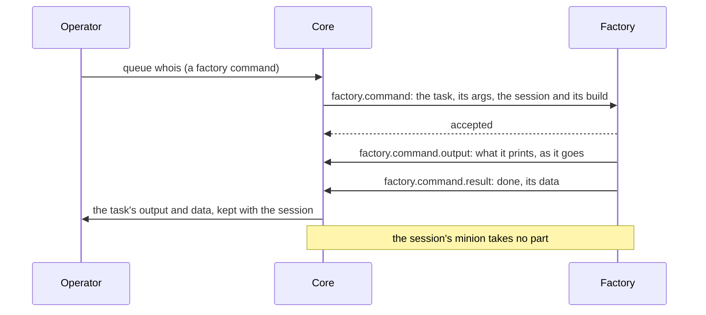

:::note[Status]
Built in part: the protocol package has its types and checks ([In the
protocol package](#in-the-protocol-package)). Core, factory-core and the web
app do not run factory commands yet, and the questions at the page's end
are open.
:::

A **factory command** is a command its factory runs itself, in the factory
module, never on a minion. The factory declares it once, in its build
schema, and every session of every build it made has it: no build picks it,
and no minion carries it. Its task is a task of the session like any other:
queued in the console, the web app or the APIs, and kept with the session's
tasks, with its output, data and files. Core sends it to the factory instead
of the minion.

A factory command works whether the session's minion can be reached or not:
a lost session's, or a minion that checks in once a day. What it can do is
what the factory can do with what core gives it: the task's args and files,
and everything core keeps of the session and of its build
([`factory.command`](#factorycommand)).

| Commands | Who runs them | Which sessions have them |
|---|---|---|
| A build's [commands](../minion-build/#commands) | the minion | the sessions of the builds that picked them |
| Core's own (`help`, `max_tasks`, `connect`, `disconnect`) | core | every session (`connect` and `disconnect`: a `bind-persistent` one's) |
| Factory commands | the factory | every session of every build the factory made |



## A factory command

A factory declares its factory commands in its [build
schema](../minion-build/#the-build-schema), in a list of their own:

```json
{
  "factory_commands": [
    {
      "id": "whois",
      "label": "Who holds the address",
      "description": "Looks the address up in a registry the factory reaches.",
      "params": [
        { "key": "address", "type": "string", "label": "Address", "description": "Empty: the session's external address" }
      ]
    }
  ]
}
```

| Field | Meaning |
|---|---|
| `id` | Identifier, as a command's (`^[a-z][a-z0-9_-]{0,62}$`): unique among the schema's `commands` and `factory_commands` together, and not one of core's own. The console types it, and core and the APIs name it by it. |
| `label`, `description` | Shown in the UI, as a command's. |
| `params[]` | What a task of it takes: field specs as in a [management action](../module-management/), `file` ([task files](../task-results-and-actions/#task-files)) and [credentials](../credentials/) among them, as a command's: one `file` at most, no `stream` (a stream feeds a minion's task), and no `num`, since nothing of it goes to a minion. |
| `result` | Optional. What its task's `data` is: one of core's [results](../task-results-and-actions/), its shape and view. Without one, the `data` shows as raw JSON. |

- **Every session of the factory kind's builds has it**: the factory
  commands of the kind's latest schema (the one core checks new builds
  against), whatever the build's target, commands and schema version. Core
  runs one on an instance whose schema declares it.
- **A build's own command comes first.** In a session whose build has a
  command of the same `id` (from an earlier schema version), that command
  is the session's, and the factory command is not offered there.
- **Nothing a command has for its minion**: no `op`, `targets`, `default`,
  `required`, `legacy`, `kinds`, `opens`, `serves`, `action`, `composite` or
  `uses`.
- **Adding, changing or removing one needs no new build**, nor a new schema
  `version`: it reaches the sessions of minions already deployed at once. A
  task already kept keeps its command's `id`, whatever came of the command
  since.
- **In the app**: the session's console, `help` and command forms offer it
  beside the build's commands and core's own, marked as the factory's, and
  the factory's page lists its factory commands. The build form does not:
  no build picks one.
- **Who may queue one**: whoever may queue the session's tasks.

## A task's life

1. **Queued** as any task: core checks its args against the command's
   params, as an operator's, fills in defaults, and takes the [task
   files](../task-results-and-actions/#task-files) it names. It takes none
   of the minion's room ([Max
   tasks](../minion-messages/tasks-and-results/#max-tasks)), and waits for no
   check-in.
2. **Taken**: core offers it to the instances of the session's factory
   (`factory.command`) until one accepts it ([Which instance runs
   it](#which-instance-runs-it)). From then on the task is running, and
   shows the instance that runs it.
3. **Output as it goes**: the factory reports what the command prints
   (`factory.command.output`), and the task shows it as it comes, as a
   minion's.
4. **Ended** by the factory's result (`factory.command.result`): `done`,
   with how it went (`ok`, `err`, `exit`), its data and its files; or
   `failed`, with why.

### Stopping

An operator's stop ends the task `cancelled` at once, and core calls the
factory (`factory.command.cancel`), which stops the command and sends no
result. What it printed until then stays with the task.

## The calls

Over the control plane, as a build's ([Operations](../minion-build/#operations)):
core calls the factory on its `rpc_queue` (`logos.factory.rpc.<instance>`),
and the factory calls core on `logos.core.rpc`, each request and reply in the
[AMQP envelope](../amqp-envelope/).

| `type` | Direction | Summary |
|---|---|---|
| `factory.command` | core → factory | Run a task. |
| `factory.command.cancel` | core → factory | Stop a task under way. |
| `factory.command.output` | factory → core | What the command printed, in order. |
| `factory.command.result` | factory → core | How the task ended. |

### `factory.command`

The task, the session as core keeps it, and the session's build: core's
record of it, and the build request the factory got for it. Request
`payload`:

```json
{
  "task_id": "7c9e6679-7425-40de-944b-e07fc1f90ae7",
  "command": "whois",
  "args": { "address": "" },
  "actor": { "type": "user", "id": "f140266c-…", "name": "admin" },
  "session": {
    "session_id": "1b4e28ba-2fa1-41d2-883f-0016d3cca427",
    "number": 12,
    "operation_id": "6a1f3c0e-2d4b-4e8f-9a7c-5b3d1e0f2a9c",
    "build_id": "5b0c4f6e-8a1d-4c2b-9e7f-3d2a1b0c9e8f",
    "target": "windows-exe",
    "platform": "windows/amd64",
    "description": "Finance workstation",
    "build_description": "Workstations, EU edge",
    "created_at": "2026-11-20T09:12:44Z",
    "last_seen_at": "2026-11-22T14:29:58Z",
    "staged": true,
    "hello": {
      "pid": 4120, "os": "windows", "arch": "amd64", "host": "WS-0042",
      "user": "CORP\\alice", "domain": "CORP", "proc": "svchost.exe", "integrity": "medium",
      "addrs": ["10.1.2.3", "172.17.0.1"], "version": "1.4.0",
      "machine_id": "win-machine-guid:4c4c4544-0042-3510-8052-b4c04f4e3732",
      "x": { "mode": "service" }, "roundtrip_time": 180
    },
    "acting": { "user": "CORP\\svc_backup", "domain": "CORP", "integrity": "high", "how": "impersonation", "since": "2026-11-22T13:02:10Z" },
    "address": "10.1.2.3",
    "peer_address": "203.0.113.7",
    "peers": [{ "address": "203.0.113.7", "first_seen": "2026-11-20T09:12:44Z", "last_seen": "2026-11-22T14:29:58Z", "count": 5120 }],
    "sleep": { "interval": 30000, "jitter": 20 },
    "late_at": "2026-11-22T14:31:04Z",
    "lost_at": "2026-11-22T14:32:16Z",
    "connected": false,
    "conn": 1, "conn_kind": "reverse-call", "conn_name": "edge-eu", "conn_count": 1,
    "max_tasks": 1,
    "feedback_errors": 0,
    "crypto": { "suite": "aes-256-cbc-hmac-sha256", "material": { "enc_key": "…", "mac_key": "…" } }
  },
  "build": {
    "build_id": "5b0c4f6e-8a1d-4c2b-9e7f-3d2a1b0c9e8f",
    "description": "Workstations, EU edge",
    "target": "windows-exe",
    "platform": "windows/amd64",
    "schema_version": 1,
    "created_by": { "type": "user", "id": "f140266c-…", "name": "admin" },
    "created_at": "2026-11-20T09:05:10Z",
    "started_at": "2026-11-20T09:05:11Z",
    "finished_at": "2026-11-20T09:06:02Z",
    "instance": "example-1",
    "factory_version": "0.4.2",
    "request": { "build_id": "5b0c4f6e-8a1d-4c2b-9e7f-3d2a1b0c9e8f", "target": "windows-exe", "platform": "windows/amd64", "schema_version": 1 },
    "connection_descriptions": ["EU edge, through the CDN"],
    "error_codes": [{ "code": 3, "exit_code": 117, "label": "No connection it can use" }],
    "warnings": ["debug build: strings are not obfuscated"],
    "artifact": {
      "filename": "WinTelemetry.exe", "size": 2412544,
      "sha256": "28afe4a10a4a7d593623dcd1eee11f519b056d2bfdda4c7b0bd7a57fc3a5fc8b",
      "media_type": "application/vnd.microsoft.portable-executable",
      "url": "/api/factory/tasks/7c9e6679-7425-40de-944b-e07fc1f90ae7/artifact?sig=…"
    },
    "files": {
      "0f9a2c1e-6f1b-4a43-9d4e-2b9b3c1d7e55": {
        "id": "0f9a2c1e-6f1b-4a43-9d4e-2b9b3c1d7e55", "name": "app.ico", "size": 4286,
        "sha256": "9f2c41d0e5a8b7c6d5e4f3a2b1c0d9e8f7a6b5c4d3e2f1a0b9c8d7e6f5a4b3c2",
        "media_type": "image/x-icon",
        "url": "/api/factory/tasks/7c9e6679-7425-40de-944b-e07fc1f90ae7/build-files/0f9a2c1e-6f1b-4a43-9d4e-2b9b3c1d7e55?sig=…"
      }
    }
  },
  "upload_url": "/api/factory/tasks/7c9e6679-7425-40de-944b-e07fc1f90ae7/files?sig=…"
}
```

| Field | Meaning |
|---|---|
| `task_id` | The task. |
| `command`, `args` | The task's command, and its args by param key, defaults filled in: a `file` param's arg is the file's id, a credential param's the credential's (a credential list's, their ids). |
| `actor` | Who queued the task, as a build's `actor` says who started the build. |
| `session` | The session, as core keeps it ([The session](#the-session)). |
| `build` | Its build: core's record, and the request the factory got ([The build](#the-build)). |
| `files` | The files the args name, by id: each its `id`, `name`, `size`, `sha256` and a `url` to fetch it whole. |
| `credentials` | The credentials the args name, by id, with their secrets ([Credentials](../credentials/)). |
| `upload_url` | Where the factory puts a file for the task: a `PUT` of the whole, as [a composite's code does](../task-outsourcing/#files). |

A field core has no value for is absent. Links are paths on core's
address, signed for the task while it runs.

Reply `payload`: `{ "task_id": "…", "accepted": true }`. A repeated call for
a task the instance already accepted is accepted again, and never runs it
twice.

#### The session

| Field | Meaning |
|---|---|
| `session_id`, `number`, `operation_id` | The session, its number in its operation (what operators call it), and the operation. |
| `build_id`, `target`, `platform` | Its build, and the build's target and platform. |
| `description`, `build_description` | What it is for, the operators' note, and its build's description when it opened. |
| `created_at`, `last_seen_at` | When it opened, and its latest message; absent before its first check-in. |
| `staged` | Opened under a temporary id after a stage, or straight under the build id ([Staging](../minion-messages/sessions/#staging)). |
| `hello` | What its latest [`hello`](../minion-messages/sessions/#hello) said: `pid`, `os`, `arch`, `host`, `user`, `domain`, `proc` (the process's name), `integrity` (by name), `addrs` (as text), `version`, `machine_id` (`<source>:<value>`), `x` (the factory's own fields) and `roundtrip_time` (milliseconds). |
| `acting` | Who its tasks run as, when not the process's own: `user`, `domain`, `integrity`, `how` (`impersonation`, `network` or `become`), `credential_id`, `task_id` and `since` ([Identity](../minion-messages/identity/)). |
| `address` | The one of `hello.addrs` the session shows: an operator's pick, else core's guess. |
| `peer_address`, `peers` | Its external address now, and each one it was seen from, with `first_seen`, `last_seen` and `count` (its messages). |
| `via`, `via_since` | The delegates its messages come through, nearest first, each a session (`session_id`, `number`) and its `task_id`, and since when ([Delegation](../minion-messages/delegation/)). |
| `sleep`, `late_at`, `lost_at` | The check-in schedule its minion said (`interval` in milliseconds, `jitter` in percent), and when it turns late and lost ([Late and lost sessions](../minion-messages/sessions/#late-and-lost-sessions)). |
| `connected` | A persistent connection serving it is open. |
| `conn`, `conn_kind`, `conn_name`, `conn_count`, `conn_changes` | The connection its minion uses (its place, from 1), its kind and name, how many there are, and the moves the minion reported (`at`, `from`, `to`, `reason`). |
| `connections`, `connections_at` | The minion's own connections, when its hello said them, each with its `channel`, `kind`, `name`, `version`, `params` and `values` (by their fields' numbers, as text), `failover_auto`, `fail_after` and `max_message`; and when they last changed. Absent: its build's ([Connections](../minion-messages/sessions/#connections)). |
| `max_tasks`, `max_tasks_set` | How many tasks its minion runs at once, as it said, and the operators' limit. |
| `feedback_errors`, `feedback_at`, `feedback_read_at` | Its unread errors, when its latest feedback came, and when someone last marked it read ([Feedback](../minion-messages/sessions/#feedback)). |
| `persisted`, `restarts`, `restart_count` | A persisted session, the latest processes that claimed it (`at`, `pid`, `host`, `build_id`), and how many in all. |
| `archived`, `folder_id` | Hidden from the operation's sessions, and the folder it is in. |
| `crypto` | Its suite and key material: what its minion's messages are sealed with now. |

#### The build

| Field | Meaning |
|---|---|
| `build_id`, `description` | The build, and what it is for, the operators' note: core's own, never in the request. |
| `target`, `platform`, `schema_version` | What it built, for which platform, against which schema version. |
| `created_by`, `created_at`, `started_at`, `finished_at` | Who started it and when, when an instance took it, and when it ended. |
| `instance`, `factory_version` | The instance that built it, and its version then. |
| `request` | The [`factory.build`](../minion-build/#factorybuild) payload that instance got, byte for byte (shortened above): values, commands, connections, failover, files, credentials with their secrets, crypto (the minion's keys), envelope, `session_id`, `max_tasks`, compression, error codes, the minion config and the actor. Its links have expired: `files` and `artifact` carry new ones. |
| `connection_descriptions` | The operators' notes on its connections, by place: core's own. |
| `error_codes` | What its minion's exit codes mean: each code its factory declared, with its `label`, `description` and `fixed`, and the `exit_code` this build's minion exits with ([Minion error codes](../minion-build/#minion-error-codes)). |
| `credential_revs` | The revision of each credential the request carries, by id. |
| `codec` | What the factory declared of the layers it translates, for a codec of its own ([Codecs](../minion-messages/codecs/)). |
| `warnings` | What its result warned of. |
| `artifact` | What it produced: `filename`, `size`, `sha256`, `media_type`, and a `url` to fetch it; `deleted` in place of the `url` once an operator removed its bytes. |
| `files` | The build files its values name, by id, as the request names them, each with a new `url`. |

#### Not given

- **Core's bookkeeping**: the session's revision, its rehello and max tasks
  send counts, when core removes it; the build's lease and its artifact's
  check.
- **Copies of what `build` says**: the session's copies of its build's
  compression, envelope, codec and connection limit, and the factory kind.
- **Keys a claim replaced**: those of processes no longer in the session.
- **How the build went**: its plan, step reports and log.
- **The session's other records**: its tasks and their results, files,
  listings, feedback and targets ([Open questions](#open-questions)).

### `factory.command.output`

Request `payload`:

```json
{ "task_id": "7c9e6679-7425-40de-944b-e07fc1f90ae7", "seq": 1, "out": "MjAzLjAuMTEzLjc6IEV4YW1wbGUgTmV0Cg==" }
```

- `out` is what the command printed since the last report, base64, 16 KiB
  at most. A report with none says the command still runs.
- `seq` numbers the reports from 1, one more each. They go one at a time,
  in order: one whose call was lost goes again with the same `seq`, and
  core keeps it once.

Reply `payload`: `{ "task_id": "…", "seq": 1, "ack": true }`. A `not_found`
error means core no longer waits for the task from this instance (it was
stopped, or is another's), and the factory stops it.

### `factory.command.result`

Request `payload`:

```json
{
  "task_id": "7c9e6679-7425-40de-944b-e07fc1f90ae7",
  "state": "done",
  "ok": true,
  "data": { "address": "203.0.113.7", "holder": "Example Net" }
}
```

- `state` is `done`: the command ran, and `ok`, `err` and `exit` say how,
  as a minion's last result part does
  ([Results](../minion-messages/tasks-and-results/#results)); an `ok` one
  has no `err`. Or `failed`: the factory could not run it, `err` says why,
  and nothing comes with it: no `exit`, data or files.
- `data` is inline when its JSON is 16 KiB or less; larger, a file the
  factory put (`data_file`, its id). Core checks it against the command's
  `result` as it checks a result part's: data that does not fit is kept, and
  flagged.
- `files` are the ids of the files the factory put that are the task's own
  (a decoded document, a report), each once: the task lists them as a
  minion's task lists what its minion sent.
- The factory sends what is left of its output first, so core has all of it
  when the task ends.

Reply `payload`: `{ "task_id": "…", "recorded": true }`. The factory sends
the result again until it gets a reply, and a repeated result is answered
the same way. A `not_found` error means core no longer waits for the task:
the factory drops the result.

### `factory.command.cancel`

Request `payload`: `{ "task_id": "…" }`. Reply `payload`:
`{ "task_id": "…", "cancelled": true }`, also for a task the instance does not
know, which it remembers: a `factory.command` for it that arrives later is
accepted and never run.

## Which instance runs it

Core offers a queued task to the registered instances of the session's
build's factory kind whose schema declares the command, never to another
module's, one after another, as it offers builds ([Choosing an
instance](../minion-build/#choosing-an-instance)):

- **`busy`, or no answer within 10 seconds**: core passes the instance over
  and tries the next.
- **Any other error** (`validation_failed`, `unsupported_version`, …): the
  instance refused the task, which ends failed, with the error's message.
- **No instance takes it**: the task stays queued, and core offers it again
  on its next pass, every 2 seconds, until one does or an operator stops it,
  as a minion's task waits for its minion.
- **The instance that takes it runs it to its end.** A task under way on an
  instance no longer registered (deregistered, declared dead or blocked)
  ends failed, as a build does (`factory_lost`), and an instance that stops
  cleanly reports its tasks failed first (`shutdown`).
- **Draining** an instance stops its new tasks, not those it runs.

## Limits

| What | Limit |
|---|---|
| Factory commands in a schema | 256, as commands |
| A factory command's params | 32, as a command's |
| An output report's `out` | 16 KiB |
| A result's `data` inline | 16 KiB; larger, as a file the factory put |
| Files a result names | 32 |
| A result's `err` | 1,000 bytes |
| A file the factory puts | as an operator's task file (`MINION_FILE_MAX_SIZE`, 2 GiB by default) |
| An instance's answer to `factory.command` | 10 s, the control plane's default; then core offers the task to the next |
| No report while it runs (output or result) | 10 minutes; then the task ends failed, and core asks the factory to stop it |
| Tasks at once in a factory-core instance | 4 by default |

## Trust

- **The call carries the session's and the build's secrets**: the session's
  keys, in the build's request the minion's keys and its credentials'
  secrets, and the task's own credentials. They are for the task alone, as a build request's are for the
  build: the factory does not log them, keep them past the task, or put them
  in its output, data or files.
- **The calls cross the broker**, as build requests do: in the clear, on
  the one broker account every module shares today, until the control
  plane gets TLS and an account per module ([Baseline security
  controls](../../architecture/#baseline-security-controls)). Files go by
  link, over HTTP(S).
- **What is new to the factory is the session's**: its keys and its record.
  The build's request, keys and credentials it got when it built the
  minion. A factory command reaches no minion, and no other session.
- **What it returns passes the checks a minion's result does**: its data
  against the command's `result`, its output and files within their limits.

## What stays the same

- **The minion**: it knows nothing of factory commands, and no message of
  its protocol changes.
- **A build's commands, core's own, and composite commands** keep every
  rule they have.

## In the protocol package

`logos-golang-protocol`'s `protocol` package:

| Go | What |
|---|---|
| `BuildSchema.FactoryCommands`, `FactoryCommand` | The declaration. `ValidateBuildSchema` checks it: an id of its own among the schema's commands and factory commands, none of core's, a known `result`, and params as a command's with no `num` and no stream, one file at most |
| `BuildSchema.FactoryCommand`, `.SessionFactoryCommands`, `FactoryCommand.Args` | One by id; a session's, but those its build's own commands come before; a task's args checked, defaults filled in |
| `TypeFactoryCommand`, `FactoryCommandRequest`, `FactoryCommandReply` | The call and its reply: `Validate`, and `ValidateFor` against the factory's schema (its command, its args, the files and credentials they name) |
| `SessionRecord`, `BuildRecord` | The session and the build the call carries, each with `Validate`; `BuildRecord.ReadRequest` reads its `factory.build` request |
| `TypeFactoryCommandOutput`, `FactoryCommandOutput`, `TypeFactoryCommandResult`, `FactoryCommandResult` | The reports, their replies, and `Validate` |
| `TypeFactoryCommandCancel`, `FactoryCommandCancelRequest`, `FactoryCommandCancelReply` | The stop |
| `MaxFactoryCommandOut`, `MaxFactoryCommandInline`, `MaxFactoryCommandFiles`, `FactoryCommandNoReport` | The limits above |

## Design notes

- **Work for which the minion is not needed.** A lookup, the decoding of
  what a task brought back, a report: the factory has tools and a network a
  minion lacks, and a minion that need not carry them stays small. Run in
  the factory, the work is done even while the minion cannot be reached.
- **The whole session and build, with each call.** A command may need any
  of it: the session's keys to open what its minion sealed, the build's
  request to make another minion like it, the host's names, addresses and
  identity to look it up. The factory keeps nothing of a build once it is
  built, so core gives it all, as it is when the task starts: no lookup
  back, no copy to keep in step.
- **The request as it went.** The factory reads the `factory.build` payload
  it already parses, byte for byte: what its code built the minion from,
  not core's reading of it.
- **Every session, with no build made again.** A factory command declared
  once reaches every session of the factory's builds, minions already
  deployed among them: nothing of it is built in.
- **A list of their own, not a flag on a command.** A build's commands are
  picked per build and built in, so `default`, `required`, `targets` and
  `op` say how; none of it means anything for a factory command. A list of
  their own says plainly that every session has them, and leaves `commands`
  what minions carry.
- **Tasks of the session, not a module's actions.** A [management
  action](../module-management/) runs on the module, for whoever manages it;
  a factory command runs about one session and keeps its result with it, in
  the session's history, where the operation's members see its other tasks.
- **Not a composite.** A composite works through the session's minion: its
  subtasks are the minion's commands. A factory command works without it.
- **Like a build, not like a decision.** A command may run for minutes, and
  the control plane's calls time out in seconds, so it goes as a build goes:
  a call to start it, reports while it runs, a call to stop it.
- **Queued until an instance takes it.** A factory restarting, or upgraded
  one instance at a time, does not fail an operator's task: it waits, as a
  task for a minion does, and either can be stopped.

## Open questions

- **Waiting for an instance**: a task stays queued while no instance takes
  it, as a minion's waits for its minion; or does it fail after a while, as
  a build does at its timeout?
- **Narrowing**: may a factory command apply to some sessions only (a
  target, the `os` a minion said)?
- **Actions**: may a view of core's run one, as it runs a command with an
  [action](../task-results-and-actions/#running-an-action)?
- **The minion's help**: may a factory command run subtasks on the
  session's minion, as a [composite](../task-outsourcing/) does, or is that a
  composite's alone?
- **The session's other records**: its tasks' results, files, listings,
  feedback and targets: by link, on request, or not at all?
- **Credentials now**: the request carries the build's credentials as they
  were when it was built (`credential_revs`); does a command need them as
  they are now?
