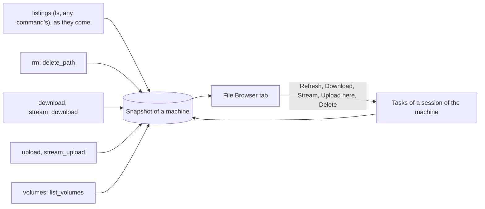

Core remembers what its minions have seen of each machine's file system, and
shows it as a **file browser**: one per machine, opened from a session, with
the files' actions a click away. Nothing is asked of a minion for it: the
snapshot is made from the tasks' results ([Task Results and
Actions](../task-results-and-actions/)) as they end.

## A machine's snapshot

A snapshot belongs to a **machine of an operation**: its key is the
operation and the sessions' [`machine_id`](../minion-messages/sessions/#machine-identity).
Every session of the machine feeds it, and it outlives them: it stays when
sessions close or are archived, and goes with the operation.

- A session whose `machine_id` is missing (a minion built before it was asked
  for) or `ephemeral:` (new with each process) has no machine to share: its
  snapshot is its own, keyed by the session.
- Two machines that share an id (clones that kept it) share a snapshot; the
  browser shows the sessions that fed it, with their hosts.

### Entries

An entry is a path the machine was seen to have, as the host writes it (its
listing's `sep`). Its parent and name, then what was last known of it:

| | |
|---|---|
| `type`, `size`, `modified`, `mode`, `owner`, `group`, `target`, `hidden` | as the last [listing](../minion-messages/tasks-and-results/#listings)'s entry for it said, or the last upload |
| `seen_at`, `seen_by` | when, and by which task and session, it was last seen or changed |
| `known` | false for a folder known only as one on the way to another entry (a download's file's folders, say): nothing was said of it yet |
| `gone_at`, `gone_by` | it was deleted (`rm`), or a later listing of its folder no longer had it; null while it is there |
| `downloaded` | the files core keeps of it ([`file_download`](../task-results-and-actions/#file_download)): each one's id, size, SHA-256 and when |
| `uploaded` | what an operator put there ([`file_upload`](../task-results-and-actions/#file_upload)): size, SHA-256, when, by whom |
| `volume` | a volume's files are here (a drive's root, a mount point), as the newest [`volumes`](../task-results-and-actions/#volumes) task said: its kind, device, label, file system, size and free space, and when and by which task and session it was listed; null once a later one no longer had it |

A **folder** also says when its children were last listed (`listed_at`, by
which session and host user): a folder never listed holds only what other
tasks put in it, and says so. One a task could not read says why
(`list_err`, permission denied), when and by whom, until a listing of it.

On a Windows host (a `\` listing), paths compare without case: `C:\Users` and
`c:\users` are one entry.

### What feeds it

Core changes the snapshot from every task, whatever started it: the
console, a typed line, the browser itself. Listings as they come, any
command's; the rest as each task ends, done.

| What a task sends | The snapshot |
|---|---|
| A [listing](../minion-messages/tasks-and-results/#listings) (an `ls`'s, a walk's: any command's), as its pieces come | The folder's children become the listing's: entries it has are seen, and once the whole listing is in, those it no longer has are gone (a partial one marks nothing gone). The folder, and its parents up to the root, are entries too. A folder not read (`err`) says so. |
| `delete_path` (an `rm`) | The entry is gone; a folder, with everything under it. |
| `file_download`, `file_stream` | The file is seen (its size), and `downloaded` gets the kept file: a download's, or a stream's [copy](../minion-messages/file-transfers/#cores-copy-of-a-stream), kept whole as it passed. A stream core kept no copy of (over the size limit, or not passed through whole) goes to `streamed` instead, its SHA-256 only. |
| `file_upload` | The file is seen, with the size the minion wrote, and `uploaded` gets it. |
| `volumes` (a `list_volumes`) | Each volume's path is a folder holding its `volume` (a Windows drive one of the machine's roots, with its parents up to the root on Linux); a volume a newer list no longer has loses it, and a list older than the newest the machine holds changes nothing (it would bring a drive back). None at all changes nothing either. |

**Newer wins.** Results come out of order (a slow listing ending after a
delete it raced): each change is stamped (a listing with when core took its
first piece, any other with its task's end), and an entry takes a change
only newer than the one it holds. A listing replaces only what it is newer
than.

**The latest listing wins**, whoever's: two sessions as different host users
see different files, and a folder shows the one listed last, saying by whom.

Nothing of a file's content is in the snapshot: what core keeps of a file is
a download's, in the [minion files bucket](../minion-messages/file-transfers/).

## The browser

A session's context menu (a right click in the Sessions table) has **File
Browser**: a work pane tab, beside the session's console tabs, of the
snapshot of the session's machine.

- **Its header**: the session its actions run through (**Act as**), the
  machine's search, **Show deleted**, and **Auto-list**: with it on,
  entering a folder never listed lists it (its `list_dir`, once while the
  tab shows it), and entering the machine's roots while none holds a
  volume lists its volumes (its [`list_volumes`](../task-results-and-actions/#list_volumes),
  the same way). Off by default.
- **Its path** as crumbs (from the machine's roots), and a folder tree beside
  the table: folders open as they are expanded, from core; opening a folder
  opens the tree on the way to it.
- **The folder's entries**, folders first: name (with the type's icon, a
  link's target), size, modified, mode, owner, the marks below. Paged and
  sorted by core, filtered by a search, as every table: a folder of 100 000
  entries reads as one of 100.
- **Freshness**: "listed 3 h ago by #46 (root)", or "never listed: only what
  other tasks put here", on every folder; at the roots, "volumes listed 3 h
  ago by #46 (root)", or "volumes never listed".
- **Volumes**: a volume's path (a drive, a mount point) shows its kind's icon
  (fixed, removable, optical, network, RAM), its label and space beside its
  name ("System · 35 GB free of 79 GB", "No media"), and the rest on hover;
  in the tree too.
- **Listed or not**: a folder listed shows amber, in the table and the tree;
  one never listed (known only as the way to another entry) grey and dashed;
  one a task could not read, a red lock, its line saying why.
- **Marks**: downloaded (opens the kept file's view), streamed (a stream
  core kept no copy of: nothing opens, and its name stays dim, as core does
  not have the file),
  uploaded (when, its SHA-256), deleted (struck through, with when and how).
  **Show deleted** hides them; it is on.
- **In flight**: a task of the acting session on a path, whatever started it,
  shows on its row as it goes ("listing…", "deleting…", "downloading…"), and
  the folder's line says so of the folder (Refresh spins) and of uploads on
  their way into it.

The tab keeps, in the operator's browser as the tabs are, the folder it
shows, the sort, Show deleted, Auto-list and the tree's open
folders; closing it forgets them. The divider between the tree and the
folder is the operator's, kept in core with their sessions layout
(`filesSplit`, as the console's `consoleSplit`): every file browser opens
with it where they left it.

### Its actions

The same as a listing's (see [dir_listing's view](../task-results-and-actions/#view)),
run as tasks of a session of the machine: **Refresh** (the folder's
`list_dir`, with the command picked for the session in its console; at the
machine's roots, its `list_volumes`),
**Upload here** and **Walk from here** (the folder), and in an entry's menu
**Open**, **List directory**, **Walk from here** (a folder and those under
it, [`walk_dir`](../task-results-and-actions/#walk_dir)), **Download**,
**Stream**, **Upload here…**, **Delete…** and **Open downloaded file**, each
a submenu when the session has several commands for it. A queued task says so, with a link to the session's
console; the snapshot changes when it ends.

They go through **the tab's session**. **Act as**, in the tab's header,
picks another of the machine's sessions (each with its host user: a root
session lists what a user's cannot): the tab becomes that session's file
browser, with its number and mark, at the same folder; into the session's
own file browser tab when one is open. A closed session runs nothing: the
snapshot stays readable, and the picker offers the machine's open ones.

A task's listing view ([`dir_listing`](../task-results-and-actions/#dir_listing))
has **Open in File Browser**: the machine's browser, at that folder.

### Search

**Search the machine**, in the tab's header: every entry the snapshot has, by
name (a part of it, any case) or by a glob (`*.kdbx`, `id_rsa*`), over all its
folders, with the deleted ones when Show deleted is on; two characters at
least. Results are paths, paged by core; a folder opens, another entry opens
its folder at it.

## API

GraphQL (`file_browser.graphql`), for any member of the operation (actions
take an operator, as tasks do). Each is asked for by a session, and answers
for its machine:

| | |
|---|---|
| `fileBrowser(sessionId)` | The session's machine: its key, and the operation's sessions with its `machine_id`, newest first (number, host, user, open or closed, last seen). |
| `fileBrowserEntries(sessionId, path, after, first, search, sort, desc, showDeleted, foldersOnly)` | A folder's entries (`path` null: the machine's roots), folders first, by `name`, `size` or `modified`, a page at a time (200; 500 at most; `next` is the cursor), with the folder's own entry (its freshness). `foldersOnly` is the tree's. |
| `fileBrowserSearch(sessionId, query, after, first, showDeleted)` | Entries anywhere on the machine, by name or glob, by path. |
| `fileBrowserChanged(sessionId)` | A subscription: each folder of the machine that changed, as tasks end. |

Actions are [`queueMinionTask`](../minion-messages/) with the action's
command and params, as from a listing.

## Design notes

- **Why from results, not a minion's own crawl.** Every listing an operator
  makes already says what a folder holds; keeping it costs nothing on the
  host and says nothing new on the wire. A recursive crawl is one more
  command that sends listings.
- **Why listings apart from a task's data.** As data, a listing was one
  folder a task, within its 4 MiB, taken when the task ended: a walk over
  thousands of folders fit none of it. Apart, any command sends any number,
  of any size, taken as they come; an `ls`'s own view is made from its
  first.
- **Why a machine, not a session.** Sessions come and go (restarts,
  persisted sessions replaced, a second implant on the same host); the files
  are the machine's. `machine_id` was asked for this.
- **Why the latest listing wins.** A view per host user is truer to what each
  can see, but most hosts are one or two users, and an operator usually
  wants what was seen last. The folder says who listed it.
