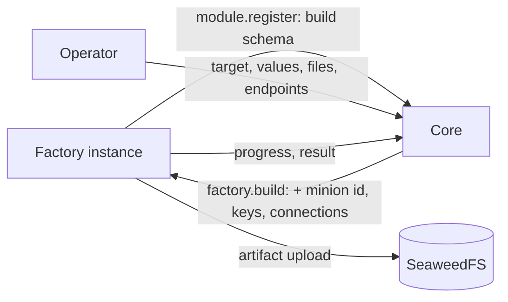
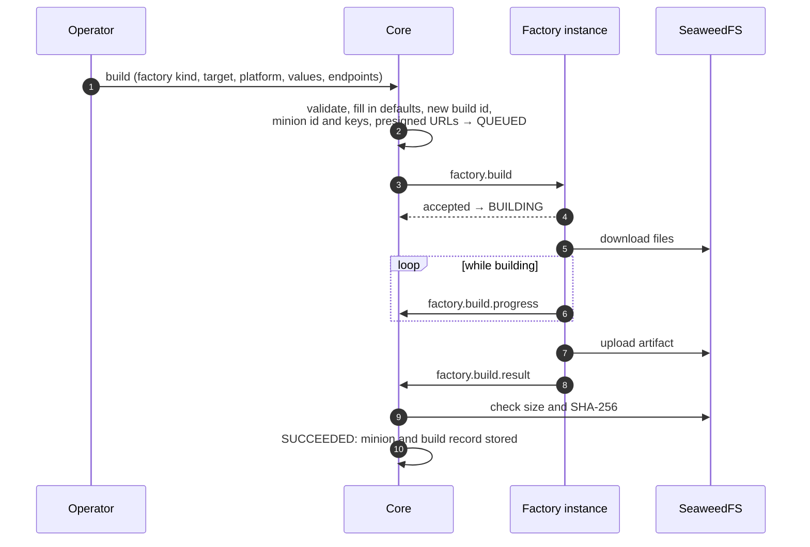

:::caution[Draft]
An agreed design that is **not built yet**: there are no protocol types, SDK,
core or UI support for it. Details may still change while it is implemented.
:::

Factories build minions. What a factory can produce, and what each build needs,
depends on the factory: one builds Windows services and Linux binaries, another
only scripts. So **each factory declares it**, as a **build schema** sent at
[registration](../module-lifecycle/#moduleregister), the same way a channel
declares its [connection schema](../minion-connection/). The app builds its
forms from the schema. Core validates what operators enter, adds the minion's
identity, keys and connection settings, and asks the factory to build.



Builds are **asynchronous**: the factory accepts a build at once, reports
progress while it works, and sends the result when it is done. A build can take
minutes, longer than a management action is allowed to run.

## The build schema

Declared in `module.register` under `build`:

```json
{
  "schema_version": "1",
  "version": 1,
  "channels": [
    {
      "module_name": "http", "versions": [2],
      "fields": [
        {
          "key": "method", "type": "enum", "label": "Method", "default": "POST",
          "options": [{ "value": "GET" }, { "value": "POST" }, { "value": "PUT" }]
        },
        {
          "key": "path_prefix", "type": "string", "label": "Path prefix", "default": "/",
          "description": "Every request path starts with it, e.g. /cdn/assets/ when the front forwards only that path.",
          "pattern": "^/[A-Za-z0-9._~!$&'()*+,;=:@%/-]*$", "max_length": 256
        }
      ]
    },
    { "module_name": "dns", "versions": [1] }
  ],
  "crypto": ["x25519-xchacha20poly1305"],
  "fields": [
    { "key": "kill_date", "type": "datetime", "label": "Kill date", "group": "Limits", "order": 1 },
    {
      "key": "guardrails", "type": "enum_list", "label": "Run only if", "group": "Limits", "order": 2,
      "options": [
        { "value": "domain_joined", "label": "Domain-joined" },
        { "value": "no_debugger", "label": "No debugger attached" }
      ]
    },
    { "key": "debug", "type": "bool", "label": "Debug build", "default": false, "group": "Build", "order": 3 }
  ],
  "targets": [
    {
      "id": "windows-exe", "label": "Windows executable", "format": "exe",
      "platforms": ["windows/amd64", "windows/386", "windows/arm64"],
      "fields": [
        { "key": "icon", "type": "file", "label": "Icon", "accept": [".ico"], "max_size": 262144, "group": "Appearance", "order": 4 }
      ]
    },
    {
      "id": "windows-service", "label": "Windows service", "format": "exe",
      "platforms": ["windows/amd64"],
      "fields": [
        {
          "key": "service_name", "type": "string", "label": "Service name", "required": true,
          "pattern": "^[A-Za-z0-9_-]{1,64}$", "group": "Service", "order": 4
        }
      ]
    },
    { "id": "linux-elf", "label": "Linux binary", "format": "elf", "platforms": ["linux/amd64", "linux/arm64"] },
    {
      "id": "shellcode", "label": "Shellcode", "format": "bin",
      "platforms": ["windows/amd64", "linux/amd64"],
      "channels": [{ "module_name": "http", "versions": [2] }]
    }
  ]
}
```

| Field | Meaning |
|---|---|
| `schema_version` | Format of this structure: `"1"`. |
| `version` | Version of the factory's parameter set, from 1. Raised when values saved against the previous set would build something else or fail: a field or target removed, renamed or given another meaning. Adding an optional field or a target does not need it. |
| `channels[]` | The channel kinds the minions can speak: `module_name`, the connection schema `versions` they read, and optional `fields`, the factory's own [connection parameters](#connection-parameters) for that kind. |
| `crypto[]` | Optional. The payload crypto suites the minions implement; core picks one it implements and generates the keys. Suite names and their key material come from the payload crypto contract, which is not written yet; the name above is an example. |
| `fields[]` | Build parameters shared by every target. Field specs as in a [management manifest](../module-management/#fields), plus the [types below](#field-types-for-builds). |
| `targets[]` | What the factory can produce, at least one. |

A target:

| Field | Meaning |
|---|---|
| `id` | Identifier, unique in the schema, `^[a-z][a-z0-9_-]{0,62}$`. |
| `label`, `description` | Shown in the UI. |
| `format` | What the artifact is: `exe`, `dll`, `elf`, `so`, `macho`, `dylib`, `bin` (raw shellcode), `script`, `zip`, or another name of the same form. Shown and filtered on; the factory names the file. |
| `platforms[]` | Where the artifact runs, as `os/arch` with Go's names (`windows/amd64`, `linux/arm64`, `darwin/arm64`). `any` stands for either half: `any/any` for a script. Checked by form only, so a new platform needs no protocol release. |
| `fields[]` | Parameters of this target only, added to the shared ones. |
| `channels[]` | Optional. Narrows the factory's `channels` for this target, to kinds and `versions` the factory lists. The connection parameters stay the factory's. |

- Core validates the schema at registration (structure, limits, defaults
  against their own specs) and refuses a registration whose schema is invalid
  (`validation_failed`). Only factories may declare `build`; a registration
  without it clears the stored one.
- Field keys are unique across the shared fields and each target's own fields.
- Like the connection schema, the build schema belongs to the **factory kind**
  (`module_name`). Core uses the kind's **latest** schema: the highest
  `version` any instance declared, from its most recent registration.

Limits: 32 targets, 64 fields per target (shared ones included), 16 platforms
per target, 16 channel kinds, 32 connection parameters per channel kind.

### Connection parameters

A channel's [connection schema](../minion-connection/) says how to **reach**
the channel. It says nothing about how a minion family **uses** it: the HTTP
channel accepts any method and any path, so which method a minion sends, and
under which path, is the minion's choice. An operator may need to set that per
endpoint, for example when a CDN forwards only `/cdn/assets/*` to the channel.

A factory declares such parameters as the `fields` of a `channels` entry. They
are field specs like any other, set **per connection**: the build (or preset)
holds one set of values for each endpoint the minion is given. In the build
request, each connection is the endpoint's export, unchanged, next to these
values with defaults filled in (see [`factory.build`](#factorybuild)).

A parameter may reuse a key of the channel's schema: the two never mix, since
the minion reads each from its own place.

### Field types for builds

Three field types are added. `datetime` and `enum_list` join the shared types,
so management properties and connection schemas can use them too; `file` is
accepted only in build schemas.

| Type | JSON value | Rules |
|---|---|---|
| `datetime` | string, RFC 3339, e.g. `"2027-01-31T00:00:00Z"` | `min`, `max` as RFC 3339 strings |
| `enum_list` | array of option values | each one of `options[].value`, no repeats; `max_items`; `required` means at least one |
| `file` | string: a [build file](#build-files) id | `accept`: extensions (`.ico`) or media types (`image/x-icon`), any file when empty; `max_size`: the largest file, in bytes |

`accept` and `max_size` are new field spec members, for `file` only. In the
UI, `datetime` is a date and time picker, `enum_list` a set of checkboxes, and
`file` an upload or a choice from the operation's build files.

## Build files

Files for `file` fields (an icon, a signing certificate, a template binary) are
uploaded in the app before building. A build file belongs to an **operation**.
It has an id, a name, a size, a SHA-256 and a media type; its bytes live in
SeaweedFS and never change after upload. `accept` and `max_size` are checked
when the file is used in a value, not at upload, so one file can serve several
fields. Uploads are capped by a core setting (default 64 MiB).

A file is kept while a preset or a build record refers to it; an upload nothing
refers to is removed after a day. Deleting an operation deletes its files.

In a build request, a file value stays the file's id, and the request's
`files` holds each file the values name, under its id, with what the factory
needs to fetch it:

```json
{
  "id": "0f9a2c1e-6f1b-4a43-9d4e-2b9b3c1d7e55", "name": "app.ico", "size": 4286,
  "sha256": "9f2c…", "media_type": "image/x-icon",
  "url": "http://logos-seaweedfs-s3:8333/…?X-Amz-Signature=…"
}
```

`url` is a presigned download URL that expires at the build's deadline. The
factory checks the SHA-256 after downloading. Core signs URLs for the storage
address factories reach, a core setting that defaults to the one core uses.

## Build presets

A preset is a ready-to-use set of build settings an operation keeps, the way
[endpoints](../minion-connection/#channel-endpoints) are ready-to-use
connection values: "Windows service for the EU front", "Linux test build". It
fills in the build form; it builds nothing on its own.

| Property | Meaning |
|---|---|
| `operation_id` | The operation that owns it. |
| `name` | Unique within the operation (`^[a-z0-9][a-z0-9._-]{0,62}$`). |
| `module_name` | The factory kind whose schema it follows. |
| `target`, `platform` | The target id, and optionally the platform. |
| `values` | By field key; `file` fields by build file id. |
| `connections` | Optional ordered list of the operation's endpoints, by reference, each with its [connection parameter](#connection-parameters) values. |
| `schema_version` | The build schema `version` the values were saved against. |
| `revision` | Grows with every change; an update must name the revision it read (otherwise `CONFLICT`). |

A preset is validated like a build, except that the platform, the connections
and required values may be left for the build form. As with endpoints,
validation runs when it is saved and again whenever it is read, against the
kind's latest schema. A preset that no longer fits, or names an endpoint that
was deleted or cannot be used, shows its problems, and the build form opens
with them marked.

A preset **refers** to endpoints, so it follows their changes. A build
**copies** their values, so a minion never changes after it is built.

## Building



### What core checks

Before anything is sent, core checks the request against the factory kind's
latest schema:

- the target exists, and the platform is one of its `platforms`;
- the values follow the field rules (type, bounds, pattern, required, and **no
  undeclared keys**) for the shared fields plus the target's own;
- at least one endpoint is chosen (there is no upper limit), each usable (no
  problems), of a channel kind the target supports, whose current connection
  schema `version` is one the factory lists;
- each connection's values follow the connection parameters the factory
  declares for that channel kind, by the same rules;
- when the factory declares `crypto`, core implements one of the suites;
- a live instance of the kind declares that latest `version`.

Defaults are then filled in, as in an endpoint export: the factory and the
build record get concrete values, never a schema to interpret.

### Choosing an instance

Core sends the build to a live instance of the kind that declares the latest
schema version. An instance at capacity replies `busy`, and core tries the next
one. When all are busy, the build stays `QUEUED`, and core tries again as builds
finish or instances register. How many builds an instance runs at once is the
factory's own setting, which operators change live, and a drained instance
replies `busy` to every new build (see [Managing a factory](#managing-a-factory)).

### Operations

| `type` | Direction | Summary |
|---|---|---|
| `factory.build` | core → factory | Start a build. |
| `factory.build.cancel` | core → factory | Stop a build. |
| `factory.build.progress` | factory → core | Report a step of a running build. |
| `factory.build.result` | factory → core | Report how a build ended. |

Core calls the factory on its `rpc_queue` (`logos.factory.rpc.<instance>`), as
for [management](../module-management/#transport). The factory calls core on
`logos.core.rpc`, as for [lifecycle](../module-lifecycle/#transport). All four
are request/reply.

---

### `factory.build`

Request `payload`:

```json
{
  "build_id": "01M6A3Q9X7J0B5KQZC2V1RS8TN",
  "minion_id": "5b0c4f6e-8a1d-4c2b-9e7f-3d2a1b0c9e8f",
  "target": "windows-exe",
  "platform": "windows/amd64",
  "schema_version": 1,
  "values": {
    "kill_date": "2027-01-31T00:00:00Z",
    "guardrails": ["domain_joined"],
    "debug": false,
    "icon": "0f9a2c1e-6f1b-4a43-9d4e-2b9b3c1d7e55"
  },
  "connections": [
    {
      "endpoint": {
        "format": "logos.channel-endpoint.v1",
        "name": "edge-eu",
        "channel": { "module_name": "http", "schema_version": 2 },
        "params": { "base_url": "https://edge-eu.example.com", "tls_verify": false, "request_timeout": "40s" }
      },
      "values": { "method": "POST", "path_prefix": "/cdn/assets/" }
    }
  ],
  "files": {
    "0f9a2c1e-6f1b-4a43-9d4e-2b9b3c1d7e55": {
      "id": "0f9a2c1e-6f1b-4a43-9d4e-2b9b3c1d7e55", "name": "app.ico", "size": 4286,
      "sha256": "9f2c41d0e5a8b7c6d5e4f3a2b1c0d9e8f7a6b5c4d3e2f1a0b9c8d7e6f5a4b3c2",
      "media_type": "image/x-icon",
      "url": "http://logos-seaweedfs-s3:8333/…?X-Amz-Signature=…"
    }
  },
  "crypto": { "suite": "x25519-xchacha20poly1305", "material": { "…": "…" } },
  "artifact": { "upload_url": "http://logos-seaweedfs-s3:8333/…?X-Amz-Signature=…", "max_size": 268435456 },
  "deadline": "2026-10-26T14:30:00Z",
  "actor": { "type": "user", "id": "6ab79922…", "name": "admin" }
}
```

| Field | Meaning |
|---|---|
| `build_id` | ULID, the build's identity. A repeated `build_id` is the same build. |
| `minion_id` | UUIDv4: the `id` the minion sends on the [data plane](../channel-core-sync/). |
| `target`, `platform`, `schema_version` | What to build, against which version of the factory's schema. |
| `values` | Every field of the target that has a value or a default. A `file` field holds the file's id. |
| `files` | The files the values name (connection parameter values included), by id, as in [Build files](#build-files). |
| `connections` | The chosen endpoints, in the order the minion tries them: each one's [export](../minion-connection/#the-export) as `endpoint`, and its [connection parameter](#connection-parameters) `values`, defaults filled in. |
| `crypto` | Present when the factory declares `crypto`: the `suite` core chose, and its key `material` as the payload crypto contract defines it. |
| `artifact` | Where to upload the artifact: a presigned upload URL valid until the deadline, and the largest size accepted (a core setting, default 256 MiB). |
| `deadline` | When core stops waiting. |
| `actor` | Who started the build, for the factory's own logs. |

The factory validates the request again, as a module validates configuration,
since only it knows its build-time constraints. It replies at once, before
building:

```json
{ "build_id": "01M6A3Q9X7J0B5KQZC2V1RS8TN", "accepted": true }
```

or with an error: `validation_failed`, `busy`, or `unsupported_version` (the
request's `schema_version` is not the one this instance declares). A repeated
request for a build it already accepted is accepted again and never builds
twice.

Key material, secret values and files are only for the build. The factory must
not log them, keep them after the build, or put them in progress messages or
the build log.

### `factory.build.progress`

Request `payload`:

```json
{ "build_id": "01M6A3Q9X7J0B5KQZC2V1RS8TN", "step": "compile", "message": "Compiling windows/amd64", "percent": 40 }
```

`step` is a short name, `message` is shown to the operator, and `percent`
(0–100) is optional. Core keeps the last 50 steps of a build and shows them.
Progress is best effort: a lost message is not sent again.

Reply `payload`: `{ "build_id": "…", "ack": true }`. A `not_found` error means
core no longer waits for the build (it was cancelled or ran out of time), and
the factory should stop it.

### `factory.build.result`

Request `payload` when the build succeeded:

```json
{
  "build_id": "01M6A3Q9X7J0B5KQZC2V1RS8TN",
  "status": "succeeded",
  "artifact": {
    "filename": "WinTelemetry.exe", "size": 2412544,
    "sha256": "28afe4a10a4a7d593623dcd1eee11f519b056d2bfdda4c7b0bd7a57fc3a5fc8b",
    "media_type": "application/vnd.microsoft.portable-executable"
  },
  "capabilities": ["shell", "upload", "download"],
  "warnings": ["debug build: strings are not obfuscated"],
  "log": "…"
}
```

and when it failed:

```json
{
  "build_id": "01M6A3Q9X7J0B5KQZC2V1RS8TN",
  "status": "failed",
  "error": { "code": "compile_failed", "message": "go build exited with status 1" },
  "log": "…"
}
```

- The artifact is uploaded to `artifact.upload_url` before the result is sent.
- `capabilities` is what the built minion can do. The names come from the
  factory's command set, a contract of its own (not written yet).
- `warnings` and `log` (the build output, its last 64 KiB) are shown with the
  build; the log matters most when it fails.
- `error.code` is the factory's own, e.g. `compile_failed`.

Core checks the stored artifact's size and SHA-256 against the result before it
marks the build `SUCCEEDED`; a mismatch fails it with `artifact_mismatch`.

Reply `payload`: `{ "build_id": "…", "recorded": true }`. The factory sends the
result again until it gets a reply or the deadline passes, and a repeated result
is answered the same way. A `not_found` error means core no longer waits for the
build: the factory drops the result.

### `factory.build.cancel`

Request `payload`: `{ "build_id": "…" }`. Reply `payload`:
`{ "build_id": "…", "cancelled": true }`, also for a build the factory does not
know. The factory stops the build, throws away what it produced and sends no
result. Core marks the build `CANCELLED` whatever the reply, also when the
instance cannot be reached, and ignores a result that still arrives.

---

## Build states

| State | When |
|---|---|
| `QUEUED` | Core accepted the build and waits for a factory instance to take it. |
| `BUILDING` | Offered to an instance, and taken by it. Core marks it before the offer: a factory reports as soon as it accepts, which can be before its reply arrives. An instance that does not take it puts it back to `QUEUED`. |
| `SUCCEEDED` | The result arrived and the artifact checked out. The minion exists from now on. |
| `FAILED` | The factory reported a failure, the artifact did not check out (`artifact_mismatch`), the build timeout passed (`timeout`), or the instance was declared dead (`factory_lost`). |
| `CANCELLED` | An operator cancelled it. |

The build timeout is a core setting (default 30 minutes) and applies to the
time a build spends queued and to the time it spends building; `deadline` in
the request is when the latter runs out. A factory that restarts during a build
loses it, and core fails the build at the deadline, or earlier when the instance
is declared dead.

## Build records and minions

Core keeps a **build record** for every build: who started it and when, the
factory kind, instance and version, `schema_version`, target, platform, values
(`file` values as build file ids), the connection settings as copied, the
crypto suite (never key material), the state, and the result: artifact,
capabilities, warnings and log, or the error.

A successful build creates the **minion**: identified by `minion_id`, with its
keys held by core and its build record. A failed or cancelled build creates
none, and its minion id and keys are thrown away.

**Every build is a new minion.** Building again from a record opens the build
form filled in from it, and the new build gets a new minion id and new keys:
two artifacts never share an identity.

Artifacts contain the minion's keys. They are kept until an operator deletes
them or the operation is deleted.

## Who can do what

| Who | Can |
|---|---|
| Viewer of the operation | see presets, builds and build records |
| Operator or admin of the operation | also manage presets and build files, build, cancel, and download artifacts |
| Agent API key | read like a viewer, never build or download |

Members also see every factory kind with its current build schema (kind,
version, targets and fields, nothing about instances), which the forms are
built from.

## Managing a factory

A factory is [managed](../module-management/) like any module: it declares
properties, actions and status values in its manifest and can serve the
[live log tail](../module-logs/). Its builds, though, run inside the SDK, so
**factory-core adds a builds section** to every factory's management, next to
what the factory declares itself (or as all of it, when the factory declares
nothing). Core sees an ordinary manifest:

| | Key | |
|---|---|---|
| Property | `max_concurrent_builds` | `int`, `live`, group "Builds". How many builds the instance runs at once; a `factory.build` beyond it gets `busy`. Starts at the factory's own setting. Lowering it lets running builds finish. |
| Action | `drain` | Take no new builds (`busy`) until resumed; running builds finish. A repeated `factory.build` for a build already accepted is still accepted. Available while not draining. |
| Action | `resume` | Take builds again. Available while draining. |
| Status | `builds_running` | Builds running now. |
| Status | `builds_accepted_total`, `builds_succeeded_total`, `builds_failed_total`, `builds_cancelled_total` | Since the process started. Cancelled: core cancelled the build or no longer waited for it. |
| Status | `builds_refused_total` | `busy` replies: at the limit, drained or stopping. |
| Status | `last_build_failure`, `last_build_failure_at` | The last failed build's `code: message`, and when (`datetime`). |
| Status | `draining` | `bool`, alert on `true`. |

These keys are taken: a factory's own manifest cannot use them. The Go SDK adds
the section with module-core's `mgmt.Server.Extend`, which runs the factory's
own `ApplyFunc` first, so a change the factory refuses never reaches the
section.

## Error codes

| Code | Used in | Meaning |
|---|---|---|
| `validation_failed` | all | Malformed payload, or a request the factory cannot build. |
| `busy` | `factory.build` | The instance runs as many builds as it may, is drained, or is stopping. |
| `unsupported_version` | `factory.build` | The request's `schema_version` is not the one this instance declares, or the envelope's major version is unknown. |
| `not_found` | `factory.build.progress`, `factory.build.result` | Core no longer waits for this build. |
| `internal_error` | all | Unexpected failure. |

Core's own reasons for a failed build, kept in its record: `timeout`,
`factory_lost`, `artifact_mismatch`.

## Design notes

- **Targets, not conditional fields.** What differs between a service
  executable and shellcode is mostly which parameters apply. A closed list of
  targets with their own fields is easy to validate and to render. Fields that
  show or hide depending on other values would need every consumer to evaluate
  conditions.
- **The factory states what its minions speak, and core checks it before
  building.** A minion reads one version of a channel's parameters. When a
  channel releases a new connection schema version, a factory that does not
  list it cannot build for that channel until it is updated, and the app says so
  instead of producing a minion that cannot read its own settings.
- **Connection parameters belong to the factory.** How a minion uses a channel
  (which method, which path) is the minion family's behaviour, not the
  channel's: the HTTP channel accepts whatever arrives. Keeping them out of the
  channel schema also keeps endpoints shareable by every factory. They travel
  next to the endpoint export rather than inside it, so a channel that later
  adds a field with the same key changes nothing for minions already built.
- **A build is building before it is offered.** A factory accepts a build and
  starts on it at once, reporting progress as it goes; its reply can reach core
  after its first report. Core therefore records the build as building on an
  instance before offering it there, and puts it back in the queue when the
  instance is busy or does not answer, so no report finds the build not yet
  its instance's.
- **The SDK manages what it runs.** A factory's builds run inside
  factory-core, so only the SDK can count them, refuse new ones or change how
  many run at once. It serves that management itself, with the same keys on
  every factory, rather than leaving each factory to expose its internals.
- **Core owns identity and keys.** Core generates the minion id and keys; they
  only pass through the factory into the artifact. They never appear in a form,
  a preset or a build record.
- **Presigned URLs for files and artifacts.** Factories need no storage
  credentials and reach only the objects of the build at hand, and file bytes
  travel through neither core nor the broker. SHA-256 checks on both sides catch
  a damaged transfer.
- **Asynchronous, with progress and results as calls to core.** A build takes
  minutes, while management actions are synchronous and capped at 60 s. A result
  must be acknowledged, and a factory must learn when core gave up on a build,
  so progress and results are calls to `logos.core.rpc` rather than events on
  `logos.events`, as the [routing conventions](../amqp-conventions/#events-publishsubscribe)
  sketched.
- **Presets refer, builds copy.** The same principle as endpoints: ready-to-use
  values spare retyping, and the minion keeps its own copy, so changing a preset
  or an endpoint changes nothing already built.
- **Every build is a new minion.** Rebuilding the same identity would leave two
  artifacts answering as one minion.
- **The command set is separate.** Which commands a minion family has, and how
  tasks map to them, belongs to the factory's command contract. A build only
  reports the capabilities it ended up with.
- **`file` only in build schemas.** Only a build hands files to a module. A
  property or an endpoint holding a file would need its own way to deliver it.
