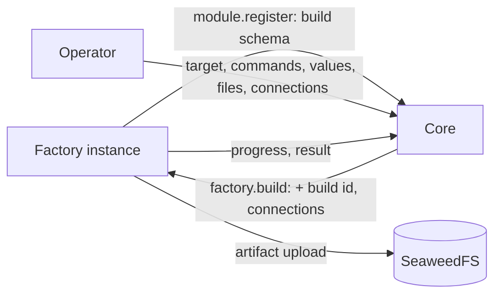
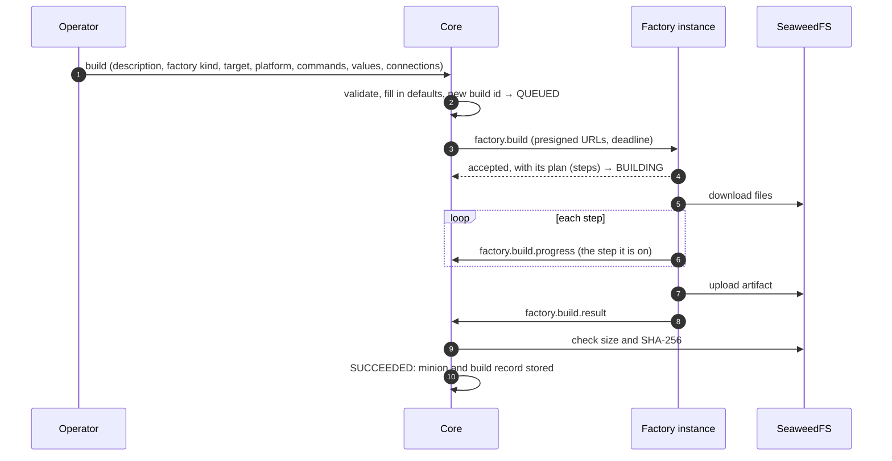

:::note[Payload crypto]
Everything on this page is built (the protocol types, factory-core, core, the
web app, and BOB as the reference factory). Of payload crypto, core generates a
minion's keys for its factory's suite and sends them in the build; encrypting
and decrypting minion traffic waits for the payload crypto contract.
:::

Factories build minions. What a factory can produce, and what each build needs,
depends on the factory: one builds Windows services and Linux binaries, another
only scripts. So **each factory declares it**, as a **build schema** sent at
[registration](../module-lifecycle/#moduleregister), the same way a channel
declares its [connection schema](../minion-connection/). The app builds its
forms from the schema. Core validates what operators enter, adds the minion's
identity, connection settings and payload crypto keys, and asks
the factory to build.



Builds are **asynchronous**: the factory accepts a build at once, reports
progress while it works, and sends the result when it is done. A build can take
minutes, longer than a management action is allowed to run.

## The build schema

Declared in `module.register` under `build`:

```json
{
  "schema_version": "1",
  "version": 1,
  "channels": [
    {
      "module_name": "http", "versions": [2],
      "fields": [
        {
          "key": "method", "type": "enum", "label": "Method", "default": "POST",
          "options": [{ "value": "GET" }, { "value": "POST" }, { "value": "PUT" }]
        },
        {
          "key": "path_prefix", "type": "string", "label": "Path prefix", "default": "/",
          "description": "Every request path starts with it, e.g. /cdn/assets/ when the front forwards only that path.",
          "pattern": "^/[A-Za-z0-9._~!$&'()*+,;=:@%/-]*$", "max_length": 256
        }
      ]
    },
    { "module_name": "dns", "versions": [1] }
  ],
  "crypto": "aes-256-cbc-hmac-sha256",
  "fields": [
    { "key": "kill_date", "type": "datetime", "label": "Kill date", "group": "Limits", "order": 1 },
    {
      "key": "guardrails", "type": "enum_list", "label": "Run only if", "group": "Limits", "order": 2,
      "options": [
        { "value": "domain_joined", "label": "Domain-joined" },
        { "value": "no_debugger", "label": "No debugger attached" }
      ]
    },
    { "key": "debug", "type": "bool", "label": "Debug build", "default": false, "group": "Build", "order": 3 }
  ],
  "targets": [
    {
      "id": "windows-exe", "label": "Windows executable", "format": "exe",
      "platforms": ["windows/amd64", "windows/386", "windows/arm64"],
      "fields": [
        { "key": "icon", "type": "file", "label": "Icon", "accept": [".ico"], "max_size": 262144, "group": "Appearance", "order": 4 }
      ]
    },
    {
      "id": "windows-service", "label": "Windows service", "format": "exe",
      "platforms": ["windows/amd64"],
      "fields": [
        {
          "key": "service_name", "type": "string", "label": "Service name", "required": true,
          "pattern": "^[A-Za-z0-9_-]{1,64}$", "group": "Service", "order": 4
        }
      ]
    },
    { "id": "linux-elf", "label": "Linux binary", "format": "elf", "platforms": ["linux/amd64", "linux/arm64"] },
    {
      "id": "shellcode", "label": "Shellcode", "format": "bin",
      "platforms": ["windows/amd64", "linux/amd64"],
      "channels": [{ "module_name": "http", "versions": [2] }]
    }
  ],
  "commands": [
    {
      "id": "sleep", "label": "Sleep", "required": true,
      "description": "Changes how long the minion waits between check-ins.",
      "params": [
        { "key": "interval", "type": "duration", "label": "Interval", "required": true },
        { "key": "jitter", "type": "int", "label": "Jitter", "unit": "%", "min": 0, "max": 100, "default": 0 }
      ]
    },
    { "id": "exit", "label": "Exit", "required": true },
    {
      "id": "shell", "label": "Run a command", "default": true,
      "params": [{ "key": "command", "type": "string", "label": "Command", "required": true }]
    },
    {
      "id": "download", "label": "Download a file", "default": true,
      "params": [{ "key": "path", "type": "string", "label": "Path", "required": true }]
    },
    { "id": "screenshot", "label": "Screenshot", "targets": ["windows-exe"] }
  ]
}
```

| Field | Meaning |
|---|---|
| `schema_version` | Format of this structure: `"1"`. |
| `version` | Version of the factory's parameter set, from 1. Raised when values saved against the previous set would build something else or fail: a field or target removed, renamed or given another meaning. Adding an optional field or a target does not need it. |
| `channels[]` | At least one: the channel kinds the minions can speak: `module_name`, the connection schema `versions` they read (1 to 16), and optional `fields`, the factory's own [connection parameters](#connection-parameters) for that kind. |
| `crypto` | Optional. The one payload crypto suite the minions implement; core generates each minion's keys for it. Core implements only `aes-256-cbc-hmac-sha256` (AES-256-CBC, then HMAC-SHA256 over the ciphertext) for now and refuses a registration with any other suite (`validation_failed`). |
| `fields[]` | Build parameters shared by every target. Field specs as in a [management manifest](../module-management/#fields), plus the [types below](#field-types-for-builds). |
| `targets[]` | What the factory can produce, at least one. |
| `commands[]` | Optional. What the minions can do. Operators pick each build's [commands](#commands) from its target's. |
| `persisted_sessions` | Optional, `false` by default. The minions can claim a persisted session: built with a `session_id`, they claim it in their `hello` (see [Persisted sessions](../minion-messages/#persisted-sessions)). Operators can build such a minion from a session only for a factory that says so. |

A target:

| Field | Meaning |
|---|---|
| `id` | Identifier, unique in the schema, `^[a-z][a-z0-9_-]{0,62}$`. |
| `label`, `description` | Shown in the UI. |
| `format` | What the artifact is: `exe`, `dll`, `elf`, `so`, `macho`, `dylib`, `bin` (raw shellcode), `script`, `zip`, or another name of the same form. Shown and filtered on; the factory names the file. |
| `platforms[]` | Where the artifact runs, as `os/arch` with Go's names (`windows/amd64`, `linux/arm64`, `darwin/arm64`). `any` stands for either half: `any/any` for a script. Checked by form only, so a new platform needs no protocol release. |
| `fields[]` | Parameters of this target only, added to the shared ones. |
| `channels[]` | Optional. Narrows the factory's `channels` for this target, to kinds and `versions` the factory lists. The connection parameters stay the factory's. |

- Core validates the schema at registration (structure, limits, defaults
  against their own specs) and refuses a registration whose schema is invalid
  (`validation_failed`). Only factories may declare `build`; a registration
  without it clears the stored one. factory-core runs the same check before it
  starts, and does not start with an invalid schema.
- Field keys are unique across the shared fields and each target's own fields.
- Target and command ids are unique; a target's `format` takes the same form
  as an id. Platforms are `os/arch` in lowercase letters and digits, each half
  up to 31 characters, unique in their target.
- Channel kinds are unique, each with its `versions` unique and from 1. A
  target's `channels` name only kinds and versions the factory lists.
- The crypto suite is a slug (`^[a-z0-9][a-z0-9._-]{0,62}$`) that core implements.
- A command's `targets` name only targets of the schema, once each.
- Labels are up to 120 characters and descriptions up to 1,000, as in a
  management manifest.
- Like the connection schema, the build schema belongs to the **factory kind**
  (`module_name`). Core uses the kind's **latest** schema: the highest
  `version` any instance declared, from its most recent registration.

Limits: 32 targets, 64 fields per target (shared ones included), 1 to 16
platforms per target, 1 to 16 channel kinds with 1 to 16 versions each, 32
connection parameters per channel kind, 256 commands, 32
params per command.

### Connection parameters

A channel's [connection schema](../minion-connection/) says how to **reach**
the channel. It says nothing about how a minion family **uses** it: the HTTP
channel accepts any method and any path, so which method a minion sends, and
under which path, is the minion's choice. An operator may need to set that per
connection, for example when a CDN forwards only `/cdn/assets/*` to the channel.

A factory declares such parameters as the `fields` of a `channels` entry. They
are field specs like any other, set **per connection**: the build holds one
set of values for each [connection](#connections) the minion is given.
In the build request, each connection's settings come as an endpoint export,
next to these values with defaults filled in (see [`factory.build`](#factorybuild)).

A parameter may reuse a key of the channel's schema: the two never mix, since
the minion reads each from its own place.

### Field types for builds

Three field types are added. `datetime` and `enum_list` join the shared types,
so management properties and connection schemas can use them too; `file` is
accepted only in build schemas.

| Type | JSON value | Rules |
|---|---|---|
| `datetime` | string, RFC 3339, e.g. `"2027-01-31T00:00:00Z"` | `min`, `max` as RFC 3339 strings |
| `enum_list` | array of option values | each one of `options[].value`, no repeats; `max_items`; `required` means at least one |
| `file` | string: a [build file](#build-files) id | `accept`: up to 32 extensions (`.ico`) or media types (`image/x-icon`, or `image/*` for any subtype), any file when empty; `max_size`: the largest file, in bytes. No `default`. |

`accept` and `max_size` are new field spec members, for `file` only. In the
UI, `datetime` is a date and time picker, `enum_list` a set of checkboxes, and
`file` an upload or a choice from the operation's build files.

### Commands

A minion can do only what was built into it. The factory declares what its
minions **can** do as `commands`, and the operator picks what **this** minion
does when they build it: a minion built for one job carries nothing more.

| Field | Meaning |
|---|---|
| `id` | Identifier, unique in the schema, `^[a-z][a-z0-9_-]{0,62}$`. Builds name the command by it, and so will tasks. |
| `label`, `description` | Shown in the UI. |
| `targets[]` | Optional. Narrows the command to these targets; empty means every target. |
| `default` | Picked in a new build until the operator unpicks it, and what a build that names no commands gets. |
| `required` | In every build of its targets: the minion cannot run without it (`sleep`, `exit`), so the operator cannot leave it out. |
| `params[]` | What a task of the command takes: field specs as in a management action. `file` is refused, as outside build schemas. |

- A build's commands are the ones picked, the target's required ones among
  them, in the schema's order. A build that leaves `commands` out (or sends
  `null`) gets the target's `default` and `required` ones; one that sends an
  empty list gets the required ones only.
- The factory builds those in and no others: what the minion can do is its
  build's `commands`. A factory that cannot build one in fails the build.
- `params` describe tasks, which minions do not take yet; the build form shows
  only what each command is.
- A command removed or renamed needs a new `version`, like a field. Adding
  one does not, a required one included: core adds it to every build of its
  targets.

## Build files

Files for `file` fields (an icon, a signing certificate, a template binary) are
uploaded in the app before building. A build file belongs to an **operation**.
It has an id, a name, a size, a SHA-256 and a media type; its bytes live in
SeaweedFS and never change after upload. `accept` and `max_size` are checked
when the file is used in a value, not at upload, so one file can serve several
fields. Uploads are capped by a core setting (default 64 MiB).

A file is kept while a build record refers to it; an upload nothing refers to is
removed after a day. Deleting an operation deletes its files.

In a build request, a file value stays the file's id, and the request's
`files` holds each file the values name, under its id, with what the factory
needs to fetch it:

```json
{
  "id": "0f9a2c1e-6f1b-4a43-9d4e-2b9b3c1d7e55", "name": "app.ico", "size": 4286,
  "sha256": "9f2c…", "media_type": "image/x-icon",
  "url": "http://logos-seaweedfs-s3:8333/…?X-Amz-Signature=…"
}
```

`url` is a presigned download URL (an HTTP GET), valid until a minute past the
build's deadline. The factory checks the size and SHA-256 after downloading.
Core signs URLs for the storage address factories reach, a core setting
(`BUILD_STORAGE_ENDPOINT`) that defaults to the one core uses. The app uploads
build files with `POST /api/v1/build-files`.

## Connections

A build gives the minion one or more **connections**, in the order the minion
tries them. Each one is:

| Property | Meaning |
|---|---|
| `module_name` | The channel kind, one the target speaks. |
| `name` | Optional. What the minion calls the connection, a slug like an endpoint name, unique among the build's connections. Without one, it is `<channel>-<position>`, e.g. `http-1`. |
| `description` | Optional. The operators' note on what the connection is for, at most 500 characters. Core keeps it with the build record; it is never part of a build request. |
| `settings` | By the channel's [connection schema](../minion-connection/) field key, validated like an endpoint's values. A field without a value takes the schema's default. |
| `values` | The factory's [connection parameters](#connection-parameters) for that channel kind. |

The build form fills a connection in from scratch or from one of the operation's
[endpoints](../minion-connection/#channel-endpoints), picked from a searchable
list: that copies the endpoint's values, its name (made unique among the
connections) and its description, unless the operator wrote their own, for the
operator to change as needed. The other way, **Save as endpoint** keeps a
connection's settings, name and description as a new endpoint of the
operation, for later builds; the factory's parameters stay with the build.
Either way it is a copy: nothing refers back afterwards.

## Building



### What core checks

Before anything is sent, core checks the request against the factory kind's
latest schema:

- the build has a `description`: what it is for, 1 to 500 characters, the
  operators' note (core keeps it, see [Build records](#build-records-and-minions));
- the target exists, and the platform is one of its `platforms`;
- the values follow the field rules (type, bounds, pattern, required, and **no
  undeclared keys**) for the shared fields plus the target's own;
- each command picked is one of the target's, picked once; core adds the
  target's required ones (see [Commands](#commands) for a build that leaves
  `commands` out);
- at least one connection is given (there is no upper limit), each through a
  channel kind the target supports, whose current connection schema `version`
  is one the factory lists, with a `name`, when it has one, that is a slug no
  other connection is called (see [Connections](#connections));
- each connection's settings follow that connection schema, and its values the
  connection parameters the factory declares for that channel kind, by the same
  rules;
- a live instance of the kind declares that latest `version`.

A value of `null`, `""` or `[]` leaves its field unset. Defaults are then
filled in, as in an endpoint export: the factory and the build record get
concrete values, never a schema to interpret. Last, core runs the factory's
own check (`ValidateBuildRequest`, the one factory-core runs) on the request it
would send, so a build it queues is one the factory takes.

### Choosing an instance

Core offers a queued build to the registered instances of its kind that
declare the build's schema version (the latest when the build was made), one
after another, starting at a different instance each time so builds spread
out:

- an instance that replies `busy`, does not answer within 10 seconds, or
  replies without accepting (`accepted` false, or another `build_id`) is
  passed over, and core tries the next one;
- an instance that replies with any other error (`validation_failed`,
  `unsupported_version`, …) refused the build, and core fails it (`refused`);
- when no instance takes it, the build stays `QUEUED`, and core offers it again
  on its next pass, every 2 seconds;
- when no registered instance declares the build's schema version any more,
  and the kind's latest schema is another version, core fails the build
  (`schema_changed`): build it again against the current schema. Under the
  same version it waits, since the instances may be restarting.

How many builds an instance runs at once is the factory's own setting, which
operators change live, and a drained instance replies `busy` to every new build
(see [Managing a factory](#managing-a-factory)). Several core instances share
the queue: one claims a queued build while it offers it, so two never offer the
same build at once.

### Operations

| `type` | Direction | Summary |
|---|---|---|
| `factory.build` | core → factory | Start a build. |
| `factory.build.cancel` | core → factory | Stop a build. |
| `factory.build.progress` | factory → core | Report the step of its plan a running build is on. |
| `factory.build.result` | factory → core | Report how a build ended. |

Core calls the factory on its `rpc_queue` (`logos.factory.rpc.<instance>`), as
for [management](../module-management/#transport). The factory calls core on
`logos.core.rpc`, as for [lifecycle](../module-lifecycle/#transport). All four
are request/reply.

---

### `factory.build`

Request `payload`:

```json
{
  "build_id": "5b0c4f6e-8a1d-4c2b-9e7f-3d2a1b0c9e8f",
  "target": "windows-exe",
  "platform": "windows/amd64",
  "schema_version": 1,
  "values": {
    "kill_date": "2027-01-31T00:00:00Z",
    "guardrails": ["domain_joined"],
    "debug": false,
    "icon": "0f9a2c1e-6f1b-4a43-9d4e-2b9b3c1d7e55"
  },
  "commands": ["sleep", "exit", "shell", "download", "screenshot"],
  "connections": [
    {
      "endpoint": {
        "format": "logos.channel-endpoint.v1",
        "name": "edge-eu",
        "channel": { "module_name": "http", "schema_version": 2 },
        "params": { "base_url": "https://edge-eu.example.com", "tls_verify": false, "request_timeout": "40s" }
      },
      "values": { "method": "POST", "path_prefix": "/cdn/assets/" }
    }
  ],
  "files": {
    "0f9a2c1e-6f1b-4a43-9d4e-2b9b3c1d7e55": {
      "id": "0f9a2c1e-6f1b-4a43-9d4e-2b9b3c1d7e55", "name": "app.ico", "size": 4286,
      "sha256": "9f2c41d0e5a8b7c6d5e4f3a2b1c0d9e8f7a6b5c4d3e2f1a0b9c8d7e6f5a4b3c2",
      "media_type": "image/x-icon",
      "url": "http://logos-seaweedfs-s3:8333/…?X-Amz-Signature=…"
    }
  },
  "crypto": { "suite": "aes-256-cbc-hmac-sha256", "material": { "enc_key": "<base64, 32 bytes>", "mac_key": "<base64, 32 bytes>" } },
  "artifact": { "upload_url": "http://logos-seaweedfs-s3:8333/…?X-Amz-Signature=…", "max_size": 268435456 },
  "deadline": "2026-10-26T14:30:00Z",
  "actor": { "type": "user", "id": "f140266c-…", "name": "admin" }
}
```

| Field | Meaning |
|---|---|
| `build_id` | UUIDv4, the identity of the build and of the minion it makes: every build operation names the build by it, and the minion sends it on the [data plane](../channel-core-sync/), where the channel passes it to core as `Logos-Build-Id`. A repeated `build_id` is the same build. |
| `target`, `platform`, `schema_version` | What to build, against which version of the factory's schema. |
| `values` | Every field of the target that has a value or a default. A `file` field holds the file's id. |
| `commands` | The ids of the [commands](#commands) the minion is built with: those picked, the target's required ones among them, in the schema's order. The minion has these and no others. |
| `files` | The files the values name (connection parameter values included), by id, as in [Build files](#build-files). |
| `connections` | The [connections](#connections), in the order the minion tries them: each one's settings as an endpoint [export](../minion-connection/#the-export) under `endpoint` (its `name`, channel kind, schema version, and `params` with defaults filled in), and its [connection parameter](#connection-parameters) `values`, defaults filled in. |
| `crypto` | Present when the factory declares `crypto`: its `suite` and the minion's key `material`, fresh for every build. For `aes-256-cbc-hmac-sha256`: `enc_key`, the AES-256 key, and `mac_key`, the HMAC-SHA256 key, 32 random bytes each in base64. The factory puts them in the artifact and keeps them nowhere else. |
| `session_id` | Present for a build with a persisted session (only to a factory that declares `persisted_sessions`): the session the minion claims in its `hello`, a lowercase UUID. The factory builds it in. |
| `artifact` | Where to upload the artifact: `upload_url`, a presigned URL to `PUT` it to, valid until a minute past the deadline, and `max_size`, the largest artifact the factory may upload (a core setting, default 256 MiB). factory-core refuses to upload a larger one (`artifact_too_large`). A presigned upload cannot be capped, so core holds the factory to it by its result: see [`factory.build.result`](#factorybuildresult). |
| `deadline` | When core stops waiting: the build timeout after the offer. |
| `actor` | Who started the build, for the factory's own logs. |

The factory validates the request again, as a module validates configuration,
since only it knows its build-time constraints. It replies at once, before
building, with its **plan** for the build:

```json
{
  "build_id": "5b0c4f6e-8a1d-4c2b-9e7f-3d2a1b0c9e8f",
  "accepted": true,
  "steps": [
    { "id": "fetch", "label": "Fetch files" },
    { "id": "compile", "label": "Compile" },
    { "id": "sign", "label": "Sign" },
    { "id": "upload", "label": "Upload" }
  ]
}
```

`steps` are what the factory will do for this request, in order: 1 to 32, each
an `id` (`^[a-z0-9][a-z0-9_-]{0,62}$`, unique in the plan) and a `label` for
the operator (1 to 64 characters, one line). The plan is the build's, not the
target's: a step that will not run for these values is left out. Core shows it
as the build's [pipeline](#the-pipeline). A plan core cannot take (none, or an
invalid one) does not stop the build; it shows as a single step, "Build".

Or the factory replies with an error: `validation_failed` (also for a deadline
already past), `busy`, or `unsupported_version` (the request's `schema_version`
is not the one this instance declares). After `busy` core tries another
instance; any other error fails the build (see
[Choosing an instance](#choosing-an-instance)).
A repeated request for a build it already accepted is accepted again, with the
same plan, and never builds twice; for one that finished, the factory sends its
result again. factory-core remembers a build for an hour past its deadline.

Key material, secret values and files are only for the build. The factory must
not log them, keep them after the build, or put them in progress messages or
the build log.

### `factory.build.progress`

Request `payload`:

```json
{ "build_id": "5b0c4f6e-8a1d-4c2b-9e7f-3d2a1b0c9e8f", "step": "compile", "message": "Compiling windows/amd64" }
```

`step` is the `id` of the step of the plan the factory is now on; reporting
it again changes its optional `message` ("compiling 3 of 10"), and one without
a message clears it. Core keeps when each step was first reported and its
latest message. A step outside the plan is ignored. Progress is best effort: a
lost report is not sent again, and core takes the steps before the one
reported as done, so a lost one only costs a step its times.

`message` is at most 1,000 bytes. Reply `payload`:
`{ "build_id": "…", "ack": true }`. A `not_found` error means core no longer
waits for the build from this instance (it was cancelled, ran out of time, or
is another instance's), and the factory should stop it.

### `factory.build.result`

Request `payload` when the build succeeded:

```json
{
  "build_id": "5b0c4f6e-8a1d-4c2b-9e7f-3d2a1b0c9e8f",
  "status": "succeeded",
  "artifact": {
    "filename": "WinTelemetry.exe", "size": 2412544,
    "sha256": "28afe4a10a4a7d593623dcd1eee11f519b056d2bfdda4c7b0bd7a57fc3a5fc8b",
    "media_type": "application/vnd.microsoft.portable-executable"
  },
  "warnings": ["debug build: strings are not obfuscated"],
  "log": "…"
}
```

and when it failed:

```json
{
  "build_id": "5b0c4f6e-8a1d-4c2b-9e7f-3d2a1b0c9e8f",
  "status": "failed",
  "error": { "code": "compile_failed", "message": "go build exited with status 1" },
  "log": "…"
}
```

- The artifact is uploaded to `artifact.upload_url` before the result is sent.
- What the minion can do is no part of the result: it is the request's
  `commands`, which the factory built in, or it failed the build.
- `warnings` and `log` (the build output, its last 64 KiB) are shown with the
  build; the log matters most when it fails.
- `error.code` is the factory's own, e.g. `compile_failed`: a slug,
  `^[a-z0-9][a-z0-9_.-]{0,62}$`. factory-core reports some
  [codes of its own](../../implementing-a-module/#results-and-failures).
- Limits: up to 32 warnings, each, like `error.message`, at most 1,000 bytes;
  the log at most 64 KiB; the artifact's `filename` a plain file name (no
  path) of 1 to 255 bytes; `sha256` 64 lowercase hex digits. Core refuses a
  result outside them (`validation_failed`).

A failed result finishes the build at once, and so does a succeeded one whose
artifact is larger than the `max_size` the instance was given
(`artifact_too_large`): core deletes the upload unread. For any other
succeeded result, core checks the stored artifact's size and SHA-256 against
the result, in the background, before it marks the build `SUCCEEDED`, reading
no more of it than the size reported. An artifact that is missing or differs
fails the build with `artifact_mismatch`, and a differing one is deleted. When
the store cannot be read, core keeps trying until an hour past the deadline,
then fails the build the same way.

Reply `payload`: `{ "build_id": "…", "recorded": true }`. The factory sends the
result again until it gets a reply or the deadline passes, and a repeated result
is answered the same way. A `not_found` error means core no longer waits for the
build: the factory drops the result.

### `factory.build.cancel`

Request `payload`: `{ "build_id": "…" }`. Reply `payload`:
`{ "build_id": "…", "cancelled": true }`, also for a build the factory does not
know, which it remembers: a `factory.build` for it that arrives later is
accepted and never built. The factory stops the build, throws away what it
produced and sends no result. Core marks the build `CANCELLED` first, whatever
the reply, also when the instance cannot be reached, and answers a result that
still arrives with `not_found`.

---

## Build states

| State | When |
|---|---|
| `QUEUED` | Core accepted the build and waits for a factory instance to take it. |
| `BUILDING` | Offered to an instance, and taken by it. Core marks it before the offer: a factory reports as soon as it accepts, which can be before its reply arrives. An instance that does not take it puts it back to `QUEUED`. |
| `SUCCEEDED` | The result arrived and the artifact checked out. The minion exists from now on. |
| `FAILED` | The factory reported a failure, or core gave up on the build for one of [its own reasons](#error-codes). |
| `CANCELLED` | An operator cancelled it, or its operation was deleted. |

The build timeout is a core setting (default 30 minutes) and applies to the
time a build spends queued and to the time it spends building; `deadline` in
the request is when the latter runs out. An offer an instance turns down
leaves the build's time in the queue as it was.

A factory instance that stops cleanly cancels its running builds and reports
them failed (`shutdown`) before it deregisters, waiting up to 10 seconds for
the reports to go out. Core fails a build still running on an instance that is
no longer registered (deregistered, declared dead or blocked) with
`factory_lost`, on its next pass. A factory that crashes and is back under the
same instance id before core declares it dead has lost its builds without core
noticing: they fail at their deadline (`timeout`).

### The pipeline

The app shows a build as a pipeline of stages: core's **Queued** (until an
instance takes the build), then the factory's plan, then core's **Check
artifact** (from the result to the size and SHA-256 check). Core works the
stages out from the build record whenever it is read:

| State | A stage that |
|---|---|
| `PENDING` | the build has not reached yet. |
| `RUNNING` | the build is in: the step last reported, or the plan's first step once the build is taken and nothing is reported yet. |
| `SUCCEEDED` | is behind the build: every step before the one reported, and every step once a succeeded result arrived. |
| `FAILED`, `CANCELLED` | the build ended in: the step it was on when the factory reported a failure, core gave up on it or an operator cancelled it; Check artifact when the artifact did not check out. |
| `SKIPPED` | the build ended before. |

Queued runs from when the build was made until an instance took it. A step's
times are known when it was reported: it starts at its first report and ends
when the next reported step starts, or with the factory's result (or the end of
the build). A step done without a report has no times, except the plan's first
step, which starts when the instance took the build while nothing is reported
yet. Check artifact runs from the result to the end of the check.

## Build records and minions

Core keeps a **build record** for every build: who started it, when and what
for (its description), the factory kind, instance and version,
`schema_version`, target, platform, values (`file` values as build file ids),
its commands, the connection settings as copied with the operators'
descriptions of them, the factory's plan and step reports, the state, who
cancelled it, and the result: artifact, warnings and log, or the error. It
also keeps the minion's payload crypto suite and keys: sent to the factory
building it, and shown to operators under `crypto` in the build's JSON. A new
build pasted from that JSON ignores them and gets keys of its own.

A successful build creates the **minion**: identified by `build_id`, with its
factory kind, target, platform, who built it, and its build's commands as what
it can do, and core holds its keys. A failed or
cancelled build creates none, and its build id is never used again.

**Every build is a new minion.** Building again from a record opens the build
form filled in from it, so every earlier build is the template for the next:
its description, target, platform, commands, values and connections with theirs, values
equal to today's defaults left out so they read as defaults. The new build gets
a new build id and new keys: two artifacts never share
an identity.

An artifact is kept until an operator deletes it (the build record stays) or
the operation is deleted, which deletes its builds, artifacts, build files and
minions, and cancels its unfinished builds.

An operator can also **delete a build**, whatever its state. An unfinished
build is cancelled first, on its factory too. The build record, its artifact
and the minion it made are removed for good; the operation's build files stay,
and become deletable once no build refers to them. A minion of a deleted build
that is already out can no longer open a session: core no longer has its
keys. Artifacts will hold the minion's
keys, so only operators download them, always as an attachment.

## Who can do what

| Who | Can |
|---|---|
| Viewer of the operation | see its builds, build records, minions and build files |
| Operator or admin of the operation | also upload build files and delete ones no build refers to, build, cancel builds, download artifacts and delete them, delete builds |
| Agent API key | nothing: builds are not on the MCP surface, the only one agent keys reach |

App admins can do everything in every operation, and in the Public operation
every signed-in user counts as an operator.

Every signed-in user also sees the factory kinds: each one's current build
schema, its icon, and how many registered instances declare that schema (a
build needs one). The forms are built from it.

## Managing a factory

A factory is [managed](../module-management/) like any module: it declares
properties, actions and status values in its manifest and can serve the
[live log tail](../module-logs/). Its builds, though, run inside the SDK, so
**factory-core adds a builds section** to every factory's management, next to
what the factory declares itself (or as all of it, when the factory declares
nothing). Core sees an ordinary manifest:

| | Key | |
|---|---|---|
| Property | `max_concurrent_builds` | `int`, `live`, group "Builds", 1 to 64 (or to the factory's own setting, when higher). How many builds the instance runs at once; a `factory.build` beyond it gets `busy`. Starts at the factory's own setting (1 unless it sets one). Lowering it lets running builds finish. |
| Action | `drain` | Risk `high`. Take no new builds (`busy`) until resumed; running builds finish. A repeated `factory.build` for a build already accepted is still accepted. Available while not draining. |
| Action | `resume` | Take builds again. Available while draining. |
| Status | `builds_running` | Builds running now. |
| Status | `builds_accepted_total`, `builds_succeeded_total`, `builds_failed_total`, `builds_cancelled_total` | Since the process started. Cancelled: core cancelled the build or no longer waited for it. |
| Status | `builds_refused_total` | `busy` replies: at the limit, drained or stopping. |
| Status | `last_build_failure`, `last_build_failure_at` | The last failed build's `code: message`, and when (`datetime`). |
| Status | `draining` | `bool`, alert on `true`. |

These keys are taken: a factory's own manifest cannot use them. The Go SDK adds
the section with module-core's `mgmt.Server.Extend`, which runs the factory's
own `ApplyFunc` first, so a change the factory refuses never reaches the
section.

## Error codes

| Code | Used in | Meaning |
|---|---|---|
| `validation_failed` | all | Malformed payload, or a request the factory cannot build. |
| `busy` | `factory.build` | The instance runs as many builds as it may, is drained, or is stopping. |
| `unsupported_version` | `factory.build` | The request's `schema_version` is not the one this instance declares, or the envelope's major version is unknown. |
| `not_found` | `factory.build.progress`, `factory.build.result` | Core no longer waits for this build. |
| `internal_error` | all | Unexpected failure. |

Core's own reasons for a failed build, kept in its record next to the
factory's codes:

| Code | When |
|---|---|
| `timeout` | No instance took the build within the build timeout, or its result had not arrived by the deadline. |
| `factory_lost` | The instance building it is no longer registered: it deregistered, was declared dead, or was blocked. |
| `refused` | The instance offered the build answered with an error other than `busy`. |
| `schema_changed` | No registered instance declares the build's schema version any more, and the factory kind's latest schema is another version. |
| `artifact_too_large` | The result reports an artifact larger than the `max_size` the instance was given. The upload is deleted. |
| `artifact_mismatch` | The artifact the result reports is not in the store, differs in size or SHA-256, or could not be read to check it until an hour past the deadline. |

## Settings

Core's settings for builds:

| Setting | Default | |
|---|---|---|
| `BUILD_TIMEOUT` | `30m` | The [build timeout](#build-states), queued and again building. |
| `BUILD_FILE_MAX_SIZE` | 64 MiB | The largest [build file](#build-files) upload, at most 1 GiB. |
| `BUILD_ARTIFACT_MAX_SIZE` | 256 MiB | The artifact's `max_size` in a build request, at most 1 GiB. A build keeps the one it was offered with. |
| `BUILD_BUCKET` | `logos-builds` | The SeaweedFS bucket for build files and artifacts. |
| `BUILD_STORAGE_ENDPOINT` | core's own S3 endpoint | The storage address presigned URLs are signed for: the one factories reach. |

## In the app and the API

**Builds** lists an operation's builds, newest first and live while they run,
with search and filters by state and factory. **New build** opens the build
form, made from the factory's schema: what to build (description, target,
platform), the commands as two lists, available and selected, with the
required ones fixed in place, the build parameters in the factory's groups,
and the connections; a JSON tab edits the same build as JSON. A build opens on
its **Overview**, with its **JSON** and its **Pipeline** next to it; operators
cancel it there while it runs, download or delete its artifact, **Build
again**, and delete the build (also from the row's menu in the list). A factory's page under Modules shows what it builds: its targets,
build parameters and commands.

The API is GraphQL: the queries `factoryKinds`, `buildFiles`, `builds` (paged,
with the same search and filters), `build` and `minions`, and the mutations
`createBuild` (problems by place in the error's `extensions.problems`),
`cancelBuild`, `deleteBuild`, `deleteBuildArtifact` and `deleteBuildFile`. Bytes go over REST:
`POST /api/v1/build-files` uploads a build file (multipart: `operationId` and
`file`; 413 when it is too large), and `GET /api/v1/builds/{id}/artifact`
downloads an artifact.

## Design notes

- **Targets, not conditional fields.** What differs between a service
  executable and shellcode is mostly which parameters apply. A closed list of
  targets with their own fields is easy to validate and to render. Fields that
  show or hide depending on other values would need every consumer to evaluate
  conditions.
- **The factory states what its minions speak, and core checks it before
  building.** A minion reads one version of a channel's parameters. When a
  channel releases a new connection schema version, a factory that does not
  list it cannot build for that channel until it is updated, and the app says so
  instead of producing a minion that cannot read its own settings.
- **Connection parameters belong to the factory.** How a minion uses a channel
  (which method, which path) is the minion family's behaviour, not the
  channel's: the HTTP channel accepts whatever arrives. Keeping them out of the
  channel schema also keeps endpoints shareable by every factory. They travel
  next to the endpoint export rather than inside it, so a channel that later
  adds a field with the same key changes nothing for minions already built.
- **A build is building before it is offered.** A factory accepts a build and
  starts on it at once, reporting progress as it goes; its reply can reach core
  after its first report. Core therefore records the build as building on an
  instance before offering it there, and puts it back in the queue when the
  instance is busy or does not answer, so no report finds the build not yet
  its instance's.
- **The SDK manages what it runs.** A factory's builds run inside
  factory-core, so only the SDK can count them, refuse new ones or change how
  many run at once. It serves that management itself, with the same keys on
  every factory, rather than leaving each factory to expose its internals.
- **Core owns identity and keys.** Core generates the build id, and will
  generate its keys with payload crypto. The keys will only pass through the
  factory into the artifact: never in a form or a build record.
- **Presigned URLs for files and artifacts.** Factories need no storage
  credentials and reach only the objects of the build at hand, and file bytes
  travel through neither core nor the broker. SHA-256 checks on both sides catch
  a damaged transfer. A presigned upload cannot be capped, so core holds a
  factory to `max_size` by the size its result reports, and never reads more
  of an artifact than that.
- **Asynchronous, with progress and results as calls to core.** A build takes
  minutes, while management actions are synchronous and capped at 60 s. A result
  must be acknowledged, and a factory must learn when core gave up on a build,
  so progress and results are calls to `logos.core.rpc` rather than events on
  `logos.events`, as the [routing conventions](../amqp-conventions/#events-publishsubscribe)
  sketched.
- **Connections hold their own settings.** Endpoints spare retyping, but a
  build often needs a variation of one (another front, a different timeout) or
  a one-off address, and making an endpoint first meant leaving the build form.
  So a build's connection is filled in on the spot, from scratch or from an
  endpoint, and keeps its own copy: changing an endpoint changes nothing
  already built.
- **Notes stay in core.** Whatever a factory gets may end up inside the
  artifact, readable by anyone who captures the minion. A build's description
  and its connections' are the operators' notes ("dry run for the EU front"),
  so core keeps them in the build record and leaves them out of the request,
  the same way an endpoint's description is not part of its export.
- **Every build is a new minion.** Rebuilding the same identity would leave two
  artifacts answering as one minion.
- **Steps declared up front.** A percentage is a guess each factory makes its
  own way, and says neither what is happening nor where a build failed. A plan
  shows the whole build before it runs, and the step it fails in. It comes
  with the acceptance, an answer core always gets, rather than with progress,
  which may be lost: core then works out each stage from what did arrive.
- **Earlier builds are the templates.** Named presets of build settings were
  dropped before release: every build record already holds a complete set of
  settings that built, and Build again starts from it. A second kind of saved
  settings needed its own list, its own checks against changing schemas and its
  own hold on build files, for what a build record already gives.
- **Commands picked per build.** A minion that can do more than its job needs
  is more to find and more to lose when it is caught. So the factory declares
  what its minions can do, and the operator picks what each one does, the way
  they pick its target and values. What a minion can do is then known before
  it is built, from the build record, rather than reported by the factory
  afterwards. How tasks reach a command and what comes back belongs to the
  tasking contract, not written yet; `params` are declared now so a command
  is described whole.
- **`file` only in build schemas.** Only a build hands files to a module. A
  property or an endpoint holding a file would need its own way to deliver it.
