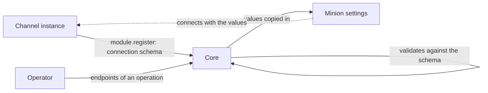

Every minion reaches core through at least one channel. What a minion needs to
know to reach a channel depends on the channel's kind: an HTTP channel needs a
base URL and TLS settings, a DNS channel would need a domain and resolvers. So
**each channel declares the parameters itself**, as a **minion connection
schema** sent at [registration](../module-lifecycle/#moduleregister). Core
stores it, and each operation keeps **channel endpoints**: ready-to-use values
for it that its operators reuse when creating minions.



The channel only provides the schema. It never sees endpoints, and nothing
depends on them: a minion gets its own copy of the values, so changing or
deleting an endpoint changes nothing already configured.

## The schema

Declared in `module.register` under `connection`:

```json
{
  "schema_version": "1",
  "version": 2,
  "fields": [
    {
      "key": "base_url", "type": "url", "label": "Base URL", "required": true,
      "pattern": "^https?://[^/?#\\s]+$", "group": "Address", "order": 1
    },
    { "key": "tls_verify", "type": "bool", "default": false, "group": "TLS", "order": 5 },
    { "key": "request_timeout", "type": "duration", "default": "40s", "min": "31s", "group": "Timing", "order": 9 }
  ]
}
```

| Field | Meaning |
|---|---|
| `schema_version` | Format of this structure: `"1"`. |
| `version` | Version of the channel's parameter set, from 1. Raised when minions built against the previous set would read the new one wrongly: a field removed, renamed or given another meaning. Adding an optional field does not need it. |
| `fields[]` | At most 32, each a field spec exactly as in a [management manifest](../module-management/#fields): `key`, `type`, label, description, group, order, required, default, bounds, pattern, options. |

Core validates the schema at registration (structure, limits, defaults against
their own specs) and refuses a registration whose schema is invalid. A
registration without `connection` clears the stored one.

The schema belongs to the **channel kind** (`module_name`): every instance of a
kind is expected to declare the same one for a given `version`, so it must not
depend on one instance's settings. Core stores it with each registration and
uses the kind's **latest** schema: the highest `version` any instance declared,
from its most recent registration.

The schema describes **what a minion is given**, not how the channel runs. The
channel's own settings are its [management properties](../module-management/).

## Channel endpoints

An endpoint is a ready-to-use set of values for a channel kind's schema,
typically one per address minions use: direct, through a CDN, through a
regional front. Endpoints belong to an **operation**: each operation has its
own set, shared by its members. Within it, an endpoint belongs to a channel
kind, not to an instance, because one address often fronts several instances
and instances come and go.

| Property | Meaning |
|---|---|
| `operation_id` | The operation that owns it. |
| `name` | Unique within the operation (`^[a-z0-9][a-z0-9._-]{0,62}$`). |
| `module_name` | The channel kind whose schema the values follow (e.g. `http`). |
| `values` | By field key. A field without a value uses the schema's default. |
| `schema_version` | The schema `version` the values were saved against. |
| `revision` | Grows with every change; an update must name the revision it read (otherwise `CONFLICT`). |

Values are validated with the same rules as management properties: type,
bounds, pattern, required, and **no undeclared keys**. Validation runs when an
endpoint is saved and again whenever it is read or exported, against the kind's
**latest** schema, because a new channel release may declare a different one.
An endpoint that no longer fits shows its problems and **cannot be used** until
it is fixed.

Endpoint values are operation data and are shown to members as they are,
`secret` fields included.

| Who | Can |
|---|---|
| Viewer of the operation | list endpoints and get their resolved settings |
| Operator or admin of the operation | also create, change and delete them |
| Agent API key | read like a viewer, never write |

Members also see every channel kind with its current schema (kind, version and
fields only — nothing about instances), which the endpoint form is built from.
Deleting an operation deletes its endpoints.

## The export

The endpoint as a minion's connection settings: its values over the schema's
defaults, so a minion needs no knowledge of the schema itself.

```json
{
  "format": "logos.channel-endpoint.v1",
  "name": "edge-eu",
  "channel": { "module_name": "http", "schema_version": 2 },
  "params": {
    "base_url": "https://edge-eu.example.com",
    "tls_verify": false,
    "request_timeout": "40s",
    "checkin_interval": "60s",
    "checkin_jitter": 20,
    "ws_reconnect_backoff": "60s"
  }
}
```

A minion that can speak several channel kinds gets an **ordered list** of
connection settings and falls back through it. Each minion must support at
least one of the kinds it is given. Creating minions with these settings is the
factory's job and is not part of this contract yet.

## HTTP channel, version 2

| Key | Type | Default | Notes |
|---|---|---|---|
| `base_url` | url | required | `http(s)://host[:port]`, **no path**: the channel accepts any path, the minion picks its own. |
| `host_header` | string | — | `Host` to send when it must differ from the base URL's host (CDN, reverse proxy). |
| `sni` | string | — | TLS server name, when it must differ. |
| `proxy` | url | — | Outbound proxy for the minion. |
| `tls_verify` | bool | `false` | Check the certificate against trusted roots. |
| `tls_pin_sha256` | string | — | SHA-256 of the server certificate (64 hex); authenticates the server with verification off. |
| `user_agent` | string (`format: user_agent`) | — | Empty: the minion's built-in one. The UI offers a generator for realistic browser User-Agents. |
| `headers` | string_map | — | Extra headers on every request and WebSocket handshake, name → value (names are header tokens, values have no line breaks; at most 32). |
| `request_timeout` | duration | `40s` | Keep it above the channel's `CORE_SYNC_TIMEOUT` (30s by default): a minion giving up sooner than the channel waits for core drops replies still on their way. |
| `checkin_interval` | duration | `60s` | How often to check in with nothing to send. |
| `checkin_jitter` | int (%) | `20` | Random spread around the interval. |
| `ws_reconnect_backoff` | duration | `60s` | Longest wait between WebSocket reconnects (from 1s, doubling). |

There is no transport, method or path parameter: the channel accepts plain
requests and WebSockets, any method, any path, and the minion is free to use and
switch between them.

## Design notes

- **The channel owns its parameters.** Core cannot know what a DNS or Telegram
  channel needs; a channel can. Reusing the management field specs means one
  validator and one form renderer for both.
- **Ready-to-use values, not configuration.** Endpoints spare operators
  retyping values; the channel does not depend on them and a minion keeps its
  own copy. That is why they can belong to a kind: nothing needs to know which
  instance answers an address.
- **Owned by the operation.** Addresses, fronts and headers differ per
  engagement, and the people who create minions are the operation's members,
  not app admins. The schema stays global: it describes the channel, not the
  operation.
- **Revalidate on read.** A schema changes with a channel's release, not with
  the endpoint. Checking on every read makes a stale endpoint visible before a
  minion is built from it, instead of silently exporting values the channel no
  longer understands.
- **No message size in the schema.** The channel's `max_body_bytes` can change
  after minions are built. Minions choose their own message size; one that sends
  more than the channel accepts fails like any other failure, and the channel
  reports it as `too_large` (log outcome and status counter), so lowering the
  limit too far shows up at once.
- **Defaults resolved in the export.** The minion gets concrete values and never
  interprets a schema; a later change of a default does not change minions
  already built.
