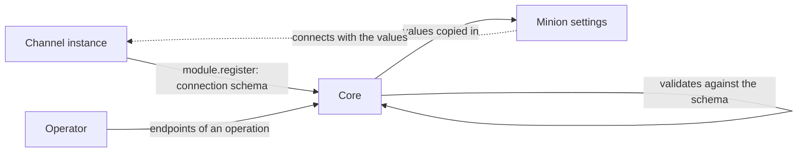

Every minion reaches core through at least one channel. What a minion needs to
know to reach a channel depends on the channel's kind: an HTTP channel needs a
base URL and TLS settings, a DNS channel would need a domain and resolvers. So
**each channel declares the parameters itself**, as a **minion connection
schema** sent at [registration](../module-lifecycle/#moduleregister): for each
[connection kind](../channel-core-connections/) it carries, the full set of
fields a minion connecting that way is given. Core stores it, and each
operation keeps **channel endpoints**: ready-to-use values for one connection
kind of a channel, which its operators reuse when creating minions.



The channel only provides the schema. It never sees endpoints, and nothing
depends on them: a minion gets its own copy of the values, so changing or
deleting an endpoint changes nothing already configured.

## The schema

Declared in `module.register` under `connection`:

```json
{
  "schema_version": "2",
  "version": 3,
  "kinds": {
    "reverse-call": {
      "fields": [
        {
          "key": "base_url", "num": 1, "type": "url", "label": "Base URL", "required": true,
          "pattern": "^https?://[^/?#\\s]+$", "max_length": 2048, "group": "Address", "order": 1
        },
        { "key": "tls_verify", "num": 6, "type": "bool", "default": false, "group": "TLS", "order": 6 },
        { "key": "request_timeout", "num": 10, "type": "duration", "default": "40s", "min": "1s", "max": "10m", "group": "Timing", "order": 10 }
      ]
    },
    "reverse-persistent": {
      "fields": [
        { "key": "base_url", "num": 1, "type": "url", "label": "Base URL", "required": true, "group": "Address", "order": 1 },
        { "key": "ws_reconnect_backoff", "num": 13, "type": "duration", "default": "60s", "min": "1s", "max": "1h", "group": "Timing", "order": 13 }
      ]
    }
  }
}
```

| Field | Meaning |
|---|---|
| `schema_version` | Format of this structure: `"2"`. (`"1"`, one field list for every kind, is gone.) |
| `version` | Version of the channel's parameter set, from 1. Raised when minions built against the previous set would read the new one wrongly: a field removed, renamed or given another meaning, in any kind. Adding an optional field does not need it. |
| `kinds` | The connection kinds the channel carries (`reverse-call`, `reverse-persistent`, `bind-call`, `bind-persistent`), at least one, each with at least one field, in its `fields` or its `target`. |
| `kinds.<kind>.fields[]` | Up to 32, each a [field spec](../field-types/#the-field-description) (`key`, `type`, label, description, group, order, required, default, bounds, pattern, options), with two things a manifest refuses: `num`, which every field has ([Field numbers](#field-numbers)), and the [credential](../credentials/) types `credential` and `credential_list` (with `accept`). `file` is not allowed, nor `advanced`, which only a command's or an action's params take; `when` makes a field depend on one of the kind's enums ([Fields that depend on another](#fields-that-depend-on-another)). A key is used once in a kind, across its fields and its target. |
| `kinds.<kind>.target[]` | Bind kinds only, up to 32: what core needs to reach a minion ([bind-call targets](../channel-core-connections/#bind-call-minions-targets-and-sessions)), field specs as `fields` are, numbered in the same numbering; a target field's `when` names one of the target's own. |
| `kinds.<kind>.max_message` | Optional. The largest minion message (CBOR plaintext) the channel carries each way on a connection of the kind, 1 024 to 786 432 bytes; left out, 786 432 (768 KiB). Core keeps what it sends within it, and gives it to builds ([Limits](../minion-messages/wire-format/#limits)). It counts the plaintext as sent (packed items at their packed size): the [sealed frame](../minion-messages/wire-format/#sealed-frame) adds 51 to 66 bytes, and the transport adds the 16-byte id it is sent under and its own encoding, so size it from what one message of the transport holds less all of that. |
| `kinds.<kind>.delegated_only` | Optional: no instance of the channel carries the kind; only [delegates](../minion-messages/delegation/) do, minions serving its transport on their hosts. Core sends no call or open of the kind to the channel's instances, and a target of it names a delegate. Never with `agentless`. |
| `kinds.<kind>.agentless` | Bind kinds only, optional: the channel acts as the minion on connections of the kind, with nothing on the target ([agentless channels](../agentless-channels/)). Core gives it the keys of each call's and open's id; every other channel never sees a key. The channel's code says it, never an operator or a factory. |
| `kinds.<kind>.max_call` | `bind-call` only, optional: the longest a call of the kind may take, a duration from `1s` to `1h` (`"10m"`). A slow transport (a DNS tunnel, mail) asks for more, a quick one for less. Core keeps each call within it and its own cap, 10 minutes, and says the result as the call's deadline; left out, 2 minutes ([when core calls](../channel-core-connections/#bind-call-minions-when-core-calls)). |
| `kinds.<kind>.max_open` | `bind-persistent` only, optional: the longest an open of the kind may take, a duration from `1s` to `1h` (`"2m"`): the channel's dial and login, the open's deadline; core waits as long again for the minion's first word once the connection's socket is up. A transport slow to set up asks for more. Core keeps each open within it and its own cap, 10 minutes; left out, 30 seconds ([opening and closing](../channel-core-connections/#bind-persistent-connections-opening-and-closing)). |

**Each kind spells out its fields in full**, even where kinds share most of
them: nothing is inherited from another kind or from a shared list. A field
may mean something different per kind (its description says how), and a kind
can gain or drop a field without touching the others.

Core validates the schema at registration (structure, limits, defaults against
their own specs: `protocol.ValidateConnectionSchema`) and refuses a
registration whose schema is invalid (`validation_failed`); channel-core's
`channel.Run` runs the same check before it starts. A registration without
`connection` clears the stored one.

The schema belongs to the **channel kind** (`module_name`): every instance of a
kind is expected to declare the same one for a given `version`, so it must not
depend on one instance's settings. Core stores it with each registration and
uses the kind's **latest** schema: the highest `version` any instance declared,
from its most recent registration. Deregistered, dead and blocked instances
count until an operator deletes them, so after a downgrade the newer schema
stays current.

The schema describes **what a minion is given**, not how the channel runs. The
channel's own settings are its [management properties](../module-management/).

### Field numbers

Every field of every kind has a number, `num`, 1 to 65535, its target
fields too: core refuses a schema missing one, whether anything reads the
channel's fields by number yet or not. A minion built from a [minion
config](../minion-build/#the-minion-config) reads its connection's settings
by them. A key has the same number in every kind, and a kind's fields and its
target's share one numbering (core gives a channel both in one map), so a
number names one key across the schema. Minions keep the numbers they were
built with, so a number stays its field's: a new field takes a number not used
before, and a removed field's is never given to another. A channel's page
under Modules, in the web app, shows each field with its number, a bind
kind's target fields under their own row (GraphQL: `ModuleField.num`).

### Fields that depend on another

A field may apply only while an `enum` of the same list holds certain
values: a way of connecting with settings of its own, such as a proxy's
address only when the minion goes through a proxy. The field says so with
`when`, as an action's or a command's param does ([Field
Types](../field-types/#the-field-description)):

```json
{
  "fields": [
    { "key": "base_url", "num": 1, "type": "url", "label": "Base URL", "required": true },
    {
      "key": "route", "num": 17, "type": "enum", "label": "Route", "default": "direct",
      "options": [{ "value": "direct" }, { "value": "proxy" }]
    },
    {
      "key": "proxy_url", "num": 18, "type": "url", "label": "Proxy URL", "required": true,
      "when": { "key": "route", "values": ["proxy"] }
    }
  ]
}
```

- **One enum of the same list.** `when.key` names an `enum` with no `when`
  of its own: one of the kind's fields for a field, one of its target's for
  a target field. Each of `values` is one of its options. Core refuses
  anything else at registration (`validation_failed`), and `channel.Run`
  makes the same check before it starts.
- **Its value, or else its default.** An endpoint keeps only the values that
  differ from the defaults, so the enum counts with its default when it has
  no value. With neither, it holds nothing, and no field that depends on it
  applies.
- **Shown and checked only while it applies.** The forms built from the
  schema (an endpoint's, a build's connection, a session's connection in
  [`edit_connection`](../task-results-and-actions/#edit_connection) and
  [`add_connection`](../task-results-and-actions/#add_connection), a
  target's) show the field only then, and leave its value out otherwise.
  Core refuses a value for a field that does not apply (`proxy_url: only
  when route is proxy`), and a `required` one is required only while it
  applies.
- **Left out of everything after.** A field that does not apply takes no
  default and goes nowhere: not into an [export](#the-export), a build
  request's connection, the [minion
  config](../minion-build/#the-minion-config), a `connection` value's
  numbered form, or the map a channel gets with a call or an open.
  Factories, minions and channels get the fields that apply, as concrete
  values, the way they get an optional field without a value: none of them
  evaluates a condition.
- **A value it no longer takes.** An endpoint or a target that holds a value
  for a field that no longer applies (a channel release added the `when`)
  shows it as a problem, as any value that no longer fits: the endpoint
  cannot be used, and the target needs editing, until it is saved again.
  The form drops the value.
- **`version`.** A `when` added to a built-in field, or changed, leaves the
  field out where minions got it before: raise `version` when they read it
  as always there (required, or with a default). Target fields change
  without it, as ever.

A channel's page under Modules shows each field's `when` beside its number.

## Channel endpoints

An endpoint is a ready-to-use set of values for one connection kind of a
channel kind's schema, typically one per address and way of connecting minions
use: direct, through a CDN, through a regional front. Endpoints belong to an
**operation**: each operation has its own set, shared by its members. Within
it, an endpoint belongs to a channel kind and a connection kind, not to an
instance, because one address often fronts several instances and instances
come and go.

| Property | Meaning |
|---|---|
| `id` | The endpoint's id (a UUID). |
| `operation_id` | The operation that owns it. |
| `name` | What operators call it: any text on one line, at most 120 characters. Need not be unique. |
| `slug` | The endpoint's identifier, unique within the operation (`^[a-z0-9][a-z0-9._-]{0,62}$`): what an export, a build's connection and a download's file name carry. Core makes it from the name (lowercased, other characters as `-`: "Edge EU (CDN)" is `edge-eu-cdn`), the next free one when that is taken, and makes it again when the name changes. The app never shows it; the API may set one. |
| `description` | Optional, at most 500 characters: what the endpoint is for. Searched; never part of the export. |
| `module_name` | The channel kind whose schema the values follow (e.g. `http`). |
| `kind` | The connection kind (e.g. `reverse-call`): one the channel kind carries. Its fields are the ones `values` follow. Required; an update may change it, with values for the new kind. |
| `values` | By the kind's field key. A field without a value uses its default. |
| `schema_version` | The schema `version` the values were saved against. |
| `revision` | Grows with every change; an update must name the revision it read (otherwise `CONFLICT`). |
| created and updated by and at | Who made and last changed it, and when. |

Values are validated with the same rules as management properties: type,
bounds, pattern, required, and **no undeclared keys** (another kind's field is
undeclared), and by each field's [`when`](#fields-that-depend-on-another).
Validation runs when an endpoint is saved and again whenever it is
read or exported, against its connection kind's fields in the channel kind's
**latest** schema, because a new channel release may declare different ones; a
release that drops the kind leaves the endpoint unusable until it is moved to
another.
An endpoint that no longer fits shows its problems and **cannot be used** until
it is fixed. One saved against another schema `version` than the kind's current
one is flagged ("Saved for vN") but stays usable while its values fit; saving
it again records the current version.

The API stores the values it is sent, leaving out only `null`, `""` and empty
lists or maps; the app's form also leaves out values equal to the field's
default, so those keep following the default.

The list is paged (20 at a time) and sorted by name, case aside. Its search runs
in core: a substring, case aside, or "quotes" for whole words, over the name,
slug, description, channel kind, connection kind and the values. It can also be
narrowed to channel kinds and to connection kinds (a build connection's "Fill
from endpoint" offers only kinds the connection can use).
The GraphQL operations: `channelKinds`, `channelEndpoints`, `channelEndpoint`,
`channelEndpointExport`, `freeChannelEndpointSlug`, and
`createChannelEndpoint`, `updateChannelEndpoint`, `deleteChannelEndpoint`.

Endpoint values are operation data and are shown to members as they are,
`secret` fields included.

| Who | Can |
|---|---|
| Viewer of the operation | list endpoints and get their resolved settings |
| Operator or admin of the operation | also create, change and delete them |
| App admin | the same in every operation, member or not |
| Agent API key | nothing today: agent keys reach core only through MCP, which has no endpoint tools |

In the Public operation every signed-in user counts as an operator.

Members also see every channel kind with its current schema (kind, version,
each connection kind with its fields, and its icon; nothing about instances),
which the endpoint form is built from (a Kind select, then the kind's fields), and so is each connection of a [build](../minion-build/#connections): a
connection can be filled in from an endpoint, or saved as a new one, each a
copy of the values.
Deleting an operation deletes its endpoints.

## The export

The endpoint as a minion's connection settings: its connection kind and its
values over that kind's defaults, so a minion needs no knowledge of the schema
itself. A field with
neither a value nor a default is left out, and so is one that does not apply
([`when`](#fields-that-depend-on-another)); `channel.schema_version` is the
kind's current version. An endpoint with problems cannot be exported: the API
answers `BAD_USER_INPUT` with the problems, and the app disables Copy and
Download as JSON (a download is named `<slug>.endpoint.json`). The export's
`name` is the endpoint's slug: what factories and minions call the
connection; the operators' name for it stays in core, like the description.

A build's connections reach the factory in this format too: each one as the
`endpoint` of a `factory.build` connection, named after the connection
(`<channel>-<n>` when it has no name), next to the factory's own `values` for
it ([Minion Build](../minion-build/#factorybuild)).

```json
{
  "format": "logos.channel-endpoint.v2",
  "name": "edge-eu",
  "channel": { "module_name": "http", "schema_version": 3 },
  "kind": "reverse-call",
  "params": {
    "base_url": "https://edge-eu.example.com",
    "tls_verify": false,
    "request_timeout": "40s",
    "checkin_interval": "60s",
    "checkin_jitter": 20
  }
}
```

`kind` is the connection kind, and `params` are that kind's fields only.
(`logos.channel-endpoint.v1`, without a kind, is gone.)

The app also takes this format back: **Import** on the Endpoints page opens a
new endpoint's form filled in from an export, pasted or from a file, to check
before saving. The export's `name` becomes the endpoint's name (an export
without one gives `imported`), and its slug is made when it is saved; its
`kind` must be one the channel carries; values equal to that kind's current
defaults are dropped so those fields keep following the defaults, keys the
kind does not declare and values of fields that do not apply are left out
(and named), and an export for another
schema `version` is pointed out. An export has no description, so an imported
endpoint starts without one.

**Duplicate** opens a new endpoint's form with an existing endpoint's stored
values and description, named `<name> (copy)`; it gets a slug of its own when
saved.

The endpoint form has **Form** and **JSON** tabs. The JSON tab edits the export's
shape plus the `description` (its `name` is the endpoint's name there, any
text), lists every field of its kind that applies, with its default, takes `null` to reset
a field, and locks `format` and `channel`; changing `kind` switches the fields
`params` holds.

A minion that can speak several channel kinds gets an **ordered list** of
connection settings and falls back through it. Every connection must be through
a channel kind and connection schema version the build's target supports, or
the build is refused; a build needs at least one. Creating minions with these
settings is the factory's job: see [Minion Build](../minion-build/).

## Design notes

- **The channel owns its parameters.** Core cannot know what a DNS or GitHub
  channel needs; a channel can.
- **Fields per kind, in full.** Kinds of one channel mostly share fields, but
  not always, and not always with the same meaning. A full list per kind lets
  one kind change without reasoning about the others, and an endpoint is for
  one kind, so it never carries values a minion connecting that way would not
  read. Reusing the management field specs means one
  validator and one form renderer for both.
- **Conditions core resolves.** A connection kind is one of the transport's
  four, so it cannot tell apart the ways of connecting within it: through a
  proxy or not. `when` says them, on one enum of the same list and one
  level deep, as commands have it. Only core and the app evaluate it: an
  export, a build request, a minion config and a channel's call carry the
  fields that apply as concrete values, so no factory, minion or channel
  evaluates a condition, the cost [Targets, not conditional
  fields](../minion-build/#design-notes) avoids for builds.
- **Ready-to-use values, not configuration.** Endpoints spare operators
  retyping values; the channel does not depend on them and a minion keeps its
  own copy. That is why they can belong to a kind: nothing needs to know which
  instance answers an address.
- **Owned by the operation.** Addresses, fronts and headers differ per
  engagement, and the people who create minions are the operation's members,
  not app admins. The schema stays global: it describes the channel, not the
  operation.
- **Revalidate on read.** A schema changes with a channel's release, not with
  the endpoint. Checking on every read makes a stale endpoint visible before a
  minion is built from it, instead of silently exporting values the channel no
  longer understands.
- **A message size per kind, not the channel's body limit.** `max_message`
  is what a kind's transport can carry at all, for a transport that holds
  less than the protocol's 768 KiB. A build's connection takes it when the
  build is made, and the minion and core keep to that value from then on. A
  channel's own limits are its management properties instead (a largest
  request body, say), and can change after minions are built: a
  minion that sends more than the channel takes fails like any other
  failure, and the channel reports it as `too_large` (log outcome and status
  counter), so lowering the limit too far shows up at once.
- **Defaults resolved in the export.** The minion gets concrete values and never
  interprets a schema; a later change of a default does not change minions
  already built.
