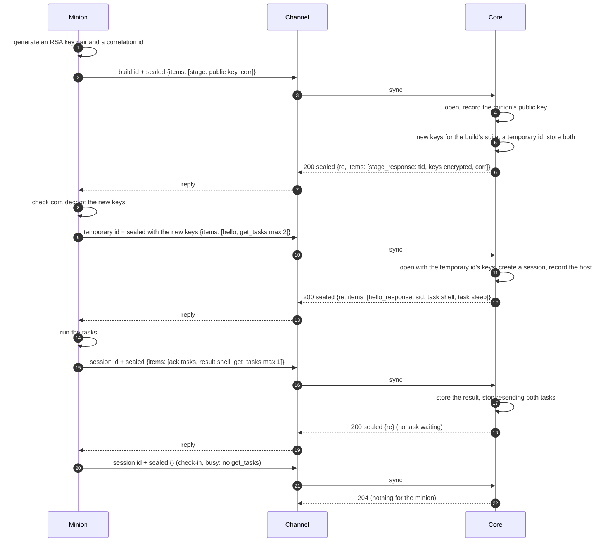

:::caution[Draft]
This page records the design of what travels inside a minion's ciphertext:
how it is sealed, and the CBOR messages within. Built so far: the sealed
frame, the CBOR formats, [staging](#staging), and the hello and the session
(protocol: `SealFrame` / `OpenFrame`, the message types with `stage`,
`stage_response`, `hello`, `hello_response` and `get_tasks`; core: the sync
call's 200 and 422, sessions opened under a temporary id or straight under the
build id, check-ins, `rehello` and `get_tasks` under a session id, the
operation's live Sessions page; BOB's minion stages, says hello, then checks
in with `get_tasks` (max 1) every check-in interval of its connection, with
its jitter, keeps its session through failures on the way and starts over
on `session_closed` or after 24 hours of failures; core keeps closed
sessions as 30-day tombstones and refuses replays with 409). No tasks wait yet, so a
`get_tasks` gets nothing back; under a session core answers any other item
with `unknown_item`: tasks, results, chunks and acks are not built yet.
:::

A minion and core talk in **messages**. The [sync call](../channel-core-sync/)
carries one sealed message per request and at most one per reply; the channel
in between sees only ciphertext. This page defines the two layers inside it:
the **sealed frame** (encryption and authentication with the minion's keys)
and the **message** (one CBOR item).

| Layer | Defined by | Seen by |
|---|---|---|
| Transport (e.g. the HTTP channel's [packed format](https://github.com/LogosCore/logos-http-channel#wire-format)) | each channel | the channel |
| Sync call: the ciphertext as the body, the build id in a header | [HTTP Sync](../channel-core-sync/) | channel and core |
| **Sealed frame**: version, direction, IV, ciphertext, tag | this page | core and the minion |
| **Message**: one CBOR map | this page | core and the minion |

Commands are the factory's: a build schema declares them and their params
([Minion Build](../minion-build/#commands)). Everything else here is core's,
the same for every factory.

## Sealed frame

For the suite `aes-256-cbc-hmac-sha256`, with the minion's `enc_key` and
`mac_key` from its [build](../minion-build/#factorybuild):

```
 0                 16     17                       n−33   n−32        n
 ┌─────────────────┬──────┬────────────────────────┬──────┬───────────┐
 │ IV (16)         │ ver  │ ciphertext (16·k)      │ dir  │ tag (32)  │
 └─────────────────┴──────┴────────────────────────┴──────┴───────────┘
```

| Field | Meaning |
|---|---|
| `IV` | 16 random bytes from a CSPRNG, fresh for every frame. |
| `ver` | `0x01`, this layout. |
| `ciphertext` | AES-256-CBC of the message with `enc_key` and `IV`, PKCS#7 padded. |
| `dir` | `0x01` minion → core, `0x02` core → minion. |
| `tag` | HMAC-SHA256 with `mac_key` over `id ‖ IV ‖ ver ‖ ciphertext ‖ dir`, all 32 bytes. `id` is the 16 raw UUID bytes of the id the message is sent under: the build id, the temporary id or the session id (see [Staging](#staging)). It is authenticated but not sent in the frame. |

A receiver checks, in this order, and drops the frame at the first failure:

1. the length is at least 66 bytes, and the ciphertext (the length minus 50)
   a multiple of 16;
2. `ver` is `0x01` and `dir` is the other side's;
3. the tag, compared in constant time;
4. only then decrypts, and checks the padding.

A frame adds 51 to 66 bytes to its message. Core answers a frame that fails
any check with **422** to the channel (see [Sync call](#sync-call)); a minion
treats a reply it cannot open as no reply.

## Message

The plaintext is one CBOR map, in [CDDL](https://www.rfc-editor.org/rfc/rfc8610).
There are two formats, one per direction: the **minion message** (minion →
core) and the **core message** (core → minion). The frame's `dir` says which
one to parse.

```cddl
minion-message = {      ; minion → core
  v: 1,                 ; this format
  ? id: msg-id,         ; when it starts an exchange
  ? re: msg-id,         ; when it answers one
  ? items: [* minion-item],  ; absent or empty: nothing to say
}

core-message = {        ; core → minion
  v: 1,
  ? id: msg-id,
  ? re: msg-id,
  ? items: [* core-item],
}

msg-id  = bstr .size 16
task-id = bstr .size 16
xfer-id = bstr .size 16
```

A message has **exactly one** of `id` and `re`. The side that starts an
exchange picks an `id` at random (16 bytes from a CSPRNG); the answer carries
it back as `re`. Who starts depends on the module in between:

| Through | Starts the exchange | Its message has | The answer has |
|---|---|---|---|
| a channel (today) | the minion | `id` | `re` (core's message) |
| a [dialer](../../module-types/#3-dialer-modules-planned) (planned) | core; on a lasting connection (SSH, TCP) either side | `id` | `re` (the other side's message) |

Items keep their direction whoever starts: tasks always go core → minion,
results always minion → core. Below, **request** and **reply** mean the
message that starts an exchange and its answer. A message carries any number
of **items**, up to 256, so one check-in can bring several results and one
reply several tasks.

### Items

| `t` | Sent by | Carries |
|---|---|---|
| `stage` | minion | the minion's public key and a correlation id: its first message, see [Staging](#staging) |
| `hello` | minion | the host and process: opens a session (see [Staging](#staging)), and again when core asks |
| `get_tasks` | minion | the minion takes new tasks, and how many at most: see [Asking for tasks](#asking-for-tasks) |
| `result` | minion | one part of a task's output |
| `stage_response` | core | core's answer to `stage`: a temporary id, new keys encrypted to the minion's public key, and the correlation id |
| `hello_response` | core | core's answer to `hello`: the session id |
| `task` | core | a command to run, with its arguments |
| `cancel` | core | stop a running task |
| `rehello` | core | send a `hello` |
| `chunk` | both | one piece of a file transfer |
| `ack` | both | tasks received; transfer progress |
| `err` | both | a problem with an earlier message or item |

```cddl
minion-item = stage / hello / get_tasks / result / chunk / ack / err
core-item   = stage_response / hello_response / task / cancel / rehello / chunk / ack / err

stage = {
  t: "stage",
  key: bstr,            ; the minion's RSA-2048 public key, DER SubjectPublicKeyInfo
  corr: bstr .size 16,  ; correlation id, random
}

get_tasks = {
  t: "get_tasks",
  ? max: uint,          ; at most this many tasks; absent: no limit of the
                        ;   minion's. 0 is invalid.
}

stage_response = {
  t: "stage_response",
  tid: bstr .size 16,   ; temporary id: a UUIDv4, raw bytes
  keys: bstr,           ; new key material for the build's suite, encrypted
                        ;   with RSA-OAEP (SHA-256) under the key from stage
  corr: bstr .size 16,  ; the correlation id from stage
}

hello_response = {
  t: "hello_response",
  sid: bstr .size 16,   ; session id: a UUIDv4, raw bytes
}

hello = {
  t: "hello",
  pid: uint,
  os: tstr,             ; GOOS-style: "windows", "linux", "darwin"
  arch: tstr,           ; GOARCH-style: "amd64", "arm64", "386"
  ? host: tstr,         ; the hostname
  ? user: tstr,         ; exactly as the OS reports it, e.g. "CORP\\svc_backup"
  ? domain: tstr,       ; the host's Windows domain or workgroup
  ? proc: tstr,         ; the process image
  ? integrity: "low" / "medium" / "high" / "system" / "root" / "user",
  ? addrs: [* tstr],    ; local IP addresses
  ? version: tstr,      ; the minion implementation's own version
  ? x: { * tstr => any },  ; the factory's own extras
  ? sid: bstr .size 16, ; the persisted session the build claims: see
                        ;   Persisted sessions
}

task = {
  t: "task",
  task: task-id,
  cmd: tstr,            ; a command id of the minion's build
  ? args: { * tstr => arg },
}

result = {
  t: "result",
  task: task-id,
  seq: uint,            ; 0, 1, 2, …: the parts of one task's output
  ? done: bool,         ; the last part; ok is then required
  ? ok: bool,           ; the minion did what the task asked
  ? out: bstr,          ; output as raw bytes, in the host's own encoding
  ? err: tstr,          ; what went wrong, with ok: false
  ? data: { * tstr => any },  ; structured output, the command's own
  ? exit: int,          ; exit code of the process the task ran: only on
                        ;   the done part, only for commands that ran one
}

cancel = { t: "cancel", task: task-id }

chunk = {
  t: "chunk",
  xfer: xfer-id,
  off: uint,            ; where data starts in the whole
  data: bstr,           ; at most 512 KiB
  ? total: uint,        ; the whole's size: in the first chunk
  ? sha256: bstr .size 32,  ; of the whole: in the last chunk
  ? task: task-id,      ; the task the transfer belongs to
  ? name: tstr,         ; e.g. the file's path: in the first chunk
}

ack = {
  t: "ack",
  ? tasks: [* task-id], ; tasks received
  ? xfer: xfer-id,      ; with next: the receiver has every byte
  ? next: uint,         ;   of the transfer before next
}

rehello = { t: "rehello" }

err = {
  t: "err",
  code: tstr,           ; see Errors
  ? msg: tstr,
  ? item: uint,         ; which item of the message it is about
}
```

A `result` carries what a person reads in `out` and what a program reads in
`data`, and may carry both (`shell`: what it printed, and the exit code):

- **`out`** is the output as raw bytes, as the command produced it: no
  conversion, so a host's code page (866 on a Russian Windows, 850 or 1252 on
  others) and binary output pass unchanged. Core and the UI decode it by
  guesswork, and offer it as a download where it does not decode. stdout and
  stderr may be mixed in it. The parts of a streamed task join in `seq` order
  into one output.
- **`data`** is structured output in a shape the command defines, such as
  `ls` entries or `ps` processes. Core does not check it: a factory handler
  may preprocess it later. Each part's `data` **adds rows** to the earlier
  parts': a key holding an array gets the new elements appended, any other key
  takes the latest value.
- **`ok`** says whether the minion did what the task asked. **`exit`** says
  what the process it ran reported, so a program that exits with 1 is still
  `ok: true`, and a command the minion could not start is `ok: false` with no
  `exit`. Only commands that start a process have one (`shell`, a `run`);
  commands the minion carries out itself (`ls`, `sleep`, `download`) do not.
  A process killed by a signal has no exit code: the minion leaves `exit` out
  and says so in `err`.

In a `hello`, `pid`, `os` and `arch` are required: a minion always knows
them. The rest are optional, since a minion cannot always learn its host or
user (in a sandbox, say). `os` and `arch` use the vocabulary of build
platforms, so core shows them next to the build's platform and flags a
mismatch (a 32-bit build on a 64-bit OS, or any build of an `any/any`
target). `integrity` is Windows' integrity level (`low`, `medium`, `high`,
`system`) or, elsewhere, `root` or `user`. A factory's own fields go under
`x`, so a key core adds later never collides with one of them; the factory
may declare them in its build schema so the UI can label them. Core replaces
all of it when a `rehello` brings new values.

A receiver ignores keys it does not know, so either side can add optional
keys without a new `v`. An item type it does not know gets an `err` with
`unknown_item` and is skipped.

### Arguments

A task's `args` follow its command's params in the build schema. Their types
map to CBOR like this:

| Param type | CBOR |
|---|---|
| `string`, `url`, `secret`, `enum` | text |
| `int`, `bytes` | integer (`bytes`: a byte count) |
| `number` | float |
| `bool` | `true` / `false` |
| `duration` | unsigned integer, milliseconds |
| `datetime` | integer, unix seconds |
| `string_list`, `enum_list` | array of text |
| `string_map` | map of text to text |

Core fills in defaults and checks the arguments against the params before a
task is queued, so a minion gets every arg that has a value or a default. It
checks types again and answers a task it cannot run with a `result`
`{done: true, ok: false, err: …}`.

### CBOR rules

Both sides write, and accept, a subset of CBOR that maps onto JSON and back:

- map keys are text, each once;
- definite lengths only;
- no tags, no `undefined`, no simple values other than `false`, `true`,
  `null`;
- text is valid UTF-8;
- integers and floats in their shortest form.

A reader also enforces limits before it trusts a length: nesting at most 16
deep, at most 256 items in a message, no string or byte string longer than
the bytes left.

## Staging

Every **new process** of a build ends up in a **session** of its own before
it does anything else. Normally it stages first, and the id a message is sent
under changes twice on the way:

| Step | Request sent under | Sealed with | Item | Core answers |
|---|---|---|---|---|
| 1. Stage | build id | the build's own keys | `stage` | `stage_response`: a temporary id and new keys |
| 2. Hello | temporary id | the new keys | `hello` | `hello_response`: a session id |
| 3. Everything after | session id | the new keys | anything | as below |

A build may also **skip staging** and send its `hello` straight under the
build id, sealed with the build's own keys. Core then gives the new session
the build's own keys:

| Step | Request sent under | Sealed with | Item | Core answers |
|---|---|---|---|---|
| 1. Hello | build id | the build's own keys | `hello` | `hello_response`: a session id |
| 2. Everything after | session id | the build's own keys | anything | as below |

All three ids are UUIDv4s and take the same path: the transport carries the
id where it carries a build id (for the HTTP channel, the 16 bytes in its
[packed format](https://github.com/LogosCore/logos-http-channel#wire-format)),
and the channel passes it to core in `Logos-Build-Id`. Channels and
channel-core carry them without knowing staging exists. Core finds the keys
by the id it gets: a session's, a temporary id's, or a build's own. The
frame's tag covers the id the message is sent under.

Under a build id core takes only `stage` or `hello`, and under a temporary
id only `hello`; anything else there gets `bad_message`.

### Stage

1. At start, the minion generates its own **RSA-2048 key pair**. The private
   key never leaves the process.
2. It picks a random 16-byte **correlation id** (CSPRNG).
3. It sends a request whose only item is `stage`: the public key and the
   correlation id, under its build id and sealed with the build's own keys,
   so only a minion of that build can stage.

Core answers with `stage_response`:

4. Core generates **new key material for the build's crypto suite**. For
   `aes-256-cbc-hmac-sha256` (BOB's suite) that is a new `enc_key` and a new
   `mac_key`, 32 random bytes each.
5. It picks a **temporary id** and stores the new key material in the
   **temporary collection** under it, with the build it belongs to, for
   **one day**.
6. It answers with the temporary id, the new key material **encrypted with
   the minion's public key**, and the minion's correlation id.

The minion checks that the correlation id is the one it sent, and decrypts
the key material with its private key. The key material is the suite's own
format, encrypted with RSA-OAEP (SHA-256): for `aes-256-cbc-hmac-sha256` the
CBOR map `{enc_key, mac_key}`, about 80 bytes, well within one RSA-2048 OAEP
operation (190 bytes at most).

A build's own keys stay valid after staging: the same build may run as
several processes, on one host or several, and each one stages on its own.

### Hello and the session

7. The minion sends a request with its `hello`, under the temporary id and
   sealed with the new keys (or, skipping staging, under the build id and
   sealed with the build's own keys).
8. Core opens it with that id's keys, creates a **session** for the minion,
   gives the session those keys, and records the host and process from the
   `hello`. A temporary id's entry is removed at once: it serves one `hello`.
9. Core answers with `hello_response`: the **session id**.

**Every message after that** is sent under the session id and sealed with the
session's keys, for as long as the process runs. A new process of the build
starts over, with a new session, unless its build has a persisted session.

### Persisted sessions

A minion whose host reboots starts again, and would open a new session each
time. An operator who wants it back in the same session builds it **with a
persisted session**: from an existing session, a new build of the same kind
that names that session. Factories that support it say so in their [build
schema](../minion-build/#the-build-schema) (`persisted_sessions`); core
gives the factory the session id in the build request (`session_id`), and
the factory builds it into the minion. One persisted session per build.

- The minion stages as always, then **claims** the session: its `hello`
  carries `sid`, the persisted session's id.
- Core honours the claim when the message is from the build that names the
  session (sent under that build's temporary id, or straight under its build
  id), and the session is open. The session then **takes the claim's keys**
  (the new ones from the stage, or the build's own) and the `hello`'s host
  and process; core answers `hello_response` with the claimed `sid`, and
  records the restart on the session. No session keys are built in: only the
  build's own, as always.
- A claim core does not honour (the session closed, of another build, or
  unknown) **opens a new session** instead, as a `hello` without `sid` does:
  the minion works, and `hello_response` says which session it got.
- **One holder at a time; the newest claim wins.** The process that held the
  session before (the session's original process, or another copy of the
  build) still opens its next message, with the keys it has: core keeps a
  session's replaced keys for 30 days, like a tombstone. It answers, sealed,
  `err` `session_replaced`. That process starts over **without claiming**,
  and carries on in a session of its own: two copies of a build never take
  the session from each other in turn.

### Session lifetime

- A session waits **one day** for its **first check-in**, the first request
  under the session id. A session nobody checks in to within the day is
  **closed**.
- After its first check-in, a session lives **as long as core keeps it**: it
  does not expire.
- Core **closes** a session that expired waiting, and every session of an
  operation that is deleted (later, also one an operator closes). A closed
  session is gone from the operation, but core keeps its id and keys for
  **30 days** (a **tombstone**): a message under it still opens, and core
  answers with a sealed `err`, `session_closed`. After the 30 days core
  forgets it, and its messages no longer open.
- **`rehello`** works under a session: the minion sends a `hello` under its
  session id, core records the new host details, and answers
  `hello_response` with the same session id.

### When an exchange fails

A session's keys live only in the process that staged it, so starting over
never mends a failure on the way; it only leaves a dead session behind. The
minion keeps its session through everything but a word from core:

| The minion gets | It means | The minion |
|---|---|---|
| no reply, a timeout, a refused connection | the channel cannot be reached | keeps the session, and checks in on its schedule |
| any failure from the channel (the HTTP channel's 404) | something went wrong on the way: core down or failing, the channel not registered, a message core did not accept | keeps the session |
| a sealed reply with `err` `session_closed` | core closed the session | starts over |
| a sealed reply with `err` `session_replaced` | another process claimed the persisted session | starts over, without claiming |
| a sealed reply with another `err` | core opened the message and refuses something in it | keeps the session, and logs it |
| a sealed reply | all is well | carries on |

**The channel never says why.** A message core does not open (an id it does
not know, a frame that fails its checks), a replayed message (see
[Freshness and replay](#freshness-and-replay)), and every trouble between
the channel and core look the same to the client: for the HTTP channel, a
404, as for any request that is not a minion message at all. Whoever probes
a channel, with garbage, random ids or a captured message sent again,
learns nothing from the answers. What core has to tell a minion it tells
inside a sealed reply, which only the minion can open and nobody can forge.

**The backstop.** Core can say nothing about a session it no longer knows:
one forgotten after its 30 days, or lost with core's data. So a minion
whose exchanges have **all failed for 24 hours** starts over on its own.

**Starting over** is staging again from the beginning: a new key pair, a new
correlation id, a new `stage` (or a new `hello` under the build id). A
failed stage or hello is tried again on the minion's schedule, with a new
key pair each time.

## How an exchange goes



This is the exchange through a **channel**, where the minion starts every
exchange (a dialer's is an open question):

- **The minion starts.** It sends a message every check-in
  (`checkin_interval` with `checkin_jitter`), or sooner when it has output.
  Core answers.
- **Core answers every message that carries items** with a sealed reply whose
  `re` is the request's `id`, even with no items of its own. Only an empty
  check-in, when core also has nothing, gets **204**.
- **A minion counts its items as delivered only on a sealed reply with the
  matching `re`.** On a 404, a timeout or a 204 to a message with items, it
  sends them again in a later message, under a new `id`.
- **Core sends tasks only when asked** (see [Asking for tasks](#asking-for-tasks)).
  It sends a task again, when asked, until the minion acks it or a result for
  it arrives. The minion keeps the ids of the tasks it received in the last 24
  hours and runs each one once.
- **Results are idempotent** by `(task, seq)`, chunks by `(xfer, off)`, acks
  and hellos as they are, so a resent item changes nothing.
- A long task streams its output as results `seq` 0, 1, 2, …, the last with
  `done`. `cancel` asks the minion to stop it; it still sends a final result.

### Asking for tasks

How many tasks a minion runs at once is the build's business: some run one
at a time, some many. So the minion asks.

- **Core puts tasks in a reply only when its request has a `get_tasks` item**,
  and never more than its `max`. Without `get_tasks` the minion gets no new
  task, whatever else the request carries: a minion that is busy just leaves
  it out.
- **`get_tasks` can share a request** with results, acks, chunks or a
  `hello`, so a minion that finishes a task sends the result and takes the
  next task in one round trip.
- **`max` absent** means no limit of the minion's: core sends what it has,
  within the [limits](#limits) of one message, and the rest in later replies.
  `max: 0` is invalid; a minion that wants nothing leaves `get_tasks` out.
- **Tasks sent before and not yet acked come first** and count toward `max`.
  If a reply with tasks was lost, the minion never got them, still has room
  for them, and gets them on its next `get_tasks`.
- **Only tasks wait for `get_tasks`.** `cancel`, `rehello`, acks, chunks,
  `stage_response` and `hello_response` come whenever core has them, so a
  minion busy with a long task can still be told to stop it.
- **One `get_tasks` per request.** A second one is a `bad_message`.

### File transfers

A file moves in chunks of at most 512 KiB, in either direction: a minion
sending a file core asked for (a `download` command), or core sending one to
the minion. The receiver acks with `{xfer, next}`, the offset it has every
byte before; the sender continues from there, so a transfer resumes after a
restart of either side. The last chunk carries `sha256` of the whole, which the
receiver checks.

## Freshness and replay

Messages carry no time. Core stamps every message with its own receive time.

- **Core** refuses a message whose `id` it has seen in the last 24 hours
  (Redis, like the sync call's dedup): the sync call answers **409**, and the
  channel answers its client as for any failure (the HTTP channel's 404). A
  minion never sends an `id` twice, so only a captured message sent again
  meets this, and it learns nothing: it gets what garbage gets.
- **A reply is fresh** when its `re` is the `id` of a request the sender is
  still waiting on. An old reply, replayed, matches nothing and is dropped.
- **The direction byte** stops a frame from being turned around: both sides
  share the keys, and a core message sent back to core fails `dir`.
- **A minion answering core's requests** (through a dialer) needs no replay
  protection of its own: core does not require it. Without it, a captured
  core message sent to the minion again opens fine and runs its tasks again;
  a minion implementation may guard against that, for instance by
  remembering recent `id`s.

## Errors

| `code` | Sent by | Means |
|---|---|---|
| `bad_message` | both | the plaintext is not a valid minion or core message. |
| `unknown_item` | both | an item type the receiver does not know (`item` says which). |
| `unknown_task` | minion | a `cancel` or chunk for a task it does not have. |
| `too_large` | both | a message or chunk over the limits below. |
| `session_closed` | core | the session the message was sent under is closed (see [Session lifetime](#session-lifetime)): start over. |
| `session_replaced` | core | another process claimed the persisted session (see [Persisted sessions](#persisted-sessions)): start over without claiming it. |

A frame that fails to open gets no `err`: the receiver cannot tell who sent it.
A minion acts on `session_closed` and `session_replaced` alone; other codes
are about the message or an item in it, and the session goes on (see [When
an exchange fails](#when-an-exchange-fails)).

## Limits

| | |
|---|---|
| Message (plaintext) | at most 768 KiB, so a sealed and packed message fits the HTTP channel's 1 MiB default `max_body_bytes` |
| Chunk data | at most 512 KiB |
| Items per message | 256 |
| Nesting | 16 levels |
| Core's replay memory | message ids, 24 hours |
| A closed session's tombstone | 30 days |
| A persisted session's replaced keys | 30 days, the last 4 |
| A minion's backstop | 24 hours of failed exchanges, then it starts over |
| Task ids a minion remembers | the last 24 hours |

Example sizes, CBOR plaintext → sealed → packed by the HTTP channel:

| Message | CBOR | JSON, for comparison | On the wire |
|---|---|---|---|
| empty check-in (busy) | 24 B | 39 B | 99 B |
| check-in asking for one task | 49 B | 75 B | 131 B |
| `hello` | 181 B | 246 B | 259 B |
| reply with two tasks | 165 B | 243 B | 243 B |
| ack + one result with 17 bytes of output | 148 B | 237 B | 227 B |

## Sync call

Two changes to the [sync call](../channel-core-sync/): core answers **422**
when the ciphertext does not open (no keys for that id, or a bad frame or
tag), and **409** for a message whose `id` it has seen (a replay). `Logos-Build-Id` carries the build id, a temporary id or a session id
(see [Staging](#staging)); core looks the keys up by any of them. For both,
a channel answers its client as for any failure (the HTTP channel's 404),
and logs it as the client's fault, not a core error.

## To build

- **Protocol**: the item types, `Seal` / `Open` for the frame, and a CBOR codec
  with the rules and limits above (`fxamacker/cbor`).
- **Core**: open each sync, check freshness, store hellos and results, queue
  tasks per minion and resend them until acked, run transfers, seal replies.
  How operators create tasks and read results is a separate design.
- **A reference minion**: a small Go one, for core's tests and to work the
  flow end to end, as BOB does for builds.

## Open questions

- **Exchanges through a dialer.** What a premade session looks like (a
  session core creates ahead of time, under the build's own keys, so a minion
  that only answers needs no staging), and how `get_tasks` and `hello` work
  when core starts the exchange. On a lasting connection both sides start
  exchanges; `id` and `re` keep them apart. See [Module Types](../../module-types/#3-dialer-modules-planned).
- **Files as task arguments.** Params exclude `file` today. A task that puts a
  file on the host (an `upload` command) would name a transfer that core
  starts in the same reply.
- **Keys per direction.** One key pair serves both directions; the direction
  byte stops reflection. Separate pairs would limit what one leaked direction
  exposes, at the cost of four keys per build.
- **Compression.** Compressing before encrypting saves bytes on text output,
  but leaks through sizes when attacker-chosen data shares a message with
  secrets. Left out unless a command asks for it.
- **Unsolicited data.** Output that belongs to no task (a minion-side monitor)
  would need an `event` item.

## Design notes

- **Why CBOR.** Messages are designed like JSON, but files, screenshots and
  raw command output travel as bytes, with no base64 inside the encryption
  and none outside it either since the [sync call](../channel-core-sync/)
  carries the ciphertext raw. The subset above converts to JSON and back, so
  core can show any message to operators as JSON.
- **Why encrypt-then-MAC with the full tag.** The tag is checked before
  anything is decrypted, so a forged or altered frame never reaches the AES
  padding check, which is the classic way CBC leaks. A 32-byte tag costs 16
  bytes more than a truncated one and leaves nothing to argue about.
- **Why the id is in the tag.** Keys are per build or per temporary id
  already, but binding the id means a frame is valid only under the id it was
  sent with, whatever a channel does to the header.
- **Why the temporary id is a UUIDv4.** It takes the build id's place in the
  transport and in `Logos-Build-Id`, so channels and channel-core carry it
  without knowing staging exists.
- **Why staging hands out new keys.** A staged process talks under keys
  that never left core except encrypted to that process's own RSA key:
  whoever reads the keys out of an artifact can stage on their own, but cannot
  open a staged session's messages. A session that skipped staging uses the
  build's own keys, so anyone with the artifact can read it: skipping trades
  that protection for one round trip less and no RSA in the minion.
- **Why two formats, by direction.** Only three item types go both ways, so
  a schema per direction makes a minion message with a `task`, or a core
  message with a `result`, simply invalid: a frame turned around fails to
  parse even before `dir` is checked. A minion writes only minion messages
  and reads only core messages, so its codec covers half the items. Who
  starts an exchange is kept apart from direction (`id` or `re`), so the same
  formats serve a channel, where the minion starts, and a dialer, where core
  does.
- **Why no time in messages.** Core's own clock is the only one it trusts,
  so it stamps messages as they arrive. The sync call is request and
  response, so a minion needs no clock either to know a reply is fresh: it
  matches `re`.
- **Why idempotent items and resends.** A reply can be lost after core
  processed the request. Rather than exactly-once delivery, every item can be
  sent again safely, and both sides keep resending until the other side
  confirms.
- **Why short ids as bytes.** Ids are 16 random bytes, not text UUIDs: 17
  bytes in CBOR instead of 37.
- **Why milliseconds and unix seconds.** A minion parses integers, not Go
  duration strings or RFC 3339.
