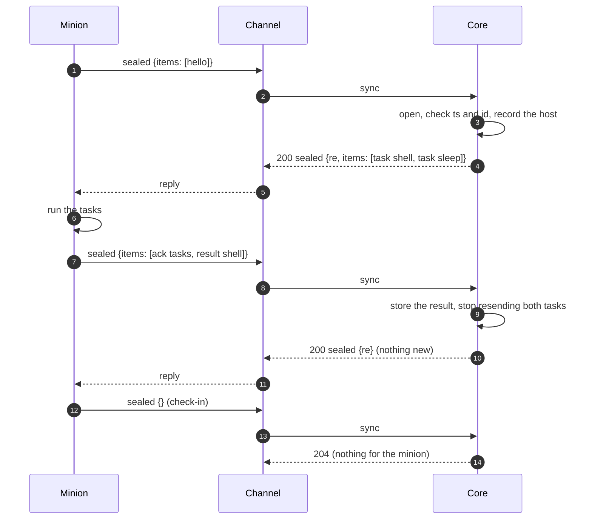

:::caution[Draft]
This page records the design of what travels inside a minion's ciphertext:
how it is sealed, and the CBOR messages within. It is agreed for review, not
built. Today core holds each minion's keys but neither opens nor seals
anything, and answers every sync with 204.
:::

A minion and core talk in **messages**. The [sync call](../channel-core-sync/)
carries one sealed message per request and at most one per reply; the channel
in between sees only ciphertext. This page defines the two layers inside it:
the **sealed frame** (encryption and authentication with the minion's keys)
and the **message** (one CBOR item).

| Layer | Defined by | Seen by |
|---|---|---|
| Transport (e.g. the HTTP channel's [packed format](https://github.com/LogosCore/logos-http-channel#wire-format)) | each channel | the channel |
| Sync call: the ciphertext as the body, the minion id in a header | [HTTP Sync](../channel-core-sync/) | channel and core |
| **Sealed frame**: version, direction, IV, ciphertext, tag | this page | core and the minion |
| **Message**: one CBOR map | this page | core and the minion |

Commands are the factory's: a build schema declares them and their params
([Minion Build](../minion-build/#commands)). Everything else here is core's,
the same for every factory.

## Sealed frame

For the suite `aes-256-cbc-hmac-sha256`, with the minion's `enc_key` and
`mac_key` from its [build](../minion-build/#factorybuild):

```
 0                 16     17                       n−33   n−32        n
 ┌─────────────────┬──────┬────────────────────────┬──────┬───────────┐
 │ IV (16)         │ ver  │ ciphertext (16·k)      │ dir  │ tag (32)  │
 └─────────────────┴──────┴────────────────────────┴──────┴───────────┘
```

| Field | Meaning |
|---|---|
| `IV` | 16 random bytes from a CSPRNG, fresh for every frame. |
| `ver` | `0x01`, this layout. |
| `ciphertext` | AES-256-CBC of the message with `enc_key` and `IV`, PKCS#7 padded. |
| `dir` | `0x01` minion → core, `0x02` core → minion. |
| `tag` | HMAC-SHA256 with `mac_key` over `minion id ‖ IV ‖ ver ‖ ciphertext ‖ dir`, all 32 bytes. The minion id is its 16 raw UUID bytes; it is authenticated but not sent in the frame. |

A receiver checks, in this order, and drops the frame at the first failure:

1. the length is at least 66 bytes, and the ciphertext (the length minus 50)
   a multiple of 16;
2. `ver` is `0x01` and `dir` is the other side's;
3. the tag, compared in constant time;
4. only then decrypts, and checks the padding.

A frame adds 51 to 66 bytes to its message. Core answers a frame that fails
any check with **422** to the channel (see [Sync call](#sync-call)); a minion
treats a reply it cannot open as no reply.

## Message

The plaintext is one CBOR map, in [CDDL](https://www.rfc-editor.org/rfc/rfc8610):

```cddl
message = {
  v: 1,                 ; this format
  id: msg-id,           ; random, unique per message
  ts: uint,             ; the sender's time, unix seconds
  ? re: msg-id,         ; core's replies: the request this answers
  ? items: [* item],    ; absent or empty: nothing to say
}

msg-id  = bstr .size 16
task-id = bstr .size 16
xfer-id = bstr .size 16
```

The sender picks `id` at random (16 bytes from a CSPRNG). A message carries
any number of **items**, up to 256, so one check-in can bring several results
and one reply several tasks.

### Items

| `t` | Direction | Carries |
|---|---|---|
| `hello` | minion → core | the host and process: sent at start, and when core asks |
| `result` | minion → core | one part of a task's output |
| `task` | core → minion | a command to run, with its arguments |
| `cancel` | core → minion | stop a running task |
| `chunk` | both | one piece of a file transfer |
| `ack` | both | tasks received; transfer progress |
| `rehello` | core → minion | send a `hello` |
| `err` | both | a problem with an earlier message or item |

```cddl
item = hello / result / task / cancel / chunk / ack / rehello / err

hello = {
  t: "hello",
  boot: bstr .size 8,   ; random per process start: tells restarts apart
  host: tstr,
  user: tstr,           ; as the OS names it, e.g. "CORP\\svc_backup"
  pid: uint,
  os: tstr,             ; GOOS-style: "windows", "linux", "darwin"
  arch: tstr,           ; GOARCH-style: "amd64", "arm64", "386"
  ? proc: tstr,         ; the process image
  ? elevated: bool,
  ? domain: tstr,
  ? addrs: [* tstr],    ; local IP addresses
  ? version: tstr,      ; the minion implementation's own version
  * tstr => any,        ; anything else the factory's minions report
}

task = {
  t: "task",
  task: task-id,
  cmd: tstr,            ; a command id of the minion's build
  ? args: { * tstr => arg },
}

result = {
  t: "result",
  task: task-id,
  seq: uint,            ; 0, 1, 2, …: the parts of one task's output
  ? done: bool,         ; the last part; ok is then required
  ? ok: bool,
  ? out: bstr,          ; output as raw bytes, in the host's own encoding
  ? err: tstr,          ; what went wrong, with ok: false
  ? data: { * tstr => any },  ; structured output, the command's own
}

cancel = { t: "cancel", task: task-id }

chunk = {
  t: "chunk",
  xfer: xfer-id,
  off: uint,            ; where data starts in the whole
  data: bstr,           ; at most 512 KiB
  ? total: uint,        ; the whole's size: in the first chunk
  ? sha256: bstr .size 32,  ; of the whole: in the last chunk
  ? task: task-id,      ; the task the transfer belongs to
  ? name: tstr,         ; e.g. the file's path: in the first chunk
}

ack = {
  t: "ack",
  ? tasks: [* task-id], ; tasks received
  ? xfer: xfer-id,      ; with next: the receiver has every byte
  ? next: uint,         ;   of the transfer before next
}

rehello = { t: "rehello" }

err = {
  t: "err",
  code: tstr,           ; see Errors
  ? msg: tstr,
  ? now: uint,          ; core's time, with clock_skew
  ? item: uint,         ; which item of the message it is about
}
```

A receiver ignores keys it does not know, so either side can add optional
keys without a new `v`. An item type it does not know gets an `err` with
`unknown_item` and is skipped.

### Arguments

A task's `args` follow its command's params in the build schema. Their types
map to CBOR like this:

| Param type | CBOR |
|---|---|
| `string`, `url`, `secret`, `enum` | text |
| `int`, `bytes` | integer (`bytes`: a byte count) |
| `number` | float |
| `bool` | `true` / `false` |
| `duration` | unsigned integer, milliseconds |
| `datetime` | integer, unix seconds |
| `string_list`, `enum_list` | array of text |
| `string_map` | map of text to text |

Core fills in defaults and checks the arguments against the params before a
task is queued, so a minion gets every arg that has a value or a default. It
checks types again and answers a task it cannot run with a `result`
`{done: true, ok: false, err: …}`.

### CBOR rules

Both sides write, and accept, a subset of CBOR that maps onto JSON and back:

- map keys are text, each once;
- definite lengths only;
- no tags, no `undefined`, no simple values other than `false`, `true`,
  `null`;
- text is valid UTF-8;
- integers and floats in their shortest form.

A reader also enforces limits before it trusts a length: nesting at most 16
deep, at most 256 items in a message, no string or byte string longer than
the bytes left.

## How an exchange goes



- **The minion speaks first, always.** It sends a message every check-in
  (`checkin_interval` with `checkin_jitter`), or sooner when it has output.
  Core can only answer.
- **Core answers every message that carries items** with a sealed reply whose
  `re` is the request's `id`, even with no items of its own. Only an empty
  check-in, when core also has nothing, gets **204**.
- **A minion counts its items as delivered only on a sealed reply with the
  matching `re`.** On a 404, a timeout or a 204 to a message with items, it
  sends them again in a later message, under a new `id`.
- **Core resends a task** in every reply until the minion acks it or a result
  for it arrives. The minion keeps the ids of the tasks it received in the
  last 24 hours and runs each one once.
- **Results are idempotent** by `(task, seq)`, chunks by `(xfer, off)`, acks
  and hellos as they are, so a resent item changes nothing.
- A long task streams its output as results `seq` 0, 1, 2, …, the last with
  `done`. `cancel` asks the minion to stop it; it still sends a final result.

### File transfers

A file moves in chunks of at most 512 KiB, in either direction: a minion
sending a file core asked for (a `download` command), or core sending one to
the minion. The receiver acks with `{xfer, next}`, the offset it has every
byte before; the sender continues from there, so a transfer resumes after a
restart of either side. The last chunk carries `sha256` of the whole, which the
receiver checks.

## Freshness and replay

- **Core** accepts a minion's message when `ts` is within **15 minutes** of
  its own clock and it has not seen the `id` in the last 30 minutes (Redis,
  like the sync call's dedup). A replayed message is dropped (204). A message
  outside the window gets a sealed `err` `clock_skew` with core's `now`,
  and its items are not processed.
- **The minion** keeps an offset to core's clock from the `ts` of every
  reply, and stamps its messages with its own clock plus that offset. A
  minion with a wrong clock thus loses one message to `clock_skew`, then
  agrees with core.
- **A reply is fresh** when its `re` is the `id` of a request the minion is
  still waiting on. An old reply, replayed, matches nothing and is dropped.
- **The direction byte** stops a frame from being turned around: both sides
  share the keys, and a reply sent back to core as a request fails `dir`.

## Errors

| `code` | Sent by | Means |
|---|---|---|
| `clock_skew` | core | `ts` outside the window; `now` is core's time. Nothing was processed. |
| `bad_message` | both | the plaintext is not a valid message. |
| `unknown_item` | both | an item type the receiver does not know (`item` says which). |
| `unknown_task` | minion | a `cancel` or chunk for a task it does not have. |
| `too_large` | both | a message or chunk over the limits below. |

A frame that fails to open gets no `err`: the receiver cannot tell who sent it.

## Limits

| | |
|---|---|
| Message (plaintext) | at most 768 KiB, so a sealed and packed message fits the HTTP channel's 1 MiB default `max_body_bytes` |
| Chunk data | at most 512 KiB |
| Items per message | 256 |
| Nesting | 16 levels |
| Core's clock window | ±15 minutes; replay memory 30 minutes |
| Task ids a minion remembers | the last 24 hours |

Example sizes, CBOR plaintext → sealed → packed by the HTTP channel:

| Message | CBOR | JSON, for comparison | On the wire |
|---|---|---|---|
| empty check-in | 32 B | 55 B | 115 B |
| `hello` | 184 B | 264 B | 259 B |
| reply with two tasks | 193 B | 291 B | 275 B |
| ack + one result with 17 bytes of output | 156 B | 253 B | 227 B |

## Sync call

One change to the [sync call](../channel-core-sync/): core answers **422**
when the ciphertext does not open (no keys for that minion id, or a bad frame
or tag). A channel answers its client as for any failure (the HTTP channel's
404), and logs it as the client's fault, not a core error.

## To build

- **Protocol**: the item types, `Seal` / `Open` for the frame, and a CBOR codec
  with the rules and limits above (`fxamacker/cbor`).
- **Core**: open each sync, check freshness, store hellos and results, queue
  tasks per minion and resend them until acked, run transfers, seal replies.
  How operators create tasks and read results is a separate design.
- **A reference minion**: a small Go one, for core's tests and to work the
  flow end to end, as BOB does for builds.

## Open questions

- **Files as task arguments.** Params exclude `file` today. A task that puts a
  file on the host (an `upload` command) would name a transfer that core
  starts in the same reply.
- **Keys per direction.** One key pair serves both directions; the direction
  byte stops reflection. Separate pairs would limit what one leaked direction
  exposes, at the cost of four keys per build.
- **Compression.** Compressing before encrypting saves bytes on text output,
  but leaks through sizes when attacker-chosen data shares a message with
  secrets. Left out unless a command asks for it.
- **Unsolicited data.** Output that belongs to no task (a minion-side monitor)
  would need an `event` item.

## Design notes

- **Why CBOR.** Messages are designed like JSON, but files, screenshots and
  raw command output travel as bytes, with no base64 inside the encryption
  and none outside it either since the [sync call](../channel-core-sync/)
  carries the ciphertext raw. The subset above converts to JSON and back, so
  core can show any message to operators as JSON.
- **Why encrypt-then-MAC with the full tag.** The tag is checked before
  anything is decrypted, so a forged or altered frame never reaches the AES
  padding check, which is the classic way CBC leaks. A 32-byte tag costs 16
  bytes more than a truncated one and leaves nothing to argue about.
- **Why the minion id is in the tag.** Keys are per minion already, but
  binding the id means a frame is valid only under the id it was sent with,
  whatever a channel does to the header.
- **Why freshness by request and reply.** The sync call is request and
  response, so a minion needs no clock to know a reply is fresh: it matches
  `re`. Only core needs `ts`, and it hands the minion its clock in every reply.
- **Why idempotent items and resends.** A reply can be lost after core
  processed the request. Rather than exactly-once delivery, every item can be
  sent again safely, and both sides keep resending until the other side
  confirms.
- **Why short ids as bytes.** Ids are 16 random bytes, not text UUIDs: 17
  bytes in CBOR instead of 37.
- **Why milliseconds and unix seconds.** A minion parses integers, not Go
  duration strings or RFC 3339.
