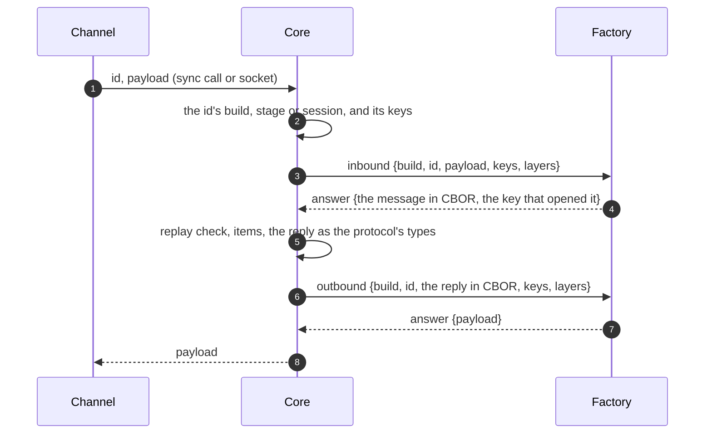

:::caution[Draft: the protocol and core released]
Agreed 2026-11-09, released the same day: the protocol v0.48.1 (the
schema's and the targets' `crypto`, `envelope` and `codec`, the build
request's `envelope`, the JSON envelope, packing in either envelope and the
factory link's frames: [In the protocol package](#in-the-protocol-package))
and core ([In core](#in-core): core's JSON envelope, the factory link and
every message through it). factory-core has the link client too,
v0.3.0 (`pkg/codeclink`: a factory gives `factory.Config` a `Codec` and
`CoreURL`). One factory uses it, [Raven](#raven-the-test-factory), a test
of the mechanics: no factory in use speaks a codec but core's CBOR and suite.
:::

A minion message becomes bytes in two layers. Its **envelope** writes the
message, the item model of these pages, as plaintext; its **suite** seals
the plaintext into the payload a channel carries. Together they are a
build's **codec**. Core implements one of each today:
[CBOR](../wire-format/#message) and the [sealed
frame](../wire-format/#sealed-frame) of `aes-256-cbc-hmac-sha256`.

This page adds a second envelope of core's, **JSON**, for minions written
where CBOR is not at hand, and lets a factory **translate** either layer
itself, for minions that cannot speak core's: its build schema names a
suite or an envelope of its own, and core hands that layer to the factory
over a **factory link**, one call per message each way. A factory that
translates its suite makes that suite's keys too.

What a codec never changes:

- **The item model.** A codec changes how a message is written, never what
  it says: the same items with the same numbered keys and values, the
  same `v` 3, limits, [freshness](../wire-format/#freshness-and-replay) and
  errors. Core reads and writes every message as the protocol's types,
  whatever its codec.
- **The channel's framing.** The payload stays opaque, and the id it is
  sent under stays outside it, where the transport carries it. Channels
  stay plaintext-blind, and a [delegate](../delegation/) carries a frame
  as it is.
- **Who holds the keys.** Core keeps every key and alone knows which id is
  whose; a factory gets the keys of a message it translates, with the
  message.
- **Compression.** [Packed items](../wire-format/#compression) are the
  item model's, not a layer of a codec: a build packs or not (its
  `compression`), whatever its codec, and an envelope writes a packed item
  as it writes any item.

```
inbound   channel ─ id, payload ─▶ core: keys by id ─▶ suite: open ─▶ envelope: decode ─▶ packed items: unpack ─▶ the message
outbound  the message ─▶ items: pack ─▶ envelope: encode ─▶ suite: seal ─▶ core ─ id, payload ─▶ channel
```

Each step is core's, or the build's factory's when it translates that
layer; packing goes with the envelope (below: [the form core hands
over](#the-factory-link)).

## A build's codec

| Layer | Build schema key | Core's | A factory's |
|---|---|---|---|
| Suite | `crypto` (as today) | `aes-256-cbc-hmac-sha256` | `<module_name>.<name>`, e.g. `acme.xchacha` |
| Envelope | `envelope` | `cbor` (the default), `json` | `<module_name>.<name>`, e.g. `acme.xml` |

- **Names.** Core's names have no dot: a name without one that core does
  not have is refused. A factory's own carry its `module_name` and a dot:
  core refuses a registration naming another module's. Both follow the
  suite pattern (`^[a-z0-9][a-z0-9._-]{0,62}$`), so a factory whose
  `module_name` does not fit it names none of its own.
- **Per target.** A target may name its own `crypto` and `envelope`, which
  replace the schema's for its builds: one factory may build a minion in a
  compiled language and one in a script.
- **`codec`**, required when the schema or a target names a factory's
  suite or envelope, refused otherwise:

  | Key | Says |
  |---|---|
  | `growth` | Required. Percent, 100 to 400: how much larger than the form core hands it (below) the factory's bytes come back, at most |
  | `overhead` | bytes, 0 to 4096, on top of `growth`, per message |
  | `timeout` | how long a call may take, a duration (`"2s"`), 100 ms to 30 s: 5 seconds when none is declared |

  ```json
  {
    "crypto": "acme.xchacha",
    "codec": { "growth": 250, "overhead": 200, "timeout": "2s" },
    "targets": [
      { "id": "windows-exe", "format": "exe", "platforms": ["windows/amd64"] },
      { "id": "ps1", "format": "script", "platforms": ["windows/any"], "envelope": "acme.xml" }
    ]
  }
  ```

- **Agentless kinds take core's codec.** An [agentless](../../agentless-channels/)
  kind's channel acts as the minion with core's keys and speaks the
  protocol itself: a target whose codec is not core's CBOR envelope with
  core's suite (a factory's suite or envelope, or `json`) connects through
  no agentless kind.
- **The build keeps it.** Core records a build's suite and envelope with
  its keys and sends them in the build request (`crypto`, as today, and
  `envelope`, left out for `cbor`). A session keeps its build's codec for
  its life.
- **A name is kept while builds use it.** A factory translates every codec
  its builds were made with for as long as their minions live: a changed
  format is a new name.

## The JSON envelope

`json`: the message written as JSON text ([RFC
8259](https://www.rfc-editor.org/rfc/rfc8259)), mapped from the
[CBOR subset](../wire-format/#cbor-rules) one to one:

| CBOR | JSON |
|---|---|
| a map with numbered keys (the message, its items, every structure the [registry](../wire-format/#registry) numbers) | an object whose names are the keys' numbers in decimal: `"0"`, `"3"` |
| a map with text keys (an `x`, a command's own data) | an object with the same names |
| a byte string where the protocol's types say bytes (ids, output, a chunk's data, a frame) | a string, its base64 ([RFC 4648 §4](https://www.rfc-editor.org/rfc/rfc4648#section-4), padded) |
| a byte string where the protocol's types leave the value open: an `x`, a result's `data`, a task's `args` | `{"$b": "<base64>"}`: a name `$b` alone is reserved there |
| text | a string |
| an integer | a number without fraction or exponent, within ±(2⁵³ − 1) |
| a float | a finite number with a fraction or an exponent (`2.0`, not `2`) |
| `true`, `false`, `null`, an array | the same |

- **Read by the protocol's types**, as CBOR is: an item by its type's
  structure, whether a field is bytes, text or a number by its CDDL. An
  object name appears once. An item of a type the reader does not know is
  read as open.
- **Open places** are those whose shape is not the protocol's but a
  command's or a factory's: an `x`, a result's `data` (core's own results'
  too: a `file_download`'s `xfer` is `{"$b": …}` there), a task's `args`
  (a file offer, a credential). There an object whose names are all
  numbers in decimal is a map with numbered keys, and any other a map with
  text keys: a factory's own maps use names that are not all numbers. A
  reader takes `{"$b": …}` wherever bytes go, open or not.
- **Written compact**: UTF-8, no byte order mark, no whitespace; a reader
  accepts whitespace.
- **The same limits**: 256 items, 65 536 elements, 16 levels, and the
  message limit (768 KiB, or the connection's `max_message`) counted in
  the JSON's bytes.
- **Sealed as any envelope**: the suite seals the JSON text as it seals
  CBOR.

A check-in asking for five tasks, `{0: 3, 1: h'000102…0f', 3: [{0: 7, 1: 5}]}`:

```json
{"0":3,"1":"AAECAwQFBgcICQoLDA0ODw==","3":[{"0":7,"1":5}]}
```

Sizes, plaintext (sealing adds the same 51 to 66 bytes to either):

| Message | CBOR | JSON |
|---|---|---|
| a check-in asking for tasks | 28 B | 58 B |
| a reply with two tasks | 77 B | 151 B |
| an ack and a result with 17 bytes of output | 91 B | 181 B |
| a 64 KiB chunk | 65 592 B | 87 487 B (+33 %) |
| a 512 KiB chunk | 524 344 B | 699 155 B (+33 %) |

Core writes a JSON minion's messages itself. It plans them in CBOR within
three quarters of the connection (bytes are a third larger as base64), and
checks the JSON as it writes it: a message past the connection goes with half
its items, the rest waiting for the next. A minion keeps its own within it
too: a 512 KiB chunk fits the protocol's 768 KiB as JSON; a connection that
carries less needs smaller chunks, as it does in CBOR.

**Packed under JSON.** A packed item's data is the item's JSON text,
deflated, and as a byte string it travels as base64. Base64 inside the
deflated text costs DEFLATE part of its gain, and base64 outside adds a
third, so compression is worth less under JSON than under CBOR, though still
much: a result with 200 000 bytes of `ls -laR` output, plaintext:

| | CBOR | JSON |
|---|---|---|
| plain | 200 030 B | 266 738 B |
| packed | 26 908 B | 59 001 B |

## Translating factories

### The factory link

A WebSocket each instance of a translating factory keeps open to core,
beside its control-plane session, as a channel keeps its [control
link](../../channel-core-connections/#the-control-link-and-connection-sockets-formats):
`GET /api/factory/link`, with `Logos-Factory-Instance`, behind the same
registration gate (an instance not registered, dead or blocked gets
**403**). Frames are binary CBOR maps with numbered keys, key 0 the frame's
type; liveness is the control link's (pings every 30 seconds, a socket
silent for 90 dropped), and the factory opens it again, backing off.

| Frame | Direction | Keys |
|---|---|---|
| `inbound` (1) | core → factory | 1 request id; 2 the build id (16 bytes); 3 the id the message came under (16 bytes); 4 the bytes: the payload as the channel gave it (the factory's suite), or the plaintext core opened (its envelope alone); 5 deadline in milliseconds; 6 keys, to a factory's suite only: the candidate key materials, in order, 1 to 5; 7 layers: `[1]` the suite, `[2]` the envelope, `[1, 2]` both |
| `outbound` (2) | core → factory | 1, 2, 3; 4 the bytes: the message in CBOR (the factory's envelope), or the plaintext core's envelope wrote (its suite alone); 5; 6 keys: the one material of the id; 7 layers |
| `keys` (4) | core → factory | 1, 2; 5; 8 for: a build 1, a stage 2; 9 the `stage` item's `key`, for a stage |
| `answer` (3) | factory → core | 1 request id; then one of: 2 the bytes (`inbound`: the message in CBOR, or the plaintext for core's envelope; `outbound`: the payload, or the plaintext its envelope wrote, which core seals); 3 which of key 6's materials opened it, its index from 0 (`inbound`, a factory's suite); 10 the material, and 11 the wrapped material for a stage (`keys`); or 4 a failure, `{1: kind, 2: message}`: not opened 1 (no key fits, or a check failed), not a message 2 (it opened, and does not decode), refused 3 (a stage key it does not take), other 4 |

- **One call per message each way**, whatever the factory translates: it
  runs its layers in order and hands back what core's next step takes, so
  core calls before its own suite or after it, never both.
- **The form core hands over** is the message in CBOR, as
  [Wire Format](../wire-format/#message) writes it, when the factory
  translates the envelope; the plaintext of core's envelope when it
  translates the suite alone. A factory reads and writes that form with
  the protocol package, or any CBOR library of its language; its minions
  never see it.
- **Packing goes with the envelope.** When the factory translates the
  envelope, items cross the link unpacked: core packs nothing for such a
  build, and the factory packs and unpacks in its own format where the
  build has compression on (its schema's `compression` says what its
  minions inflate), handing core its minion's items unpacked (core takes
  packed ones too, as from any minion). When it translates the suite alone,
  packed items are inside the plaintext core's envelope wrote, which the
  factory seals as it is: core packs and unpacks, as for any build.
- **Any instance**: core sends a call to one of the module's instances
  with a link open, the one with the fewest calls waiting. Every instance
  translates every codec the module declares.
- **Request ids** are core's, unique among its calls waiting on that link;
  answers come in any order.
- **factory-core keeps the link** (`pkg/codeclink`): a factory gives
  `factory.Config` a `Codec`, three methods (`Inbound`, `Outbound`, `Keys`),
  and core's base URL (`CoreURL`), and Run keeps the link open, answering
  each call within its deadline. `NotOpened`, `NotMessage` and `Refused` are
  the failures core tells apart; any other error goes as other.
  `codeclink.Answer` runs one call in process, and `factorytest.NewCore` is
  core's end of a real link, for a factory's tests.



### Keys

A factory that translates its suite makes that suite's keys: core cannot
make keys for a suite it does not know.

- **A build's keys**: before it sends a build request, core asks `keys`
  for a build, keeps the material, and sends it in the request's `crypto`
  (`suite`, `material` base64), as it sends its own suite's today.
- **A stage's keys**: the [`stage`](../sessions/#stage) item's `key` is the
  suite's to define (RSA-2048 for core's suite). Core passes it in `keys`
  for a stage, keeps the material under the temporary id, and puts the
  wrapped material in `stage_response`'s `keys`. A suite without staging
  answers `refused`, and its minions say `hello` under the build id.
- **Candidates**: for an inbound message core sends the materials the id
  may open with, in order: the id's own, then a persisted session's
  [replaced keys](../sessions/#persisted-sessions), newest first. The
  answer says which opened it, so core tells a replaced holder
  `session_replaced` as it does today.
- Material and wrapped material are at most 4 KiB each; core keeps them as
  it keeps its own suite's, and never shows them.

### Sizes

Core fills each message it sends a minion to the connection's room. For a
codec it writes itself it counts the bytes; for a factory's it plans by the
declaration: a message of `n` bytes, in the form core hands over, comes back
at most `n × growth / 100 + overhead`, kept within the connection's
`max_message` (and the protocol's 768 KiB). An XML envelope with base64
bytes might declare `growth` 250 and `overhead` 200. The form is unpacked
when the factory translates the envelope, so `growth` bounds its bytes
before any packing of its own: packing only takes them under the bound.

- **An answer past its bound** is not sent: core sends the message again
  with half its items (the rest wait for the next), and logs that the codec
  outgrew its declaration. A message of one item still past it is not sent:
  its exchange fails as when the factory does not answer.
- **Inbound**, the message as the factory hands it to core is held to the
  protocol's limits; how large it was on the wire is the channel's.

### When the factory does not answer

No link open, the call past its `timeout`, or the link dropping with the
call waiting:

| Waiting | Core |
|---|---|
| a minion's message (`inbound`) | treats it as a message it cannot open: the sync call answers **422**, and the channel answers its client as for any refusal; a socket's frame is dropped. The minion retries as after any failed exchange, and loses nothing: it keeps what was not acknowledged |
| a reply, or a message core starts (`outbound`) | does not send it: the reply's exchange fails as above; pushes, calls and opens wait in the outbox for the link |
| a build's or a stage's keys | the build waits in the queue, asked again each time its lease runs out (2 minutes), and fails at its queue deadline; the stage is not answered |
| a reply already kept for a message seen again | sends it: it is sealed already |

Core shows it on the session (its factory does not answer, since when),
and clears it once the factory answers.

## Mechanics by connection kind

The same on every kind, for the index's
[table](../#mechanics-by-connection-kind): a codec runs at core's edge,
between the channel and the conversation. Each message costs one factory
call each way when the factory translates; while it does not answer, what
core starts waits, and what the minion sends is refused.

## Trust

- **The factory sees its builds' sessions** in plaintext, with their keys,
  when it translates: it already writes each build's keys into its
  minions, so it could open their staging, and their sessions, before.
  Core sends a call only to an instance of the build's own factory module,
  never another.
- **The link carries keys and plaintext**: it has the control link's gate,
  and channel authentication, when it comes, applies to it too; encryption
  between core and its modules is the deployment's.
- **A factory's suite is its own to get right.** Core does not check it;
  the build shows the suite's name and that it is the factory's.

## Limits

| | |
|---|---|
| A codec name | the suite pattern, at most 63 characters; a factory's `<module_name>.<name>` |
| `growth` | 100 to 400 percent |
| `overhead` | 0 to 4096 bytes |
| `timeout` | 100 ms to 30 s, 5 seconds by default |
| Key material, wrapped material, a stage's key | 4 KiB each |
| Candidate keys in an `inbound` call | 5: the id's own and a persisted session's last 4 replaced |
| A factory link frame | the message limit grown by the most a codec may declare, plus 64 KiB: 3 215 360 B |
| A JSON integer | ±(2⁵³ − 1) |

## In the protocol package

`logos-golang-protocol`'s `protocol` package, v0.48.1 (v0.48.0 did not build
for 32-bit platforms):

| Go | What |
|---|---|
| `BuildSchema.Envelope`, `.Codec` (`BuildCodec`); `BuildTarget.Crypto`, `.Envelope`; `BuildRequest.Envelope` | the declarations; `ValidateBuildSchema` checks names and `codec` |
| `BuildSchema.TargetCodec`, `Codec.Layers`, `.Agentless`; `BuildCodec.Bound`, `.CallTimeout` | a target's codec, what its factory translates, the size bound, the call's timeout |
| `ValidateCodecOwner(schema, module)`, `ValidateAgentlessCodecs(schema, isAgentless)` | the checks that need the module or the channels' schemas: core's at registration |
| `JSONEnvelope`, `CBOREnvelope`, `CoreEnvelope(name)` | core's envelopes: a message or an item, CBOR to the envelope's form and back |
| `PackIn`, `UnpackIn`, `UnpackRoomIn`, `UnpackItemsIn` | packing in either envelope; `Pack` and the rest are CBOR's |
| `FactoryCall`, `FactoryAnswerFrame`, `EncodeFactoryCall`, `DecodeFactoryAnswer` (and back), `FactoryLinkPath`, `HeaderFactoryInstance` | the factory link's frames and their checks (`ValidateFor`: an answer against its call) |

## In core

`logos-core`, released 2026-11-09 (9c68d41, a645db7):

| Where | What |
|---|---|
| `pkg/factorylink` | The hub: a link per factory instance, a call to the one with the fewest waiting, answers by request id checked against their call; no link, a dropped link or no answer in time is the factory not answering |
| `GET /api/factory/link` (`controller/factory_link.go`) | The endpoint, behind the sync call's registration gate: 403 for an instance that is not a registered factory |
| `pkg/minionsync/codecs.go` | `readMessage` and `writeMessage`, which every message goes through (a sync call, a socket, a push, a call to a bind minion): core's layers, one factory call each way for the factory's; candidate keys and replaced holders; a stage's keys; the session's `codecDownSince`; `planLimit` |
| `pkg/builds` | A target's codec kept on the build (`envelope`, `codec`), a factory suite's keys asked at the offer, the request's `envelope`, a codec an agentless kind cannot speak refused |
| Registration | A suite without a dot core does not implement, and a factory's name of another module, refused |
| GraphQL and the web app | `Build.envelope`, `Build.codec`, `BuildTarget.crypto`/`envelope`, `MinionSession.codecDownSince`; the build overview's Codec row and the session's Codec notice |

## Raven: the test factory

`logos-raven` (v0.1.0) runs the mechanics end to end with a minion that cannot speak
core's codec: PowerShell scripts (Windows PowerShell 5.1, PowerShell 7)
that check in through the HTTP channel (`reverse-call`) and do two things,
`hello` and `echo`. Both layers are Raven's:

- **`raven.clixml`**, the envelope: a message as PowerShell's own CLIXML,
  what `PSSerializer` writes and reads, so the script needs no encoder.
  The protocol's maps are Hashtables, numbered keys `Int32` (`Int64` past
  it), byte strings `byte[]`, arrays `Object[]`. Raven reads it as CBOR and
  writes core's CBOR as it, both ways typed, so nothing is guessed.
- **`raven.raven`**, the suite: a lie to core. It seals nothing: Raven makes
  each build's keys and the candidates arrive with every call, but the
  script sends its CLIXML in the clear, and the first key "opens" every
  message. It protects nothing, and exists to test the mechanics.
- **`codec`**: growth 400 %, overhead 4096 B (CLIXML is some 20 times CBOR on
  a small message, a third more on bytes; core sends fewer items when a
  message outgrows it). No staging: Raven answers `refused`, and its
  minions say hello under the build id. No compression.

Run end to end on 2026-11-09 against the dev stack: a build's keys made by
Raven at the offer, a session opened under the build id, `hello` and
`echo` (text with XML's specials, a literal `_x000A_`, a newline and an
emoji) answered exactly; with Raven stopped, the minion's messages refused
(the channel's 404) and the session flagged, cleared once Raven was back.
The same day on Windows 11 under Windows PowerShell 5.1, a session played by
hand through the HTTP channel.

## Open questions

- **A codec per connection.** A build's codec is the same on all its
  connections; a transport that carries little might want a denser one
  than the build's others. Left out until a channel needs it.

## Design notes

- **Why compression is not a third layer.** A factory never needs to take
  it over for minions that cannot do core's: it is optional, so a factory
  whose minions cannot inflate DEFLATE declares no `compression`, and its
  builds pack nothing. A factory that translates its envelope already packs
  in its own format, as part of writing its messages, with no call of its
  own. And packing is per item, as core fills a message: a factory's
  algorithm could not pack an item without a call per item. Another
  algorithm, when minions want one, is a number in the protocol for every
  factory and core alike, as DEFLATE is.

- **Why two layers.** Formats and crypto change for different reasons. A
  minion with AES but no CBOR keeps core's suite and translates its
  envelope, or takes core's JSON; one with its own crypto and CBOR at
  hand translates the suite alone.
- **Why one call each way.** Four hooks, two layers by two directions,
  would be two round trips per message each way when a factory translates
  both. The build says which layers are the factory's; one call runs them
  in order.
- **Why the factory makes its suite's keys.** Core cannot make keys for a
  suite it does not know, nor wrap them for a key exchange it does not
  know. It still keeps every key: which id is whose, a session's replaced
  holders and when keys expire stay core's.
- **Why CBOR across the link.** Core reads one form, its own; the factory
  writes it with the protocol package or any CBOR library, once, in core's
  direction only.
- **Why growth is declared.** Core fills a message by sizes it computes,
  and cannot compute a factory's. Asking the factory to measure would take
  several calls per message; a declared bound takes none, and an answer
  past it costs one more.
- **Why a JSON envelope in core.** Most of the languages a minion is
  written in read JSON natively (PowerShell, PHP, JavaScript, Python), and
  core's needs no factory in the message's path. It keeps numbered keys, so
  a minion still carries no names. Bytes cost a third more as base64, small
  messages about double.
- **Why names carry the module.** A factory's names never meet a suite or
  envelope core adds later, and a session's codec says whose it is.
- **Why a link, not the control plane.** Builds go over AMQP and take
  minutes; a codec call is in every message's path and must take
  milliseconds. The link is a channel's control link, for factories.
- **Why not WebAssembly yet.** A factory could give core its codec compiled
  to WebAssembly, run in core: no hop, and no dependency on the factory
  being up. It asks more of factory authors; the link is enough until a
  codec's hop costs too much.
- **Why a factory that does not answer means a refusal.** Core cannot tell
  a message it has no way to open from one it could not open; both get the
  channel's refusal, and the minion retries as after any failed exchange.
