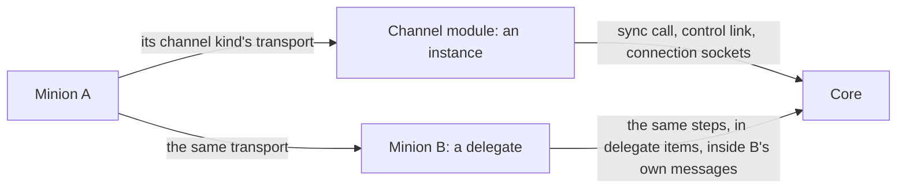
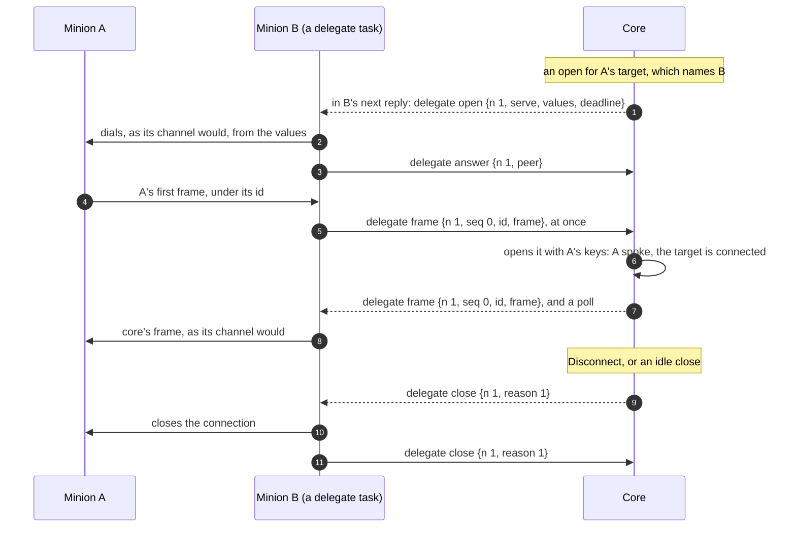

:::caution[Draft]
A design agreed 2026-11-08: nothing is built. The protocol only: what a
delegate is, who declares what, the `delegate` item, the delegate's two
actions, and what core does with what they carry. Core's records and the
web app come with the build.
:::

Core reaches a minion's connection through an **instance** of the
connection's channel kind: a channel module, registered, carrying the
kind's transport between the minion and core. **Delegation** gives core a
second kind of instance: a **delegate**, a minion of the operation that
serves a channel kind's transport on its own host while a task of its
runs, and carries what a channel module would say to core inside its own
messages, in `delegate` items. The minion it serves, the **delegated
minion**, is not changed and is not told: it speaks its connection's
channel kind as it always does, and cannot tell a delegate from the
module.



So delegation is not a kind of minion, nor a channel kind of its own: it
is one more way core reaches a connection of any channel kind, beside that
kind's module. Below, **A** is the delegated minion and **B** its delegate.

- **Any channel kind, any connection kind.** What a channel says to core is
  the same for every transport: the [sync
  call](../../channel-core-sync/) for `reverse-call`, the [control
  link](../../channel-core-connections/#the-control-link-and-connection-sockets-formats)'s
  `call` and `open` for `bind-call` and `bind-persistent`, [connection
  sockets](../../channel-core-connections/#three-paths) for both persistent
  kinds. A delegate carries those steps, so it serves any kind of any
  channel whose transport its factory implements.
- **A is built as it always is.** Whether core reaches it through the
  module or through a delegate is chosen where it is reached: a bind
  target names a delegate, or none; a reverse minion's settings give the
  address it dials, the module's or a delegate's.
- **B never reads A's messages**: they stay sealed with A's keys end to
  end, as a channel carries them, and B sees what a channel sees.

## Who declares what

| Piece | Declared by | Says |
|---|---|---|
| A channel kind | its channel module, at [registration](../../minion-connection/) | the kind's transport, its connection schema by kind, and whether its own instances carry a kind or only delegates do (`delegated_only`, below) |
| What A speaks | A's factory, its build schema's [`channels`](../../minion-build/#the-build-schema) | as today: the channel kinds and connection kinds its minions speak, the minion's side of each transport |
| What B serves | B's factory: a command whose action is `delegate` or `reverse_delegate`, with `serves` | the channel kinds and connection kinds its minions serve, the channel's side of each transport ([The delegate's tasks](#the-delegates-tasks)) |
| Where A is reached | the operator | a bind kind: the target's fields as always, and its **delegate**, a session, or none; a reverse kind: A's settings, the address of what serves it |

**A transport's format is its channel's**, documented by whoever develops
the channel: the side a minion speaks and the side a delegate serves are
the same format from its two ends, which each factory writes for every kind
it speaks or serves. Channels by different developers may share a format or
not; the protocol keeps none.

**`delegated_only`**, a connection schema kind's flag, optional: no
instance of the module carries the kind; only delegates do. Core sends no
`call` or `open` of the kind to the module's instances, a bind target of
it must name a delegate, and the endpoint form says a reverse one's address
is a delegate's. A module may declare a transport it cannot carry from
where it runs (one that exists only inside a host or its network), and drop
the flag in a later release that carries it.

**`serves`**, a command's, for the two actions alone: the channel kinds its
minions serve, each `{module_name, versions, kinds}` as a build schema's
`channels` names them (`versions`: the connection schema versions it
reads), at most 16. `delegate` names bind kinds, `reverse_delegate`
reverse ones. **Agentless kinds are not delegated**: an
[agentless](../../agentless-channels/) kind's channel is the minion, and
keys never go to a minion, so `serves` never names one. A target
narrows it, as it narrows `channels`.

## The delegate's tasks

Two of core's [actions](../../task-results-and-actions/), by who starts
what the task carries, as `tunnel` and `reverse_tunnel` are. While a task of
either runs, B is an instance of every kind its command serves. A task's
exchanges and connections are all one side's: in a `delegate` task core
starts them and numbers them, in a `reverse_delegate` task B does.

| Action | Serves | B | Started by |
|---|---|---|---|
| `delegate` | bind kinds | takes core's calls and opens, calls or dials the target each names, and relays | core, when a target that names B needs one and none runs (the first command serving the kind); or an operator |
| `reverse_delegate` | reverse kinds | listens as its command's params say, takes the requests and connections minions bring, and relays | an operator |

- **Its own params are the factory's**: where to listen and how, for a
  reverse one (a transport's server side is its channel's own business,
  never in a connection schema), each required or with a default. A
  `delegate` task needs none: each call and open carries its values.
- **Core adds `stop_idle`** to both, as to a tunnel (a duration, never sent
  to the minion): core stops the task once nothing went through it that
  long, `1h` by default for `delegate`, never for `reverse_delegate`.
- **No result, no place in B's max tasks**: the task's view is core's
  (what it carried, each session through it). Their `kinds` leave out
  `bind-call`: a page runs no task between calls.
- **The task ends, and with it everything it carries**: B closes its
  connections, gives up its exchanges, and stops listening. Its session
  closing or replaced (`session_replaced`) ends it in core.

## The item

One item carries every step, both ways. Its keys 1 to 13 are those of the
control link's frames, for the same things.

```cddl
delegate = {
  0: 29,                ; t: delegate
  15: task-id,          ; task: the delegate or reverse_delegate task
  16: uint,             ; step: what this is (below)
  1: uint,              ; n: the exchange or the connection, from 1, the
                        ;   starting side's (core's in a delegate task,
                        ;   the delegate's in a reverse_delegate task),
                        ;   never reused within the task
  ? 17: uint,           ; serve: which of its command's serves, from 1:
                        ;   on a call and an open, a sync, and a
                        ;   connection's first frame from the delegate
  ? 2: { * tstr => any },  ; values: call, open: the build connection's
                        ;   and the target's, by the keys the channel
                        ;   declared
  ? 3: bstr .size 16,   ; id: the id the frame is sent under: a build id,
                        ;   a temporary id or a session id
  ? 4: bstr,            ; frame: the sealed frame, or a piece of it; the
                        ;   delegate never reads it
  ? 18: uint,           ; seq: a connection's frame, its number in its
                        ;   direction, from 0
  ? 19: uint,           ; off, and
  ? 20: uint,           ;   size: a frame in pieces: where this piece
                        ;   starts, and the whole frame's length
  ? 5: uint,            ; deadline: call, open: milliseconds, the
                        ;   transport's, from when the delegate takes it
  ? 6: uint,            ; status: answer: the transport's (an HTTP
                        ;   status); reply: the sync call's (200 with a
                        ;   frame, 204 nothing for the minion, else a
                        ;   refusal: 409, 413, 422)
  ? 7: { 1: uint, 2: tstr },  ; failure: answer: unreachable 1, timeout 2,
                        ;   TLS 3, other 4, and why
  ? 8: bstr,            ; head: answer: the first 512 bytes of what
                        ;   answered, when it is not a minion message
  ? 9: bstr,            ; peer: the minion's address as the delegate saw
                        ;   it, 4 or 16 bytes
  ? 10: bstr .size 16,  ; under: open: the id the minion speaks under
  ? 12: { * tstr => any },  ; credentials: call, open: those of the
                        ;   values' credential fields, by id
  ? 13: [* { 1: tstr, ? 2: true }],  ; logins: answer: how each
                        ;   credential fared, in order (true: taken)
  ? 21: uint,           ; reason: close (below)
  ? 22: tstr,           ; msg: close, for a person, 256 bytes at most
}
```

Keys 11 and 14, the control link's keys and acting identity, are an
agentless kind's alone: never in this item.

| `step` | Name | From | Carries | As a channel's |
|---|---|---|---|---|
| 1 | `sync` | delegate | n, serve, id, frame, peer | sync call request |
| 2 | `reply` | core | n, status, and the frame with 200 | its reply |
| 3 | `call` | core | n, serve, values, id, frame, deadline, credentials | control link `call` |
| 4 | `open` | core | n, serve, values, deadline, under, credentials | control link `open` |
| 5 | `answer` | delegate | n; id, frame and status, or status and head, or failure; peer, logins | control link `answer` |
| 6 | `frame` | both | n, seq, id, frame (serve and peer on a reverse connection's first) | a connection socket's frame |
| 7 | `close` | both | n, reason, msg | a connection socket closing |

| `reason` | Means |
|---|---|
| 1 | closed. From the delegate: the connection ended (the minion, its host or the network). From core: close it |
| 2 | no such connection: the receiver does not have it |
| 3 | the task ended, or the delegate runs no such task |

- **Steps can go twice.** Core sends a `call`, an `open` and a `close`
  with every message to B until its answer comes (an `answer`, a `close`
  back), or the deadline passes; B takes each once by its `n`, and sends the
  answer it gave again. A `sync`, a `reply` and a `frame` are not resent by
  core or B: a lost one is a lost transport message, which A's messages
  survive by their own rules ([Freshness and
  replay](../wire-format/#freshness-and-replay)).
- **Frames go as they come.** A connection's frames may arrive out of
  order, or not at all, as messages do on every kind: each is a message
  whole, its items safe to take twice. `seq` puts a frame's pieces
  together; nothing waits on a gap.
- **Frames in pieces.** A frame goes whole when its message has room for
  it, else in pieces: items of the same step, `n` (and `seq`), each with its
  `off` and the whole's `size`, in one message or several. The receiver
  keeps the pieces until it has the whole, at most 1 MiB, and takes it then;
  a piece sent again is taken once by its `off`. A, unchanged, cannot know
  B's room, and its messages are as large as its connection allows.
- **An item about what the receiver does not have** gets a `close`, reason
  2 (a connection) or 3 (a task), and the sender drops it. A `frame` that
  starts a reverse connection the receiver does not know opens it.

## How each kind goes through a delegate

A `bind-persistent` connection, B itself polling core:



- **`reverse-call`.** A minion's request reaches B's listener. B sends a
  `sync` and holds the request; core takes the frame as from the sync
  call, and answers with a `reply` in its reply to the message that
  carried the `sync`. B answers the request as its channel answers a sync
  call's status: the frame for 200, its "nothing" for 204, its failure for
  a refusal.
- **`reverse-persistent`.** A minion's connection reaches B's listener. Its
  first frame, B's `frame` with a new `n`, opens a connection in core, as a
  socket's first frame does; frames go both ways as they come, and either
  side's `close` ends it.
- **`bind-call`.** Core's `call` names the target's values; B makes the
  call (an HTTP request, as its channel would), and sends the `answer`.
- **`bind-persistent`.** Core's `open` names the target's values; B dials,
  and sends the `answer`, `ok` being an answer with no failure, which opens
  the connection: frames go both ways under `n`, and either side's `close`
  ends it.

Every rule of each kind holds as through the module: [bind-call
targets](../../channel-core-connections/#bind-call-minions-targets-and-sessions)
and their states, [bind-persistent
opens](../../channel-core-connections/#bind-persistent-connections-opening-and-closing)
and their policies, the minion speaking first, a target connected once its
minion spoke, `reack` over each new connection, presence, answers to pushes
over any connection of the session, `max_call`, `max_open`, and the
connection's `max_message` (A's messages are as large as its own connection
says, whatever B's room).

## What core does

- **It takes a delegated frame as a channel's**: it finds the keys by the
  frame's id, checks it, and takes it as any message under that id: a
  `stage`, a `hello` (a session opens, its connection the one the frame came
  over), a check-in, an answer to what core pushed.
- **Only the delegate's operation**: a frame under an id of another
  operation, or one that does not open, core does not take: a `reply` with
  the sync call's refusal, nothing over a connection (as over a socket), a
  target state for a call's or an open's (as a channel's answer that does
  not open). A minion of one operation never reaches core through
  another's.
- **A bind target names its delegate**, a session of its operation, or
  none: then core picks an instance of the module, as now, never for a
  `delegated_only` kind. A target names only a delegate whose build serves
  its kind and version (`serves`); if no `delegate` task of the delegate's
  runs for it, core queues one, and the target is `connecting` until its
  open or call has gone through it. The deadline counts from when B takes
  the step: a polling B takes it at its next check-in. A step B has not
  taken by the time B goes late fails as a channel's that could not reach
  the target (`unreachable`, the delegate late), and the target's retries
  go on as for any unreachable target. Changing a target's
  delegate, or removing it, moves the next open or call: a connection open
  through the old one stays until it closes.
- **A reverse connection is matched as through the module**: the `serve`
  says the channel kind and connection kind, and a `hello` that names no
  `conn` is taken to come through the build's one connection of that kind
  when only one fits.
- **Core's messages for A** go in the step A's kind uses (a `reply`, a
  `call`, a `frame`) to B: pushed when B is connected, in B's next reply
  when it polls, behind B's own cancels and acks and before B's tasks.
- **A polling B** (`reverse-call`) checks in at once while it holds items
  for core: a `sync` waits on it, a frame or an answer. Core sends B a
  `poll` (within a second) while it has, for B, a step to answer, the rest
  of a frame in pieces, or a frame for a persistent A, which its kind
  would push at once.
- **Presence through a delegate** is A's connection's, as through the
  module, while B can be reached (connected, or on time); when B goes lost,
  its connections count as closed. The `peer` is A's external address, as a
  channel's peer address is.
- **Delegates of delegates**: B may be delegated itself, its own messages
  carried by another delegate: core opens each frame in turn, at most 4
  delegates between a minion and a channel module. A frame of a session
  already on the way is a loop, and is not taken.

## When something fails

| What happens | Core | B | A |
|---|---|---|---|
| B's message, or core's reply to it, is lost | answers B's message sent again with the reply it kept, A's in it | sends it again, as it was | — |
| A step of core's to B is lost | sends it again until answered or its deadline | takes it once | — |
| A frame for A is lost on the way | sends again what A did not take, by A's own rules | — | gets what core sends again |
| A frame core cannot open, or of another operation | does not take it (above) | answers A as its channel answers that | its rules for a failed exchange |
| A connection ends on B's side | closes it, as a socket that closed | `close` 1 | dials again (reverse) or waits for the next open (bind) |
| B's task ends, or B's session | closes what it carried | — | as a connection that ended |
| B goes lost | counts its connections closed | — | — |

## Mechanics by connection kind

For the index's [table](../#mechanics-by-connection-kind). A's rows are its
connection's kind's: it is reached as through the module, at its
delegate's pace. B's, by B's own kind:

| Mechanic | `reverse-call` | `reverse-persistent` | `bind-call` | `bind-persistent` |
|---|---|---|---|---|
| Serving as a delegate | B checks in at once with items for core; core's in its replies, `poll` while a step, pieces or a persistent A's frames wait | pushed both ways as they come | none: a page serves no transport | pushed both ways while connected |

## Trust

- **B sees what a channel sees**: ids, ciphertext, and what a call or an
  open carries, the target's values and credentials. It can drop, hold or
  send again a frame, never read or forge one: A's keys never reach it, and
  staging through it gives A keys encrypted to A's own RSA key. A frame sent
  again meets A's message ids ([replay](../wire-format/#freshness-and-replay)).
- **One operation**: a delegate carries only its own operation's minions,
  and is given only its targets.
- **No agentless kinds**: those keys never go to a minion.

## Limits

| | |
|---|---|
| A frame joined from pieces | 1 MiB |
| `serves` of a command | 16 |
| Delegates between a minion and a channel module | 4 |

## When built: the other pages

- [Wire format](../wire-format/#registry): item 29 `delegate`, the value
  sets "Delegate steps" (sync 1 … close 7) and "Delegate close reasons"
  (closed 1, no such connection 2, task ended 3).
- [Minion Messages](../#items): the item's row, and the row above.
- [Task Results and Actions](../../task-results-and-actions/): `delegate`
  and `reverse_delegate`.
- [Minion Build](../../minion-build/#commands): a command's `serves`, and a
  target narrowing it.
- [Minion Connection Schema](../../minion-connection/): a kind's
  `delegated_only`.
- [Channel ↔ Core: Connections](../../channel-core-connections/): an
  instance is a module's or a delegate's; a target's delegate; and "one
  connection serves several sessions", with core's rules for a pivot's
  sockets, goes ([Design notes](#design-notes)).
- [Tunnels](../tunnels/#each-case): "Reverse minions behind a minion" and
  "Bind minions behind a minion" point here, and the left-out "minions
  relaying for each other" is this.

## Design notes

- **Why the channel's steps.** What a channel says to core does not depend
  on its transport: every transport, built or to come, is a channel kind
  that comes down to the sync call, the control link and connection
  sockets. A delegate that carries those steps serves any of them, the
  minion it serves stays as it is, and a new transport needs a channel
  kind and the factories that speak it, nothing of core's or of this
  protocol.
- **Why not a channel kind of core's** for delegation, with its own
  transport: it fixed how A reaches B, left out every other transport, and
  needed A built for it.
- **Why not a tunnel to the module.** A reverse tunnel on B to a channel
  module's address works today ([Tunnels](../tunnels/#each-case)): every
  frame then crosses core twice, as a stream and then as the channel's,
  its bytes under windows, acks and resends beneath messages that resend
  themselves, core never learns that A is behind B, and only a transport on
  a port can go.
- **Why not frames on B's own connection.** Core's rule that one
  connection serves several sessions (a pivot's frames over its socket
  under their own ids) works over persistent kinds only, the sync call
  carrying one id, shows the channel every delegated session's id, and has
  core guess whose connection a socket is. No minion relays so; delegation
  replaces it, and the rule goes with its owner bookkeeping.
- **Why a task is the instance.** A module is an instance while it is
  registered; a delegate, while its task runs. Operators see what it
  carries and stop it; what it carries ends with it, so a process that
  restarts leaves nothing behind; and core starting one on demand is core
  running an action. Two actions, by who starts, give each task numbers of
  one side, as a tunnel's streams are.
- **Why the control link's key numbers.** The steps are the control link's
  and the sync call's: the same keys for the same things keep a delegate's
  code a mirror of a channel's.
- **Why pieces.** A is unchanged: it cannot learn B's room, and fills its
  messages to its own connection's size, which a delegate's message,
  carrying it in an item, can never hold whole when both are the largest.
