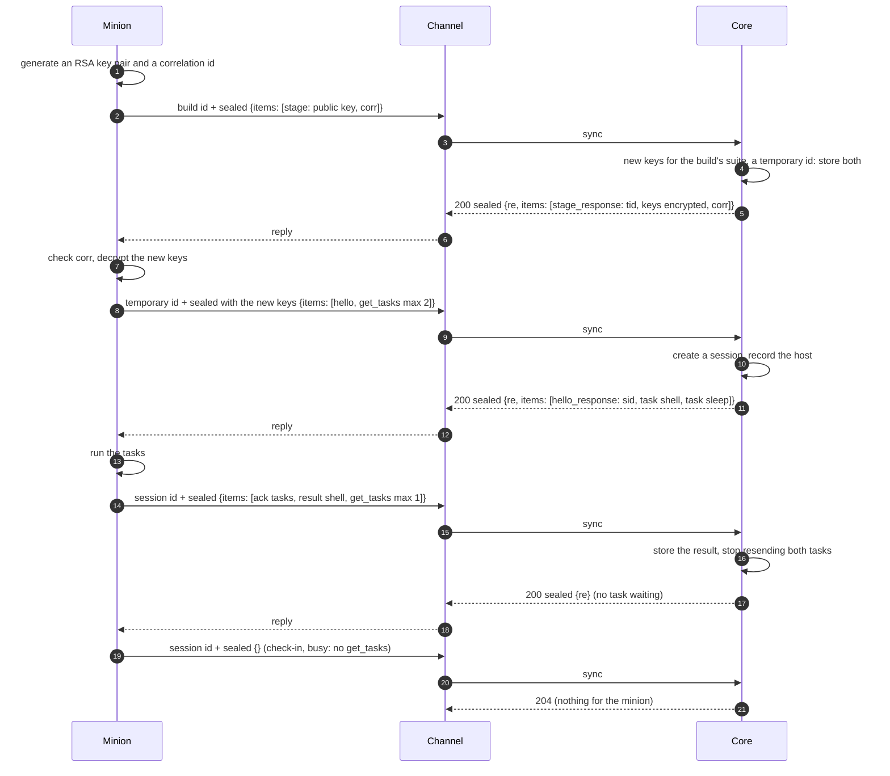

A minion and core talk in **messages**: CBOR maps, sealed with the minion's
keys, carried by a channel that sees only ciphertext. These pages define what
travels inside that ciphertext and how both sides use it. Commands themselves
are the factory's (a build schema declares them: [Minion
Build](../minion-build/#commands)); everything here is core's, the same for
every factory.

:::note[Status]
Built, in the protocol package (`logos-golang-protocol`), core and BOB's
minion. Planned: exchanges through a
[dialer](../../module-types/#3-dialer-modules-planned), and the `rehello`
item (core asking a minion for a new `hello`).
:::

## The layers

The [sync call](../channel-core-sync/) carries one sealed message per request
and at most one per reply.

| Layer | Defined by | Seen by |
|---|---|---|
| Transport (e.g. the HTTP channel's [packed format](https://github.com/LogosCore/logos-http-channel#wire-format)) | each channel | the channel |
| Sync call: the ciphertext as the body, the id in a header | [HTTP Sync](../channel-core-sync/) | channel and core |
| **Sealed frame**: version, direction, IV, ciphertext, tag | [Wire format](wire-format/#sealed-frame) | core and the minion |
| **Message**: one CBOR map of items | [Wire format](wire-format/#message) | core and the minion |

## The pages

| Page | What it covers |
|---|---|
| [Wire format](wire-format/) | The sealed frame, the message envelope, CBOR rules, replay, errors and limits: what every message is. |
| [Sessions](sessions/) | How a minion process gets keys and a session (staging, `hello`), what identifies its machine, how long a session lives, persisted and late sessions, and what a minion does when an exchange fails. |
| [Tasks and results](tasks-and-results/) | How an exchange goes, asking for tasks, a task and its arguments, cancelling, results, and listings of the host's file system. |
| [File transfers](file-transfers/) | Files both ways, kept in core or streamed through it: chunks, acks, resuming, and what core keeps. |

## A minion's life at a glance

1. **Staging** (1–7): a new process stages under its build id and gets new
   keys and a temporary id. A build may skip staging and say `hello` under
   its build id. See [Sessions](sessions/#staging).
2. **Hello** (8–12): under the temporary id, the minion says what host and
   process it is; core opens a **session** and answers with its id. Every
   message after that goes under the session id.
3. **Check-ins** (13–): the minion sends a message every check-in interval,
   or sooner when it has something to say. With `get_tasks` it takes new
   tasks; with `result` it sends what they produced; files move in `chunk`s
   alongside. Core answers each message. See [Tasks and
   results](tasks-and-results/) and [File transfers](file-transfers/).

## Items

A message carries a list of **items**, each a map with its type in `t`. Each
is defined, in [CDDL](https://www.rfc-editor.org/rfc/rfc8610), on the page
that explains it.

| `t` | Sent by | Carries | Defined in |
|---|---|---|---|
| `stage` | minion | its public key and a correlation id: its first message | [Sessions](sessions/#stage) |
| `stage_response` | core | a temporary id and new keys, encrypted to that public key | [Sessions](sessions/#stage) |
| `hello` | minion | the host and process: opens a session, or updates it | [Sessions](sessions/#hello) |
| `hello_response` | core | the session id | [Sessions](sessions/#hello) |
| `sleep_update` | minion | its check-in schedule changed | [Sessions](sessions/#late-and-lost-sessions) |
| `rehello` | core | *planned*: send a `hello` again | [Sessions](sessions/#hello) |
| `get_tasks` | minion | it takes new tasks, and how many at most | [Tasks and results](tasks-and-results/#asking-for-tasks) |
| `task` | core | a command to run, with its arguments | [Tasks and results](tasks-and-results/#tasks) |
| `cancel` | core | stop a running task | [Tasks and results](tasks-and-results/#cancelling-a-task) |
| `result` | minion | one part of a task's output, data and listings | [Tasks and results](tasks-and-results/#results) |
| `ack` | both | tasks received; how far a file transfer got | [Tasks and results](tasks-and-results/#acknowledging) |
| `chunk` | both | one piece of a file | [File transfers](file-transfers/#chunks) |
| `err` | both | a problem with a message or one of its items | [Wire format](wire-format/#errors) |

## Changing these formats

- **A receiver ignores keys it does not know**, so either side can add
  optional keys without a new message version (`v`).
- **An item type it does not know** gets an `err` with `unknown_item` and is
  skipped; the rest of the message is taken.
- A change that breaks either rule needs a new `v`, and a protocol release
  both sides adopt.

## Open questions

- **Exchanges through a dialer.** What a premade session looks like (one core
  creates ahead of time, under the build's own keys, so a minion that only
  answers needs no staging), and how `get_tasks` and `hello` work when core
  starts the exchange. On a lasting connection (SSH, TCP) both sides start
  exchanges; `id` and `re` keep them apart ([Wire format](wire-format/#message)).
  See [Module Types](../../module-types/#3-dialer-modules-planned).
