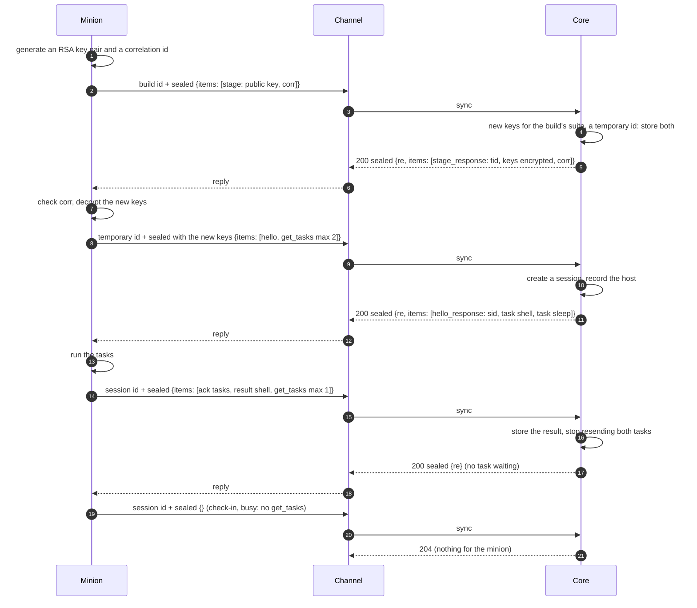

A minion and core talk in **messages**: CBOR maps, sealed with the minion's
keys, carried by a channel that sees only ciphertext. These pages define what
travels inside that ciphertext and how both sides use it. Commands themselves
are the factory's (a build schema declares them: [Minion
Build](../minion-build/#commands)); everything here is core's, the same for
every factory.

:::note[Status]
Built, in the protocol package (`logos-golang-protocol`), core, BOB's minion
and the Dumbo factory's PHP page, through all four [connection
kinds](../../module-types/#connection-kinds): `reverse-call`,
`reverse-persistent`, `bind-call` and `bind-persistent`. How each mechanic
goes on each kind is [below](#mechanics-by-connection-kind).
:::

## The layers

Between a channel and core a sealed message travels one of three ways, by
the connection's kind ([Channel ↔ Core: Connections](../channel-core-connections/#three-paths)):
the [sync call](../channel-core-sync/) (one message per request, at most one
per reply), the control link's `call` (core's message to a page, the page's
answer back), or a connection socket (one message per frame, both ways).

| Layer | Defined by | Seen by |
|---|---|---|
| Transport (e.g. the HTTP channel's [packed format](https://github.com/LogosCore/logos-http-channel#wire-format), the TCP channel's length-prefixed frames) | each channel | the channel |
| Channel ↔ core: the sync call, the control link or a connection socket, each carrying the ciphertext and the id it is sent under | [HTTP Sync](../channel-core-sync/), [Connections](../channel-core-connections/#the-control-link-and-connection-sockets-formats) | channel and core |
| **Sealed frame**: version, direction, IV, ciphertext, tag | [Wire format](wire-format/#sealed-frame) | core and the minion |
| **Message**: one CBOR map of items | [Wire format](wire-format/#message) | core and the minion |

The envelope and the suite are a build's [codec](codecs/) (a draft: core's
JSON envelope, and a factory translating either layer itself).

## The pages

| Page | What it covers |
|---|---|
| [Wire format](wire-format/) | The sealed frame, the message envelope, CBOR rules, replay, errors and limits: what every message is. |
| [Codecs](codecs/) | A draft: a build's envelope and suite, core's (CBOR, JSON; `aes-256-cbc-hmac-sha256`) or its factory's own, translated over a factory link, one call per message each way. |
| [Sessions](sessions/) | How a minion process gets keys and a session (staging, `hello`), what identifies its machine, how long a session lives, persisted and late sessions, and what a minion does when an exchange fails. |
| [Identity](identity/) | Who a minion's work runs as when not its process's own: the `identity` item, its order with the acks, and what core keeps and shows. |
| [Tasks and results](tasks-and-results/) | How an exchange goes, asking for tasks, a task and its arguments, cancelling, results, and listings of the host's file system. |
| [File transfers](file-transfers/) | Files both ways, kept in core or streamed through it: chunks, acks, resuming, and what core keeps. |
| [Delegation](delegation/) | A minion that serves a channel kind's transport on its host for other minions, carrying what the channel would say to core in its own messages: any channel kind, any connection kind, the minions it serves unchanged. |
| [Tunnels](tunnels/) | TCP streams and UDP associations the minion opens from its host (unix sockets, named pipes, processes, a listener for one connection too), carried in messages; core's SOCKS or HTTP proxy, a port forward, or a terminal, on an operational port in front; or a reverse tunnel, the minion listening and core forwarding each of its streams to one destination. |

## A minion's life at a glance

A minion that starts its exchanges (`reverse-call` here):

1. **Staging** (1–7): a new process stages under its build id and gets new
   keys and a temporary id. A build may skip staging and say `hello` under
   its build id. See [Sessions](sessions/#staging).
2. **Hello** (8–12): under the temporary id, the minion says what host and
   process it is; core opens a **session** and answers with its id. Every
   message after that goes under the session id.
3. **Check-ins** (13–): the minion sends a message every check-in interval,
   or sooner when it has something to say. With `get_tasks` it takes new
   tasks; with `result` it sends what they produced; files move in `chunk`s
   alongside. Core answers each message. See [Tasks and
   results](tasks-and-results/) and [File transfers](file-transfers/).

On the other kinds the same items go other ways. Over a persistent
connection (`reverse-persistent`, `bind-persistent`, once the channel has
dialed) the minion stages and says hello as above, and core also sends on
its own: tasks within the `get_tasks` allowance, cancels, a stream's go.
A `bind-call` page speaks only when called: core's first call is a
`rehello` under the build id, the page's `hello`, sealed with the build's
keys, opens the session ([Sessions](sessions/#hello)), and every exchange
after is a call core makes under the session id.

## Items

A message carries a list of **items**, each a map with its type in key `0`
(`t`), a number. Each is defined, in [CDDL](https://www.rfc-editor.org/rfc/rfc8610),
on the page that explains it. Keys are numbers too, and so are closed sets
of values and a task's command and args: the pages call them by name, and
the CDDL gives both ([Registry](wire-format/#registry)). Core names
everything as it comes, so operators never see the numbers.

| `t` | Item | Sent by | Carries | Defined in |
|---|---|---|---|---|
| 1 | `stage` | minion | its public key and a correlation id: its first message | [Sessions](sessions/#stage) |
| 2 | `stage_response` | core | a temporary id and new keys, encrypted to that public key | [Sessions](sessions/#stage) |
| 3 | `hello` | minion | the host and process: opens a session, or updates it | [Sessions](sessions/#hello) |
| 4 | `hello_response` | core | the session id | [Sessions](sessions/#hello) |
| 5 | `sleep_update` | minion | its check-in schedule changed | [Sessions](sessions/#late-and-lost-sessions) |
| 6 | `rehello` | core | send a `hello` again (a `bind-call` minion's first call) | [Sessions](sessions/#hello) |
| 7 | `get_tasks` | minion | it takes new tasks, and how many at most | [Tasks and results](tasks-and-results/#asking-for-tasks) |
| 8 | `task` | core | a command to run, with its arguments | [Tasks and results](tasks-and-results/#tasks) |
| 9 | `cancel` | core | stop a running task | [Tasks and results](tasks-and-results/#cancelling-a-task) |
| 10 | `result` | minion | one part of a task's output, data and listings | [Tasks and results](tasks-and-results/#results) |
| 11 | `ack` | both | tasks received; how far a file transfer got | [Tasks and results](tasks-and-results/#acknowledging) |
| 12 | `chunk` | both | one piece of a file | [File transfers](file-transfers/#chunks) |
| 13 | `err` | both | a problem with a message or one of its items | [Wire format](wire-format/#errors) |
| 14 | `conn_update` | minion | the connection it uses changed | [Sessions](sessions/#connections) |
| 15 | `resume` | core | go on with a task from where its last part said | [Tasks and Results](tasks-and-results/#resuming-a-task) |
| 16 | `poll` | core | come back sooner than the schedule: something may go on any moment | [Tasks and Results](tasks-and-results/#coming-back-sooner) |
| 17 | `max_tasks` | both | how many tasks the minion runs at once: core sets it, the minion says what it has | [Tasks and Results](tasks-and-results/#max-tasks) |
| 18 | `feedback` | minion | a warning or an error for its operators | [Sessions](sessions/#feedback) |
| 19 | `reack` | core | which of the tasks core thinks the minion runs it still has | [Tasks and results](tasks-and-results/#tasks-the-minion-lost) |
| 20 | `identity` | minion | who its tasks, or a task, run as when not its process's own | [Identity](identity/) |
| 29 | `delegate` | both | one step of what a delegate carries for the minions it serves: a sync and its reply, a call or an open and its answer, a connection's frame or close | [Delegation](delegation/#the-item) |

## Mechanics by connection kind

The format is the same on every kind: `id` and `re` keep apart who starts
an exchange, every item keeps its direction, and every item can be sent
again safely. What differs is who can speak next, and so how what core has
for a minion reaches it.

**How core's messages reach a minion.** Everything core sends a minion on
its own comes from one place, whatever the kind: the session's cancels,
the resumes of tasks under way (on a call), its streams' acks, and its
tasks within what the minion takes, most urgent first, within the
connection's message size. When core has something new (a task queued or
stopped, a part taken, a stream that may go on) it **nudges** the session,
and the nudge goes the way the minion's connection allows:

| Kind | Core's messages go | When |
|---|---|---|
| `reverse-call` | in the reply to the minion's request | when it checks in; sooner when core asks with a [`poll`](tasks-and-results/#coming-back-sooner) |
| `reverse-persistent` | in the reply to the minion's request, or pushed over the connection | at once (within a tenth of a second) |
| `bind-call` | in a call core makes to the page | at once (within a second), on the page's schedule if it says one, on Check now |
| `bind-persistent` | as `reverse-persistent`, once the connection is open | at once while connected; core opens it as the target's [policy](../channel-core-connections/#bind-persistent-connections-opening-and-closing) says |

What answers the minion's own items (an ack for its chunk, the chunk it
pulls, the resume for its part, an `err` about one) goes in the reply to
them, first.

**Each mechanic on each kind:**

| Mechanic | `reverse-call` | `reverse-persistent` | `bind-call` | `bind-persistent` |
|---|---|---|---|---|
| [Staging](sessions/#staging) | the minion stages | the minion stages | skipped: the session keeps the build's keys | the minion stages, once dialed |
| [`hello`](sessions/#hello) | the minion's | the minion's | the page's, answering core's `rehello` | the minion's |
| [Presence](sessions/#late-and-lost-sessions) | late and lost by its schedule | connected while a connection of its own is open; between connections, by its schedule | from the last call that worked, by its schedule if it says one | the connection: connected once the minion spoke, not connected (on purpose), unreachable since |
| [`get_tasks`](tasks-and-results/#asking-for-tasks) `max` | per reply | a standing allowance | per next call | a standing allowance |
| [`cancel`](tasks-and-results/#cancelling-a-task) | at the next check-in | pushed | in the next call (a task inside a running call ends first) | pushed |
| [Lost tasks](tasks-and-results/#tasks-the-minion-lost) (`reack`) | after a claim, at the next check-in | after a claim, pushed | none: a call's tasks end within it, long ones go on through `resume` | after a claim, and on each new connection in the reply to the minion's first message under its session |
| [Feedback](sessions/#feedback) | with its next check-in, at once | as it comes | in its answer to core's next call | as it comes |
| [Identity](identity/) | with its next check-in, in order with its acks | as it comes, in order with its acks | in its answer to core's call, in order with its acks | as it comes, in order with its acks |
| [Max tasks](tasks-and-results/#max-tasks) (`max_tasks`) | in every reply until the minion has it | pushed, then in every reply until it has it | in the next call, and every one after until it has it | pushed, then in every reply until it has it |
| [Long tasks](tasks-and-results/#resuming-a-task) (`resume`) | answers a part | answers a part | every call carries it | answers a part |
| [Files](file-transfers/) either way | the minion checks in at once while one moves | as it goes | a chunk a call, core calling again at once | as it goes |
| [Streams](file-transfers/#streaming-a-file) that hold | core's `poll`: back within a second | pushed when they may go on | called when they may go on | pushed when they may go on |
| [Tunnels](tunnels/) | core's `poll`: at once while items go, 250 ms with a stream idle, 1 s with none; the minion checks in at once with items of its own | pushed both ways as they come | only a minion that keeps its sockets between calls: called again while items go | pushed both ways as they come |
| [Serving as a delegate](delegation/) | the delegate checks in at once with items for core; core's in its replies, `poll` (a second) while a step, pieces or a frame wait | pushed both ways as they come | none: a page runs no task between calls | pushed both ways while connected |
| [Switching](sessions/#connections) | the minion moves | the minion moves | a page has one connection | core dials, the minion moves through the dial |
| [Failover](../channel-core-connections/#failover) | the minion's | the minion's | none | none: core has to dial it |
| [Replays](wire-format/#freshness-and-replay) of core's messages | none: replies match `re` | the minion may remember ids | the page refuses an `at` out of its window | the minion may remember ids |
| A [lost reply](wire-format/#freshness-and-replay) | the request sent again as it was gets it (10 minutes) | the same | core waits for every call it sends; what it carried goes again until acknowledged | the same as `reverse-persistent` |
| Message size | the connection's `max_message` | the same | the same | the same |

## Changing these formats

- **A receiver ignores keys it does not know**, so either side can add
  optional keys without a new message version (`v`). A new key or item type
  takes a new number; a number is never reused
  ([Registry](wire-format/#registry)).
- **An item type it does not know** gets an `err` with `unknown_item` and is
  skipped; the rest of the message is taken.
- **An open is the exception**: a `tunnel` with a key its receiver does not
  know is refused (result 7, unsupported), never read as a plain connect,
  since the open has the host act ([Tunnels](tunnels/#streams), Read
  strictly).
- A change that breaks either rule needs a new `v`, and a protocol release
  both sides adopt.

**A new mechanic** (a tunnel's new kind of stream, an `event` stream)
fits every kind when it answers these, and adds its row to the table above:

1. **Items that can go twice.** Each step is an item, numbered, that does
   no harm sent again: keyed like results by `(task, seq)` and chunks by
   `(xfer, off)`. Exchanges fail and get resent on every kind.
2. **Driven by whoever can speak next.** The minion moves it on by
   asking (and checks in at once while work remains); core moves it on by
   putting what it has where every message it sends a minion is made, and
   nudging the session, which pushes, calls or opens as the kind allows.
   Nothing may wait for the minion to speak (a page never does) or for
   core to (a polling minion hears only replies): what a polling minion
   must hear soon, core asks for with a `poll`.
3. **State in a `ctx`.** Whatever the minion needs between messages it may
   put in a `ctx` of its own bytes, which core keeps and echoes on every
   item it sends about that task or transfer, an `err` included: a minion
   that keeps nothing (a page) can then take part.
4. **Within the connection's size.** Every message keeps within the
   connection's `max_message` ([Wire format](wire-format/#limits)): what is
   larger goes in parts, sized by the connection, not by a constant.
5. **Kinds it needs.** A mechanic that cannot work, or work well, over
   some kinds (a tunnel needs a minion that keeps its sockets between
   messages, which a page does not)
   says so in its command's [`kinds`](../minion-build/#commands): core
   refuses its task on a session on another kind, and `help` says so.
