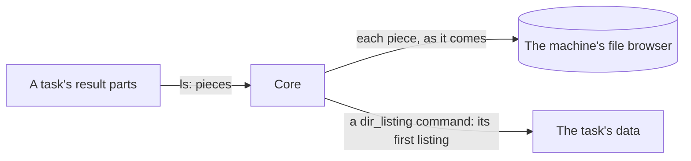

Operators give a session's minion **tasks** from its console in the Sessions
page; the minion runs them and sends back **results**. This page covers how
an exchange goes, how a minion asks for tasks, a task and its arguments,
acknowledging and cancelling, results, and listings of the host's file
system. What a result's `data` means, command by command, is in [Task Results
and Actions](../../task-results-and-actions/).

## How an exchange goes

Through a channel, the minion starts every exchange:

- **The minion checks in.** It sends a message every check-in interval
  (`checkin_interval` with `checkin_jitter`, from its connection), or sooner
  when it has something to send. Core answers.
- **Core answers every message that carries items** with a sealed reply whose
  `re` is the request's `id`, even when it has nothing of its own. Only an
  empty check-in, when core has nothing either, gets **204**.
- **Items count as delivered only on a sealed reply with the matching `re`.**
  On a 404, a timeout, or a 204 to a message with items, the minion sends
  them again in a later message, under a new `id`.
- **Every item can be sent again safely.** Results are taken once by
  `(task, seq)`, chunks by `(xfer, off)`; acks and hellos are the same each
  time. So nothing needs exactly-once delivery: both sides resend until the
  other confirms.

## Asking for tasks

How many tasks a minion runs at once is its build's business, so the minion
asks:

```cddl
get_tasks = {
  t: "get_tasks",
  ? max: uint,          ; at most this many; absent: no limit of the
                        ;   minion's. 0 is invalid.
}
```

- **Core puts tasks in a reply only when the request has a `get_tasks`**, and
  never more than `max`. A minion that is busy leaves it out and gets no new
  task, whatever else its request carries.
- **`get_tasks` can share a request** with results, acks, chunks or a
  `hello`: a minion that finishes a task sends its result and takes the next
  task in one round trip.
- **`max` absent** means no limit of the minion's: core sends what it has
  within one message's [limits](../wire-format/#limits), and the rest in
  later replies. A minion that wants nothing leaves `get_tasks` out.
- **Tasks sent before and not acked come first**, and count toward `max`: a
  minion whose reply with tasks was lost gets them again on its next
  `get_tasks`.
- **Only tasks wait for `get_tasks`.** `cancel`, acks, chunks,
  `stage_response` and `hello_response` come whenever core has them, so a
  minion busy with a long task can still be told to stop it.
- **One `get_tasks` per request.** A second is a `bad_message`.

## Tasks

```cddl
task = {
  t: "task",
  task: task-id,
  cmd: tstr,            ; a command id of the minion's build
  ? args: { * tstr => arg },
}
```

A task's `args` follow its command's params in the build schema
([Commands](../../minion-build/#commands)). Core fills in defaults and checks
them before the task is queued, so a minion gets every arg that has a value
or a default. Their types map to CBOR like this:

| Param type | CBOR |
|---|---|
| `string`, `url`, `secret`, `enum` | text |
| `int`, `bytes` | integer (`bytes`: a byte count) |
| `number` | float |
| `bool` | `true` / `false` |
| `duration` | unsigned integer, milliseconds |
| `datetime` | integer, unix seconds |
| `string_list`, `enum_list` | array of text |
| `string_map` | map of text to text |
| `file` | map: the [file core sends](../file-transfers/#core-sending-a-file) for the task, `{xfer, name, size, sha256}` |
| `stream` | map: the [file core streams](../file-transfers/#streaming-a-file-to-a-minion) for the task, `{xfer, name, stream: true}` |

- **Core sends a task again**, when asked, until the minion acks it or a
  result for it arrives.
- **The minion runs each task once**: it keeps the ids of the tasks it
  received in the last 24 hours.
- **A task the minion cannot run** (a command its build lacks, an arg of the
  wrong type) gets a `result` `{done: true, ok: false, err: …}`.
- `help` is core's own command: core answers it at once and it never goes
  out ([Commands](../../minion-build/#commands)).

## Acknowledging

```cddl
ack = {
  t: "ack",
  ? tasks: [* task-id], ; tasks received
  ? xfer: xfer-id,      ; with next: the receiver has every byte of the
  ? next: uint,         ;   transfer before next
  ? hold: bool,         ; with xfer: the transfer waits (see File transfers)
}
```

A minion acks the tasks it received with `tasks`, in its next message: core
stops sending them. `xfer`, `next` and `hold` move a file transfer along
([File transfers](../file-transfers/#chunks)).

## Cancelling a task

```cddl
cancel = { t: "cancel", task: task-id }
```

When an operator stops a task, core sends `cancel` with **every reply** until
the task ends; a task not sent yet is cancelled in core at once and never
goes out. The minion stops the task and still sends a final `result`
(`done`). A `cancel` for a task the minion does not have gets an `err`
`unknown_task`.

## Results

```cddl
result = {
  t: "result",
  task: task-id,
  seq: uint,            ; 0, 1, 2, …: the parts of one task's output
  ? done: bool,         ; the last part; ok is then required
  ? ok: bool,           ; the minion did what the task asked
  ? out: bstr,          ; output as raw bytes, in the host's own encoding
  ? err: tstr,          ; what went wrong, with ok: false
  ? data: { * tstr => any },  ; structured output, its command's result's shape
  ? exit: int,          ; the exit code of a process the task ran: done part only
  ? ls: [* listing-piece],  ; what the task saw of the file system: Listings
}
```

A task's output comes in **parts**, `seq` 0, 1, 2, …, the last with `done`. A
long task streams them as it goes; a short one may send one part. A part can
carry what a person reads (`out`), what a program reads (`data`), listings
(`ls`), or several of these.

- **`out`** is the output as raw bytes, as the command produced it: no
  conversion, so a host's code page (866 on a Russian Windows, 850 or 1252 on
  others) and binary output pass unchanged. stdout and stderr may be mixed in
  it. Core and the web app decode it by guesswork, and offer the bytes as a
  download where they do not decode. The parts' `out` join in `seq` order.
- **`data`** is structured output, such as a directory's entries or a process
  list, in the shape of its command's [result](../../task-results-and-actions/)
  (named in the build schema). Core checks each part against it, keeps it as
  the CBOR it came in, and joins the parts by the result's rule. Output too
  big for one message goes in several parts.
- **`ok`** says whether the minion did what the task asked. **`exit`** is what
  a process the task ran reported, so a program that exits with 1 is still
  `ok: true`, and a command the minion could not start is `ok: false` without
  `exit`. Only commands that start a process have one (`shell`); those the
  minion carries out itself (`ls`, `download`) do not. A process killed by a
  signal has no exit code: the minion says so in `err`.

How core keeps a task's parts (the done part is the last, a late part fills a
gap, output and data share 4 MiB, missing parts are flagged) is in [What core
does with a result](../../task-results-and-actions/#what-core-does-with-a-result).
Operators read a task's output and data in its console; the bytes as they came
download from `GET /api/v1/minion-tasks/{id}/output`, and the data as a CBOR
sequence from `GET /api/v1/minion-tasks/{id}/data`.

## Listings

What a task saw of the host's file system travels as **listings**, on its
result parts (`ls`), beside or instead of `out` and `data`: a directory's
entries, read by any command (an `ls` of one folder, a walk over many). Core
keeps them in the machine's [file browser](../../file-browser/) as they come.

```cddl
listing-piece = {
  id: uint,             ; which listing of the task: 0, 1, 2…
  part: uint,           ; which piece of it: 0, 1, 2…
  ? last: bool,         ; the listing's last piece
  ? path: tstr,         ; part 0 only (then required): the directory,
  ? sep: "/" / "\\",    ;   absolute, as the host writes it; its separator;
  ? parent: tstr,       ;   and the directory above it, left out at a root
  ? entries: [* entry], ; as a dir_listing's (Task Results and Actions)
  ? partial: bool,      ; some entries could not be read: not the whole
  ? err: tstr,          ; the directory could not be read at all: part 0,
                        ;   last, no entries
}
```



- **A listing is one directory**, numbered `id` within its task. An `ls`
  sends one; a walk sends one a folder.
- **It comes in pieces**, numbered `part` from 0, the last with `last`. The
  first names the directory; every piece adds entries. One result part can
  carry pieces of several listings, and one listing can span several parts.
- **Whole** is a listing whose pieces 0 to `last` all came and none says
  `partial`. Only a whole listing tells core what the folder no longer has;
  one cut short adds what it has.
- **`err`** is a directory the minion may not read (permission denied): one
  piece, `part` 0 and `last`, no entries. Core marks the folder so.

Core, as each result part comes:

1. **Takes its pieces into the file browser at once**, not when the task
   ends: a long walk fills the browser as it goes, and a stopped one keeps
   what it saw. A listing's time is when core took its first piece (not the
   minion's clock); every piece of it shares it. A piece that comes before
   its listing's first (a part resent late) waits for it.
2. **Keeps them apart from the task's output and data**: listings do not
   count toward its 4 MiB.
3. **Makes a [`dir_listing`](../../task-results-and-actions/#dir_listing)
   command's data from its first listing** (`id` 0), so its task shows what
   it read as any task's data.

## Open questions

- **Unsolicited data.** Output that belongs to no task (a minion-side
  monitor) would need an `event` item.
