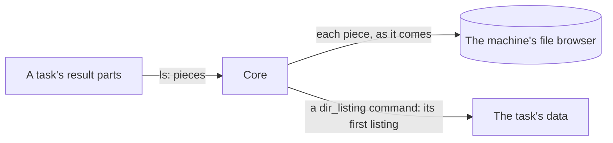

Operators give a session's minion **tasks** from its console in the Sessions
page; the minion runs them and sends back **results**. This page covers how
an exchange goes, how a minion asks for tasks, a task and its arguments,
acknowledging and cancelling, results, and listings of the host's file
system. What a result's `data` means, command by command, is in [Task Results
and Actions](../../task-results-and-actions/).

## How an exchange goes

Who starts an exchange is the connection's kind's ([Mechanics by
connection kind](../#mechanics-by-connection-kind)):

- **Through the sync call (`reverse-call`) the minion checks in.** It sends
  a message every check-in interval (`checkin_interval` with
  `checkin_jitter`, from its connection), or sooner when it has something to
  send, or when core asked with a [`poll`](#coming-back-sooner). Core answers.
- **Over a persistent connection** the minion sends what it has when it has
  it, and core sends too: tasks within the minion's allowance, cancels, a
  held stream's go. The minion acknowledges what core sent, with `re` or in
  its next message.
- **A `bind-call` page answers calls**: core starts every exchange, and the
  page's answer carries `re`.
- **Core answers every message that carries items** with a sealed reply whose
  `re` is the request's `id`, even when it has nothing of its own. Through
  the sync call an empty check-in, when core has nothing either, gets
  **204**; over a socket every request gets a reply, empty or not, so the
  minion knows it arrived.
- **Items count as delivered only on a sealed reply with the matching `re`.**
  On a 404, a timeout, or a 204 to a message with items, the minion sends
  them again in a later message, under a new `id`. Core does the same with
  what it sends: what the minion did not acknowledge goes again.
- **Every item can be sent again safely.** Results are taken once by
  `(task, seq)`, chunks by `(xfer, off)`; acks and hellos are the same each
  time. So nothing needs exactly-once delivery: both sides resend until the
  other confirms.

## Coming back sooner

```cddl
poll = {
  0: 16,                ; t: poll (core → minion)
  1: uint,              ; within: milliseconds, a day at most
}
```

A minion that starts its exchanges checks in on its schedule, which may
be an hour; core cannot reach it before then. When core expects something
of the minion's to go on any moment, it says so in its reply: **`poll`**,
come back within `within`, sooner than the schedule. It holds for that one
wait; the next reply says it again while it still applies. Core sends it
through the sync call only (over a persistent connection it pushes
instead) and today when a [stream](../file-transfers/#streaming-a-file) the
minion holds has its downloader or uploader there: within a second. A
minion that does not know `poll` answers `unknown_item` and keeps its
schedule.

## Asking for tasks

How many tasks a minion runs at once is its build's business, so the minion
asks:

```cddl
get_tasks = {
  0: 7,                 ; t: get_tasks
  ? 1: uint,            ; max: at most this many; absent, no limit of the
                        ;   minion's. 0 is invalid.
}
```

- **Core puts tasks in a reply only when the request has a `get_tasks`**, and
  never more than `max`. A minion that is busy leaves it out and gets no new
  task, whatever else its request carries.
- **`get_tasks` can share a request** with results, acks, chunks or a
  `hello`: a minion that finishes a task sends its result and takes the next
  task in one round trip.
- **`max` absent** means no limit of the minion's: core sends what it has
  within one message's [limits](../wire-format/#limits), and the rest in
  later replies. A minion that wants nothing leaves `get_tasks` out.
- **Tasks sent before and not acked come first**, and count toward `max`: a
  minion whose reply with tasks was lost gets them again on its next
  `get_tasks`.
- **Only tasks wait for `get_tasks`.** `cancel`, acks, chunks,
  `stage_response` and `hello_response` come whenever core has them, so a
  minion busy with a long task can still be told to stop it.
- **One `get_tasks` per request.** A second is a `bad_message`.
- **On a persistent connection** `get_tasks` is a standing allowance of
  unfinished tasks ([Connections](../../channel-core-connections/#get_tasks-on-a-persistent-connection)),
  and `max 0` takes none for now: a minion pauses with it.

## Max tasks

Every minion has a limit of tasks at once. Its factory sets it in one of
two ways:

- **The factory's own** (one at a time, say): the minion may say it in its
  `hello`, and the session shows it ("max 1 · set by its factory"); nothing
  changes it. A minion that does not say shows "max not reported".
- **The operators'**, for a factory that declares `max_tasks` ([Minion
  Build](../../minion-build/)): the build's as the minion starts, which an
  operator changes live from the session (**Tasks** in its record: the
  pencil). Its minion must say it in its `hello`, and takes the
  `max_tasks` item, which carries it both ways:

```cddl
max_tasks = {
  0: 17,                ; t: max_tasks
  1: uint,              ; max: tasks at once, 0 to 64
}
```

- **Core → minion: the limit to have.** It goes in every message core
  sends the minion, after the cancels and before any task, whatever the
  minion runs and whether it asked for tasks, until the minion says it has
  it. Not a task: a task would wait for a free slot (the very limit it
  changes), and after a limit of 0 none could reach the minion again. Core
  sends it only to a minion whose build's factory declares `max_tasks`.
- **5 messages at most.** A minion that takes it says so in its very next
  message; one that never does (one that does not know the item answers
  `unknown_item`, which names the item only by its place in a message core
  no longer has) is sent it 5 times, then no more: the session says the
  minion did not take it. Setting it again, or the minion saying a limit
  (a `rehello`), tries again.
- **Minion → core: the limit it has**, in its next message (at once, not
  on its schedule) after core's, and whenever it changes on its own. Core
  records it as the session's; its `get_tasks` follow it: through a call,
  the room the limit leaves (none asked when it is full); on a persistent
  connection, the limit itself, a standing allowance core counts the
  unfinished tasks against.
- **The `hello` says the limit the minion starts with** (key 17). A minion
  whose `hello` says none gets no `max_tasks`, whatever its factory
  declares.
- **0 pauses**: no new tasks; what runs goes on, and `cancel` still
  reaches it.
- **The operator's limit stays with the session**: a process that claims
  it later (a [persisted session](../sessions/#persisted-sessions), or a
  `rehello` saying another) gets it again.
- **A build sets the starting limit** for a factory that declares
  `max_tasks` ([Minion Build](../../minion-build/)), 5 unless the operator
  says otherwise.
- **From the console**: `max_tasks <max>`, core's own command in such a
  session's console. Core keeps it as a task, running ("max tasks 5 → 8: on
  its way to the minion") until the minion says it has the limit (done:
  "the minion runs 8 at once now"; at once when it has it already), or does
  not take it, or a newer limit (another `max_tasks`, the session's Tasks)
  replaces it (failed, saying which). Nothing goes to the minion as a task:
  a task would wait for a free slot, the very limit it changes.

BOB runs each task in a goroutine of its own, its parts sharing each
message's room; its `exit` stops the tasks running beside it first, so each
ends cancelled, its end sent before exit's.

## Tasks

```cddl
task = {
  0: 8,                 ; t: task
  1: task-id,           ; task
  2: uint,              ; cmd: the command's op in the build schema
  ? 3: { * uint => arg },  ; args: by their params' num in the build schema
}

; a credential param's arg is the credential, a credential_list's an
; array of them, in order (Credentials, "What a module gets"): a minion
; has no way to look one up by its id.

file-offer = {          ; a file or stream param's arg
  1: xfer-id,           ; xfer: the transfer, core's pick, one a task
  2: tstr,              ; name: the file's name as uploaded, no path
  ? 3: uint,            ; size: the whole's (not a stream's)
  ? 4: bstr .size 32,   ; sha256: the whole's (not a stream's)
  ? 5: true,            ; stream: the file is streamed to the minion
}
```

A task names its command by its **`op`** and each arg by its param's
**`num`**, the numbers the build schema gives them
([Commands](../../minion-build/#commands)): a minion dispatches on numbers
its factory compiled in, and carries no command or param names. Operators,
core and the API name commands and params by `id` and `key` as before; core
puts the numbers in when it sends the task. Core fills in defaults and checks
the args before the task is queued, so a minion gets every arg that has a
value or a default. Their types map to CBOR like this:

| Param type | CBOR |
|---|---|
| `string`, `url`, `secret`, `enum` | text |
| `int`, `bytes` | integer (`bytes`: a byte count) |
| `number` | float |
| `bool` | `true` / `false` |
| `duration` | unsigned integer, milliseconds |
| `datetime` | integer, unix seconds |
| `string_list`, `enum_list` | array of text |
| `string_map` | map of text to text |
| `file` | `file-offer`: the [file core sends](../file-transfers/#core-sending-a-file) for the task, `{xfer, name, size, sha256}` |
| `stream` | `file-offer`: the [file core streams](../file-transfers/#streaming-a-file-to-a-minion) for the task, `{xfer, name, stream: true}` |

- **Core sends a task again**, when asked, until the minion acks it or a
  result for it arrives.
- **The minion runs each task once**: it keeps the ids of the tasks it
  received in the last 24 hours.
- **A task the minion cannot run** (a command its build lacks, an `op` it
  does not know, an arg of the wrong type) gets a `result` `{done: true, ok:
  false, err: …}`.
- **A task too large for the connection** (its item more than the
  connection's `max_message` takes, [Limits](../wire-format/#limits)) never
  goes: core ends it failed, saying the sizes. Tasks that fit go in the
  messages after, as many as each holds.
- **A command that works over some kinds only** (its build schema's
  [`kinds`](../../minion-build/#commands)) is refused when queued on a
  session whose minion uses another kind: an operator switches it first.
- `help`, `connect`, `disconnect` and `max_tasks` are core's own
  commands: core runs them and they never go out
  ([Commands](../../minion-build/#commands)). A core command still
  running (a `connect` waiting for its dial, a `max_tasks` for the
  minion's word) takes none of the minion's room: core counts only the
  minion's tasks against its `get_tasks`.

## Acknowledging

```cddl
ack = {
  0: 11,                ; t: ack
  ? 1: [* task-id],     ; tasks: tasks received
  ? 2: xfer-id,         ; xfer, with next: the receiver has every byte of
  ? 3: uint,            ;   the transfer before next
  ? 4: bool,            ; hold, with xfer: the transfer waits (see File
                        ;   transfers)
  ? 5: bstr,            ; ctx, with xfer: the transfer's ctx (see File
                        ;   transfers)
}
```

A minion acks the tasks it received with `tasks`, in its next message: core
stops sending them. `xfer`, `next` and `hold` move a file transfer along
([File transfers](../file-transfers/#chunks)).

## Cancelling a task

```cddl
cancel = {
  0: 9,                 ; t: cancel
  1: task-id,           ; task
  ? 2: bstr,            ; ctx: the ctx of the task's newest part that said
                        ;   one (Resuming a task)
}
```

When an operator stops a task, core sends `cancel` with **every reply** until
the task ends; a task not sent yet is cancelled in core at once and never
goes out. The minion stops the task and still sends a final `result`
(`done`). A `cancel` for a task the minion does not have gets an `err`
`unknown_task` naming it (`task`), and core ends it cancelled: a minion that
lost a task (it restarted) does not leave it stopping for good. Core also
asks on its own when a minion may have lost tasks ([Tasks the minion
lost](#tasks-the-minion-lost)). A task whose
parts said a `ctx` gets it on its `cancel`, and one whose parts did not gets
its transfer's (a file going either way, or a stream): a minion that keeps
nothing ends the task from there (its next `seq`), a page removing a
partial upload.

## Tasks the minion lost

```cddl
reack = {
  0: 19,                ; t: reack (core → minion)
  1: [+ task-id],       ; tasks: those core thinks the minion has, 256 at
                        ;   most
}
```

Core counts a task running from its `ack` until its last `result`. A
minion can lose one in between: a process that restarts has none of the
tasks the one before ran, and a channel acting as the minion (an
[agentless](../../agentless-channels/) one) runs its commands inside its
connection to the server, so they go when that connection goes. Core is not
told: without asking, it would show the task running for good, and count it
against the minion's [`get_tasks`](#asking-for-tasks) room, so a minion
that lost as many tasks as it runs at once would get no more.

So when the minion comes back in a way that may have lost them, core asks
with a `reack` naming the tasks it thinks the minion runs:

- **after a claim**: a new process took the [persisted
  session](../sessions/#persisted-sessions) over;
- **over a new `bind-persistent` connection**, at the minion's first message
  under its session there: the commands of a channel acting as the minion
  ran inside the connection that went.

It goes once, in core's next message to the minion (the reply to the
message that brought the minion back, or a push), as many tasks as the
message has room for and the rest in the next. The minion answers in its
next message:

- an **`ack`** naming those it has: running, or ended with an end core has
  not had yet (it sends that end as it would). They go on; over a
  `bind-persistent` connection they are the new connection's, which [stays
  open](../../channel-core-connections/#bind-persistent-connections-opening-and-closing)
  while they run;
- an **`err` `unknown_task`** naming each it does not have (`task`, with
  `item` the `reack`'s place): core ends it failed, or cancelled when an
  operator had asked to stop it.

A minion that does not take a `reack` answers `unknown_item`, and core
knows no more than before: the tasks stay as they were, and a `cancel`
still ends one the minion does not have. A minion that keeps its tasks
across restarts (on disk, say) acks them.

## Resuming a task

```cddl
resume = {
  0: 15,                ; t: resume
  1: task-id,           ; task
  2: bstr,              ; ctx: as the task's newest part said it, 1024
                        ;   bytes at most
}
```

A minion that keeps nothing between messages (a
[`bind-call`](../../channel-core-connections/#bind-call-minions-when-core-calls)
page) cannot carry a long task (a walk) through one exchange: one answer is
768 KiB at most, a call ends with its channel's timeout. It hands the task
over instead: a part that is not done says where the minion stands
(`ctx`, its own bytes: core never reads them), and core answers it with
`resume`, giving them back. The minion goes on from there, and its next
part says the next `ctx`, until a part says `done`.

- **Core keeps the newest part's `ctx`** on the task: a call that fails
  loses no walk, as the next call core makes to the page carries the
  `resume` again; and a `cancel` carries it, so the minion can end the task
  where it stood.
- **Sent once a part asks**: a part without `ctx` gets no `resume`; a
  minion that keeps its own state never sees one. Once an operator stops
  the task, no `resume` goes: the `cancel` does.

## Results

```cddl
result = {
  0: 10,                ; t: result
  1: task-id,           ; task
  2: uint,              ; seq: 0, 1, 2, …, the parts of one task's output
  ? 3: bool,            ; done: the last part; ok is then required
  ? 4: bool,            ; ok: the minion did what the task asked
  ? 5: bstr,            ; out: output as raw bytes, in the host's own encoding
  ? 6: tstr,            ; err: what went wrong, with ok: false
  ? 7: { * any => any },  ; data: structured output, its command's
                        ;   result's shape: numbered for core's results
  ? 8: int,             ; exit: the exit code of a process the task ran,
                        ;   done part only
  ? 9: [* listing-piece],  ; ls: what the task saw of the file system,
                        ;   Listings
  ? 10: bstr,           ; ctx: where the minion stands with the task, on a
                        ;   part that is not done (Resuming a task)
}
```

A task's output comes in **parts**, `seq` 0, 1, 2, …, the last with `done`. A
long task streams them as it goes; a short one may send one part. A part can
carry what a person reads (`out`), what a program reads (`data`), listings
(`ls`), or several of these.

- **`out`** is the output as raw bytes, as the command produced it: no
  conversion, so a host's code page (866 on a Russian Windows, 850 or 1252 on
  others) and binary output pass unchanged. stdout and stderr may be mixed in
  it. Core and the web app decode it by guesswork, and offer the bytes as a
  download where they do not decode. The parts' `out` join in `seq` order.
- **`data`** is structured output, such as a walk's progress or a process
  list, in the shape of its command's [result](../../task-results-and-actions/)
  (named in the build schema). The data of core's results travels numbered,
  and core names it as it takes the part; a factory's own shape (a command
  without a result) keeps its text keys. Core checks each part, keeps it as
  CBOR, and joins the parts by the result's rule. Output too big for one
  message goes in several parts.
- **`ok`** says whether the minion did what the task asked. **`exit`** is what
  a process the task ran reported, so a program that exits with 1 is still
  `ok: true`, and a command the minion could not start is `ok: false` without
  `exit`. Only commands that start a process have one (`shell`); those the
  minion carries out itself (`ls`, `download`) do not. A process killed by a
  signal has no exit code: the minion says so in `err`.

How core keeps a task's parts (the done part is the last, a late part fills a
gap, output and data share 4 MiB, missing parts are flagged) is in [What core
does with a result](../../task-results-and-actions/#what-core-does-with-a-result).
Operators read a task's output and data in its console; the bytes as they came
download from `GET /api/v1/minion-tasks/{id}/output`, and the data as a CBOR
sequence from `GET /api/v1/minion-tasks/{id}/data`.

## Listings

What a task saw of the host's file system travels as **listings**, on its
result parts (`ls`), beside or instead of `out` and `data`: a directory's
entries, read by any command (an `ls` of one folder, a walk over many). Core
keeps them in the machine's [file browser](../../file-browser/) as they come.

```cddl
listing-piece = {
  1: uint,              ; id: which listing of the task, 0, 1, 2…
  2: uint,              ; part: which piece of it, 0, 1, 2…
  ? 3: bool,            ; last: the listing's last piece
  ? 4: tstr,            ; path: the directory, absolute, as the host
                        ;   writes it
  ? 5: "/" / "\\",      ; sep: the host's separator
  ? 6: tstr,            ; parent: the directory above, left out at a root
                        ;   (path, sep, parent: part 0 only, which needs
                        ;   path and sep)
  ? 7: [* entry],       ; entries
  ? 8: bool,            ; partial: some entries could not be read, not the
                        ;   whole
  ? 9: uint,            ; err: the directory could not be read at all
                        ;   (denied 1, not found 2, other 3): part 0, last,
                        ;   no entries
  ? 10: [* tstr],       ; owners: the owner and group names its entries
                        ;   name, each once
  ? 11: tstr,           ; err_msg: more on err, for a person
}

entry = {
  1: tstr,              ; name
  2: uint,              ; type: dir 1, file 2, link 3, other 4
  ? 3: uint,            ; size
  ? 4: int,             ; modified: unix seconds
  ? 5: uint,            ; mode: the host's own bits, st_mode (Unix) or the
                        ;   file attributes (Windows)
  ? 6: uint,            ; owner: its place in the piece's owners, from 1
  ? 7: uint,            ; group: its place in the piece's owners, from 1
  ? 8: tstr,            ; target: a link's
  ? 9: bool,            ; hidden
  ? 10: { * tstr => any },  ; x: the factory's own fields, text keys
}
```



- **A listing is one directory**, numbered `id` within its task. An `ls`
  sends one; a walk sends one a folder.
- **It comes in pieces**, numbered `part` from 0, the last with `last`. The
  first names the directory; every piece adds entries. One result part can
  carry pieces of several listings, and one listing can span several parts.
- **Whole** is a listing whose pieces 0 to `last` all came and none says
  `partial`. Only a whole listing tells core what the folder no longer has;
  one cut short adds what it has.
- **`err`** is a directory the minion could not read: one piece, `part` 0
  and `last`, no entries, the reason as a code (permission denied, not
  found, other) with `err_msg` for more. Core marks the folder so, by the
  code's name.
- **Entries as the host has them.** An entry's `mode` is the host's bits, not
  their rendering, and its `owner` and `group` are places in the piece's
  `owners`, so names that recur (every file `root`) travel once a piece. Core
  names it all as it takes the piece: the type by name, the mode as the host
  shows it (`-rw-r--r--` as `ls -l` does, or on Windows `-a-h--` as
  PowerShell does, by the session's `os`), the owners by name.

Core, as each result part comes:

1. **Takes its pieces into the file browser at once**, not when the task
   ends: a long walk fills the browser as it goes, and a stopped one keeps
   what it saw. A listing's time is when core took its first piece (not the
   minion's clock); every piece of it shares it. A piece that comes before
   its listing's first (a part resent late) waits for it.
2. **Keeps them apart from the task's output and data**: listings do not
   count toward its 4 MiB.
3. **Makes a [`dir_listing`](../../task-results-and-actions/#dir_listing)
   command's data from its first listing** (`id` 0), so its task shows what
   it read as any task's data.

## Open questions

- **Unsolicited data.** Output that belongs to no task (a minion-side
  monitor) would need an `event` item.
