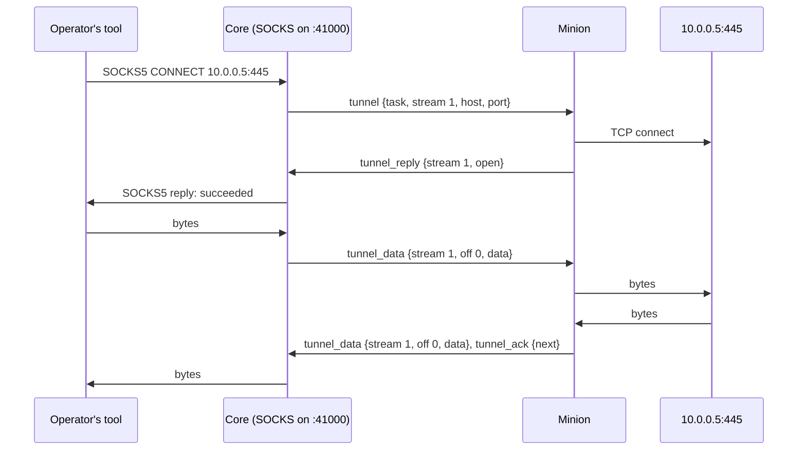
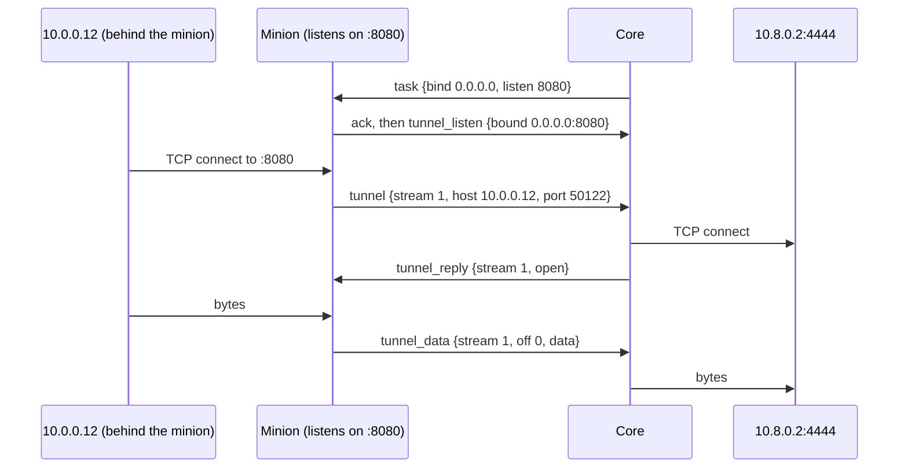

A **tunnel** is a TCP connection the minion makes from its host, whose bytes
core and the minion carry inside their messages: core opens a **stream** to
`host:port`, the minion connects there, and each side relays what its end
sends. Core speaks the protocol of the operator's tools in front of it; the
first is a **SOCKS proxy** on one of core's **operational ports**, so an
operator's browser, scanner or `proxychains` reaches what the minion's host
reaches. The minion never sees SOCKS: it opens, relays and closes TCP
streams, whatever core put in front. A **reverse port forward** goes the
other way: the minion listens on its host, and core connects each
connection that comes there to a destination on its side.



## Operational ports

Core keeps a **range of ports** it may listen on for operators: the
operational ports. Each one in use serves one purpose for one task, and goes
back to the range when the task ends. A SOCKS proxy is the first purpose;
others (a port forward to a host behind a minion) take ports the same way.
A reverse port forward takes none: the port it serves is the minion's.

| Setting | Meaning |
|---|---|
| `OPERATIONAL_PORTS` | The ports core may open: ranges and single ports, `41000-41063,42000`. Empty (the default): none, and no tunnel can be opened. |
| `OPERATIONAL_BIND` | The address core listens on: `0.0.0.0` by default; `127.0.0.1` keeps them to the core host (an SSH forward to it, say). |
| `OPERATIONAL_ADDRESS` | The host or address operators connect to, as the web app shows it (`proxychains` lines, the proxy's address): core's public host when unset. |

- **Published by the deployment.** Docker Compose and the Helm chart publish
  the range, TCP and UDP, as they publish core's own ports.
- **Open to whoever reaches them.** Core's SOCKS takes no credentials: a
  port is as private as the network in front of it. The deployment's
  firewall lets the operators' addresses through, or `OPERATIONAL_BIND`
  keeps the ports on the core host.
- **One core instance.** The listeners live in core's process, as its
  persistent connections do ([One core
  instance](../../../architecture/#one-core-instance)): scaling out pins a
  port to the instance that holds it.
- **Kept, and opened again.** Core keeps which port serves which task
  (`operational_ports`: the port, its purpose, operation, session, task, who
  opened it and when, the task's `max_streams` and `timeout`, and how many
  streams it has opened, so a stream's number is never used twice, a
  restart's neither). A restart opens again the ports of tasks still
  running; one that does not open ends its task, as Stop does. Streams do
  not outlive a restart: their clients' connections close, and the minion's
  sockets for them close when it next says anything of them (core answers
  `tunnel_close` 3).
- **Who.** An operator of the operation opens and closes them, through the
  task; every member sees which are open, and the operation's **Ports**
  lists them.

## The tunnel commands

A minion tunnels only when its build has a command for it, as for any other
work: the factory declares a command whose
[action](../../task-results-and-actions/) is a **tunnel action**, and the
operator picks it into the build. A minion built without one carries
nothing of tunnels, and takes no tunnel item. The action says what core puts
in front of the port; the minion's side is the same for each: it opens the
streams core asks for, wherever each goes, and relays them.

| Action | Core gives | In front of the port |
|---|---|---|
| **`socks_proxy`** | `port` | core's [SOCKS](#socks) proxy: each tool says where each of its connections goes |
| **`port_forward`** | `port`, `host` (string), `to` (int) | a [port forward](#port-forward): every connection a stream to `host:to` |
| **`reverse_port_forward`** | `bind` (string), `listen` (int), `udp` (bool), `host` (string), `to` (int) | nothing of core's: the minion listens at `bind:listen`, and core connects each connection there to `host:to`, or with `udp` sends on each source's datagrams ([Reverse port forward](#reverse-port-forward)) |

| All | |
|---|---|
| `port` | a proxy's and a forward's: an `int`, the operational port core listens on for the task, 0 for any free one. The minion needs nothing of it, nor of a forward's `host` and `to`: each stream's `tunnel` item names its destination. |
| `bind`, `listen`, `udp` | a reverse port forward's: where the minion listens, and whether for UDP datagrams, which it reads from its task. Its `host` and `to` are core's alone: they carry no `num`, and never go to the minion. |
| `stop_idle` | optional, core's alone (no `num`): a duration after which, with no stream open, core [stops the task](#the-tunnel-commands) (Stop when idle, below); absent or 0, never. |
| Needs result | none: the task's view is core's (the port's address and its streams). |
| `kinds` | The command's [`kinds`](../../minion-build/#commands) leave out those its minion cannot keep a socket open over between messages: a `bind-call` page keeps nothing between calls, so its factory leaves `bind-call` out. |

A command may take more, each with a default: how long the minion waits for
a connect (`timeout`, 10 s), and how many streams may be open at once
(`max_streams`, 256). Core reads both as well: it holds a SOCKS client that
long and 30 s more for its stream to open, and refuses one past
`max_streams` itself. A reverse port forward's `timeout` is core's connect:
the minion holds a connection that long and 30 s more for core's reply. How often a minion that polls checks in is core's to
say ([On each connection kind](#on-each-connection-kind)).

**The task is the tunnel.** Core opens the port when it queues the task, and
holds it while the task runs: one SOCKS proxy or one forward, any number of
streams. A reverse port forward's minion listens as it takes the task, and
stops when the task ends.

**Shared by the operation.** A port serves its task, not the operator who
started it: any number of tools, of any number of operators, use it at once,
their connections streams of the same task. They share its `max_streams` and
its Stop; each stream says the client's address (who started the task is
the task's). An operator who wants a tunnel of their own starts
another tunnel task on the session, on another port. The
minion acks the task and keeps it running, taking `tunnel` items for it,
until core cancels it. **Stop** cancels the task: core closes the port and
its streams, and the minion closes its sockets and ends the task ok. A task
that ends on the minion's side (it exited, it lost the task) closes the port.

**Stop when idle.** A command may take `stop_idle`, a duration, as an
optional param of every tunnel action, which core alone reads. Core stops
the task, as Stop does, once no stream has been open that long:

- **Idle means no stream open**, not no bytes: an open stream holds the
  clock however quiet it is (an SSH session left at its prompt). The clock
  runs from when core sees the minion has the task (its ack), and starts
  again each time the last open stream ends. A core restart starts it
  again.
- **Per task, with the command's default**: BOB's `socks_proxy` and
  `port_forward` stop after `1h`, its `reverse_port_forward` never (`0s`:
  one often waits hours for a callback). The operator changes it when
  starting the tunnel; a command line that leaves it out gets the default,
  which core then writes into the task's args, as the form's are; a
  command without it never stops on its own, as before.
- **Said where it shows**: the task's Proxy or Forward tab says when it
  stops unless a stream opens (`stopsAt`), as the Ports page does. A task
  core stopped keeps why (`cancelReason`: "stopped by core: no stream open
  for 1h (stop_idle)"), shown under its title and in its state ("stopped by
  core"), so it reads as neither an operator's Stop nor a failure.
- **Core alone**: the minion sees a cancel, as on Stop, and nothing on the
  wire changes. Why: a running tunnel keeps a polling minion checking in
  every second, holds one of core's operational ports, or keeps a listener
  open on the target, long after anyone uses it.

**No place in max tasks.** A tunnel task runs as long as its tunnel is
open: a capability the minion lends, not work it does. It holds no place in
the minion's [max tasks](../tasks-and-results/#max-tasks): the minion leaves
it out of the room its `get_tasks` asks for, and core out of a standing
allowance, so a SOCKS proxy and any number of forwards leave the minion all
its places. The session's Tasks line counts them apart ("2 running · 1
tunnel beside the limit · max 5").

## Streams

Every item names its task and the **stream** in it: a number the side that
opens it gives from 1, never reused within the task: core, but the minion
in a [reverse port forward](#reverse-port-forward). A task's streams are
all one side's. Five items, one CDDL each:

```cddl
tunnel = {              ; open a stream: core → minion, or minion → core
                        ;   in a reverse port forward
  0: 21,                ; t: tunnel
  1: task-id,           ; task: the tunnel task
  2: uint,              ; stream: its number in the task, from 1
  ? 3: tstr,            ; host: a name, which the minion resolves, or an
                        ;   IPv4 or IPv6 address; none for a udp
                        ;   association core opens. From the minion: the
                        ;   address that connected, or a UDP stream's source
  ? 4: uint,            ; port: 1 to 65535, beside a host
  ? 5: uint,            ; room: what its sender takes of the stream past
                        ;   an ack (its window), 262144 when absent
  ? 6: bool,            ; udp: a UDP association, not a TCP connection
                        ;   (see UDP)
}

tunnel_reply = {        ; the other way: opened, or why not
  0: 22,                ; t: tunnel_reply
  1: task-id,           ; task
  2: uint,              ; stream
  3: uint,              ; result: 0 open, else why (below); one the
                        ;   receiver does not know reads as 6
  ? 4: tstr,            ; bound: the local address of the minion's socket,
                        ;   "ip:port", when open; 128 bytes at most. Core's
                        ;   say none
  ? 5: uint,            ; room: what its sender takes past an ack, 262144
                        ;   when absent
  ? 6: tstr,            ; msg: why, for a person, when not open; 256
                        ;   bytes at most. Core's say none
}

tunnel_data = {         ; both: bytes of the stream, one direction
  0: 23,                ; t: tunnel_data
  1: task-id,           ; task
  2: uint,              ; stream
  3: uint,              ; off: where data starts in this direction's bytes
  ? 4: bstr,            ; data: at most 64 KiB, within the connection's
                        ;   max_message
  ? 5: bool,            ; eof: the sender sends no more after data (its
                        ;   end closed for writing); an item has data, an
                        ;   eof, or both
}

tunnel_ack = {          ; both: how far the receiver has a direction
  0: 24,                ; t: tunnel_ack
  1: task-id,           ; task
  2: uint,              ; stream
  3: uint,              ; next: it has every byte before next
  ? 4: uint,            ; room: it takes this many past next, unchanged
                        ;   when absent; 0 stops the sender until an ack
                        ;   gives room; 16 MiB at most
}

tunnel_close = {        ; both: the stream is over
  0: 25,                ; t: tunnel_close
  1: task-id,           ; task
  2: uint,              ; stream
  3: uint,              ; reason (below); one the receiver does not know
                        ;   reads as a reset
  ? 4: tstr,            ; msg: for a person, 256 bytes at most
}
```

| `result` | Means | SOCKS5 reply |
|---|---|---|
| 0 | open | succeeded (0) |
| 1 | refused: nothing listens there | connection refused (5) |
| 2 | host unreachable, or its name does not resolve | host unreachable (4) |
| 3 | network unreachable | network unreachable (3) |
| 4 | timed out connecting (the command's `timeout`) | TTL expired (6) |
| 5 | not allowed: `max_streams` open already | not allowed (2) |
| 6 | another failure (`msg` says) | general failure (1) |

| `reason` | Means |
|---|---|
| 1 | done: both directions reached `eof` and were acked |
| 2 | reset: one end aborted (the operator's tool, or the host) |
| 3 | no such stream here: the receiver does not have it (a stream of a connection that went) |
| 4 | the task ended, or is ending, or the minion runs no such tunnel task |

**Opening.** Core sends `tunnel` once a SOCKS client asked for a
destination and the minion has the task (its ack: a client that comes
sooner waits); the minion connects (resolving a name on its own host, so
internal names work) and answers with `tunnel_reply`. Core holds the SOCKS
client until the reply comes, or the command's `timeout` and 30 s more have
passed, then answers it with the reply's code (TTL expired when none came,
and sends `reset`, should the minion open it late). A `tunnel` with no
reply goes again after 5 s. A reverse port forward's streams open the other
way, the same ([Reverse port forward](#reverse-port-forward)).

**Bytes, in order, within a window.** Each direction is a byte stream from 0,
as a file is in [chunks](../file-transfers/#chunks): a receiver takes a
`tunnel_data` from its `next` (the part before it, it has), so one sent
again is not kept twice. One that starts past `next` (two messages crossing,
or one lost before it) it may keep, within the room it gave, until the bytes
before it come; core does, and a minion should, as its messages and core's
may cross over a persistent connection. The receiver answers every
`tunnel_data` with `tunnel_ack`: `next`, and the `room` it has past it. A
sender keeps every byte it sends until an ack covers it, sends again from
the ack what stays unacked for a while (core: 5 s), and sends no byte past
`next + room`: a stream whose reader is slow stops its writer, on both
sides, and neither holds more than its window of it. A window shut that
long with bytes waiting gets a probe, one byte past it, as TCP probes a
zero window: the ack that gave room may have been lost, and the receiver,
taking the byte or dropping it, acks. An ack whose `next` is below the last
one taken is ignored; one with the same `next` updates `room`. A receiver
takes every byte within the room it gave, even when a later ack gives
less.

**Closing.** A direction ends with `eof` (a half close: the other may go on).
The eof takes one place in the offsets, after the last byte, as TCP's FIN
does: an ack of `off + len(data) + 1` says the receiver has it, so even an
eof with no data is acked. It needs no room. When both directions have ended and each side has
the other's eof, the side that sees it sends `tunnel_close` with `done` and
drops the stream. An end that aborts (the tool closed its socket, the host
reset) sends `reset`, and the other side drops the stream at once. An item
about a stream the receiver does not have is answered with `tunnel_close`
reason 3, and the sender drops it (a close needs no answer, nor a reply that
says it did not open); a `tunnel` for a task its receiver does not run as a
tunnel whose streams the sender opens, with reason 4.

**Sent twice, safely.** `tunnel` for a stream its receiver has is answered
with its `tunnel_reply` again; `tunnel_data` before `next` is dropped (and acked
again); an ack below the last is ignored; `tunnel_close` for a stream gone is
nothing. A message sent again, a lost reply, or the minion back over another
connection loses no byte and doubles none.

**Back over a new connection.** The streams are the minion's sockets and
core's clients: they outlive a connection that drops when both ends do. When
the minion comes back (its next check-in, or a new persistent connection),
each side sends again from the other's last ack, as it does with anything
unacked for a while. A minion whose sockets go
with its connection (a channel that acts as the minion, its state per
connection) answers the first item about each with reason 3, and core closes
its SOCKS client.

**In a message.** Tunnel items share messages with everything else, within
the connection's `max_message` ([Limits](../wire-format/#limits)) and its
256 items: core puts its acks and cancels first, then tasks, then the
tunnels': replies (its answers to a reverse port forward's streams), closes,
opens, acks, then data, one item per stream in turn while
the message has room (half of it when the reply also carries an upload's
chunks), so a busy stream does not starve the others or the tasks. A minion
fills its own the same way.

## SOCKS

Core answers SOCKS on the task's port:

- **SOCKS5** ([RFC 1928](https://www.rfc-editor.org/rfc/rfc1928)) `CONNECT`
  to an IPv4 or IPv6 address or a domain name, and `UDP ASSOCIATE`
  ([UDP](#udp)); **SOCKS4** / **4a** `CONNECT`. A name goes to the minion as
  it came: the minion resolves it. `BIND` is refused (command not
  supported, 7).
- **No credentials.** Core offers SOCKS5's "no authentication" method only:
  any tool reaching the port uses it ([Operational
  ports](#operational-ports)).
- A `CONNECT` reply's `BND.ADDR` is the minion's `bound` address, so a tool
  sees the address its connection leaves the host from; a `UDP ASSOCIATE`
  reply's is core's relay.

## Port forward

A `port_forward` task opens its port onto one destination, as `ssh -L` does:
what reaches `core:41001` reaches `10.0.0.5:3389` from the minion's host
(`mstsc /v:core:41001`). Its command's `host` and `to` are core's: core
checks them as a stream's destination when it queues the task (a name, or
an address; a port from 1 to 65535), and refuses the task otherwise.

- **No handshake.** Each connection to the port is a stream to `host:to` at
  once. A client that connects before the minion has the task waits, as a
  SOCKS client does; one past `max_streams`, or whose connect the minion
  could not make, has its connection reset, as the destination refusing it
  would.
- **TCP only:** the port has no UDP relay.
- **The same streams** as a proxy's: the same items, each stream's
  destination the forward's.
- Its task's **Forward** tab says `core:41001 → 10.0.0.5:3389` and copies
  the address; the operation's Ports page says what each port forwards to.

## Reverse port forward

A `reverse_port_forward` task goes the other way, as `ssh -R` does: the
minion listens on its host, and core connects each connection that comes
there to `host:to` from its own network. What reaches `10.0.0.7:8080` from
a host behind the minion reaches the operator's `10.8.0.2:4444` (a
handler, a web server serving a payload).



- **The minion listens** as it takes the task, at `bind:listen` (`listen`
  0: any free port), and says where with a `tunnel_listen` (below). A
  listen that fails (the port in use, one below 1024 without root) ends the
  task, failed, saying why, and sends none.
- **Its streams are the minion's.** Each connection that comes there is a
  stream the minion opens: a `tunnel` from the minion, numbered by it from
  1, its `host` and `port` the address that connected. Core connects it to
  `host:to` within the command's `timeout`, and answers with a
  `tunnel_reply` that says its result alone: no `bound`, no `msg`, no
  `room` (core's is the default). From then on the stream is any other: the
  same items, windows and closes. A result other than open resets the
  connection, as the destination refusing it would.
- **The destination is core's alone.** `host` and `to` carry no `num`: the
  task the minion gets says where to listen, never where core sends what
  comes. Core checks them as a destination when it queues the task, and
  connects to whatever the operator typed: a reverse port forward reaches
  what core's network reaches, core's own services among them.
- **Limits on both sides.** The minion resets a connection past
  `max_streams` without opening a stream; core answers one past it not
  allowed (5). A `tunnel` with `udp` is answered failed (6): TCP only.
- **Sent twice, safely.** The minion sends its `tunnel` again after 5 s
  with no reply, and gives up after `timeout` and 30 s more, resetting the
  connection and sending a reset close. A `tunnel` again for a stream core
  has gets its reply again, never a second connect; one for a stream that
  went (its number at or below the last core kept) a close, reason 3. Core
  takes no `tunnel_reply` from the minion for a stream of the minion's.
- **No operational port.** Core keeps the listener (`minion_listeners`: the
  task, its session and operation, where the minion is to listen and where
  it says it does, the destination, the last stream number, the task's
  `max_streams` and `timeout`, who opened it and when) while the task runs.
  A restart takes up the tasks still running: their streams went (the
  minion's next word of each is answered with a close), new ones open, and
  an old one is never connected again.
- **Stop** cancels the task: the minion closes its listener and every
  stream, and ends the task ok; core closes its connections.

**UDP.** With `udp`, the minion listens for datagrams (`ListenPacket`), and
says where with the same `tunnel_listen`. Each address that sends one there
is a stream: the minion opens it with a `tunnel` that says `udp` and names
that source (`host`, `port`), and holds its datagrams (256 KiB at most,
dropping past it) until core's reply. Core opens a UDP socket of its own to
`host:to` for the stream, so what comes back is that source's, and answers.
Then `tunnel_datagram` goes both ways ([UDP](#udp): each `seq` taken once,
no acks), naming the source both ways: the minion's from it, core's to it,
which the minion sends from its listener whatever address the item names.
UDP has no close: a stream with no datagram either way for 2 minutes
(`protocol.TunnelUDPIdle`) ends, the minion sending `tunnel_close` done;
core ends one idle a minute longer still, telling the minion, should that
close go missing. A source's next datagram opens a new stream. Past
`max_streams`, a new source's datagrams are dropped, as UDP drops what does
not fit. A TCP stream of a UDP forward, or a UDP one of a TCP forward, or
one that names no source, core answers failed.

```cddl
tunnel_listen = {       ; minion → core: the task's listener is up
  0: 27,                ; t: tunnel_listen
  1: task-id,           ; task: the reverse port forward's
  2: tstr,              ; bound: where the minion listens, "ip:port";
                        ;   128 bytes at most
}
```

The minion sends it once its listener is up, after the task's ack; again,
it changes nothing.

## UDP

SOCKS5 **`UDP ASSOCIATE`**, for what speaks UDP to the minion's networks
(DNS to an internal server, SNMP, NTP).

1. A tool asks for an association over its SOCKS connection. Core opens a
   stream for it with `tunnel` and `udp: true` (key 6) and no host or port;
   the minion opens a UDP socket and answers `tunnel_reply` with its
   `bound` address.
2. Core answers the tool with its UDP relay: the same operational port
   number, UDP, at core's `OPERATIONAL_ADDRESS` when it is an IP, else the
   address the tool reached core at (tools such as PySocks send to the
   proxy's host they know, and the reply's port). Datagrams the tool sends
   there (the SOCKS UDP header, then the payload) go to the minion as
   `tunnel_datagram` items: the destination, the payload. The minion sends
   each from its socket, and sends what comes back to it as
   `tunnel_datagram` with the source; core wraps it in the header and
   sends it to the tool.
3. The association lasts as long as the tool's SOCKS connection: when that
   closes, core sends `tunnel_close`, and the minion closes its socket.

```cddl
tunnel_datagram = {     ; both: one datagram of a UDP stream
  0: 26,                ; t: tunnel_datagram
  1: task-id,           ; task
  2: uint,              ; stream: the association's
  3: uint,              ; seq: its number in this direction, from 0
  4: tstr,              ; host: core → minion the destination (a name
                        ;   the minion resolves, or an address); minion →
                        ;   core the source's address
  5: uint,              ; port
  6: bstr,              ; data: the payload, within the connection's
                        ;   max_message
}
```

- **As UDP is: no acks, no resending.** A datagram that does not fit, or
  finds the other side's queue full (256 KiB of datagrams per association),
  is dropped. `seq` only lets a receiver drop one it already has, when a
  message goes twice.
- **No fragments.** A SOCKS UDP header with `FRAG` other than 0 is dropped,
  as most SOCKS servers do.
- **The same task**, the same `max_streams` (an association counts as one),
  and the same ending.
- **Whose datagram.** The relay is one socket for the port's associations:
  a datagram is the association's whose tool sent it, the first that comes
  from the tool's address (its SOCKS connection's) binding the association
  to its source, port and all. What the request says the tool sends from
  is not checked: NAT, and Docker's proxy for a published port, change it.
  A port whose UDP is taken has no relay: its `UDP ASSOCIATE`s are refused
  (command not supported, 7).
- **Once each.** Each side takes a `seq` once (the latest and the 64
  before it), so a message sent again doubles no datagram.
- **It is listed** as a stream, with `udp` and no destination (each
  datagram names its own), the payloads' bytes each way. The Proxy tab
  shows it as UDP.

## On each connection kind

| Kind | A tunnel's items go |
|---|---|
| `reverse-call` | in the minion's check-ins and core's replies, as fast as they go: core's replies say when to come back ([`poll`](../#mechanics-by-connection-kind)): at once while tunnel items go either way, within 250 ms with a stream open and nothing under way, within 1 s while the task runs (or waits for its ack) with no stream open, so a new stream opens within about a second. A minion with tunnel items of its own (its host's bytes, an ack) checks in at once, skipping its sleep. With no tunnel task, on its schedule. |
| `reverse-persistent` | as they come, pushed both ways (core waits 5 ms for more of a client's bytes, to send them as one message) |
| `bind-call` | in core's calls, called again at once while a stream has bytes either way: only for a minion that keeps its sockets between calls. A page does not, and leaves the kind out of the command's `kinds`. |
| `bind-persistent` | as `reverse-persistent`, while connected |

The [mechanics checklist](../#changing-these-formats): every step is an
item keyed by `(task, stream, off)` or `(task, stream)` and harmless sent
again; core drives it by putting tunnel items where its messages are made
and nudging the session, the minion by checking in at once; nothing needs a
`ctx`, since a tunnel lives in the minion's sockets (which is why a page
cannot have one); every message keeps within `max_message`; and the
command's `kinds` say where it works.

## What core keeps and shows

- **The task** in the session's Tasks, running, with **Stop**; its args show
  the port core took. Its **Proxy** tab: the proxy's address (core's
  `OPERATIONAL_ADDRESS`, else the web app's host) to copy as `host:port`, as
  a `socks5h://` URL (for `curl -x`, `ALL_PROXY` or a browser) and as a
  `proxychains` line (a forward's **Forward** tab, its destination; a
  reverse port forward's, where its minion listens, as the task asks until
  the minion says, and the destination); whether core listens (and that tools wait until the
  minion has the task); its streams counted and its bytes each way; and,
  while the task runs, its streams, live, the latest first, searched (the
  tool, the destination) and filtered (open, ended) by the server. The
  task's live updates carry the numbers, once a second at most while its
  streams move.
- **Each stream, in core's memory alone** and only while its task runs:
  every open one and the latest 1000 that ended (the tunnel's `kept`). Each
  says its number, the client's address (a reverse port forward's: who
  connected at the minion), the destination as the tool named it, when it
  opened, the minion's reply (result, `bound`, `msg`; a reverse port
  forward's, core's connect, its own address and why, which the minion
  never hears), when and how it ended (`done`, `not_opened`, `no_reply`,
  `client_reset`, `reset`, `lost`, `task_ended`, `core_stopped`) and the
  bytes each way. None is stored: once the task ends, or is stopped, its
  streams go and the tab says so. The bytes themselves are never kept.
- **What a tunnel came to**, kept with its task as its tunnel closes (the
  task's `tunnel`: its streams counted, the bytes each way): what its tab
  shows once it ended. While it runs its port or listener keeps its bytes
  so far (every 15 s, and as core stops), so a restart counts on from them;
  its streams' list starts again empty. An older core kept each stream in
  `minion_tunnel_streams`: core drops that collection as it starts.
- **The operation's Ports** (a page of its own): every operational port in
  use, the latest opened first: what it serves, its session, who opened it
  and when, its streams; searched by the port, the session's number and
  who opened it; live, by the operation's port events (opened, its streams'
  numbers once a second at most, closed). **Minions' ports**, beside it,
  lists the reverse port forwards the same way: where each one's minion
  listens, what to, and the rest (live by the operation's listener events,
  `minionListenerChanged`).

## Limits

| | |
|---|---|
| A `tunnel_data`'s data | 64 KiB, and within the connection's `max_message` |
| A stream's window (`room`), as opened | 256 KiB each way, unless a side says another; 16 MiB at most |
| A destination's (or a datagram source's) host | 255 bytes, printable |
| A datagram's payload | 65 535 bytes, and within the connection's `max_message` |
| Streams open at once in a task | the command's `max_streams` (256 by default); core refuses more SOCKS clients with not allowed |
| A SOCKS client's greeting and request | 10 s |
| A SOCKS client waiting for its stream to open | the command's `timeout` (10 s by default) and 30 s more |
| What core reads of a client ahead of the minion's ack | the minion's room, 1 MiB at most |
| Sent and not acked, or a window shut, before core sends again (or probes) | 5 s |
| A reverse port forward's connect, core's | the command's `timeout` (10 s by default) |
| A connection waiting at the minion for core's reply | the command's `timeout` and 30 s more; its `tunnel` again every 5 s |
| A UDP reverse forward's stream with no datagram either way | 2 minutes, then the minion closes it (core: 3 minutes) |
| A UDP reverse forward's datagrams held for core's reply, per source | 256 KiB |
| Ended streams a running tunnel lists | the latest 1000 (every open one too); none once its task ended |
| A tunnel with no stream open, before core stops it | the command's `stop_idle` (BOB: `1h` for a proxy or a forward, never for a reverse forward); checked every 15 s |

## Future cases

:::note[Not built]
A review of the tunnel items against the cases past SOCKS, port forwards and
reverse port forwards (2026-11-07): what each takes, and a change proposed
for each gap. None of it is agreed or built; the rest of this page is what
is.
:::

**What holds.** A stream is general already: bytes in order each way,
offsets and a window, a half close, every item safe to send twice, a
reconnect that loses nothing. It would carry a shell, a unix socket or a
pipe as it carries TCP. And core speaks the front while the minion only
opens and relays, so a new front is mostly core's work alone: an HTTP proxy,
reverse dynamic SOCKS, a VPN for TCP and UDP.

**What is narrow.** What a stream can open: a TCP host and port, or a UDP
association. Fronts bound to build commands: a front that changes nothing
on the minion still takes a factory release and every minion built again.
And an older minion misreads an open it does not fully understand rather
than refusing it, while core does not notice a minion refusing one. All
three are cheapest to change while one minion (BOB) takes tunnel items.

### The cases

✓ the items carry it today · ~ with a small addition · ✗ not as they are ·
– not involved. **Open**: what a `tunnel` can name. **Bytes**:
`tunnel_data`, `tunnel_ack` and `tunnel_close`. **Datagrams**:
`tunnel_datagram`. **Control**: what a stream says besides its bytes, and
how it ended. **Front**: what core puts in front, and whether that takes a
new action today. **Needs**: the [changes](#proposed-changes) it takes.

| Case | Open | Bytes | Datagrams | Control | Front | Needs |
|---|---|---|---|---|---|---|
| HTTP proxy | ✓ | ✓ | – | – | ~ a new action | [1](#1-the-front-a-core-param) |
| Reverse dynamic SOCKS | ✓ | ✓ | – | – | ~ a new action | [1](#1-the-front-a-core-param) |
| A VPN front | ✓ TCP | ✓ | ~ UDP ✓, ICMP ✗ | – | ~ a new action | [1](#1-the-front-a-core-param), [6](#6-icmp); for scans [7](#7-bytes-with-the-open), [8](#8-stream-numbers-without-a-write-each) |
| Scans through SOCKS | ✓ | ✓ | – | – | ✓ | [8](#8-stream-numbers-without-a-write-each) |
| Unix sockets | ✗ | ✓ | – | – | ~ a forward to a path | [2](#2-what-a-command-opens), [3](#3-an-open-refused-not-misread), [4](#4-opens-of-more-kinds) |
| Named pipes | ✗ | ✓ byte mode | – | – | ~ a forward to a pipe | [2](#2-what-a-command-opens), [3](#3-an-open-refused-not-misread), [4](#4-opens-of-more-kinds) |
| An interactive shell | ✗ a process | ✓ | – | ✗ size, signals, exit code | ~ a terminal | [4](#4-opens-of-more-kinds), [5](#5-controls-and-an-end-for-shells) |
| ICMP | – | – | ✗ a port is required | – | ~ the VPN front | [6](#6-icmp) |
| Options of a stream | ✗ misread | ✓ | – | – | ✓ | [3](#3-an-open-refused-not-misread), then [2](#2-what-a-command-opens) |
| Reverse minions behind a minion | ✓ | ✓ | – | – | ✓ | none |
| Bind minions behind a minion | ✓ | ✓ | – | – | ✓ | the channel's own: a proxy setting |
| One front over several minions | ✓ | ✓ | – | – | ✗ a port is one task's | [1](#1-the-front-a-core-param) |
| SOCKS5 `BIND` | ✗ | ✓ | – | ✗ two replies | ✓ | a new item: left out |
| Bulk copies over a fast pivot | ✓ | ~ a fixed window | – | – | ✓ | [9](#9-timing-that-follows-the-link) |
| Slow links | ✓ | ~ a fixed resend | ✓ | – | ✓ | [9](#9-timing-that-follows-the-link), and the [bandwidth cap](#open-questions) |
| The SSH channel's tunnels | ✓ | ✓ | ✗ SSH has no UDP | – | ✓ | none: UDP answered failed |
| Pages that keep sockets | ✓ | ✓ | ✓ | – | ✓ | none |
| The host's HTTP stack | ✗ | – | – | – | – | a mechanic of its own |

### Each case

- **HTTP proxy**: `CONNECT`, and plain requests (`GET http://…`), for the
  tools that speak no SOCKS (WinHTTP, npm). Core answers HTTP on the port,
  and each request's destination is a stream, as a SOCKS one is; the
  minion's side is a SOCKS proxy's. Today a new action, a factory command
  and every minion built again; with change
  [1](#1-the-front-a-core-param), a front, core's alone.
- **Reverse dynamic SOCKS** (`ssh -R` with no destination): a host behind
  the minion reaches core's networks through it. The minion listens, as for
  a reverse port forward; core answers each of its streams open at once,
  reads the SOCKS request from the stream's first bytes, connects where it
  asks, and answers in the stream's bytes. The minion never sees SOCKS.
  With change [1](#1-the-front-a-core-param): a reverse forward whose front
  is SOCKS.
- **A VPN front** (a TUN with a user-space TCP/IP stack on core's side, as
  ligolo-ng's proxy has, so the operator's whole system routes into the
  minion's networks): each TCP connection the stack sees is a stream to its
  address, the minion's reply deciding the stack's answer (open: the
  handshake completes; refused: a reset; unreachable: ICMP's unreachable;
  timed out: nothing). Each UDP flow is an association. ICMP takes change
  [6](#6-icmp), scans through it [7](#7-bytes-with-the-open) and
  [8](#8-stream-numbers-without-a-write-each), the front
  [1](#1-the-front-a-core-param). Where the TUN lives (core's host, or a
  client of core's on the operator's machine) is the front's design, not
  the items'.
- **Scans through SOCKS** (`nmap -sT`, netexec, proxychains sweeps): work
  today, each probe a stream, its reply the port's state (refused: closed;
  timed out: filtered). What costs is per stream: a database write for its
  number before it opens (change
  [8](#8-stream-numbers-without-a-write-each)), and a round trip to open
  it; `max_streams` bounds how many go at once.
- **Unix sockets** (`/var/run/docker.sock`, an SSH agent's socket, a
  database's local one): a stream to a path, a kind of open (change
  [4](#4-opens-of-more-kinds)), which the command says it opens
  ([2](#2-what-a-command-opens)) and a minion that does not refuses
  ([3](#3-an-open-refused-not-misread)). In front, a forward whose
  destination is the path: `docker -H tcp://core:41003 ps`.
- **Named pipes** (`\\.\pipe\name`, or another host's over SMB,
  `\\host\pipe\name`): as a unix socket, a pipe kind of open. A byte-mode
  pipe is a stream as it is; a message-mode one would need each message's
  end said (a key of `tunnel_data`, behind
  [3](#3-an-open-refused-not-misread)). A pipe stream is also what a pivot
  over SMB would ride: a channel whose connection is a stream, a design of
  its own.
- **An interactive shell** (a PTY): a stream to a process, a process kind
  of open (change [4](#4-opens-of-more-kinds): the program, its args, the
  terminal's size), and what it says besides bytes
  ([5](#5-controls-and-an-end-for-shells): the size again, a signal, the
  exit code). Its bytes are a stream's: offsets, a window, a reconnect that
  loses nothing. In front, a terminal in the web app, or an operational port
  that speaks the bytes raw (`nc core 41005`); its command's
  [`kinds`](../../minion-build/#commands) keep it to connections both sides
  speak on at once, as the [checklist](../#changing-these-formats) says of
  a shell.
- **ICMP** (ping, `nmap -sn`; traceroute would need each datagram's TTL
  too): `tunnel_datagram` names a port, which ICMP has none of. An ICMP
  kind of stream (change [6](#6-icmp)), its datagrams echo messages with no
  port, sent from an unprivileged ICMP socket of the minion's. SOCKS
  carries no ICMP: the VPN front is what would use it.
- **Options of a stream** (the source address on a host with two networks,
  TLS to the destination, a socket's options): each a key of the open,
  which today's minions would ignore, connecting plainly from the default
  address (probed). So change [3](#3-an-open-refused-not-misread) first, an
  older minion refusing what it does not know, then each option a key the
  command says it takes ([2](#2-what-a-command-opens)).
- **Reverse minions behind a minion**: today. A reverse port forward on
  minion A whose destination is core's HTTP channel, and minion B, built
  with A's address and the forward's port as its connection, checks in
  through A.
- **Bind minions behind a minion**: the TCP channel dials a
  `bind-persistent` minion; one behind minion A it would dial through A's
  SOCKS proxy. A proxy setting on the channel's target, the channel's work
  alone; the items are a SOCKS proxy's.
- **One front over several minions** (two minions in one network behind
  one port: each stream through either, new ones through the other when one
  goes): a front no single task has. With change
  [1](#1-the-front-a-core-param) the front is core's, and core may give one
  front the tasks of several sessions, each stream opened in one of them; a
  stream stays one task's.
- **SOCKS5 `BIND`** (a tool asks the proxy to take one connection back, as
  active FTP does): the minion would listen within a stream core opened,
  which then has two replies (where it listens, then who came): a new item.
  Rarely asked for, and a reverse port forward covers callbacks: left out.
- **Bulk copies over a fast pivot**: a stream goes at most a window each
  round trip, 256 KiB each way: about 2.5 MiB/s at 100 ms. The room is each
  receiver's to give, up to 16 MiB: change
  [9](#9-timing-that-follows-the-link).
- **Slow links** (a DNS channel, a dead drop, two pivots deep): every item
  can go twice and the offsets keep order, so slowness loses nothing. What
  costs: each side sends again what stays unacked 5 s, and a round trip past
  that sends every unacked byte twice, on the links least able to carry it
  (change [9](#9-timing-that-follows-the-link)). How much of a scarce link a
  tunnel takes is the [bandwidth cap](#open-questions).
- **The SSH channel's tunnels**: SSH has the same shape. `direct-tcpip` is
  core's open (a host, a port), `forwarded-tcpip` (after a `tcpip-forward`)
  the minion's, SSH's EOF and close a stream's `eof` and `tunnel_close`, its
  windows its own. SSH carries no UDP: a UDP stream is answered failed.
  OpenSSH's `direct-streamlocal@openssh.com` would carry the unix kind
  (change [4](#4-opens-of-more-kinds)).
- **Pages that keep sockets between calls** (JSP, ASPX, a Node server, as
  reGeorg's do): `bind-call` carries a tunnel already, core calling again at
  once while a stream has bytes. A PHP page keeps nothing between calls,
  and its factory leaves the kind out, as now.
- **The host's own HTTP stack** (WinINet or WinHTTP with the user's logon:
  Kerberos or NTLM to internal sites, the user's cookies): not a stream. The
  minion would speak HTTP itself, which this design keeps out of every
  minion: a mechanic of its own, if ever.

### Proposed changes

#### 1. The front, a core param

Each front is an action today: `socks_proxy`, `port_forward` and
`reverse_port_forward`. The first two are the same on the minion, which
opens what each `tunnel` names and needs nothing of the front ([The tunnel
commands](#the-tunnel-commands)): core alone tells them apart. So a front
that changes nothing on the minion (an HTTP proxy, a VPN, reverse dynamic
SOCKS) still takes a protocol action, a factory command, a factory release
and every minion built again; and a minion built with `socks_proxy` alone
cannot carry a port forward, which it could.

Proposed: the actions say what the minion lends: **`tunnel`** (it connects
where each stream's `tunnel` says) and **`reverse_tunnel`** (it listens, and
opens a stream for each connection). What core puts in front is a core-only
param (no `num`, as `stop_idle` is), `front`: `socks`, `forward` (with
`host` and `to`), `http` or `vpn` for a `tunnel`; `forward` or `socks` for a
`reverse_tunnel`. A factory's commands may fix the front (BOB's
`socks_proxy` and `port_forward` as `tunnel` commands), and core may start
any front it has on a command of the action, as the file browser runs
`list_dir` on its own. `socks_proxy`, `port_forward` and
`reverse_port_forward` stay, read as the two with their fronts, so
factories and builds made before keep working. No limit is lost: a
forward's minion opens whatever core names already, and only core holds it
to the destination.

#### 2. What a command opens

A command says one action and its `kinds`; the build schema's flags
(`persisted_sessions`, `failover`, `max_tasks`) are the whole factory's.
Nothing says that a Linux minion opens unix sockets, a Windows one pipes,
the SSH channel no UDP.

Proposed: `opens` on a tunnel command, a list: `tcp` and `udp` (what a
command that says none opens, as today's do), then `unix`, `pipe`,
`process` and `icmp`. Core opens nothing else: a SOCKS `UDP ASSOCIATE`
through a minion that opens no `udp` is refused at once (command not
supported, 7), and the forms and `help` offer only what the command opens.
A factory says them per target (a Windows build's pipes, a Linux build's
unix sockets), and may build in only what is picked.

#### 3. An open refused, not misread

A receiver ignores keys it does not know ([Changing these
formats](../#changing-these-formats)): right for data and acks, wrong for an
open, an instruction to act on the host. An open with two keys an older
minion does not know (TLS to it, a source address) reads there as a plain
TCP connect from the default address (probed). And an open the minion
cannot read at all gets an `err` (`bad_message`), which core only logs: the
operator's tool waits the command's `timeout` and 30 s more, while core
sends the open again every 5 s and an err answers each.

Proposed: a receiver answers a `tunnel` with a key it does not know, or one
it cannot read but whose `task` and `stream` it can, with `tunnel_reply`
result 7, **unsupported** (SOCKS: command not supported, 7; a core that does
not know 7 reads it as failed, 6, as any result it does not know). The one
exception to ignoring keys, for the one item that has the host act; and
cheapest while one minion takes tunnel items.

#### 4. Opens of more kinds

A `tunnel` names a host and a port (1 to 65535), or a UDP association.

Proposed: the open says its kind, behind changes
[2](#2-what-a-command-opens) and [3](#3-an-open-refused-not-misread): `tcp`
(none said: today's), `udp` (today's `udp`), `unix` (a path), `pipe`
(`\\.\pipe\name` or `\\host\pipe\name`), `process`
([5](#5-controls-and-an-end-for-shells)) and `icmp` ([6](#6-icmp)); with
results for what fails there: not found, denied. With change
[1](#1-the-front-a-core-param), a forward to `/var/run/docker.sock` is a
front's destination, not an action. OpenSSH's
`direct-streamlocal@openssh.com` opens the SSH channel's `unix`.

#### 5. Controls and an end, for shells

Past its open, a stream says bytes, and its close a reason: an exit code in
a key a close does not have is dropped without a word (probed).

Proposed: a `tunnel_ctl` item, both ways, numbered (`seq`, each taken once,
as datagrams are): toward the minion the terminal's size (rows, columns)
and a signal; from it the exit code, before its eof. A PTY merges stderr
into the bytes, as a terminal shows it.

#### 6. ICMP

`tunnel_datagram` names a port, which ICMP has none of.

Proposed: an `icmp` stream ([4](#4-opens-of-more-kinds)), its datagrams
ICMP echo messages with no port. The minion sends them from an unprivileged
ICMP socket (Linux's ping sockets, where the host allows them; Windows'
`IcmpSendEcho`), and sends back what answers, an unreachable among them.

#### 7. Bytes with the open

Core sends a stream's bytes once the minion said open: a client that speaks
first (RDP, HTTP or SMB through a forward; everything through the VPN
front) waits a round trip for nothing, on a polling minion a check-in. BOB
already takes bytes that come with the open, while it connects, and writes
them once it has (probed).

Proposed: core may send a stream's first bytes with its `tunnel`, within the
default room, for forwards and the VPN front. SOCKS gains only by answering
its tool before the minion did, which scans cannot have: every port would
look open. A minion that restarts before its reply reaches core takes the
open again, and writes them again on a new connection, as TCP's fast open
may.

#### 8. Stream numbers without a write each

Core keeps a task's last stream number, so a number goes to one stream
only, across a restart too: a database write for every stream core opens,
before it opens. Fine for a browser; for a scan, or the VPN front,
thousands a second.

Proposed: core takes its numbers a thousand at a time, keeping where the
block ends; a restart goes on from the next block, and a number still goes
to one stream only. Core's alone.

#### 9. Timing that follows the link

Each side sends again what stays unacked 5 s, and gives each stream 256 KiB
of room. Over a persistent link whose round trip passes 5 s (a slow link,
two pivots, a full socket buffer), every unacked byte goes again every 5 s,
on the links least able to carry it twice; over a fast pivot a stream goes
at most a window a round trip (about 2.5 MiB/s at 100 ms), though a side may
give 16 MiB.

Proposed: each side measures the round trip from its acks, as TCP does, and
sends again only past it (never sooner than 5 s); and gives more room while
its reader keeps up. The contract leaves both to each side already: no item
changes.

### What needs no change

- **One side opens a task's streams.** A rule of each task: a mechanic
  whose streams both sides open (SOCKS `BIND`, a shell with its own
  forwards) can number them apart in its own action (core's odd, the
  minion's even).
- **Codes extend.** A result a receiver does not know reads as failed, a
  close reason as a reset, an item as `unknown_item`.
- **Pacing is core's.** Each side fills its own messages, so the bandwidth
  cap (below) stays core's alone.

**In order.** Changes [1](#1-the-front-a-core-param),
[2](#2-what-a-command-opens) and [3](#3-an-open-refused-not-misread)
together, in one protocol release: every later case lands on them. Then
each case as it is wanted: a unix socket first, then a shell, ICMP with the
VPN front, [7](#7-bytes-with-the-open) and
[8](#8-stream-numbers-without-a-write-each) with the VPN front or heavy
scans. Change [9](#9-timing-that-follows-the-link) once a slow link or a
fast pivot asks for it.

## Open questions

- **A bandwidth cap** per tunnel task, so one tunnel cannot fill a slow
  connection's messages or a scarce network. Proposed: the operator sets it
  when starting the tunnel (bytes a second each way; none by default) and
  changes it live; core enforces it alone, the minion unchanged. Core paces
  what it sends (`tunnel_data` toward the minion) and what it lets the
  minion send (it gives `room` in its acks no faster than the cap allows),
  over every stream of the task together. UDP datagrams over the cap are
  dropped.

- **The SSH channel's tunnels**: none yet; a reverse port forward would be
  SSH's own remote forwarding (`tcpip-forward`), over `bind-persistent`
  only, as the server's `AllowTcpForwarding` and `GatewayPorts` allow; core's
  own streams, `direct-tcpip` channels ([Each case](#each-case)).

## Design notes

**Core speaks SOCKS; the minion speaks TCP.** Forwarding the SOCKS bytes for
the minion to parse would put a SOCKS server in every minion (and a SOCKS4,
and UDP's headers, and each one's quirks), and leave core blind to what is
reached. With core in front, a minion implements a few small items once,
and the same items serve every front core adds later (a port forward, a
browser's own proxy); core sees each destination.

**A task, not a session's setting.** A tunnel is work the minion does, so it
goes as work goes: built in only when picked (a minion built without it
carries none of it), held to the kinds it works over, stopped by a cancel,
found or lost by [`reack`](../tasks-and-results/#tasks-the-minion-lost) after
a reconnect, recorded in the session's history, and its streams end with it,
as a transfer ends with its task.

**Streams are not stored.** A tunnel used for hours has streams by the
hundred thousand: a scan through a proxy makes one a probe (every port of
a /24, 16.7 million), a browser hundreds a page. Stored, they cost writes
on every connect, and a search that matches nothing, the open ones, or the
totals read every stream the task had (1.4 s a million, measured), while an
operation runs many such tunnels and keeps little of value in them. What
an operator looks at is what goes on now: the open streams and the latest
that ended, a search away. So core keeps those in memory while the task
runs, and what the tunnel came to with its task.

**A reverse forward's streams are the minion's.** A connection comes to the
minion's listener with no one asking: the minion opens it at once, rather
than ask core for a number and wait. Each task's streams stay one side's,
so neither side numbers a stream the other does, and every other rule
holds as it was.

**A UDP source is a stream.** Core sends a source's datagrams from a
socket of the stream's own, so what the destination answers is that
source's, and goes back to it alone. Two minutes of quiet ends the stream,
as a NAT forgets a UDP flow; the minion decides, since its listener is
where sources come and go, and core only cleans up after it.

**The destination stays with core.** The minion needs to know where to
listen, never where what comes goes: `host` and `to` carry no `num`, and
core's replies say nothing of its side, so a minion found on a host
gives away no operator's address.

**Offsets and windows, as files have.** A stream is a file with no end yet,
in both directions at once: `off` and `next` make every item safe to send
again, on every kind, and a window bounds what each side holds of a stream
whose reader is slower than its writer, which a TCP connection's own window
otherwise hides from the minion until its memory fills.
