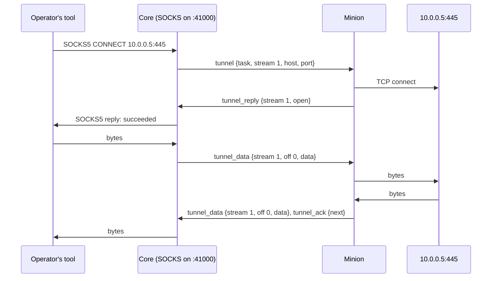

:::caution[Draft]
A design to agree on, not built yet. Nothing here is in the protocol package,
core or a minion; the item numbers and the action are proposed, and the open
questions at the end are to settle first.
:::

A **tunnel** is a TCP connection the minion makes from its host, whose bytes
core and the minion carry inside their messages: core opens a **stream** to
`host:port`, the minion connects there, and each side relays what its end
sends. Core speaks the protocol of the operator's tools in front of it; the
first is a **SOCKS proxy** on one of core's **operational ports**, so an
operator's browser, scanner or `proxychains` reaches what the minion's host
reaches. The minion never sees SOCKS: it opens, relays and closes TCP
streams, whatever core put in front.



## Operational ports

Core keeps a **range of ports** it may listen on for operators: the
operational ports. Each one in use serves one purpose for one task, and goes
back to the range when the task ends. A SOCKS proxy is the first purpose;
others (a port forward to a host behind a minion) take ports the same way.

| Setting | Meaning |
|---|---|
| `OPERATIONAL_PORTS` | The ports core may open: ranges and single ports, `41000-41063,42000`. Empty (the default): none, and no tunnel can be opened. |
| `OPERATIONAL_BIND` | The address core listens on: `0.0.0.0` by default; `127.0.0.1` keeps them to the core host (an SSH forward to it, say). |
| `OPERATIONAL_ADDRESS` | The host or address operators connect to, as the web app shows it (`proxychains` lines, the proxy's address): core's public host when unset. |

- **Published by the deployment.** Docker Compose and the Helm chart publish
  the range, TCP and UDP, as they publish core's own ports.
- **Open to whoever reaches them.** Core's SOCKS takes no credentials: a
  port is as private as the network in front of it. The deployment's
  firewall lets the operators' addresses through, or `OPERATIONAL_BIND`
  keeps the ports on the core host.
- **One core instance.** The listeners live in core's process, as its
  persistent connections do ([One core
  instance](../../../architecture/#one-core-instance)): scaling out pins a
  port to the instance that holds it.
- **Kept, and opened again.** Core keeps which port serves which task
  (`operational_ports`: the port, its purpose, operation, session, task, who
  opened it and when). A restart opens again the ports of tasks still
  running.
- **Who.** An operator of the operation opens and closes them, through the
  task; every member sees which are open, and the operation's **Ports**
  lists them.

## The tunnel command

A minion tunnels only when its build has a command for it, as for any other
work: the factory declares a command whose
[action](../../task-results-and-actions/) is **`tunnel`**, and the operator
picks it into the build. A minion built without one carries nothing of
tunnels, and takes no tunnel item.

| `tunnel` action | |
|---|---|
| Core gives | `port`, an `int`: the operational port core listens on for the task, 0 for any free one. The minion needs nothing of it. |
| Needs result | none: the task's view is core's (the proxy's address and its streams). |
| `kinds` | The command's [`kinds`](../../minion-build/#commands) leave out those its minion cannot keep a socket open over between messages: a `bind-call` page keeps nothing between calls, so its factory leaves `bind-call` out. |

A command may take more, each with a default, which only the minion reads:
how long it waits for a connect (`timeout`, 10 s), how many streams it keeps
open at once (`max_streams`, 256), and, for a minion that polls, how often it
checks in while the task runs and no stream is open (`interval`, 1 s).

**The task is the tunnel.** Core opens the port when it queues the task, and
holds it while the task runs: one SOCKS proxy, any number of streams.

**Shared by the operation.** A port serves its task, not the operator who
started it: any number of tools, of any number of operators, use it at once,
their connections streams of the same task. They share its `max_streams` and
its Stop; each stream's record says the client's address (who started the
task is the task's). An operator who wants a tunnel of their own starts
another tunnel task on the session, on another port. The
minion acks the task and keeps it running, taking `tunnel` items for it,
until core cancels it. **Stop** cancels the task: core closes the port and
its streams, and the minion closes its sockets and ends the task ok. A task
that ends on the minion's side (it exited, it lost the task) closes the port.

## Streams

Every item names its task and the **stream** in it: a number core gives
from 1, never reused within the task. Five items, one CDDL each:

```cddl
tunnel = {              ; core → minion: open a stream
  0: 21,                ; t: tunnel
  1: task-id,           ; task: the tunnel task
  2: uint,              ; stream: its number in the task, from 1
  ? 3: tstr,            ; host: a name, which the minion resolves, or an
                        ;   IPv4 or IPv6 address; not for udp
  ? 4: uint,            ; port: 1 to 65535; not for udp
  ? 5: uint,            ; room: what core takes of the stream past an ack
                        ;   (its window), 262144 when absent
  ? 6: bool,            ; udp: a UDP association, not a TCP connection
                        ;   (see UDP)
}

tunnel_reply = {        ; minion → core: opened, or why not
  0: 22,                ; t: tunnel_reply
  1: task-id,           ; task
  2: uint,              ; stream
  3: uint,              ; result: 0 open, else why (below)
  ? 4: tstr,            ; bound: the local address of the minion's socket,
                        ;   "ip:port", when open
  ? 5: uint,            ; room: what the minion takes past an ack, 262144
                        ;   when absent
  ? 6: tstr,            ; msg: why, for a person, when not open
}

tunnel_data = {         ; both: bytes of the stream, one direction
  0: 23,                ; t: tunnel_data
  1: task-id,           ; task
  2: uint,              ; stream
  3: uint,              ; off: where data starts in this direction's bytes
  ? 4: bstr,            ; data: at most 64 KiB, within the connection's
                        ;   max_message
  ? 5: bool,            ; eof: the sender sends no more after data (its
                        ;   end closed for writing)
}

tunnel_ack = {          ; both: how far the receiver has a direction
  0: 24,                ; t: tunnel_ack
  1: task-id,           ; task
  2: uint,              ; stream
  3: uint,              ; next: it has every byte before next
  ? 4: uint,            ; room: it takes this many past next, unchanged
                        ;   when absent
}

tunnel_close = {        ; both: the stream is over
  0: 25,                ; t: tunnel_close
  1: task-id,           ; task
  2: uint,              ; stream
  3: uint,              ; reason (below)
  ? 4: tstr,            ; msg: for a person
}
```

| `result` | Means | SOCKS5 reply |
|---|---|---|
| 0 | open | succeeded (0) |
| 1 | refused: nothing listens there | connection refused (5) |
| 2 | host unreachable, or its name does not resolve | host unreachable (4) |
| 3 | network unreachable | network unreachable (3) |
| 4 | timed out connecting (the command's `timeout`) | TTL expired (6) |
| 5 | not allowed: `max_streams` open already | not allowed (2) |
| 6 | another failure (`msg` says) | general failure (1) |

| `reason` | Means |
|---|---|
| 1 | done: both directions reached `eof` and were acked |
| 2 | reset: one end aborted (the operator's tool, or the host) |
| 3 | no such stream here: the receiver does not have it (a stream of a connection that went) |
| 4 | the task ended, or is ending |

**Opening.** Core sends `tunnel` once a SOCKS client asked for a
destination; the minion connects (resolving a name on its own host, so
internal names work) and answers with `tunnel_reply`. Core holds the SOCKS
client until the reply comes, or the command's `timeout` and the minion's way
back have passed, then answers it with the reply's code.

**Bytes, in order, within a window.** Each direction is a byte stream from 0,
as a file is in [chunks](../file-transfers/#chunks): a `tunnel_data` is kept
only when its `off` is where the receiver has the stream (its `next`), so one
sent again is not kept twice. The receiver answers with `tunnel_ack`: `next`,
and the `room` it has past it. A sender keeps every byte it sends until an
ack covers it, and sends no byte past `next + room`: a stream whose reader is
slow stops its writer, on both sides, and neither holds more than its window
of it.

**Closing.** A direction ends with `eof` (a half close: the other may go on).
When both have ended and been acked, either side sends `tunnel_close` with
`done`. An end that aborts (the tool closed its socket, the host reset)
sends `reset`, and the other side drops the stream at once. An item about a
stream the receiver does not have is answered with `tunnel_close` reason 3,
and the sender drops it.

**Sent twice, safely.** `tunnel` for a stream the minion has is answered with
its `tunnel_reply` again; `tunnel_data` before `next` is dropped (and acked
again); an ack below the last is ignored; `tunnel_close` for a stream gone is
nothing. A message sent again, a lost reply, or the minion back over another
connection loses no byte and doubles none.

**Back over a new connection.** The streams are the minion's sockets and
core's clients: they outlive a connection that drops when both ends do. When
the minion comes back (its next check-in, or a new persistent connection),
each side sends again from the other's last ack. A minion whose sockets go
with its connection (a channel that acts as the minion, its state per
connection) answers the first item about each with reason 3, and core closes
its SOCKS client.

**In a message.** Tunnel items share messages with everything else, within
the connection's `max_message` ([Limits](../wire-format/#limits)): core puts
its acks and cancels first, then tasks, then tunnel acks, then tunnel data,
one item per stream in turn while the message has room, so a busy stream
does not starve the others or the tasks. A minion fills its own the same
way.

## SOCKS

Core answers SOCKS on the task's port:

- **SOCKS5** ([RFC 1928](https://www.rfc-editor.org/rfc/rfc1928)) `CONNECT`
  to an IPv4 or IPv6 address or a domain name, and **SOCKS4** / **4a**
  `CONNECT`. A name goes to the minion as it came: the minion resolves it.
  `UDP ASSOCIATE` comes [next](#udp); `BIND` is refused (command not
  supported, 7).
- **No credentials.** Core offers SOCKS5's "no authentication" method only:
  any tool reaching the port uses it ([Operational
  ports](#operational-ports)).
- The reply's `BND.ADDR` is the minion's `bound` address, so a tool sees the
  address its connection leaves the host from.

## UDP

Right after the TCP streams: SOCKS5 **`UDP ASSOCIATE`**, for what speaks
UDP to the minion's networks (DNS to an internal server, SNMP, NTP).

1. A tool asks for an association over its SOCKS connection. Core opens a
   stream for it with `tunnel` and `udp: true` (key 6) and no host or port;
   the minion opens a UDP socket and answers `tunnel_reply` with its
   `bound` address.
2. Core answers the tool with its UDP relay: the same operational port
   number, UDP. Datagrams the tool sends there (the SOCKS UDP header, then
   the payload) go to the minion as `tunnel_datagram` items: the
   destination, the payload. The minion sends each from its socket, and
   sends what comes back to it as `tunnel_datagram` with the source; core
   wraps it in the header and sends it to the tool.
3. The association lasts as long as the tool's SOCKS connection: when that
   closes, core sends `tunnel_close`, and the minion closes its socket.

```cddl
tunnel_datagram = {     ; both: one datagram of a UDP stream
  0: 26,                ; t: tunnel_datagram
  1: task-id,           ; task
  2: uint,              ; stream: the association's
  3: uint,              ; seq: its number in this direction, from 0
  4: tstr,              ; host: core → minion the destination (a name
                        ;   the minion resolves, or an address); minion →
                        ;   core the source's address
  5: uint,              ; port
  6: bstr,              ; data: the payload, within the connection's
                        ;   max_message
}
```

- **As UDP is: no acks, no resending.** A datagram that does not fit, or
  finds the other side's queue full (256 KiB of datagrams per association),
  is dropped. `seq` only lets a receiver drop one it already has, when a
  message goes twice.
- **No fragments.** A SOCKS UDP header with `FRAG` other than 0 is dropped,
  as most SOCKS servers do.
- **The same task**, the same `max_streams` (an association counts as one),
  and the same ending.

## On each connection kind

| Kind | A tunnel's items go |
|---|---|
| `reverse-call` | in the minion's check-ins and core's replies, as fast as they go: **while a stream is open the minion skips its sleep**, checking in again as soon as a reply comes; while the task runs with no stream open, it checks in every `interval` (1 s), so a new stream opens within about a second; with no tunnel task, on its schedule. Core answers at once when it has tunnel items, and holds an empty reply up to 250 ms for bytes to come, so an idle stream does not spin. |
| `reverse-persistent` | as they come, pushed both ways |
| `bind-call` | in core's calls, called again at once while a stream has bytes either way: only for a minion that keeps its sockets between calls. A page does not, and leaves the kind out of the command's `kinds`. |
| `bind-persistent` | as `reverse-persistent`, while connected |

The [mechanics checklist](../#changing-these-formats): every step is an
item keyed by `(task, stream, off)` or `(task, stream)` and harmless sent
again; core drives it by putting tunnel items where its messages are made
and nudging the session, the minion by checking in at once; nothing needs a
`ctx`, since a tunnel lives in the minion's sockets (which is why a page
cannot have one); every message keeps within `max_message`; and the
command's `kinds` say where it works.

## What core keeps and shows

- **The task** in the session's Tasks: *SOCKS on core:41000*, running, with
  **Stop**. Its view: the proxy's address and port to copy, a `proxychains`
  line, and its streams, live: the
  client's address, the destination, bytes each way, when it opened, how it
  ended.
- **Each stream's destination**, in the task's output as it opens and ends
  (`10.0.0.5:445 open … closed, 3.2 KB up, 18.4 KB down`): who reached what
  through the minion, as the operation's record. The bytes are never kept.
- **The operation's Ports**: every operational port in use, by whom, for
  which session, since when.

## Limits

| | |
|---|---|
| A `tunnel_data`'s data | 64 KiB, and within the connection's `max_message` |
| A stream's window (`room`), as opened | 256 KiB each way, unless a side says another |
| Streams open at once in a task | the command's `max_streams` (256 by default); core refuses more SOCKS clients with not allowed |
| A SOCKS client waiting for its stream to open | the command's `timeout` and the minion's way back: on `reverse-call`, within its `interval` |

## Open questions

- **A bandwidth cap** per tunnel task, so one tunnel cannot fill a slow
  connection's messages or a scarce network. Proposed: the operator sets it
  when starting the tunnel (bytes a second each way; none by default) and
  changes it live; core enforces it alone, the minion unchanged. Core paces
  what it sends (`tunnel_data` toward the minion) and what it lets the
  minion send (it gives `room` in its acks no faster than the cap allows),
  over every stream of the task together. UDP datagrams over the cap are
  dropped.

## Design notes

**Core speaks SOCKS; the minion speaks TCP.** Forwarding the SOCKS bytes for
the minion to parse would put a SOCKS server in every minion (and a SOCKS4,
and UDP's headers, and each one's quirks), and leave core blind to what is
reached. With core in front, a minion implements a few small items once,
and the same items serve every front core adds later (a port forward, a
browser's own proxy); core sees and records each destination.

**A task, not a session's setting.** A tunnel is work the minion does, so it
goes as work goes: built in only when picked (a minion built without it
carries none of it), held to the kinds it works over, stopped by a cancel,
found or lost by [`reack`](../tasks-and-results/#tasks-the-minion-lost) after
a reconnect, recorded in the session's history, and its streams end with it,
as a transfer ends with its task.

**Offsets and windows, as files have.** A stream is a file with no end yet,
in both directions at once: `off` and `next` make every item safe to send
again, on every kind, and a window bounds what each side holds of a stream
whose reader is slower than its writer, which a TCP connection's own window
otherwise hides from the minion until its memory fills.
