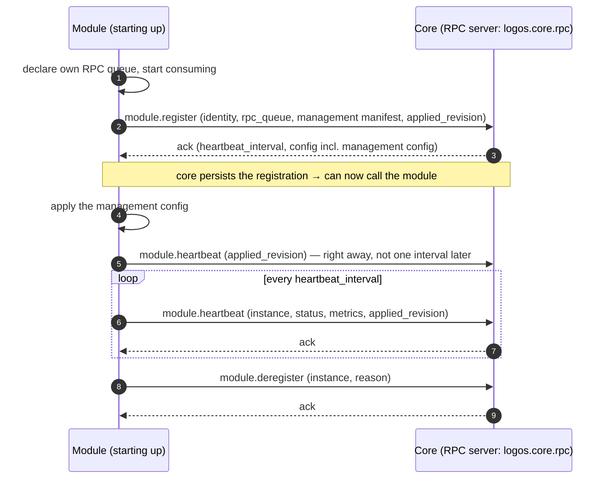
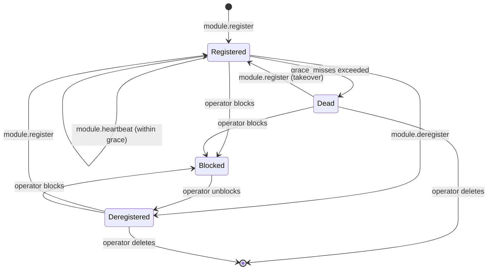

This is a **control-plane** contract shared by **all** module types — channels
and factories alike. It defines how a module announces itself to core,
proves it is alive, and leaves cleanly. It is the bootstrap that every other
control-plane contract depends on: core cannot issue management RPC to a module
until that module has registered.

It builds on the shared [AMQP envelope](../amqp-envelope/) and
[routing conventions](../amqp-conventions/). A module that can be managed also
declares its [management manifest](../module-management/#the-manifest) here and
receives its configuration in the register reply.

## Roles and direction

For lifecycle operations the **module is the RPC client** and **core is the RPC
server**. This is the opposite direction from [Module Management](../module-management/),
where core is the client.
The control plane is bidirectional; ownership is per-operation, not global.



## Transport

| Aspect | Value |
|---|---|
| Exchange | `logos.core.rpc` (direct) |
| Routing key | `core` |
| Request queue | `logos.core.rpc` (competing consumers across core instances) |
| Reply | direct reply-to (`amq.rabbitmq.reply-to`), `correlation_id` echoed |
| Body | [AMQP envelope](../amqp-envelope/) / RPC reply envelope |

All operations are request/reply. The `type` field selects the operation. The
sections below specify each operation's request and reply `payload`; the
surrounding envelope is omitted for brevity.

## Operations

| `type` | Summary |
|---|---|
| `module.register` | Announce a module instance and receive bootstrap config. |
| `module.heartbeat` | Prove liveness; refresh config if changed. |
| `module.deregister` | Leave gracefully (e.g. on shutdown). |

---

### `module.register`

Sent once on startup, after the module has declared its own RPC request queue and
begun consuming, so it is ready to serve management calls the moment core
acknowledges.

Request:

```json
{
  "module_type": "channel",
  "module_name": "http",
  "instance": "http-1",
  "version": "1.2.0",
  "rpc_queue": "logos.channel.rpc.http-1",
  "description": "HTTPS/DNS Logos channel — primary beacon listener.",
  "icon": "<svg xmlns=\"http://www.w3.org/2000/svg\" viewBox=\"0 0 24 24\" fill=\"none\" stroke=\"currentColor\" stroke-width=\"2\"><circle cx=\"12\" cy=\"12\" r=\"9\"/></svg>",
  "management": {
    "schema_version": "1",
    "properties": [ … ],
    "actions": [ … ],
    "status": [ … ],
    "capabilities": ["logs"]
  },
  "applied_revision": 0,
  "connection": {
    "schema_version": "1",
    "version": 1,
    "fields": [ … ]
  }
}
```

- `module_name` is the module's **hardcoded identity** — its project/kind
  (`http`, `dns`, `telegram`, `git`, ...), baked into the implementation and
  shared by every running instance of that module. It is not operator-selectable.
- `instance` is the **unique id of one deployed instance**, self-assigned by the
  module (e.g. from its env/config). Core does not mint it. An operator may run
  several instances of the same `module_name` (e.g. `http-channel-1`,
  `http-channel-2`); each must carry a distinct `instance`, since heartbeat,
  deregister, and management RPC all address a module by `instance` alone.
  Core does not detect a clash: a module that registers under an instance id
  already in use, even of another type or name, takes that instance over,
  stored configuration and history included.
- `rpc_queue` tells core which queue to use when it acts as client toward this
  module (see [routing conventions](../amqp-conventions/#rpc-requestreply)).
- `description` is optional free-text the module reports about itself, surfaced
  on the admin Modules page.
- `icon` is optional: the module's own SVG icon, shown next to it in the app.
  Without one, the app shows its type's default (a radio tower for channels, a
  factory for factories). The app draws it as a single-colour glyph in its text
  colour, like its built-in icons, so draw shapes on a transparent background
  (`stroke="currentColor"` on a 24×24 `viewBox` matches them); colours are not
  kept. It must be at most 16 KiB of well-formed XML with one root `<svg>` in
  the SVG namespace, built only from shapes, structure (`g`, `defs`, `symbol`,
  `use`), gradients, clipping, masks, text, `title` and `desc`: no scripts,
  `foreignObject`, images, `<style>` elements (a `style` attribute is fine),
  animations or event handlers, no DOCTYPE or processing instructions (but the
  `<?xml?>` declaration), and no references outside the icon (`href` and
  `url()` only to `#id`). Core drops an icon that breaks these
  rules, with a warning in its log; the module still registers. How a module
  keeps its icon (a file embedded at build time, a constant, something
  generated) is up to it. A page that lists module kinds (the factories to
  build with, the channels to connect through) shows each kind's icon from its
  latest registration that sent one.
- `icon_light` is optional, and only taken with an `icon`: the same picture
  drawn for light themes, which the app shows there instead. The text colour
  the icon is painted in is light on dark themes and dark on light ones. Line
  art reads the same either way, but an icon whose shape is the lit parts of a
  shaded drawing reads as a negative on light themes; draw that one again with
  the shadows and lines as the shape. The same rules apply; core drops one that
  breaks them, or that comes without an `icon`, with a warning in its log, and
  keeps the rest of the registration. A registration without one clears the
  stored one.
- `management` is optional: the module's
  [management manifest](../module-management/#the-manifest). Without it the
  module is registered but not manageable. An invalid manifest fails the whole
  registration with `validation_failed`.
- `applied_revision` is the configuration revision the process has applied — 0
  for a fresh process. Core uses it to see whether the module is in sync.
- `connection` is optional, for channels: the
  [minion connection schema](../minion-connection/), the parameters minions are
  given to reach this channel. An invalid schema fails the registration with
  `validation_failed`; a registration without one clears the stored schema.
- `build` is optional, for factories: the
  [build schema](../minion-build/#the-build-schema), what the factory can build
  and which parameters each build takes. Only a module of type `factory` may
  send one. An invalid schema, or one from another type, fails the
  registration with `validation_failed`; a registration without one clears the
  stored schema.
- Other top-level fields are type-specific declarations, like `connection` for
  channels and `build` for factories. The Go SDK adds them with
  `lifecycle.WithRegisterField` (channel-core and factory-core add those two);
  the SDK's own keys are reserved: `module_type`, `module_name`, `instance`,
  `version`, `rpc_queue`, `description`, `icon`, `icon_light`, `management` and
  `applied_revision`. The SDK sends `Identity.Icon` as `icon` and
  `Identity.IconLight` as `icon_light`, and refuses to start with one that
  breaks the rules (`protocol.ValidateIcon`) or a light icon without an icon.

Reply `payload`:

```json
{
  "instance": "http-1",
  "registered": true,
  "heartbeat_interval_seconds": 30,
  "heartbeat_grace_misses": 3,
  "config": {
    "policy": {},
    "feature_flags": {},
    "management": {
      "revision": 6,
      "values": { "max_body_bytes": 4194304, "log_level": "debug" }
    }
  }
}
```

Core persists the registration in its module registry (MongoDB) and may now issue
management RPC to `rpc_queue`. `config.policy` and `config.feature_flags` are
always empty today.

`config.management` is present when the module sent a manifest. It is the same
configuration an [`mgmt.config.apply`](../module-management/#mgmtconfigapply)
would carry: the module applies it as soon as the ack arrives (the Go SDK does
it inside `Register`), and this first apply is also when `restart` properties
take effect. A module that starts serving before it registers, as the HTTP
channel does, serves with its own starting values until then. The module then heartbeats **at once**
with the new `applied_revision`, so core sees it in sync immediately rather than
one interval later.

**Re-registration is idempotent (takeover).** If an `instance` re-registers — for
example after a restart — core upserts the existing record and resumes; it does
not create a duplicate and does not error, unless an operator blocked the
instance. The most recent registration wins: it replaces the manifest, the
connection and build schemas and the icons, and clears any it leaves out, and
it clears what the previous process reported (its last heartbeat, health,
status values, rejected values, `restart_required` and the last apply error).

Errors:

- `validation_failed`: a malformed payload; a missing `module_type`,
  `module_name`, `instance` or `rpc_queue`; an invalid manifest, connection
  schema or build schema; a build schema from a module that is not a factory.
- `instance_blocked`: an operator blocked the instance.
- `unsupported_version`: the request envelope's contract major version is one
  core does not serve — enforced at the transport layer for every RPC, not
  per-declared-contract.
- `internal_error`: the registry could not be written.

### `module.heartbeat`

Sent every `heartbeat_interval_seconds` from the register ack. A reaper in core
runs every 15 seconds (`MODULE_REAPER_INTERVAL`; `MODULE_REAPER_ENABLED` turns it
off) and marks a registered instance **dead** when its last heartbeat (or its
registration, if it never beat) is older than the interval times
`heartbeat_grace_misses`: by default 30 s × 3, so an instance is declared dead
90 to 105 seconds after its last beat (`MODULE_HEARTBEAT_INTERVAL`,
`MODULE_HEARTBEAT_GRACE_MISSES`). `Dead` is a state of its own: the instance
stays listed until an operator deletes it, and its heartbeats get
`unknown_instance`, which makes it register again.

Request:

```json
{
  "instance": "http-1",
  "status": "healthy",
  "metrics": {
    "requests_total": 1532,
    "draining": false
  },
  "applied_revision": 6
}
```

`status` is one of `healthy`, `degraded`: the module's own judgement of
whether it can do its job. It carries no module-specific states — a channel
paused by an admin, for example, stays `healthy` and shows the pause in its
management status values. `metrics` is an optional, lightweight liveness
snapshot — not a metrics-pipeline substitute. A managed module puts its
declared [status values](../module-management/#fields) here; core shows the
latest ones and keeps no history.

`applied_revision` (managed modules) is the configuration revision the module
has applied. When it differs from the desired revision, core pushes the
configuration again (drift repair, see
[Module Management](../module-management/#delivery)).

Reply `payload`:

```json
{ "instance": "http-1", "ack": true, "config_changed": false }
```

When `config_changed` is `true`, the module should re-`register` to pull the
updated bootstrap config. Core always sends `false` today. Management
configuration does not use this flag: core pushes it with `mgmt.config.apply`.

Errors: `unknown_instance` (no active registration — module should re-`register`),
`validation_failed` (a malformed payload, or no `instance`).

### `module.deregister`

Sent on graceful shutdown so core can drop the instance from the active registry
immediately rather than waiting for heartbeats to lapse.

Request:

```json
{ "instance": "http-1", "reason": "shutdown" }
```

`reason` is free-form (`shutdown`, `redeploy`, `operator_request`, ...).

Reply `payload`:

```json
{ "instance": "http-1", "deregistered": true }
```

Errors: `unknown_instance`, `validation_failed` (a malformed payload, or no
`instance`).

---

## Liveness state machine



Core stops issuing management RPC to an instance once it is `Dead`,
`Deregistered` or `Blocked`, and resumes after a fresh `module.register`.

### Operators

An operator with `module:delete` (never an agent key) changes an instance's
state from the Modules page:

- **Block**, in any state but blocked. Core refuses the instance's
  `module.register` with `instance_blocked`, its heartbeats with
  `unknown_instance` and its traffic (the data-plane gate), until it is
  unblocked. A running instance is cut off at once and cannot come back: its
  next heartbeat leads it to register again, which is refused. Core records
  when, who and an optional reason (at most 500 characters), and clears the
  instance's health and status values. The Go SDK logs the block and asks again
  every 30 s, so a running instance comes back by itself once unblocked.
- **Unblock** leaves the instance `Deregistered`, free to register again.
- **Delete**, only for a `Deregistered` or `Dead` instance: its row leaves the
  registry. Its stored configuration and history stay, and an instance that
  registers again under the same id gets them back. A registered instance
  would only register again (block it instead), and a blocked instance's row
  is its block.

Nothing else removes an instance: core keeps deregistered and dead instances
listed until an operator deletes them. An operator cannot deregister a running
instance; that would last only until its next heartbeat.

## Error codes

| Code | Meaning |
|---|---|
| `validation_failed` | Malformed lifecycle payload. |
| `unsupported_version` | Module declares a contract major version core cannot serve. |
| `unknown_instance` | Heartbeat/deregister for an instance with no active registration. |
| `instance_blocked` | Register from an instance an operator blocked; refused until it is unblocked. |
| `internal_error` | Unexpected core-side failure (registry I/O, etc.). |

## Auditing

Core publishes every lifecycle transition on `logos.events` for observers,
routed as `<module_type>.<instance>.<event>` (envelope type `module.<event>`,
payload `{"module_type", "instance", "event"}`), where the event is one of
`registered`, `deregistered`, `declared_dead`, `blocked`, `unblocked` and
`deleted`; it also logs it, and the web app's module views update on it at
once. Core keeps no lifecycle history of its own: the registry row holds the
latest times (registered, last heartbeat, deregistered, blocked). Nothing
subscribes to the events yet.
