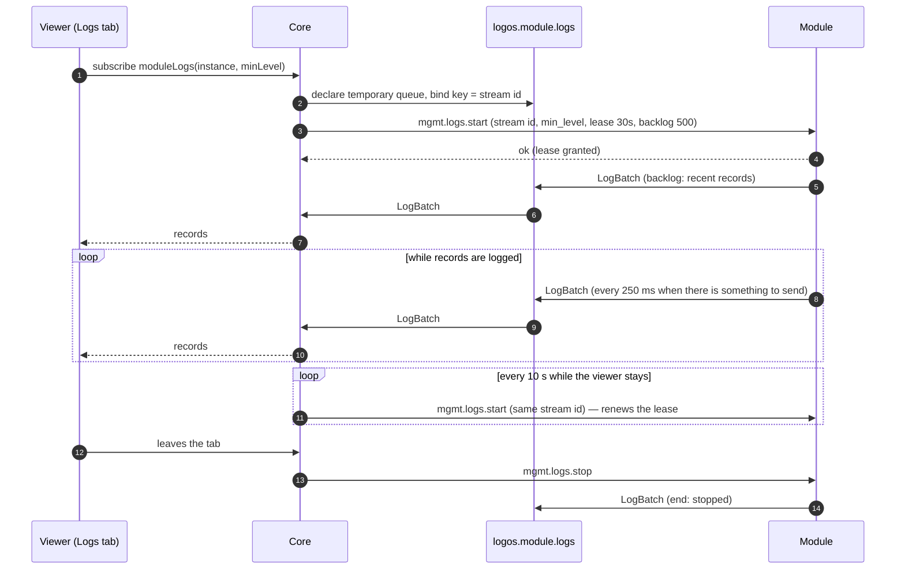

This **control-plane** contract lets an operator watch a module's logs live in
core's admin UI. Core asks the module for a **leased stream**; the module
publishes its log records in batches while the lease lasts; core relays them to
the viewer. **Nothing is stored** — not in core, not on the broker. History
belongs to a log aggregator reading the module's own output.

It is an optional part of [Module Management](../module-management/): a module
that supports it lists `logs` in its manifest's `capabilities`, and core shows
the Logs tab only for such modules.

## Flow



## Transport

| Direction | How |
|---|---|
| Core → module | `mgmt.logs.start` / `mgmt.logs.stop` on the module's management queue, like every [management operation](../module-management/#transport) |
| Module → core | `LogBatch` JSON messages published to the **`logos.module.logs`** exchange (direct, durable), routing key = **stream id**, transient (not persisted) |
| Core side | one queue per stream, `logos.core.logs.<stream id>`: exclusive, auto-delete, at most 200 batches (`x-max-length`, oldest dropped first) |

Batches are plain JSON, not wrapped in the RPC envelope: they are a stream, not
requests. A batch no queue is bound for (the viewer is gone) is dropped by the
broker.

## Operations

### `mgmt.logs.start`

Request `payload`:

```json
{
  "stream_id": "a87ff679-a2f3-471d-9181-a67b7542122c",
  "min_level": "debug",
  "lease_seconds": 30,
  "backlog": 500,
  "actor": { "type": "user", "id": "6ab79922…", "name": "admin" }
}
```

| Field | Meaning |
|---|---|
| `stream_id` | Chosen by core, `^[A-Za-z0-9_-]{1,64}$`. Routing key of the batches. |
| `min_level` | `debug`, `info` (default), `warn` or `error`: filtering happens at the source. |
| `lease_seconds` | How long the module streams without a renewal: default 30, at most 120. |
| `backlog` | How many recent records (at or above `min_level`) to send first, at most 1000. |

**Sending start again for an active `stream_id` renews the lease** (and may
change `min_level`) without resending a backlog. A start for an id the module
does not have — after it restarted, reconnected, or let the lease expire —
**creates the stream anew**; its batches then start again at `seq` 1.

Reply `payload`: `{ "stream_id": "…", "lease_seconds": 30 }` (the granted lease).
Errors: `validation_failed` (bad fields), `not_found` (the module does not
support log streaming), `internal_error` (not connected to the broker).

### `mgmt.logs.stop`

Request `payload`: `{ "stream_id": "…" }`. Ends the stream with a final batch
(`end_reason: stopped`). Stopping an unknown or ended stream succeeds. Reply
`payload`: `{ "stream_id": "…" }`.

## Batches

```json
{
  "stream_id": "a87ff679-a2f3-471d-9181-a67b7542122c",
  "instance": "http-local",
  "seq": 7,
  "records": [
    {
      "time": "2026-10-25T13:07:09.712Z",
      "level": "info",
      "message": "request failed",
      "attrs": {
        "outcome": "bad_request",
        "status": 404,
        "headers": { "accept": "*/*", "user-agent": "curl/8.21.0" }
      }
    }
  ]
}
```

False, zero and empty fields are left out: a live batch with nothing dropped
carries neither `backlog` nor `dropped`.

| Field | Meaning |
|---|---|
| `seq` | Increases by one per batch of a stream, so a gap means batches were lost on the way. Starts again at 1 when the stream is recreated. |
| `backlog` | The records predate the start (the module's recent buffer). |
| `records[]` | `time` (RFC 3339), `level`, `message`, `attrs`. |
| `dropped` | Records the module discarded since the previous batch (rate limit, slow publishing). |
| `end`, `end_reason` | Set on the stream's last batch: `stopped` (`mgmt.logs.stop`), `lease_expired` (no renewal in time), `shutdown` (the module is stopping), `replaced` (a newer stream took its slot). A stream that dies with the module's broker session ends with no last batch. |

**`attrs` is the module's own structure**, as its JSON log output has it:
nested objects stay nested, and values keep their JSON type. They travel as a
JSON object, so keys arrive sorted rather than in logging order. The Go SDK
turns an error into its message and a duration into nanoseconds, and cuts a
structured value whose JSON passes 4 KiB into a string. Core and the UI show it
as it is and never interpret key names.

### Limits

| Limit | Value |
|---|---|
| Message length | 8 KiB (longer messages are cut, ending in `…`) |
| One attr value (a string, or the JSON of a structured value) | 4 KiB |
| Attr values per record | 128 |
| Records per batch | 500 (but a stream's last batch, which drains everything still queued for it in one, up to about 1,000) |
| Records per second per stream | 200 (excess counted in `dropped`) |
| Concurrent streams per module | 4 (a fifth replaces the oldest, which ends with `replaced`) |
| Recent buffer (backlog source) | 1000 records |

These are the Go SDK's defaults: the ring size, rate and flush interval can be
changed (`WithRingSize`, `WithRate`, `WithFlushInterval`), and the attr limits
are the SDK's slog handler's. Core checks none of them. It keeps at most 64
events per viewer.

## Module obligations

A module that declares `logs`:

- keeps a **small in-memory buffer** of recent records to serve `backlog`;
- **never blocks its own logging** on a stream: when publishing falls behind it
  drops records and counts them in `dropped`;
- **ends a stream by itself** when its lease runs out, so a core that crashed
  or lost the viewer never leaves a stream running;
- sends a final `shutdown` batch when it stops, if it can;
- may produce `debug` records for a stream that asks for them even when its own
  output level is higher — without changing its own output. The Go SDK always
  sends `info` and above to its streams, whatever `log_level` says, and `debug`
  only while a stream asks for it, so the recent buffer holds `debug` records
  only from such times.

`logos-golang-module-core` does all of this in `pkg/logstream`; see
[Implementing a Module](../../implementing-a-module/).

## What core does

- **One stream per viewer**, with the viewer's own level and backlog. Core
  renews it every 10 s while the viewer stays and stops it when the viewer
  leaves.
- **Recovery.** When core has seen a stream end, or a renewal fails, it creates
  the stream again, asking for a backlog so the viewer sees what was logged in
  between. Two cases go further:
  - A module that loses its broker session ends its streams with no last batch.
    If it is back before a renewal fails, the renewal recreates the stream with
    no backlog: `seq` starts again at 1, and what was logged in between is not
    shown.
  - When core loses its own queue, it binds a new one and starts the stream
    again with a backlog; the module, whose stream is still alive, only renews
    its lease and sends no backlog, so the gap shows as lost batches.

  The viewer sees the state: streaming, disconnected (retrying) or ended.
- **Lost batches.** Core compares `seq` from batch to batch and flags a gap; the
  UI says some batches were lost in transit.
- A stream ended with `replaced` stays ended: recreating it would push another
  viewer out, who would do the same, in a loop.
- **Never blocks on a slow viewer**: it drops records and counts them, but
  always delivers state changes.
- Records who opened and closed a stream, and at which level, in its own log —
  never the content.

**Opening a stream.** An unknown instance gives `NOT_FOUND`; an instance that is
not registered, or that does not serve `logs`, gives `BAD_USER_INPUT`. When the
first `mgmt.logs.start` fails, or gets no reply within 5 s, the subscription
fails and is not retried; the web app tries again when the module registers
again.

**What a viewer receives** (the `moduleLogs` GraphQL subscription): events with
`records`, `backlog`, `dropped` (the module's drops and core's), `lost`, and the
stream's `state` and `reason`. Levels are uppercase (an unknown one is
`INFO`), and times are UTC RFC 3339.

**In the web app**, the module page's Logs tab keeps the last 5,000 lines
(10,000 while paused or scrolled up) and filters them in the browser. Changing
the level opens a new stream and clears the lines; a backlog sent again after a
restart is not shown twice. It can pause, clear and download, and shows a
record's raw JSON in a side pane. A browser tab in the background stops its
stream.

Access needs `module:logs:read`, which only the app's `admin` role holds;
agent API keys are refused.

## Design notes

- **A live tail, not log management.** Storing logs would make core a log
  aggregator with retention, search and access questions of its own. A module's
  output (JSON on stderr) is what an aggregator should collect.
- **Leases instead of trusting stop.** A stop can be lost — core crashes, a
  WebSocket drops. With a lease, the worst case is a stream that runs 30 s too
  long.
- **One stream per viewer.** Sharing one stream between viewers would need core
  to keep a copy of recent records for late joiners, which is storage. Per-viewer
  streams keep core stateless; the per-module cap bounds the cost.
- **Filtering at the source.** `min_level` travels to the module, so debug
  volume never crosses the broker unless someone asked for it.
- **Never reinterpret module content.** Every module has its own log structure.
  The SDK keeps it intact (groups stay nested objects) and the UI renders the
  JSON tree as received, with no knowledge of key names.
