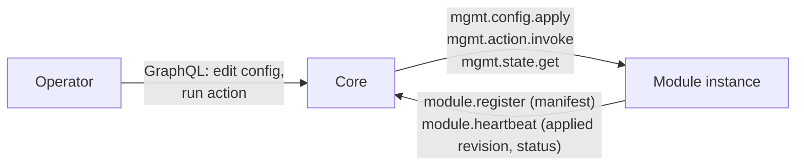
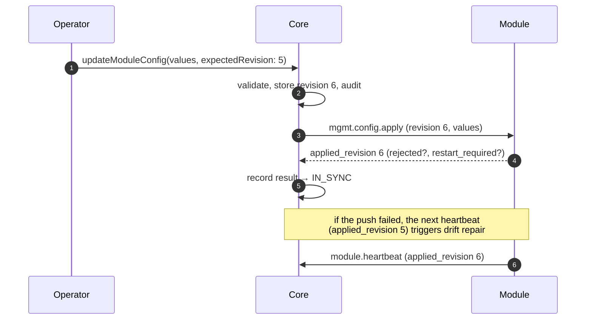

This is the **control-plane** contract through which core manages a registered
module: the module **declares** what can be managed — properties, actions and
status values — and core lets operators change properties and run actions from
its admin UI and API. It applies to every module type, not only channels.

It builds on the shared [AMQP envelope](../amqp-envelope/),
[routing conventions](../amqp-conventions/) and
[module lifecycle](../module-lifecycle/): the declaration travels in
`module.register`, status values in `module.heartbeat`. Live log tailing, an
optional management capability, has its own page:
[Module Logs](../module-logs/).

## Roles and ownership

| Party | Owns |
|---|---|
| **Module** | What is manageable (its manifest), validating and applying values, running actions, its effective runtime state. It is the system of record for what it actually applied. |
| **Core** | The **desired** value of each property per instance, revisions, authorization, the audit trail, and the admin UI/API. |

For the management operations core is the **RPC client** and the module the
**RPC server** — the opposite of lifecycle, where the module calls core.



## Transport

| Aspect | Value |
|---|---|
| Exchange | the default exchange; the module also binds its queue to `logos.<module-type>.rpc` (direct) with key `<instance>`, which core does not route through |
| Routing key | the `rpc_queue` the module sent at registration |
| Request queue | that `rpc_queue`, by convention `logos.<module-type>.rpc.<instance>`; the module handles at most 8 requests at a time |
| Reply | direct reply-to (`amq.rabbitmq.reply-to`), `correlation_id` echoed |
| Body | [AMQP envelope](../amqp-envelope/) / RPC reply envelope, version `1.0` |

The module's inbox queue is **exclusive and auto-delete**, and the module
consumes it **before** it registers: core may call it the moment it acknowledges
the registration. Core publishes requests as *mandatory* with a per-message
expiration equal to the call timeout, so a request to an instance whose queue is
gone fails immediately instead of waiting out the timeout.

## The manifest

A module declares its management surface in `module.register` under
`management`. Core validates it and **rejects the whole registration** if it is
invalid (`validation_failed`), so a module with a broken manifest never appears
half-managed.

```json
{
  "schema_version": "1",
  "properties": [
    {
      "key": "max_body_bytes", "type": "bytes", "label": "Max request body",
      "description": "Largest accepted client request body.",
      "group": "Limits", "order": 1, "unit": "bytes",
      "default": 1048576, "min": 17, "max": 67108864,
      "apply": "live"
    },
    {
      "key": "log_level", "type": "enum", "label": "Log level", "group": "Logging", "order": 2,
      "default": "info", "apply": "live",
      "options": [
        { "value": "debug", "label": "Debug", "description": "Every request outcome, plus everything below." },
        { "value": "warn",  "label": "Warn",  "description": "Core problems only." }
      ]
    }
  ],
  "actions": [
    {
      "name": "drain", "label": "Drain", "risk": "high",
      "description": "Stop serving clients until resumed.",
      "confirm": "Clients will receive 404 for every request until the channel is resumed."
    },
    { "name": "check_core", "label": "Check core", "risk": "low", "timeout_seconds": 10 }
  ],
  "status": [
    { "key": "requests_total", "type": "int", "label": "Requests" },
    { "key": "draining", "type": "bool", "label": "Draining", "alert": true }
  ],
  "capabilities": ["logs"]
}
```

### Fields

Properties and action parameters share one field description:

| Field | Meaning |
|---|---|
| `key` | Identifier, `^[a-z][a-z0-9_]{0,62}$`, unique within its list. |
| `type` | One of the [field types](#field-types). |
| `label`, `description` | Shown in the UI. Up to 120 and 1000 bytes. |
| `group`, `order`, `unit`, `placeholder` | UI hints only. |
| `format` | For `string` only: what the value is, so the UI can offer a helper. A lowercase name like a key; the value is never checked against it, and unknown formats are ignored. Known: `user_agent` (an HTTP User-Agent; the UI generates one from an OS, a browser available on it, and its latest version or 1 to 3 behind, or a common one at random), `path` (a URL path, e.g. `/cdn/assets/`; the UI generates paths of 1 to 6 words from word lists it ships, divided by `/`, `-`, `.` or `_`, offering only those that pass the field's `pattern` and `max_length`). |
| `required` | A value must be present (and, for strings, non-empty; for a `string_list` or `string_map`, no empty item or value; for an `enum_list`, at least one option). |
| `default` | The module's own value when core holds none — typically what it read from its env. Must satisfy the field's own constraints. Not to be set for `secret`: core does not check it, and never shows one. For an action param, it only pre-fills the UI's form: neither core nor the module fills in an absent param, so a `required` param is always sent. |
| `min`, `max` | Numbers for `int` / `number` / `bytes`, duration strings for `duration`, RFC 3339 timestamps for `datetime`. |
| `pattern`, `max_length` | For string-like types (each item of a `string_list`, each value of a `string_map`). `pattern` is a Go (RE2) regular expression, unanchored: anchor it with `^…$` to match the whole value. |
| `key_pattern` | For `string_map`: what every key must match. |
| `max_items` | For `string_list`, `string_map` and `enum_list`: most items or entries. |
| `options` | For `enum` and `enum_list`: 1 to 64, each a `value`, optional `label` and `description` (shown under the label in the option list). |

A **property** adds `apply`:

- `live` — the module applies a new value immediately.
- `restart` — the new value takes effect at the next start. Until then the
  module reports the key in `restart_required`, and the UI says so.

An **action** has a `name` (a key, unique among the actions), `risk` (`low` or
`high`; the UI asks before running any `high` one), an optional `confirm`
prompt the UI shows before running it, up to 16 `params`,
`timeout_seconds` (default 30, at most 60), and optional `available_when`
[conditions](#action-conditions).

A **status value** (`key`, `type`, `label`, `description`, `unit`; any type
but `secret` and `file`) is reported
by the module in its heartbeat `metrics` under `key`, and in
[`mgmt.state.get`](#mgmtstateget), which core calls after every action. Core
shows the latest value; it never stores history. For `bool`, `enum` and `string` values the
module may declare `alert`: the value that needs an operator's attention (for
example `true` for `draining`). The UI highlights a matching value and shows any
other as normal; without `alert`, values are shown neutrally — core cannot know
which value of a module's status is bad.

`capabilities` lists optional features the module serves, such as `logs`.
Unknown capabilities are ignored.

### Action conditions

Some actions only make sense in some states: draining a channel that already
drains, or closing WebSockets when none is open, changes nothing. An action
says when it is available with `available_when`, a list of conditions that must
all hold:

```json
{
  "schema_version": "1",
  "actions": [
    {
      "name": "drain",
      "label": "Drain",
      "risk": "high",
      "available_when": [
        { "status": "draining", "op": "eq", "value": false, "message": "Already draining" }
      ]
    },
    {
      "name": "resume",
      "label": "Resume",
      "risk": "low",
      "available_when": [
        { "status": "draining", "op": "eq", "value": true, "message": "Not draining" }
      ]
    },
    {
      "name": "close_connections",
      "label": "Close WebSockets",
      "risk": "high",
      "available_when": [
        { "status": "ws_connections_open", "op": "gt", "value": 0 }
      ]
    }
  ],
  "status": [
    { "key": "draining", "type": "bool", "label": "Draining", "alert": true },
    { "key": "ws_connections_open", "type": "int", "label": "WebSocket connections" }
  ]
}
```

Each condition compares the current value of a `status` value or of a
`property` (its effective value), declared in the same manifest, with `value`:

| `op` | Holds when the current value is | Types |
|---|---|---|
| `eq`, `ne` | equal, not equal to `value` | `string`, `int`, `number`, `bool`, `enum`, `duration`, `bytes`, `url`, `datetime` |
| `gt`, `gte`, `lt`, `lte` | above, at least, below, at most `value` | `int`, `number`, `bytes`, `duration`, `datetime` |
| `in` | one of the list `value` | as `eq` |

`value` is a value of the subject's type, a list of them for `in`; for an
`enum` property, one of its options. Secrets, lists and maps cannot be
compared. `message` says why the action is unavailable while the condition does
not hold; without one, the reason is made from the subject's label, such as
"Requires WebSocket connections above 0".

Core shows each action as available or not, with the reason, evaluated against
the latest status values and the effective configuration, and the UI disables
an unavailable action. That is advice: the module checks again when the action
is invoked, against its live values, and refuses it with `action_unavailable`
(module-core does this for every action). Core never refuses on its own, since
its copy of the status can be behind. A condition on a value that is not
reported, or not of its type, holds: whoever knows the value decides.

### Field types

| Type | JSON value | Rules |
|---|---|---|
| `string` | string | `pattern`, `max_length` |
| `int` | integer | `min`, `max`; must fit in int64 |
| `number` | number | `min`, `max` |
| `bool` | boolean | — |
| `enum` | string | one of `options[].value` |
| `duration` | string, e.g. `"30s"` | Go duration syntax; `min`, `max` as durations |
| `bytes` | integer | not negative; `min`, `max` |
| `url` | string | absolute URL (scheme and host) |
| `secret` | string | write-only: never returned by core or by the module |
| `string_list` | array of strings | each item checked like a `string`; `max_items` |
| `string_map` | object of string keys to string values | keys non-empty and matching `key_pattern`; each value checked like a `string`; `max_items`. Key order is not kept. |
| `datetime` | string, RFC 3339, e.g. `"2027-01-31T00:00:00Z"` | `min`, `max` as RFC 3339 timestamps |
| `enum_list` | array of option values | each one of `options[].value`, no repeats; `max_items`; `required` means at least one |

`file` exists too, for [build schemas](../minion-build/#field-types-for-builds)
only: a management manifest that declares one is refused.

### Limits

| Limit | Value |
|---|---|
| Properties / actions / status values / capabilities | 64 / 32 / 64 / 16 |
| Params per action / options per enum | 16 / 64 |
| Label / description length (bytes; option labels and condition messages too) | 120 / 1000 |
| Action timeout | 60 s |
| Conditions per action / values of an `in` condition / message length | 8 / 64 / 120 |

## Configuration

### Desired and applied

Core keeps the **desired** values of one instance's properties together with a
**revision**. Every write that changes a value increments the revision (one
that changes nothing creates no revision, history entry or push); it never goes
down. The
module reports the revision it **applied** — at registration, in every
heartbeat, and in each apply reply. The two together give the sync state the UI
shows:

| State | When |
|---|---|
| `IN_SYNC` | applied revision = desired revision |
| `PENDING` | a newer revision is on its way |
| `OUT_OF_SYNC` | pushing failed, or the instance is not registered |

The **effective** value of a property is the stored value, or the module's
`default` when core holds none. Configuration is **per instance**: there is no
value shared by all instances of a module.

### Delivery

Core delivers the configuration in two ways:

1. **In the `module.register` reply**, under `config.management`. A restarted
   module gets its configuration before it serves anything, and that is also
   when `restart` properties take effect.
2. **By `mgmt.config.apply`**, after an operator changes a value, and as
   **drift repair**: when a heartbeat reports an applied revision different from
   the desired one, core pushes again.



A push is tried up to 3 times when the module cannot be reached (10 s per
attempt, 1 s and then 2 s apart). An error reply from the module is not
retried. Drift repair runs only when a heartbeat arrives, at most every 10 s;
after a failed push the gap is 20 s, doubling with each further failure up to
640 s (about 10 minutes). A new configuration write resets it. Core's own
pushes (drift repair) carry the actor `{"type": "system", "id": "core"}`.

Values the module rejects on the register-time apply never reach core: the
heartbeat carries only `applied_revision`, so the instance shows `IN_SYNC` with
no rejected keys until a later push reports them.

If a module reports an applied revision **above** the desired one — core's
store was reset while the module kept running — core raises its revision above
the reported one and pushes, rather than having the module ignore every
following apply as stale.

### Writing configuration

Writes go through core's API, never to the module directly.
`updateModuleConfig` takes the instance, a list of `{key, value}` and
`expectedRevision`:

- The instance must have a manifest; the list needs at least one value, each
  key once. An instance that is not registered can still be written: its next
  registration reply carries the values.
- `value: null` clears the stored value: the property returns to the module's
  `default`.
- Every key must be a declared property and every value valid for it, or the
  whole write is refused.
- `expectedRevision` must equal the current revision. If someone else wrote in
  between, the write fails with `CONFLICT` and nothing changes (optimistic
  concurrency). The UI takes the revision when the first field is edited.

Each write is recorded in the instance's change history: who, when, the new
revision, and old → new per key.

## Operations

| `type` | Summary |
|---|---|
| `mgmt.config.apply` | Apply a configuration revision. |
| `mgmt.action.invoke` | Run a declared action. |
| `mgmt.state.get` | Report the effective values and status. |
| `mgmt.logs.start`, `mgmt.logs.stop` | Live log tail — see [Module Logs](../module-logs/). |

---

### `mgmt.config.apply`

Request `payload`:

```json
{
  "revision": 6,
  "values": { "max_body_bytes": 4194304, "log_level": "debug" },
  "actor": { "type": "user", "id": "6ab79922…", "name": "admin" }
}
```

`values` holds every property core has a value for. The module:

- **ignores a stale revision** (lower than the one it applied) and replies with
  its current state;
- treats a property **absent** from `values` as reset to its `default`;
- **validates each value**. A rejected key keeps its previous value; the others
  still apply;
- for `restart` properties, keeps the running value and lists the changed key in
  `restart_required` — except on the first apply after start (the register
  reply), which is what the process starts with;
- if applying fails as a whole, keeps all previous values and reports the
  changed keys as rejected.

Applying the same revision twice is harmless.

Reply `payload`:

```json
{
  "applied_revision": 6,
  "rejected": { "max_body_bytes": "must be <= 67108864" },
  "restart_required": ["listen_addr"]
}
```

`applied_revision` is the revision the module **processed**, even when some keys
were rejected — otherwise drift repair would push the same refused value
forever. Core shows rejected keys next to the property.

### `mgmt.action.invoke`

Request `payload`:

```json
{
  "invocation_id": "e4da3b7f-bbce-4345-9777-2b0674a318d5",
  "action": "check_core",
  "params": {},
  "actor": { "type": "user", "id": "6ab79922…", "name": "admin" }
}
```

Core checks first: the instance must be registered and the action declared,
the params valid and none unknown, and a `high`-risk action needs its
permission (`FORBIDDEN` otherwise). A call core refuses is not recorded. The
module validates `params` against the declared ones again (unknown params are
refused) and runs the action within its timeout. A repeated `invocation_id` for
the same action is **the same invocation**: the module returns the first
outcome, or waits for it while it is still running, and never runs the action
twice. The Go SDK remembers the last 100 finished invocations. An action keeps running if the request that started it is lost (for
example, the module's broker connection drops); its outcome is still returned
for a retry.

Reply `payload` on success:

```json
{ "invocation_id": "e4da3b7f-bbce-4345-9777-2b0674a318d5", "result": { "reachable": true, "latency_ms": 3 } }
```

`result` is any JSON value; core stores and shows it as returned. A failure is
an error reply: `action_failed` (the action returned an error, panicked or timed
out), `action_unavailable` (its [conditions](#action-conditions) do not hold;
the message says why), `validation_failed` (bad params) or `not_found` (unknown
action). A repeated `invocation_id` gets its first answer, refusal included.

Core records every invocation — actor, params, status (`RUNNING`, `SUCCEEDED`,
`FAILED`, `TIMED_OUT`), result or error, start and end time — and runs it
synchronously: the operator's request returns when the action finishes. Once the
module has answered, core reads its status with `mgmt.state.get`, so the
action's effect, and which actions are available now, show without waiting for
the next heartbeat.

### `mgmt.state.get`

Request `payload`: `{}`. Reply `payload`:

```json
{
  "applied_revision": 6,
  "values": { "max_body_bytes": 4194304, "log_level": "debug", "api_token": "***" },
  "status": { "requests_total": 1532, "draining": false },
  "restart_required": []
}
```

`values` are the module's effective values; a set secret is redacted as `"***"`,
and an unset one is left out.

---

## Authorization

Authorization is core's alone; modules never decide it.

| Permission | Allows |
|---|---|
| `module:read` | Viewing modules, their manifests, configuration and histories. |
| `module:config:write` | Changing property values. |
| `module:action:invoke` | Running `low`-risk actions. |
| `module:action:invoke:high` | Additionally needed for `high`-risk actions. |
| `module:logs:read` | Live log tail ([Module Logs](../module-logs/)). |

Agent API keys are refused for all management writes, actions and the log tail,
whatever their owner's role: managing modules is operator-only.

**Secrets** are write-only. Core never returns a stored `secret` value — the UI
only learns whether one is set — and redacts secrets in the change history and
in stored action params.

## Error codes

Errors the module returns over RPC:

| Code | Meaning |
|---|---|
| `validation_failed` | A malformed envelope or payload, an unknown operation type, a missing `invocation_id`, an unknown or invalid action param, a bad log request. (`mgmt.config.apply` never fails for a value: it ignores unknown keys and reports invalid values per key in `rejected`.) |
| `not_found` | Unknown action (or log streaming not supported). |
| `action_failed` | The action failed, panicked or timed out. |
| `action_unavailable` | The action's `available_when` does not hold; the message says why. |
| `unsupported_version` | Unknown envelope major version. |
| `internal_error` | Unexpected module-side failure. |

Core's API refuses a write with an unknown property or an invalid value before
anything reaches the module, as `BAD_USER_INPUT`; a revision that moved on as
`CONFLICT`; a missing permission as `FORBIDDEN`.

## SDK-added sections

An SDK may add a section of its own to a module's management, next to what the
module declares. factory-core adds a builds section to every factory:
`max_concurrent_builds`, the `drain` and `resume` actions, build counters and
`draining`. Those keys are reserved for it: a factory's own manifest cannot use
them. See [Managing a factory](../minion-build/#managing-a-factory).

## Design notes

- **The module declares, core never guesses.** Core knows nothing about any
  module's settings: the manifest carries every key, type, constraint, label
  and description, and the UI is generated from it. The same goes for status
  values and action results — core shows them as the module reports them.
- **Configuration is per instance only.** An earlier design also had
  module-wide values shared by every instance, with per-instance overrides. It
  was dropped: there was no real case for it, and one level is easier for
  operators to reason about.
- **Desired state lives in core, applied state in the module.** Core can always
  re-send the whole configuration (register reply, drift repair), so a module
  does not have to persist anything, and a lost push heals itself.
- **Revisions only grow, and the applied revision always advances.** Monotonic
  revisions make stale pushes detectable; counting a partly rejected apply as
  processed stops drift repair from looping on a value the module will never
  accept.
- **Not everything belongs in the manifest.** How a module reaches core (sync
  URL, timeouts) and deployment concerns (log format) stay in its env: a wrong
  value pushed from the UI could cut the module off from the core that would
  have to fix it.
- **Conditions are declared, and the module has the last word.** Only the
  module knows which of its states make an action pointless, so it says so in
  the manifest, as data core and the UI can evaluate without knowing the
  module, like `alert`. Conditions are a flat list that must all hold, which
  covers the cases so far; alternatives can be added if a module needs them.
  Core's copy of the status comes from heartbeats and can be behind, so core
  only advises, and the module, which has the live values, decides.
- **Module-specific states are status values, not health.** Lifecycle health is
  only `healthy` / `degraded`. A paused channel (`drain`) is still healthy; the
  pause is its own `draining` status value, and `drain` is the module's action,
  not a platform concept.

## Known limits (prototype)

- Secrets are stored unencrypted in core's database.
- Numbers are stored as floating point, so integers above 2^53 lose precision.
- Actions are synchronous; there is no background job for long-running work.
- RabbitMQ access is not yet restricted per module.
