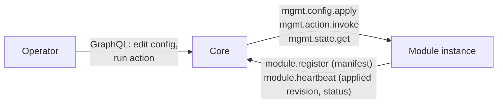
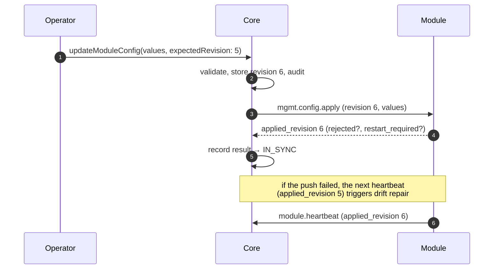

This is the **control-plane** contract through which core manages a registered
module: the module **declares** what can be managed — properties, actions and
status values — and core lets operators change properties and run actions from
its admin UI and API. It applies to every module type, not only channels.

It builds on the shared [AMQP envelope](../amqp-envelope/),
[routing conventions](../amqp-conventions/) and
[module lifecycle](../module-lifecycle/): the declaration travels in
`module.register`, status values in `module.heartbeat`. Live log tailing, an
optional management capability, has its own page:
[Module Logs](../module-logs/).

## Roles and ownership

| Party | Owns |
|---|---|
| **Module** | What is manageable (its manifest), validating and applying values, running actions, its effective runtime state. It is the system of record for what it actually applied. |
| **Core** | The **desired** value of each property per instance, revisions, authorization, the audit trail, and the admin UI/API. |

For the management operations core is the **RPC client** and the module the
**RPC server** — the opposite of lifecycle, where the module calls core.



## Transport

| Aspect | Value |
|---|---|
| Exchange | `logos.channel.rpc` (direct) |
| Routing key | the module's `<instance>` |
| Request queue | the `rpc_queue` the module sent at registration, by convention `logos.channel.rpc.<instance>` |
| Reply | direct reply-to (`amq.rabbitmq.reply-to`), `correlation_id` echoed |
| Body | [AMQP envelope](../amqp-envelope/) / RPC reply envelope, version `1.0` |

The module's inbox queue is **exclusive and auto-delete**, and the module
consumes it **before** it registers: core may call it the moment it acknowledges
the registration. Core publishes requests as *mandatory* with a per-message
expiration equal to the call timeout, so a request to an instance whose queue is
gone fails immediately instead of waiting out the timeout.

## The manifest

A module declares its management surface in `module.register` under
`management`. Core validates it and **rejects the whole registration** if it is
invalid (`validation_failed`), so a module with a broken manifest never appears
half-managed.

```json
{
  "schema_version": "1",
  "properties": [
    {
      "key": "max_body_bytes", "type": "bytes", "label": "Max request body",
      "description": "Largest accepted client request body.",
      "group": "Limits", "order": 1, "unit": "bytes",
      "default": 1048576, "min": 17, "max": 67108864,
      "apply": "live"
    },
    {
      "key": "log_level", "type": "enum", "label": "Log level", "group": "Logging", "order": 2,
      "default": "info", "apply": "live",
      "options": [
        { "value": "debug", "label": "Debug", "description": "Every request outcome, plus everything below." },
        { "value": "warn",  "label": "Warn",  "description": "Core problems only." }
      ]
    }
  ],
  "actions": [
    {
      "name": "drain", "label": "Drain", "risk": "high",
      "description": "Stop serving clients until resumed.",
      "confirm": "Clients will receive 404 for every request until the channel is resumed."
    },
    { "name": "check_core", "label": "Check core", "risk": "low", "timeout_seconds": 10 }
  ],
  "status": [
    { "key": "requests_total", "type": "int", "label": "Requests" },
    { "key": "draining", "type": "bool", "label": "Draining", "alert": true }
  ],
  "capabilities": ["logs"]
}
```

### Fields

Properties and action parameters share one field description:

| Field | Meaning |
|---|---|
| `key` | Identifier, `^[a-z][a-z0-9_]{0,62}$`, unique within its list. |
| `type` | One of the [field types](#field-types). |
| `label`, `description` | Shown in the UI. Up to 120 and 1000 characters. |
| `group`, `order`, `unit`, `placeholder` | UI hints only. |
| `required` | A value must be present (and, for strings, non-empty). |
| `default` | The module's own value when core holds none — typically what it read from its env. Must satisfy the field's own constraints. Never set for `secret`. |
| `min`, `max` | Numbers for `int` / `number` / `bytes`, duration strings for `duration`. |
| `pattern`, `max_length` | For string-like types (each item of a `string_list`). |
| `options` | For `enum`: `value`, optional `label` and `description` (shown under the label in the option list). |

A **property** adds `apply`:

- `live` — the module applies a new value immediately.
- `restart` — the new value takes effect at the next start. Until then the
  module reports the key in `restart_required`, and the UI says so.

An **action** has a `name`, `risk` (`low` or `high`), an optional `confirm`
prompt the UI shows before running it, up to 16 `params`, and
`timeout_seconds` (default 30, at most 60).

A **status value** (`key`, `type`, `label`, `description`, `unit`) is reported
by the module in its heartbeat `metrics` under `key`. Core shows the latest
value; it never stores history. For `bool`, `enum` and `string` values the
module may declare `alert`: the value that needs an operator's attention (for
example `true` for `draining`). The UI highlights a matching value and shows any
other as normal; without `alert`, values are shown neutrally — core cannot know
which value of a module's status is bad.

`capabilities` lists optional features the module serves, such as `logs`.
Unknown capabilities are ignored.

### Field types

| Type | JSON value | Rules |
|---|---|---|
| `string` | string | `pattern`, `max_length` |
| `int` | integer | `min`, `max`; must fit in int64 |
| `number` | number | `min`, `max` |
| `bool` | boolean | — |
| `enum` | string | one of `options[].value` |
| `duration` | string, e.g. `"30s"` | Go duration syntax; `min`, `max` as durations |
| `bytes` | integer | not negative; `min`, `max` |
| `url` | string | absolute URL (scheme and host) |
| `secret` | string | write-only: never returned by core or by the module |
| `string_list` | array of strings | each item checked like a `string` |

### Limits

| Limit | Value |
|---|---|
| Properties / actions / status values / capabilities | 64 / 32 / 64 / 16 |
| Params per action / options per enum | 16 / 64 |
| Label / description length | 120 / 1000 |
| Action timeout | 60 s |

## Configuration

### Desired and applied

Core keeps the **desired** values of one instance's properties together with a
**revision**. Every write increments the revision; it never goes down. The
module reports the revision it **applied** — at registration, in every
heartbeat, and in each apply reply. The two together give the sync state the UI
shows:

| State | When |
|---|---|
| `IN_SYNC` | applied revision = desired revision |
| `PENDING` | a newer revision is on its way |
| `OUT_OF_SYNC` | pushing failed, or the instance is not registered |

The **effective** value of a property is the stored value, or the module's
`default` when core holds none. Configuration is **per instance**: there is no
value shared by all instances of a module.

### Delivery

Core delivers the configuration in two ways:

1. **In the `module.register` reply**, under `config.management`. A restarted
   module gets its configuration before it serves anything, and that is also
   when `restart` properties take effect.
2. **By `mgmt.config.apply`**, after an operator changes a value, and as
   **drift repair**: when a heartbeat reports an applied revision different from
   the desired one, core pushes again.



A push is retried up to 3 times with back-off when the module cannot be reached
(10 s per attempt). An error reply from the module is not retried. After a
failed push, drift repair waits 10 s before trying again, then twice as long
after each further failure (up to about 10 minutes); a new configuration write
resets the wait.

If a module reports an applied revision **above** the desired one — core's
store was reset while the module kept running — core raises its revision above
the reported one and pushes, rather than having the module ignore every
following apply as stale.

### Writing configuration

Writes go through core's API, never to the module directly.
`updateModuleConfig` takes the instance, a list of `{key, value}` and
`expectedRevision`:

- `value: null` clears the stored value: the property returns to the module's
  `default`.
- Every key must be a declared property and every value valid for it, or the
  whole write is refused.
- `expectedRevision` must equal the current revision. If someone else wrote in
  between, the write fails with `CONFLICT` and nothing changes (optimistic
  concurrency). The UI takes the revision when the first field is edited.

Each write is recorded in the instance's change history: who, when, the new
revision, and old → new per key.

## Operations

| `type` | Summary |
|---|---|
| `mgmt.config.apply` | Apply a configuration revision. |
| `mgmt.action.invoke` | Run a declared action. |
| `mgmt.state.get` | Report the effective values and status. |
| `mgmt.logs.start`, `mgmt.logs.stop` | Live log tail — see [Module Logs](../module-logs/). |

---

### `mgmt.config.apply`

Request `payload`:

```json
{
  "revision": 6,
  "values": { "max_body_bytes": 4194304, "log_level": "debug" },
  "actor": { "type": "user", "id": "6ab79922…", "name": "admin" }
}
```

`values` holds every property core has a value for. The module:

- **ignores a stale revision** (lower than the one it applied) and replies with
  its current state;
- treats a property **absent** from `values` as reset to its `default`;
- **validates each value**. A rejected key keeps its previous value; the others
  still apply;
- for `restart` properties, keeps the running value and lists the changed key in
  `restart_required` — except on the first apply after start (the register
  reply), which is what the process starts with;
- if applying fails as a whole, keeps all previous values and reports the
  changed keys as rejected.

Applying the same revision twice is harmless.

Reply `payload`:

```json
{
  "applied_revision": 6,
  "rejected": { "max_body_bytes": "must be <= 67108864" },
  "restart_required": ["logos_sync_base_url"]
}
```

`applied_revision` is the revision the module **processed**, even when some keys
were rejected — otherwise drift repair would push the same refused value
forever. Core shows rejected keys next to the property.

### `mgmt.action.invoke`

Request `payload`:

```json
{
  "invocation_id": "01M5SJR1RFZX19RP85YH1WF4Q4",
  "action": "check_core",
  "params": {},
  "actor": { "type": "user", "id": "6ab79922…", "name": "admin" }
}
```

The module validates `params` against the declared ones (unknown params are
refused) and runs the action within its timeout. A repeated `invocation_id` for
the same action is **the same invocation**: the module returns the first
outcome, or waits for it while it is still running, and never runs the action
twice. An action keeps running if the request that started it is lost (for
example, the module's broker connection drops); its outcome is still returned
for a retry.

Reply `payload` on success:

```json
{ "invocation_id": "01M5SJR1RFZX19RP85YH1WF4Q4", "result": { "reachable": true, "latency_ms": 3 } }
```

`result` is any JSON value; core stores and shows it as returned. A failure is
an error reply: `action_failed` (the action returned an error, panicked or timed
out), `validation_failed` (bad params) or `not_found` (unknown action).

Core records every invocation — actor, params, status (`RUNNING`, `SUCCEEDED`,
`FAILED`, `TIMED_OUT`), result or error, start and end time — and runs it
synchronously: the operator's request returns when the action finishes.

### `mgmt.state.get`

Request `payload`: `{}`. Reply `payload`:

```json
{
  "applied_revision": 6,
  "values": { "max_body_bytes": 4194304, "log_level": "debug", "api_token": "***" },
  "status": { "requests_total": 1532, "draining": false },
  "restart_required": []
}
```

`values` are the module's effective values; secrets are redacted as `"***"`.

---

## Authorization

Authorization is core's alone; modules never decide it.

| Permission | Allows |
|---|---|
| `module:read` | Viewing modules, their manifests, configuration and histories. |
| `module:config:write` | Changing property values. |
| `module:action:invoke` | Running `low`-risk actions. |
| `module:action:invoke:high` | Additionally needed for `high`-risk actions. |
| `module:logs:read` | Live log tail ([Module Logs](../module-logs/)). |

Agent API keys are refused for all management writes, actions and the log tail,
whatever their owner's role: managing modules is operator-only.

**Secrets** are write-only. Core never returns a stored `secret` value — the UI
only learns whether one is set — and redacts secrets in the change history and
in stored action params.

## Error codes

| Code | Meaning |
|---|---|
| `validation_failed` | Malformed payload, unknown property or param, invalid value. |
| `not_found` | Unknown action (or log streaming not supported). |
| `action_failed` | The action failed, panicked or timed out. |
| `unsupported_version` | Unknown envelope major version. |
| `internal_error` | Unexpected module-side failure. |

## Design notes

- **The module declares, core never guesses.** Core knows nothing about any
  module's settings: the manifest carries every key, type, constraint, label
  and description, and the UI is generated from it. The same goes for status
  values and action results — core shows them as the module reports them.
- **Configuration is per instance only.** An earlier design also had
  module-wide values shared by every instance, with per-instance overrides. It
  was dropped: there was no real case for it, and one level is easier for
  operators to reason about.
- **Desired state lives in core, applied state in the module.** Core can always
  re-send the whole configuration (register reply, drift repair), so a module
  does not have to persist anything, and a lost push heals itself.
- **Revisions only grow, and the applied revision always advances.** Monotonic
  revisions make stale pushes detectable; counting a partly rejected apply as
  processed stops drift repair from looping on a value the module will never
  accept.
- **Not everything belongs in the manifest.** How a module reaches core (sync
  URL, timeouts) and deployment concerns (log format) stay in its env: a wrong
  value pushed from the UI could cut the module off from the core that would
  have to fix it.
- **Module-specific states are status values, not health.** Lifecycle health is
  only `healthy` / `degraded`. A paused channel (`drain`) is still healthy; the
  pause is its own `draining` status value, and `drain` is the module's action,
  not a platform concept.

## Known limits (prototype)

- Secrets are stored unencrypted in core's database.
- Numbers are stored as floating point, so integers above 2^53 lose precision.
- Actions are synchronous; there is no background job for long-running work.
- RabbitMQ access is not yet restricted per module.
