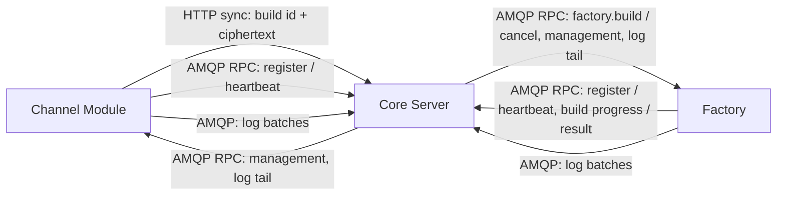

This section is the canonical home for the **contracts** between modules and the
core Server. A contract defines the wire format, transport, and semantics that
two components rely on to interoperate without sharing implementation.

## Two communication surfaces

Logos modules talk to core over two distinct surfaces. Each contract lives on
exactly one of them.

| Surface | Transport | Carries | Pattern |
|---|---|---|---|
| **Data plane** | HTTP (`POST /api/channel/sync`) | Minion traffic — opaque encrypted blobs | Request/response |
| **Control plane** | RabbitMQ (AMQP) | Module management, coordination, events | RPC + pub/sub |

- The **data plane** moves minion payloads. It is deliberately minimal and
  plaintext-blind: channels deliver the build id and its ciphertext, the
  ciphertext as the raw body of the sync call, and never decrypt. Core cares
  only about that call — how a channel extracts them from its transport is the
  channel's business.
  See [Channel ↔ Core: HTTP Sync](../channel-core-sync/).
- The **control plane** carries everything else — module lifecycle, channel
  management, build coordination, health/events. It never carries minion
  ciphertext. It is built on a shared [AMQP envelope](../amqp-envelope/) and
  [routing conventions](../amqp-conventions/).

Files take neither surface: a factory downloads a build's files from, and
uploads its artifact to, presigned object store URLs that core hands it with
the build ([Minion Build](../minion-build/#build-files)).

### The control plane is bidirectional

RPC ownership is **per-operation**, not global. Both core and modules act as RPC
servers depending on the operation:

| Flow | Direction | RPC server | Operations |
|---|---|---|---|
| Lifecycle | module → core | **core** (`logos.core.rpc`) | `module.register`, `module.heartbeat`, `module.deregister` |
| Management | core → module | **module** (`logos.<type>.rpc.<instance>`) | `mgmt.config.apply`, `mgmt.action.invoke`, `mgmt.state.get` |
| Log tail control | core → module | **module** (same queue) | `mgmt.logs.start`, `mgmt.logs.stop` |
| Log batches | module → core | — (pub/sub on `logos.module.logs`) | live log records, while a stream is open |
| Builds | core → factory | **factory** (its `rpc_queue`) | `factory.build`, `factory.build.cancel` |
| Build reports | factory → core | **core** (`logos.core.rpc`) | `factory.build.progress`, `factory.build.result` |
| Lifecycle events | core → any subscriber | — (pub/sub on `logos.events`) | `module.registered`, `.deregistered`, `.declared_dead`, `.blocked`, `.unblocked`, `.deleted` |

Registration bootstraps everything else: core cannot issue a management RPC to a
module until that module has registered itself. See
[Module Lifecycle](../module-lifecycle/).

## Shared rules

Every contract in this section, regardless of surface, follows the same baseline:

- **Versioning** — messages carry an explicit `version`. RPC servers reject
  unknown major versions and tolerate additive minor changes. (Core's sync
  endpoint does not check `version` yet.)
- **Correlation** — every enveloped message carries a `message_id`; RPC
  exchanges also carry a `correlation_id` to tie a reply to its request. HTTP
  sync answers in the same response, by `id`. Log batches travel bare, without
  the envelope, keyed by their stream.
- **Idempotency** — processing is idempotent where possible: an operation is
  keyed by what it acts on (a build's `build_id`, an action's
  `invocation_id`, a configuration `revision`, a log `stream_id`), and the data
  plane drops a `message_id` it has seen.
- **Crypto boundary** — minion payload crypto belongs to core Logos services only
  (a draft lets a build's own factory translate it: [Codecs](../minion-messages/codecs/)).
  Control-plane contracts never transport minion ciphertext, and channels stay
  plaintext-blind on the data plane. A build request carries a minion's key
  material to its factory (`crypto`), which writes it into the artifact.
- **Modules describe themselves; core does not interpret them** — what a
  module can be managed on, its status values, action results and log records
  are declared or produced by the module and shown by core as they are. Core
  holds no knowledge of any particular module.

## Contracts in this section

| Contract | Surface | Parties | Status |
|---|---|---|---|
| [HTTP Sync](../channel-core-sync/) | Data plane | Channel ↔ Core | Implemented; the channel is not authenticated yet |
| [Connections](../channel-core-connections/) | Data plane: the connection kinds where core starts exchanges, the control link and connection sockets | Channel ↔ Core | `reverse-persistent`, `bind-call` (the control link's `call`, targets) and `bind-persistent` (the link's `open`, policies) implemented; fallback and `add_connection` a draft |
| [Agentless Channels](../agentless-channels/) | Data plane: `bind` kinds whose channel acts as the minion, and gets the keys and the session's acting task with each call and open | Channel ↔ Core; Factory → Core | Implemented: the SSH module (`logos-ssh`); its tunnels since v0.6.0 (wave 5) |
| [Module Lifecycle](../module-lifecycle/) | Control plane | Module (client) → Core (server) | Implemented |
| [Module Management](../module-management/) | Control plane | Core (client) → Module (server) | Prototype |
| [Module Logs](../module-logs/) | Control plane | Core ↔ Module | Prototype |
| [Minion Connection Schema](../minion-connection/) | Control plane | Channel → Core | Implemented |
| [Minion Build](../minion-build/) | Control plane | Core ↔ Factory | Implemented; payload crypto pending |
| [Credentials](../credentials/) | Credential fields in connection and build schemas: what a module gets, and the logins a channel reports | Core → Channel, Factory, Minion | Implemented; the SSH channel's targets first |
| [Minion Messages](../minion-messages/) | Data plane, inside the ciphertext | Minion ↔ Core | Implemented (`v` 3: numbered keys, values and commands, `rehello`); [tunnels](../minion-messages/tunnels/) (SOCKS with UDP, port forwards through a minion: protocol v0.36.0, BOB v0.26.0; reverse port forwards, the minion listening, over TCP and UDP, and stop when idle: protocol v0.37.0, BOB v0.27.0; the actions `tunnel` and `reverse_tunnel` with core's fronts (an HTTP proxy, reverse SOCKS), `opens`, `unsupported`, bytes with the open, stream numbers in blocks, timing that follows the link and the bandwidth cap: protocol v0.38.0, BOB v0.28.0; forwards to unix sockets and named pipes, a source address and TLS to the destination: protocol v0.39.0, BOB v0.29.0; a terminal front (processes in a PTY or a ConPTY, raw on the port or in the web app), SOCKS5 BIND and `tunnel_ctl`: protocol v0.40.0, BOB v0.30.0; `stop_idle` one of core's params: protocol v0.41.0, BOB v0.30.1; reverse SOCKS dropped: protocol v0.42.0, BOB v0.30.2); [compression](../minion-messages/wire-format/#compression) (packed items, DEFLATE): protocol v0.47.0, BOB v0.33.0 |
| [VPN Front](../vpn-front/) | Data plane: an operator's machine routed into a minion's networks, by `logos-vpn`, a client of core's, over a WebSocket of tunnel items; ICMP through a minion | VPN client ↔ Core; Core ↔ Minion | Implemented: protocol v0.44.0, BOB v0.31.0 (ICMP), `logos-vpn` v0.1.1; not yet run on a real network |
| [Delegation](../minion-messages/delegation/) | Data plane: a minion serving a channel kind's transport for another minion, the channel's steps carried in its own messages | Minion ↔ Core | Implemented: protocol v0.46.0, core, BOB v0.32.0 (`delegate` and `reverse_delegate`: the TCP channel's three kinds), the TCP channel v0.2.0 |
| [Codecs](../minion-messages/codecs/) | Data plane: how a message is written and sealed: core's envelopes (CBOR, JSON) and suite, or a factory's own, translated over a factory link | Core ↔ Factory | Draft (agreed 2026-11-09); protocol and core built, factory-core not |
| [Task Results and Actions](../task-results-and-actions/) | Data plane: a task's `data`; what core runs a command for | Minion → Core, named in the build schema | Implemented: results `dir_listing`, `dir_walk`, `volumes`, `file_download`, `file_upload`, `file_stream`; actions `list_dir`, `walk_dir`, `list_volumes`, `download_file`, `upload_file`, `upload_stream`, `stream_file`, `delete_path` |
| [File Browser](../file-browser/) | A machine's file system, as tasks saw it | Core, from tasks' results | Implemented |

To build a module against these contracts, see
[Implementing a Module](../../implementing-a-module/).

Foundational specs the control-plane contracts build on:

- [AMQP Message Envelope](../amqp-envelope/) — the shared base envelope.
- [AMQP Routing Conventions](../amqp-conventions/) — exchange/queue/routing-key naming.

