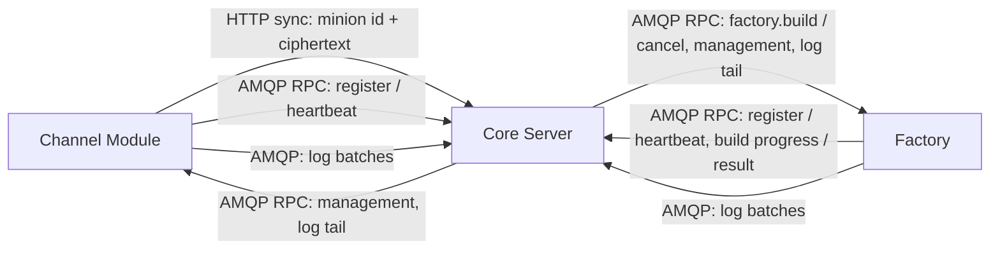

This section is the canonical home for the **contracts** between modules and the
core Server. A contract defines the wire format, transport, and semantics that
two components rely on to interoperate without sharing implementation.

## Two communication surfaces

Logos modules talk to core over two distinct surfaces. Each contract lives on
exactly one of them.

| Surface | Transport | Carries | Pattern |
|---|---|---|---|
| **Data plane** | HTTP (`POST /api/channel/sync`) | Minion traffic — opaque encrypted blobs | Request/response |
| **Control plane** | RabbitMQ (AMQP) | Module management, coordination, events | RPC + pub/sub |

- The **data plane** moves minion payloads. It is deliberately minimal and
  plaintext-blind: channels deliver the minion id and its ciphertext, the
  ciphertext as the raw body of the sync call, and never decrypt. Core cares
  only about that call — how a channel extracts them from its transport is the
  channel's business.
  See [Channel ↔ Core: HTTP Sync](../channel-core-sync/).
- The **control plane** carries everything else — module lifecycle, channel
  management, build coordination, health/events. It never carries minion
  ciphertext. It is built on a shared [AMQP envelope](../amqp-envelope/) and
  [routing conventions](../amqp-conventions/).

Files take neither surface: a factory downloads a build's files from, and
uploads its artifact to, presigned object store URLs that core hands it with
the build ([Minion Build](../minion-build/#build-files)).

### The control plane is bidirectional

RPC ownership is **per-operation**, not global. Both core and modules act as RPC
servers depending on the operation:

| Flow | Direction | RPC server | Operations |
|---|---|---|---|
| Lifecycle | module → core | **core** (`logos.core.rpc`) | `module.register`, `module.heartbeat`, `module.deregister` |
| Management | core → module | **module** (`logos.<type>.rpc.<instance>`) | `mgmt.config.apply`, `mgmt.action.invoke`, `mgmt.state.get` |
| Log tail control | core → module | **module** (same queue) | `mgmt.logs.start`, `mgmt.logs.stop` |
| Log batches | module → core | — (pub/sub on `logos.module.logs`) | live log records, while a stream is open |
| Builds | core → factory | **factory** (its `rpc_queue`) | `factory.build`, `factory.build.cancel` |
| Build reports | factory → core | **core** (`logos.core.rpc`) | `factory.build.progress`, `factory.build.result` |
| Lifecycle events | core → any subscriber | — (pub/sub on `logos.events`) | `module.registered`, `.deregistered`, `.declared_dead`, `.blocked`, `.unblocked`, `.deleted` |

Registration bootstraps everything else: core cannot issue a management RPC to a
module until that module has registered itself. See
[Module Lifecycle](../module-lifecycle/).

## Shared rules

Every contract in this section, regardless of surface, follows the same baseline:

- **Versioning** — messages carry an explicit `version`. RPC servers reject
  unknown major versions and tolerate additive minor changes. (Core's sync
  endpoint does not check `version` yet.)
- **Correlation** — every enveloped message carries a `message_id`; RPC
  exchanges also carry a `correlation_id` to tie a reply to its request. HTTP
  sync answers in the same response, by `id`. Log batches travel bare, without
  the envelope, keyed by their stream.
- **Idempotency** — processing is idempotent where possible: an operation is
  keyed by what it acts on (a build's `minion_id`, an action's
  `invocation_id`, a configuration `revision`, a log `stream_id`), and the data
  plane drops a `message_id` it has seen.
- **Crypto boundary** — minion payload crypto belongs to core Logos services only.
  Control-plane contracts never transport minion ciphertext, and channels stay
  plaintext-blind on the data plane. A build request carries a minion's key
  material to its factory (`crypto`), which writes it into the artifact.
- **Modules describe themselves; core does not interpret them** — what a
  module can be managed on, its status values, action results and log records
  are declared or produced by the module and shown by core as they are. Core
  holds no knowledge of any particular module.

## Contracts in this section

| Contract | Surface | Parties | Status |
|---|---|---|---|
| [HTTP Sync](../channel-core-sync/) | Data plane | Channel ↔ Core | Prototype: core answers every message with 204, nothing for the minion |
| [Module Lifecycle](../module-lifecycle/) | Control plane | Module (client) → Core (server) | Implemented |
| [Module Management](../module-management/) | Control plane | Core (client) → Module (server) | Prototype |
| [Module Logs](../module-logs/) | Control plane | Core ↔ Module | Prototype |
| [Minion Connection Schema](../minion-connection/) | Control plane | Channel → Core | Implemented |
| [Minion Build](../minion-build/) | Control plane | Core ↔ Factory | Implemented; payload crypto pending |

To build a module against these contracts, see
[Implementing a Module](../../implementing-a-module/).

Foundational specs the control-plane contracts build on:

- [AMQP Message Envelope](../amqp-envelope/) — the shared base envelope.
- [AMQP Routing Conventions](../amqp-conventions/) — exchange/queue/routing-key naming.

