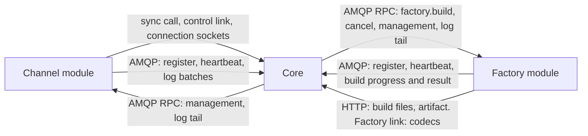

This section is the canonical home for the **contracts** between modules and
core. A contract defines the wire format, transport, and semantics that two
components rely on to interoperate without sharing implementation. To build a
module against them, start with the guides:
[Implementing a Module](../../implementing-a-module/), then
[Writing a Channel](../../guides/writing-a-channel/) or
[Writing a Factory](../../guides/writing-a-factory/).

## How modules reach core

| Path | Transport | Carries | Contract |
|---|---|---|---|
| **The sync call** | HTTP, `POST /api/channel/sync` | a minion's message per request, and core's reply in the response (`reverse-call`) | [HTTP Sync](../channel-core-sync/) |
| **Connection sockets** | a WebSocket per minion connection (`/api/channel/connection`) | sealed frames both ways (`reverse-persistent`, `bind-persistent`) | [Connections](../channel-core-connections/) |
| **The control link** | a WebSocket per channel instance (`/api/channel/link`) | core's calls and opens (`bind-call`, opening `bind-persistent`) | [Connections](../channel-core-connections/) |
| **The factory link** | a WebSocket per factory instance that translates a codec (`/api/factory/link`) | messages to translate, and keys | [Codecs](../minion-messages/codecs/) |
| **The control plane** | RabbitMQ (AMQP) | lifecycle, management, the live log tail, builds, events | [AMQP Envelope](../amqp-envelope/), [Routing](../amqp-conventions/) |
| **Build files** | HTTP, links core hands each build | a build's files to its factory, its artifact to core | [Minion Build](../minion-build/#build-files) |

- The first three are the **data plane**. They carry a minion's sealed frames
  and the id each was sent under; a channel never opens them. The one
  exception is an [agentless channel](../agentless-channels/), which acts as
  the minion and gets the keys of the ids it serves.
- The **control plane** carries everything else and never carries minion
  ciphertext. A build request does carry a minion's key material to its
  factory (`crypto`), which builds it into the artifact.
- The modules open every path: core never connects to a module. An
  operator's VPN client is the one other party that reaches core with minion
  traffic ([VPN Front](../vpn-front/)).

### The control plane is bidirectional

RPC ownership is **per-operation**, not global. Both core and modules act as RPC
servers depending on the operation:

| Flow | Direction | RPC server | Operations |
|---|---|---|---|
| Lifecycle | module → core | **core** (`logos.core.rpc`) | `module.register`, `module.heartbeat`, `module.deregister` |
| Management | core → module | **module** (`logos.<type>.rpc.<instance>`) | `mgmt.config.apply`, `mgmt.action.invoke`, `mgmt.state.get` |
| Log tail control | core → module | **module** (same queue) | `mgmt.logs.start`, `mgmt.logs.stop` |
| Log batches | module → core | — (pub/sub on `logos.module.logs`) | live log records, while a stream is open |
| Builds | core → factory | **factory** (its `rpc_queue`) | `factory.build`, `factory.build.cancel` |
| Build reports | factory → core | **core** (`logos.core.rpc`) | `factory.build.progress`, `factory.build.log`, `factory.build.result` |
| Lifecycle events | core → any subscriber | — (pub/sub on `logos.events`) | `module.registered`, `.deregistered`, `.declared_dead`, `.blocked`, `.unblocked`, `.deleted` |

Registration bootstraps everything else: core cannot issue a management RPC to a
module, nor take its traffic, until that module has registered itself. See
[Module Lifecycle](../module-lifecycle/).

## Shared rules

Every contract in this section follows the same baseline:

- **Versioning** — control-plane messages carry an explicit `version`: RPC
  servers reject unknown major versions and tolerate additive minor changes.
  Minion messages carry their format's version (`v`,
  [Wire Format](../minion-messages/wire-format/)); connection and build
  schemas carry theirs (`schema_version`) and the module's own (`version`).
- **Correlation** — every enveloped message carries a `message_id`; RPC
  exchanges also carry a `correlation_id` to tie a reply to its request. The
  sync call answers in its own response. Log batches travel bare, without
  the envelope, keyed by their stream.
- **Idempotency** — an operation is keyed by what it acts on (a build's
  `build_id`, an action's `invocation_id`, a configuration `revision`, a log
  `stream_id`). A minion's message sent again gets the reply it got, and a
  replay is refused
  ([Freshness and replay](../minion-messages/wire-format/#freshness-and-replay)).
- **Crypto boundary** — core holds minions' keys and seals and opens their
  frames, or the build's own factory, when it translates its suite
  ([Codecs](../minion-messages/codecs/)). Channels stay blind, but for an
  agentless one acting as the minion.
- **Modules describe themselves; core does not interpret them** — what a
  module can be managed on, its status values, action results and log records
  are declared or produced by the module and shown by core as they are. Core
  holds no knowledge of any particular module.

## Contracts in this section

| Contract | What it covers | Parties | Status |
|---|---|---|---|
| [AMQP Envelope](../amqp-envelope/) and [Routing](../amqp-conventions/) | The control plane's envelope, exchanges, queues and routing keys | Core ↔ Module | Built |
| [Module Lifecycle](../module-lifecycle/) | Register, heartbeat, deregister; blocking and deleting instances | Module → Core | Built |
| [Module Management](../module-management/) | Configuration, actions, status values | Core → Module | Prototype |
| [Module Logs](../module-logs/) | The live log tail | Core ↔ Module | Prototype |
| [HTTP Sync](../channel-core-sync/) | The sync call | Channel ↔ Core | Built; channels are not authenticated yet |
| [Minion Connection Schema](../minion-connection/) | What a minion is given to reach a channel, per connection kind | Channel → Core | Built |
| [Connections](../channel-core-connections/) | The connection kinds, the control link, connection sockets, targets, failover | Channel ↔ Core | Built; `add_connection` a draft |
| [Agentless Channels](../agentless-channels/) | `bind` kinds whose channel acts as the minion | Channel ↔ Core | Built: the SSH module |
| [Minion Build](../minion-build/) | Build schemas, builds, the minion config, minion error codes | Core ↔ Factory | Built |
| [Credentials](../credentials/) | Credential fields, what a module gets, the logins a channel reports | Core → Channel, Factory, Minion | Built |
| [Minion Messages](../minion-messages/) | The minion's protocol: the wire format, sessions, tasks, files, identity | Minion ↔ Core | Built (`v` 3) |
| [Tunnels](../minion-messages/tunnels/) | Streams a minion opens from its host, behind core's fronts | Minion ↔ Core | Built |
| [VPN Front](../vpn-front/) | An operator's machine routed into a minion's networks | VPN client ↔ Core ↔ Minion | Built; not yet run on a real network |
| [Delegation](../minion-messages/delegation/) | A minion serving a channel's transport for other minions | Minion ↔ Core | Built |
| [Codecs](../minion-messages/codecs/) | Core's envelopes and suite, or a factory's own, translated over its factory link | Core ↔ Factory | Built |
| [Task Results and Actions](../task-results-and-actions/) | A task's data, and the commands core runs for its own views | Minion → Core | Built |
| [File Browser](../file-browser/) | A machine's file system as tasks saw it | Core, from tasks' results | Built |

A page about a design that is agreed but not built yet opens with a
**Draft** note, and one built in part with a **Status** note
([Writing the Docs](../../contributing/writing-the-docs/)).
