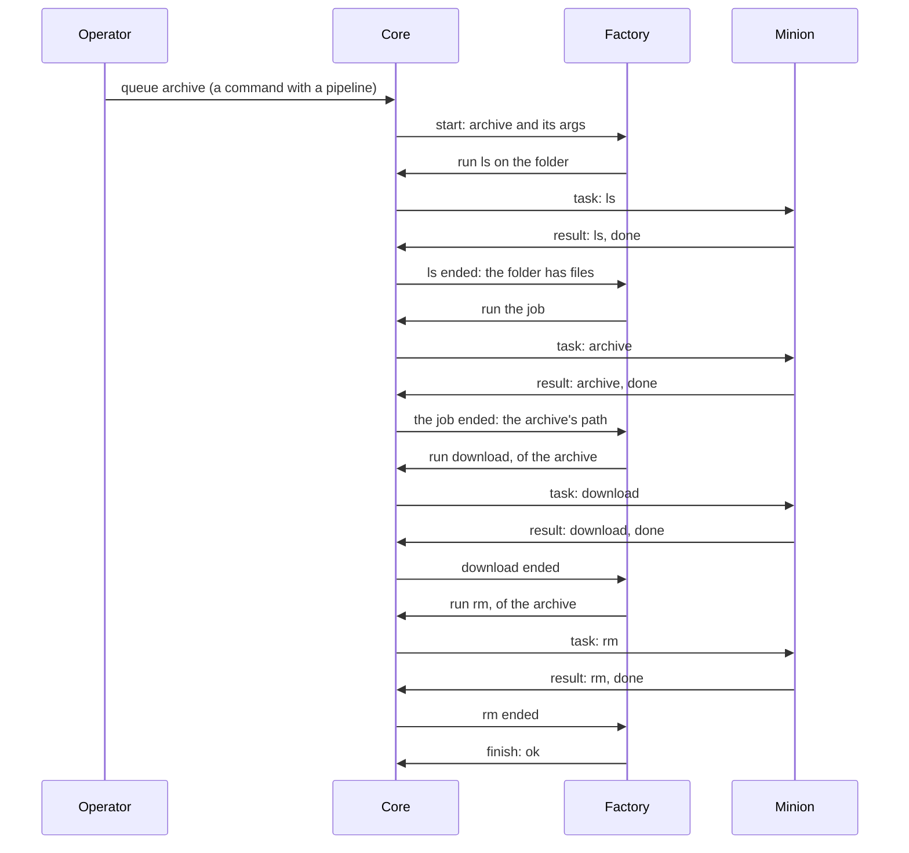

:::caution[Draft]
A design under discussion: nothing of it is built. It records where the
discussion stands, so that its open questions are settled before any code.
:::

A task can outsource part of its work to the session's other commands. A
command with a **pipeline** does: the factory's own code, in the factory
module, decides which of the session's commands to run as the task's
**steps**, before and after the command's **own job** on the minion, one
decision at a time, from the task's args and each step's end. The job runs
when the pipeline says, with the args it says, or not at all. A command may
also have no job of its own: a pipeline alone, whose task never goes to the
minion.

Core runs every step, and the command's own job, as an ordinary task of the
session: the minion cannot tell them from an operator's tasks, and knows
nothing of the pipeline. Each keeps what any task has: its result, its
files and listings, who it ran as, its cancel.

A step may depend on another's result, be skipped for some of its values,
run in a loop, or run once for each entry of a listing: whatever the
factory's code decides. A pipeline works within its own session: its steps
run on that session's minion, never on another.



## A command's pipeline

A factory declares it on a command of its [build
schema](../minion-build/#commands):

```json
{
  "id": "archive",
  "op": 40,
  "label": "Archive a folder",
  "pipeline": true,
  "uses": ["ls", "download", "rm"],
  "params": [
    { "key": "path", "num": 1, "type": "string", "label": "Folder" }
  ]
}
```

| Field | Meaning |
|---|---|
| `pipeline` | `true`: the command has a pipeline, the factory's code, which runs steps around its job, or in its place. |
| `uses[]` | Required with `pipeline`: the commands its steps may run, by `id`. Each has a job of its own (an `op`), and is on every target the command is on. |

- **With an `op`**, the command has a job of its own on the minion, built
  in and numbered as any command's. Its pipeline decides when the job runs,
  with which args, and whether it runs at all. Its `result` is its job's.
- **Without an `op`**, the command is its steps alone: its task never goes
  to the minion, its params have no `num`, and its `result` is the shape of
  the data it finishes with.
- **A step runs a command's job alone, never its pipeline**: steps do not
  nest. So `uses` may name the command itself, to run its job again.
- **The rest as any command's**: `label`, `description`, `targets`,
  `default`, `required`, `params` (a `file` or `stream` param included) and
  `kinds`. No `action`, `opens` or `serves` with a pipeline.
- **Picking a command with a pipeline picks what it uses**, as a target's
  required commands are: the factory builds those in. A command with no job
  of its own builds nothing: a session has it when its build has every
  command it uses, so it works over minions already built.
- **Changing a pipeline needs no new minion**: the code is the factory's. A
  step whose command the session's build lacks ends refused, and the
  factory's code decides what follows.
- **A schema with a pipeline needs a factory that runs it**: factory-core
  refuses one given no pipeline code, as it refuses a codec of the factory's
  own given no `Codec`.

## A task's life

1. **Queued** as any task: by an operator in the session's console, the
   web app or the APIs. Core checks its args, fills in defaults, and takes
   the [task files](../task-results-and-actions/#task-files) it names.
2. **Started**: core calls the factory with the command and its args
   (`start`). The task waits in core for what its pipeline says, and takes
   none of the minion's room ([Max
   tasks](../minion-messages/tasks-and-results/#max-tasks)) while it does.
3. **Each answer** of the factory is a decision: steps to run now, the job
   to run now, a finish, or nothing yet (it waits for what is under way).
   With it, a `ctx`, the factory's own bytes, which core keeps and gives
   back with the next call, and a `status`, a line shown on the task
   ("downloading the archive").
4. **Each step** core checks and queues as it would an operator's task:
   its command is one the pipeline uses and the session's build has, its
   args are checked and their defaults filled in, and its command works
   over the session's connection kind. A step that fails a check never
   runs: the factory hears of it as a step that ended refused.
5. **The job**, when a decision says so: core sends the task itself to the
   minion, as any task, with the args the decision gives (the task's own
   when it gives none), checked as an operator's are. It runs once at most.
   From then until its done part, the task takes its place in the minion's
   max tasks.
6. **Each end**, a step's or the job's (done, failed, cancelled or
   refused), core gives the factory in a call (`ended`), with what it
   returned, and the factory's answer decides what comes next.
7. **The finish** ends the task: `ok`, and an `err` when not ok. A command
   without a job finishes with its own `out` and `data` too. A finish may
   fail a task whose job did well (its cleanup did not); the job's result
   stays as the minion sent it. Steps still under way are cancelled, and so
   is a job still out.

- **The job's done part ends the job, not the task**: the task runs on
  while its pipeline does, and ends at the finish. A finish before the job
  skips it: the minion never hears of the task.
- **One call at a time**: core never calls the factory about one task while
  a call about it waits. Ends that come meanwhile wait their turn, in
  order.
- **Calls are numbered** (`seq`, from 1). A call sent again, its answer
  lost, gets an answer again; core takes the first answer to a `seq` alone,
  so nothing is queued twice.
- **Steps are the task's.** Each shows which task queued it, and is issued
  by whoever queued that task. A step takes the minion's room as any task
  does, and goes in the session's queue with the other tasks, in the order
  they were queued.
- **More steps than may be under way at once** ([Limits](#limits)) wait in
  the task, in order, and are queued as others end: a factory may ask for a
  step per file of a listing in one decision.
- **A wait with nothing under way** ends the task failed: no end would call
  the factory again.
- **An operator may stop a step** as any task: the factory hears of it as a
  step that ended cancelled, and decides.
- **Stopping the task** cancels its steps under way, drops those waiting,
  and cancels its job when it is out. Core ends the task cancelled once
  they have ended, and tells the factory (`stopped`), whose answer it does
  not wait for.
- **The session closing** ends its tasks with a pipeline failed; core calls
  nothing.

## The calls

Over the control plane: core calls the factory on its `rpc_queue`
(`logos.factory.rpc.<instance>`), as it calls it for builds and
management, with `factory.pipeline`, request and reply in the [AMQP
envelope](../amqp-envelope/). Core calls an instance of the build's own
factory module, never another.

Request `payload`:

```json
{
  "build_id": "…",
  "task_id": "…",
  "session_id": "…",
  "seq": 4,
  "event": "ended",
  "command": "archive",
  "args": { "path": "C:\\Users\\alice\\Documents" },
  "schema_version": 6,
  "job": "ended",
  "steps_under_way": 0,
  "steps_ended": 1,
  "ctx": "…",
  "end": {
    "task_id": "…",
    "command": "archive",
    "job": true,
    "state": "done",
    "ok": true,
    "data": { "archive": "C:\\Users\\alice\\AppData\\Local\\Temp\\docs.zip" },
    "out": "…"
  }
}
```

| Field | Meaning |
|---|---|
| `build_id`, `task_id`, `session_id` | The build, the task and its session. |
| `seq` | The call's number for the task, from 1. |
| `event` | `start`, `ended` (something the task runs ended: `end`) or `stopped`. |
| `command`, `args` | The task's command, and its args by param key, defaults filled in. |
| `schema_version` | The build schema version the build was made with: a pipeline tells older builds apart, whose commands may take other params. |
| `job` | The task's own job: `not_run`, `out` or `ended`. Absent for a command with no job of its own. |
| `steps_under_way`, `steps_ended` | Its steps not ended yet (queued, sent, running, or waiting in the task), and those ended so far. |
| `ctx` | As the factory's last decision left it, base64. Absent before the first. |
| `end` | What ended: its `task_id` and `command`; `job: true` for the task's own job; `as`, the name the factory gave a step; `state`, `done`, `failed`, `cancelled` or `refused` (it failed core's checks); and what it returned: `ok`, `err`, `exit`, `data`, `out`. |

What an end returned travels small or by link:

- **`data`** inline, as core gives it to the web app ([As JSON, for the web
  app](../task-results-and-actions/#as-json-for-the-web-app)), up to 256
  KiB. Larger, `data_url` in its place.
- **`out`** inline, base64, its first 64 KiB; `out_cut: true` when there is
  more, and `out_url` for the whole.
- **A link** is a path on core's address, as a build's links are, signed
  for this call until a minute past its deadline. The factory fetches it
  over HTTP(S), as it fetches a build's files: the same JSON for `data`,
  the raw bytes for `out`.

Reply `payload`, the factory's decision:

```json
{
  "run": [
    { "command": "download", "args": { "path": "C:\\…\\docs.zip" }, "as": "fetch the archive" }
  ],
  "ctx": "…",
  "status": "downloading the archive"
}
```

| Field | Meaning |
|---|---|
| `run` | Steps to queue now, in order: each a `command` the pipeline uses, its `args` by param key (a file param's names a file of the task's own args), and `as`, a name for it in its view and its end. |
| `job` | Send the task's own job now: `{}` with the task's own args, or `{ "args": { … } }`. |
| `finish` | End the task: `ok`, an `err` when not ok; a command with no job of its own adds its `out` (base64) and `data`, in its result's shape. |
| `ctx` | Replaces the bytes core keeps, base64, 64 KiB at most. |
| `status` | A line shown on the task. |

- **Names, not numbers.** Steps and the job name commands by `id` and
  args by `key`, as operators do; core puts in the `op` and `num` of the
  session's build as it sends them.
- **A decision with nothing to run and no finish waits** for the next
  end.
- **An `error` reply** ends the task failed, with its message: the
  factory's code could not decide.

## A factory's code

factory-core would take the pipeline code in `factory.Config`, as it takes
a `Codec`, and serve `factory.pipeline` on the factory's queue beside
`factory.build`. A decision might read like this: the job skipped for an
empty folder, and the archive it made downloaded and then removed:

```go
func (archive) Decide(ctx context.Context, c factory.PipelineCall) (factory.Decision, error) {
    switch {
    case c.Event == factory.Start:
        return factory.Run(factory.Step{Command: "ls", Args: map[string]any{"path": c.Args["path"]}}), nil
    case c.Ended.Job:
        if !c.Ended.OK {
            return factory.Finish(false, c.Ended.Err), nil
        }
        zip := archivePath(c.Ended.Data) // the job's data, in the factory's own shape
        return factory.Run(factory.Step{Command: "download", Args: map[string]any{"path": zip}}).Ctx([]byte(zip)), nil
    case c.Ended.Command == "ls":
        if isEmpty(c.Ended.Data) { // a dir_listing with no entries
            return factory.Finish(true, "nothing to archive"), nil // the job never runs
        }
        return factory.RunJob(nil), nil // with the task's own args
    case c.Ended.Command == "download": // remove the archive, whatever the download did
        return factory.Run(factory.Step{Command: "rm", Args: map[string]any{"path": string(c.Ctx)}}), nil
    default: // rm ended
        return factory.Finish(c.Ended.OK, c.Ended.Err), nil
    }
}
```

## When the factory does not answer

Core calls an instance it knows alive, as it offers builds. A call to an
instance whose queue is gone comes back at once (mandatory), and core calls
another; a call past its timeout (its expiration) goes again, with the same
`seq`, to any live instance. Meanwhile the task shows that its factory does
not answer, and since when. Steps already queued, and a job already out, run
on, and their ends wait in order; a job not sent yet waits for its
pipeline's word. After 10 minutes without an answer core ends the task
failed and cancels what is under way.

## Mechanics by connection kind

A step, or the job, goes as any task of its kind ([Mechanics by connection
kind](../minion-messages/#mechanics-by-connection-kind)). What waits on
another's end costs no exchange of its own:

- **A message that brings an end is answered after the factory's
  decision**, within 2 seconds: what the decision queues goes in that same
  reply, as a minion that sends a result takes its next task in one round
  trip ([Asking for tasks](../minion-messages/tasks-and-results/#asking-for-tasks)).
  Past the 2 seconds, the reply goes without it, and it goes as any new
  task does.
- **`reverse-call`**: the minion that checks in with an end leaves with
  what follows. What is queued later waits for its next check-in.
- **Persistent kinds**: core pushes it at once.
- **`bind-call`**: core calls the page at once, as for any task it has.

## Limits

| What | Limit |
|---|---|
| Steps of one task, in all | 1000 |
| Steps under way at once (queued, sent or running) | 32 |
| A `ctx` | 64 KiB |
| An end's `data` in a call | 256 KiB; larger, by link |
| An end's `out` in a call | its first 64 KiB; the whole by link |
| A call's timeout | 10 s, the control plane's default |
| No answer from the factory, then the task fails | 10 minutes |
| A message that brings an end waits for the decision | 2 s |

## What stays the same

- **The minion**: steps and a command's own job are ordinary tasks; it
  cannot tell them from an operator's.
- **Every rule of [Tasks and Results](../minion-messages/tasks-and-results/)**
  holds for each step and for the job: acks, resends, cancels, lost tasks,
  max tasks.
- **Identity is the session's.** A step that changes who the session's
  tasks run as (a become) changes it for every task after it, the
  pipeline's and an operator's alike
  ([Identity](../minion-messages/identity/#message-order)).

## Trust

- **The calls cross the broker**, as build requests do: in the clear, on
  the one broker account every module shares today, until the control
  plane gets TLS and an account per module ([Baseline security
  controls](../../architecture/#baseline-security-controls)). What is
  larger than a request should carry goes by a link to core, over
  HTTP(S), never through the broker.
- **The factory sees what its steps and its jobs return**, in plaintext:
  their output and data. It already writes each build's keys into its
  minions ([Codecs, Trust](../minion-messages/codecs/#trust)), so it could
  read the session anyway: a pipeline gives it nothing it could not reach.
- **A pipeline reaches its own session alone**, and the commands it uses
  alone: never another session, never core's own commands.
- **What it sends passes the checks an operator's task does**, its steps
  and its job's args alike: the factory's code is trusted no more than an
  operator's input.

## Open questions

- **Cleanup when stopped.** Should a stopped task get one more say, to
  queue cleanup steps (removing what an upload left), before it ends?
- **Reworking the job's result.** Could a finish replace or add to the
  data the job returned (a shell's output parsed into a listing)?
- **The job's args.** May a decision change args the operator gave, or only
  fill in those left empty? As drafted, any, checked as an operator's.
- **A command with a pipeline as an action's command.** Could core run one
  from a view (Download on a folder)? It would finish with the action's
  result's shape.
- **Commands only pipelines run.** Should a factory hide a used command
  from operators, so that it runs only as a step?
- **Coming back sooner.** On `reverse-call`, what is queued after the reply
  waits a whole check-in. Should core send `poll` while a pipeline runs, at
  the cost of a minion that checks in more often?
- **The limits' numbers** are a first guess.

## Design notes

- **The factory's code decides, core runs the steps.** No list of steps
  core could follow covers every case: a step that depends on another's
  result, one skipped for some values, a loop. Code does, and only the
  factory knows what its commands mean: core knows no particular module.
  Core keeps the part it owns, the tasks.
- **In the factory module, not in the minion.** A factory may still
  compose its commands inside its minion. But that is fixed in each build
  (a change means a new build on the host), and a task has one result, so
  its parts cannot be tasks with results of their own. A pipeline in the
  factory changes with the factory, over minions already deployed, and
  each step keeps its own result, files and history.
- **A job of its own, or none.** A pipeline prepares and follows up its
  command's own job, which still runs on the minion as the command's task:
  one command for the operator, its preparation and cleanup in the
  factory's code. A command with no job of its own is a pipeline alone.
- **Nothing held on the minion while preparing.** A task takes the
  minion's room only while its job is out, so a minion that runs one task
  at a time still runs the steps that prepare it.
- **The job runs once.** A task runs once on its minion, which keeps its
  id for a day; a pipeline that needs the job again runs the command as a
  step.
- **Steps run jobs, never pipelines.** Steps do not nest, so a pipeline's
  code sees only plain tasks end, and no pipeline waits on another.
- **One session.** A pipeline outsources to its own minion's commands
  alone: a step's command, connection and identity are the session's.
- **The control plane, not the factory link.** A pipeline call decides
  about tasks and carries none of the minion's traffic: it goes where
  core's other requests to a factory go (builds, management), with their
  deadlines, routing and replies, and a factory with pipelines and no codec
  needs no link. Large data goes by a link to core, so the broker carries
  small requests alone. A codec's call is the minion's traffic itself, and
  keeps the link ([Codecs, Design
  notes](../minion-messages/codecs/#design-notes)).
- **A stateless factory.** Core keeps the `ctx` and numbers the calls, so
  any instance may answer, a restart loses nothing, and an answer that
  comes twice queues nothing twice.
- **One call at a time.** A pipeline's code never sees two of its task's
  events at once, so it needs no locking of its own.
- **A decision before the reply.** Without it, everything that waits on
  another's end would cost a whole check-in on a `reverse-call` minion;
  with it, what follows leaves in the same reply, as a minion's next task
  does when it sends a result.
