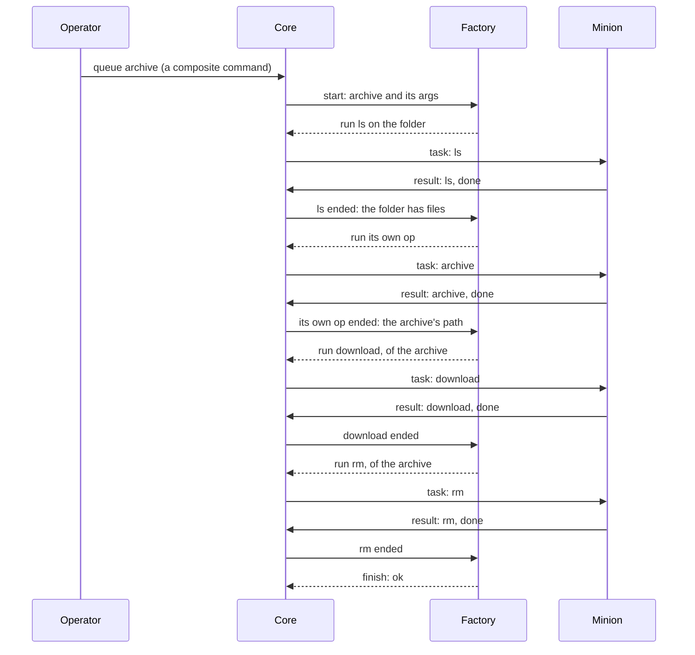

:::note[Status]
Built in the protocol package and factory-core. Not yet in core, which does
not know composite commands: a factory whose schema has one with no `op` is
refused at registration, and one with an `op` goes to the minion as an
ordinary command.
:::

A task can outsource part of its work to the session's other commands. A
**composite** command does: the factory's own code, in the factory module,
decides which of the session's commands to run as the task's **subtasks**,
before and after the command's **own op** on the minion, one decision at a
time, from the task's args and each subtask's end. Its own op runs when the
code says, with the args it says, or not at all. A composite command may
also have no op of its own: its subtasks alone, whose task never goes to
the minion.

Core runs every subtask, and the command's own op, as an ordinary task of
the session: the minion cannot tell them from an operator's tasks, and knows
nothing of the composite. Each keeps what any task has: its result, its
files and listings, who it ran as, its cancel.

A subtask may depend on another's result, be skipped for some of its
values, run in a loop, run again after a wait, or run once for each entry of
a listing: whatever the factory's code decides. A composite command works
within its own session: its subtasks run on that session's minion, never on
another.



## A composite command

A factory declares it on a command of its [build
schema](../minion-build/#commands):

```json
{
  "id": "archive",
  "op": 40,
  "label": "Archive a folder",
  "composite": true,
  "uses": ["ls", "download", "rm"],
  "params": [
    { "key": "path", "num": 1, "type": "string", "label": "Folder" }
  ]
}
```

| Field | Meaning |
|---|---|
| `composite` | `true`: the factory's code runs the command's task, with subtasks around its own op, or in its place. |
| `uses[]` | Required with `composite`: the commands its subtasks may run, by `id`. Each has an `op`, and is on every target the command is on. |

- **With an `op`**, the command has its own op on the minion, built in and
  numbered as any command's. Its code decides when its own op runs, with
  which args, and whether it runs at all. Its `result` is its own op's.
- **Without an `op`**, the command is its subtasks alone: its task never
  goes to the minion, its params have no `num` and no `stream`, and its
  `result` is what it finishes with: its own data, or a subtask's result
  ([Decisions](#decisions)).
- **A subtask runs a command's op alone, never its code**: composites do
  not nest. So `uses` may name the command itself, to run its op again.
- **The rest as any command's**: `label`, `description`, `targets`,
  `default`, `required`, `params` (a `file` or `stream` param included),
  `kinds` and `action`. No `opens` or `serves`: a composite is no tunnel and
  no delegate.
- **An action runs it as any command with that action** ([Running an
  action](../task-results-and-actions/#running-an-action)), any action but a
  tunnel's or a delegate's. Its `result` is the action's, as such a
  command's is: its own op's, or, with no op, its own data or a subtask's
  result.
- **Picking a composite command picks what it uses**, as a target's
  required commands are: the factory builds those in. One with no op of its
  own builds nothing: a session has it when its build has every command it
  uses, so it works over minions already built.
- **Changing a composite's code needs no new minion**: the code is the
  factory's. Each call names the session's build's commands (`commands`),
  and a subtask whose command the build lacks ends refused: the code decides
  what follows.
- **A schema with a composite command needs a factory that runs it**:
  factory-core refuses one given no `Composer`, as it refuses a codec of the
  factory's own given no `Codec`.

## A task's life

1. **Queued** as any task: by an operator in the session's console, the
   web app or the APIs. Core checks its args, fills in defaults, and takes
   the [task files](../task-results-and-actions/#task-files) it names.
2. **Started**: core calls the factory with the command and its args
   (`start`). The task waits in core for what its code decides, and takes
   none of the minion's room ([Max
   tasks](../minion-messages/tasks-and-results/#max-tasks)) while it does.
3. **Each answer** of the factory is a [decision](#decisions): subtasks to
   run, its own op to run, what to stop, when to be called again, or a
   finish; or nothing yet, waiting for what is under way. With it, a `ctx`,
   the factory's own bytes, which core keeps and gives back with the next
   call, and a `status`, a line shown on the task ("downloading the
   archive").
4. **Each subtask** core checks and queues as it would an operator's task:
   its command is one the composite uses and the session's build has, its
   args are checked and their defaults filled in, and its command works over
   the session's connection kind. A subtask that fails a check never runs,
   and is no task of the session: the factory hears of it as a subtask that
   ended refused, saying why.
5. **Its own op**, when a decision says so: core sends the task itself to
   the minion, as any task, with the args the decision gives (the task's
   own when it gives none), checked as an operator's are. It runs once at
   most. From then until its done part, the task takes its place in the
   minion's max tasks.
6. **Each end**, a subtask's or its own op's (done, failed, cancelled or
   refused), core gives the factory in a call (`ended`), with what it
   returned, and the factory's answer decides what comes next. A **timer** a
   decision set calls the factory too (`timer`), when nothing ended first.
7. **The finish** ends the task: core stops what is under way, and once it
   has ended, the task ends as the finish says, `ok` or not, with a
   `message` or an `err`. A command with no op of its own finishes with its
   own `out` and `data` too, or a subtask's result. A finish may fail a task
   whose own op did well (its cleanup did not); the op's result stays as the
   minion sent it.

- **Its own op's done part ends the op, not the task**: the task runs on
  while its code does, and ends at the finish. A finish before its own op
  skips it: the minion never hears of the task.
- **One call at a time**: core never calls the factory about one task while
  a call about it waits. Ends that come meanwhile wait their turn, in order.
  Of several core instances, one makes a task's calls at a time: it claims
  the task while a call is out, as one claims a queued build while it offers
  it.
- **Calls are numbered** (`seq`, from 1). A call sent again, its answer
  lost, gets an answer again; core takes the first answer to a `seq` alone,
  so nothing is queued twice.
- **Subtasks are the task's.** Each shows which task queued it, and is
  issued by whoever queued that task. A subtask takes the minion's room as
  any task does, and goes in the session's queue with the other tasks, in
  the order they were queued.
- **More subtasks than may be under way at once** ([Limits](#limits)) wait
  in the task, in order, and are queued as others end: a factory may ask for
  one per file of a listing in one decision.
- **A wait with nothing under way and no timer** ends the task failed: no
  end would call the factory again.
- **An operator may stop a subtask** as any task: the factory hears of it as
  a subtask that ended cancelled, and decides.
- **A minion that exits or goes quiet** leaves the subtasks it had not ended
  waiting, as it leaves any task, and the task with them: a timer lets the
  code give up, and an operator's stop ends it.
- **A closed session** takes its tasks with it ([Session
  lifetime](../minion-messages/sessions/#session-lifetime)): core calls the
  factory no more about them.

### Stopping

When an operator stops the task:

1. **Core stops what is under way**: it cancels the subtasks queued, sent or
   running and its own op when it is out, drops the subtasks waiting in the
   task, and stops the timer. An answer that comes after the stop counts for
   its `ctx` alone.
2. **Once they have ended**, core calls the factory (`stopped`) with every
   end it had not heard of (`ends`), so that its code knows what the stop
   left behind.
3. **Its answer may run cleanup subtasks**, removing what an upload or its
   own op left on the host: core takes its `run` alone, no own op and no
   timer. Their ends call the factory no more.
4. **The task ends cancelled** once its cleanup subtasks have ended, at once
   when there are none. Without an answer within a minute, it ends
   cancelled, cleaning nothing.

A second stop ends the task cancelled at once: its cleanup subtasks are
cancelled, and core calls the factory no more.

## The calls

Over the control plane: core calls the factory on its `rpc_queue`
(`logos.factory.rpc.<instance>`), as it calls it for builds and management,
with `factory.compose`, request and reply in the [AMQP
envelope](../amqp-envelope/).

Request `payload`:

```json
{
  "task_id": "7c9e6679-7425-40de-944b-e07fc1f90ae7",
  "session_id": "1b4e28ba-2fa1-41d2-883f-0016d3cca427",
  "build_id": "5b0c4f6e-8a1d-4c2b-9e7f-3d2a1b0c9e8f",
  "seq": 3,
  "event": "ended",
  "deadline": "2026-11-20T14:30:10Z",
  "command": "archive",
  "args": { "path": "C:\\Users\\alice\\Documents" },
  "actor": { "type": "user", "id": "f140266c-…", "name": "admin" },
  "platform": "windows/amd64",
  "os": "windows",
  "commands": ["sleep", "exit", "ls", "download", "rm", "archive"],
  "own_op": "ended",
  "subtasks_under_way": 0,
  "subtasks_ended": 1,
  "upload_url": "/api/factory/tasks/7c9e6679-7425-40de-944b-e07fc1f90ae7/files?expires=1795185070&sig=…",
  "end": {
    "task_id": "7c9e6679-7425-40de-944b-e07fc1f90ae7",
    "own_op": true,
    "command": "archive",
    "args": { "path": "C:\\Users\\alice\\Documents" },
    "state": "done",
    "ok": true,
    "data": { "archive": "C:\\Users\\alice\\AppData\\Local\\Temp\\docs.zip" },
    "out": "YXJjaGl2ZWQgMTIgZmlsZXM="
  }
}
```

| Field | Meaning |
|---|---|
| `task_id`, `session_id`, `build_id` | The task, its session, and the session's build. |
| `seq` | The call's number for the task, from 1. |
| `event` | `start`; `ended`, something the task runs ended (`end`); `timer`, the timer a decision set ran out; `stopped`, an operator stopped the task and what was under way has ended (`ends`). |
| `deadline` | When core stops waiting for the answer: the call's timeout after it was sent. Its links last until a minute past it. |
| `command`, `args` | The task's command, and its args by param key, defaults filled in. |
| `actor` | Who queued the task, as a build's `actor` says who started the build. Absent for a task core queued itself (an action it runs on its own). |
| `platform`, `os` | The build's platform (`windows/amd64`), and the `os` the session's minion gave in its [`hello`](../minion-messages/sessions/#hello). |
| `commands` | The session's build's commands, by `id`: a subtask can run those of them the command uses. |
| `own_op` | The task's own op: `not_run`, `out` or `ended`. Absent for a command with no `op`. |
| `subtasks_under_way`, `subtasks_ended` | Its subtasks not ended yet (queued, sent, running, or waiting in the task), and those ended so far. |
| `ctx` | As the factory's decisions left it, base64. Absent while there is none. |
| `upload_url` | Where the factory may put a file for the task ([Files](#files)). |
| `end` | What ended, below. |
| `ends` | On `stopped`: every end the factory had not heard of, in order, each as `end`. |

An end:

| Field | Meaning |
|---|---|
| `task_id` | Its task: a subtask's own, or the task's for its own op. Absent for a subtask that never became a task: refused, or stopped while it waited in the task. |
| `own_op` | `true` for the task's own op. |
| `command`, `args`, `key`, `as` | What ran: its command, the args it ran with (defaults filled in), and, for a subtask, the `key` and `as` its decision gave. |
| `state` | `done`: the minion sent its last part, and `ok` says how it went; `failed`: core ended it (too large for the connection, lost by its minion), and `err` says why; `cancelled`: it was stopped; `refused`: it failed core's checks and never ran, and `err` says which. |
| `ok`, `err`, `exit` | As its last part gave them ([Results](../minion-messages/tasks-and-results/#results)). |
| `data`, `out` | What it returned: small, inline; larger, by link ([What travels, and how](#what-travels-and-how)). |
| `files[]` | The files its task got, each with a link ([Files](#files)). |
| `truncated`, `incomplete` | As its task is marked: its output and data past their budget, or parts of them lost ([What core does with a result](../task-results-and-actions/#what-core-does-with-a-result)). |

## Decisions

The factory's answer, the reply `payload`:

```json
{
  "run": [
    {
      "command": "download",
      "args": { "path": "C:\\Users\\alice\\AppData\\Local\\Temp\\docs.zip" },
      "key": "fetch",
      "as": "fetch the archive"
    }
  ],
  "after": "10m",
  "ctx": "eyJhcmNoaXZlIjoiQzpcXFVzZXJzXFxhbGljZVxcQXBwRGF0YVxcTG9jYWxcXFRlbXBcXGRvY3MuemlwIn0=",
  "status": "downloading the archive"
}
```

| Field | Meaning |
|---|---|
| `run` | Subtasks to queue, in order: each a `command` the composite uses; its `args` by param key; optionally a `key`, the factory's own name for it, which its end and a `cancel` name it by (64 bytes at most, never shown); and optionally `as`, a line naming it in its view. |
| `own_op` | Send the task's own op: `{}`, with the task's own args, or `{ "args": { … } }`. |
| `cancel` | Stop what is under way: `keys`, every subtask not ended yet whose `key` is one of them; `own_op: true`, its own op while it is out. Each ends cancelled, and its end calls the factory as any end does. |
| `after` | Call again after this long (`timer`), unless something ends first: a duration, 1 second to a day. |
| `finish` | End the task: `ok`; a `message` when ok ("nothing to archive"), an `err` when not; for a command with no op of its own, its `out` and `data` ([What travels, and how](#what-travels-and-how)), or `result_of`, the `task_id` of a subtask whose result becomes the task's: its data, output and files. |
| `ctx` | Replaces the bytes core keeps: base64, 64 KiB at most; `""` clears them. Absent, they stay. |
| `status` | The line shown on the task while it runs; `""` clears it. Absent, it stays. |

- **In this order**: core stops what `cancel` names, queues `run`'s
  subtasks, then its own op, then sets the timer.
- **A finish stands alone**, with a `status` at most: it stops what is under
  way itself. Its `message` or `err` takes the status line's place.
- **The timer stops at the next call**, whatever brings it: each decision
  sets its own, or none.
- **Nothing to run, no timer and no finish** waits for the next end.
- **Names, not numbers.** Subtasks name commands by `id`, and they and the
  own op name args by `key`, as operators do; core puts in the `op` and
  `num` of the session's build as it sends them.
- **Its own op's args may be any**, checked as an operator's. Core keeps
  the args it ran with beside those the operator gave, and the task shows
  both.
- **An invalid decision** ends the task failed, saying why: an `own_op`
  after it was sent, or for a command with no `op`; a finish with more than
  a `status`; a `result_of` for a command with an `op`, or naming no
  subtask of the task that ended done with the command's `result`; a `ctx`
  past 64 KiB; an `after` out of its range. A subtask that fails core's
  checks, or one past the task's 1000, makes no decision invalid: it ends
  refused.
- **An `error` reply** ends the task failed, with its message: the factory's
  code could not decide. An instance that cannot take the call is another
  matter ([Which instance answers](#which-instance-answers)).

## What travels, and how

What an end returned, and what a finish gives back, crosses the broker when
it is small, and goes by a link to core when it is not:

- **`data`**, as core gives it to the web app ([As JSON, for the web
  app](../task-results-and-actions/#as-json-for-the-web-app)), its parts
  joined by its result's rule: inline when that JSON is 16 KiB or less;
  larger, `data_url` in its place.
- **`out`**, base64: inline when it is 16 KiB or less; larger, `out_url` in
  its place.
- **A link** is a path on core's address, as a build's links are, signed for
  its call until a minute past the call's `deadline`. The factory fetches it
  over HTTP(S), as it fetches a build's files: the same JSON for `data`, the
  raw bytes for `out`.
- **A finish's own `out` and `data`**, a command's with no op of its own,
  go the same way back: inline up to 16 KiB each; larger, as a file the
  factory put for the task ([Files](#files)), named by its id (`out_file`,
  `data_file`, the data as JSON), which core takes as the task's and then
  drops. Core checks the data against the command's `result` as it checks a
  result part's: data that does not fit is kept, and flagged. A finish that
  takes a subtask's result (`result_of`) carries none: core gives the task
  that subtask's data, output and files.

## Files

A download's end, with the file its task got:

```json
{
  "task_id": "3f2504e0-4f89-41d3-9a0c-0305e82c3301",
  "command": "download",
  "args": { "path": "C:\\Users\\alice\\AppData\\Local\\Temp\\docs.zip" },
  "key": "fetch",
  "as": "fetch the archive",
  "state": "done",
  "ok": true,
  "data": {
    "xfer": { "$bytes": "…" },
    "path": "C:\\Users\\alice\\AppData\\Local\\Temp\\docs.zip",
    "size": 48213,
    "sha256": { "$bytes": "…" }
  },
  "files": [
    {
      "id": "d4f9a1c2-5b3e-4c7d-8e9f-0a1b2c3d4e5f", "name": "docs.zip", "size": 48213,
      "sha256": "63af51616216a711fb32172e019b127a511e67e1603563840de4724e1d60c9ff",
      "url": "/api/factory/tasks/7c9e6679-7425-40de-944b-e07fc1f90ae7/files/d4f9a1c2-5b3e-4c7d-8e9f-0a1b2c3d4e5f?expires=1795185070&sig=…"
    }
  ]
}
```

- **An end lists the files its task got** (`files`): a download's, a
  screenshot's, any its minion sent core for it. Each has its `id`, `name`,
  `size`, `sha256` and a `url`, signed as the call's other links, to fetch
  it whole.
- **A subtask's `file` param may name** a file of the task's own args, a
  file an end listed (one a subtask of the task got), or a file the factory
  put for the task. Core checks it against the param's `accept` and
  `max_size`, as an operator's.
- **The factory puts a file for the task** at the call's `upload_url`: a
  `PUT` of the whole, with its length (`Content-Length`) and its name
  (`Logos-File-Name`), as it uploads an artifact. Core answers with the
  file's `id`, `size` and `sha256`. The file is the task's, kept while the
  task, or a subtask that names it, has not ended, as an operator's [task
  file](../task-results-and-actions/#task-files) is, and within the same
  size limit.
- **A `stream` param takes nothing in a subtask**: a stream is fed by its
  uploader, for the task it was opened for. A composite command's own goes
  to its own op.

## Which instance answers

Core calls an instance of the build's own factory kind, never another
module's: a registered one whose schema declares the command composite,
whatever schema version the build was made with, and of those the one with
the fewest calls waiting.

- **`busy`**: the instance has as many decisions at once as it takes. Core
  calls another, or the same one a moment later.
- **`validation_failed` or `unsupported_version`**: the instance cannot take
  the call (it predates composites, in a rolling upgrade, say). Core calls
  another; to the task, its factory does not answer meanwhile.
- **Any other error** is the code's: the task ends failed, with its message.
- **Draining** an instance stops its new builds, not its decisions.

## When the factory does not answer

A call to an instance whose queue is gone comes back at once (mandatory),
and core calls another; a call past its timeout (its expiration) goes again,
with the same `seq`, to any instance that can take it. Meanwhile the task
shows that its factory does not answer, and since when. Subtasks already
queued, and an own op already out, run on, and their ends wait in order; an
own op not sent yet waits for the code's word. After 10 minutes without an
answer core ends the task failed and stops what is under way.

## Mechanics by connection kind

A subtask, or an own op, goes as any task of its kind ([Mechanics by
connection kind](../minion-messages/#mechanics-by-connection-kind)). On
`reverse-call`, what waits on another's end costs no check-in of its own:

- **`reverse-call`**: a message that brings an end and asks for tasks
  (`get_tasks`) is answered after the factory's decision, within 2 seconds:
  what the decision queues goes in that same reply, as a minion that sends a
  result takes its next task in one round trip ([Asking for
  tasks](../minion-messages/tasks-and-results/#asking-for-tasks)). Past the
  2 seconds the reply goes without it, with a
  [`poll`](../minion-messages/tasks-and-results/#coming-back-sooner) (within
  a second), as does every reply while that call is out, until its timeout.
- **Persistent kinds**: no reply waits: core pushes what a decision queues
  at once.
- **`bind-call`**: no reply waits: core calls the page at once, as for any
  task it has.

What a timer's decision queues goes as any new task does: on `reverse-call`,
at the minion's next check-in.

## A factory's code

factory-core takes the code of each composite command in `factory.Config`,
a `Composer` by command id (`Composers`), as it takes a `Codec`: Run refuses
a composite command without one, and one for another id. It serves
`factory.compose` on the factory's queue beside `factory.build`:

- **Decisions are quick**, as a build's plan is: no slow work, and no
  waiting but on the call's own links. `Compose` gets a context that ends a
  second before the call's deadline.
- **A few at a time**: past `MaxConcurrentDecisions` (4 by default), and
  while the factory stops, factory-core answers `busy`, so that build offers
  and management keep their room in the instance's 8 requests at a time
  ([Module request queue](../amqp-conventions/#module-request-queue)).
- **Never an invalid decision**: factory-core checks each as core does, and
  answers `invalid_decision` instead; an error from the code is
  `compose_failed`, a panic `panic`. A finish's own output or data past
  16 KiB it puts as a file for the task.
- **A `ctx` outlives a version**: in a rolling upgrade, one task's calls may
  go to instances of two versions, so a `ctx` says its own format.

An `archive` might read like this. It finishes without its own op for a
folder that is empty or cannot be read; downloads the archive its own op
made, giving up after 10 minutes; and removes it from the host whatever the
download did, or when the task is stopped. `Ctx` keeps a value as JSON, and
`ReadCtx` reads it back:

```go
// state is what the task's decisions keep in its ctx.
type state struct {
    Archive string `json:"archive,omitempty"` // the archive its own op made
    Failed  string `json:"failed,omitempty"`  // why the download failed
}

func (archive) Compose(ctx context.Context, c factory.ComposeCall) (factory.Decision, error) {
    var st state
    if err := c.ReadCtx(&st); err != nil {
        return factory.Decision{}, err
    }
    switch c.Event {
    case factory.Start:
        return factory.RunSubtasks(factory.Subtask{Command: "ls", Args: map[string]any{"path": c.Args["path"]}}), nil
    case factory.Timer: // the download took too long: stop it (it ends cancelled)
        st.Failed = "the download took over 10 minutes"
        return factory.Cancel("fetch").Ctx(st), nil
    case factory.Stopped: // clean up the archive, unless rm removed it
        for _, e := range c.Ends {
            switch {
            case e.OwnOp && e.OK:
                st.Archive = archivePath(e.Data)
            case e.Command == "rm" && e.OK:
                st.Archive = ""
            }
        }
        if st.Archive == "" {
            return factory.Decision{}, nil // nothing to clean up
        }
        return factory.RunSubtasks(rm(st.Archive)), nil
    }
    e := c.End
    switch {
    case e.Command == "ls":
        if !e.OK { // no such folder, access denied
            return factory.Finish(false, e.Err), nil
        }
        if isEmpty(e.Data) { // a dir_listing with no entries
            return factory.Finish(true, "nothing to archive"), nil // its own op never runs
        }
        return factory.RunOwnOp(nil), nil // with the task's own args
    case e.OwnOp:
        if !e.OK {
            return factory.Finish(false, e.Err), nil
        }
        st.Archive = archivePath(e.Data) // its data, in the factory's own shape
        fetch := factory.Subtask{Command: "download", Args: map[string]any{"path": st.Archive}, Key: "fetch", As: "fetch the archive"}
        return factory.RunSubtasks(fetch).After(10 * time.Minute).Ctx(st), nil
    case e.Key == "fetch": // remove the archive, whatever the download did
        if !e.OK && st.Failed == "" {
            st.Failed = "the download failed: " + e.Err
        }
        return factory.RunSubtasks(rm(st.Archive)).Ctx(st), nil
    default: // rm ended
        switch {
        case st.Failed != "":
            return factory.Finish(false, st.Failed), nil
        case !e.OK:
            return factory.Finish(false, "downloaded, but the archive is still on the host: "+e.Err), nil
        }
        return factory.Finish(true, ""), nil
    }
}

func rm(path string) factory.Subtask {
    return factory.Subtask{Command: "rm", Args: map[string]any{"path": path}, As: "remove the archive"}
}
```

## Limits

| What | Limit |
|---|---|
| Subtasks of one task, in all | 1000 |
| Subtasks under way at once (queued, sent or running) | 32 |
| Calls about one task, in all | 10,000; past them the task ends failed |
| A `ctx` | 64 KiB |
| A subtask's `key` | 64 bytes |
| A subtask's `as` | 120 characters, one line |
| A `status`, a finish's `message` or `err` | 1,000 bytes; a status on one line |
| A timer (`after`) | 1 second to a day |
| An end's `data`, and its `out`, in a call | 16 KiB each; larger, by link |
| A finish's own `data`, and its `out` | 16 KiB each; larger, as a file the factory put |
| A file the factory puts | as an operator's task file (`MINION_FILE_MAX_SIZE`, 2 GiB by default) |
| A call's timeout | 10 s, the control plane's default |
| No answer from the factory, then the task fails | 10 minutes |
| The answer to `stopped` | 1 minute; without one, nothing is cleaned up |
| A `reverse-call` message that brings an end waits for the decision | 2 s |
| Decisions at once in a factory-core instance | 4 by default (`MaxConcurrentDecisions`) |

## What stays the same

- **The minion**: subtasks and a command's own op are ordinary tasks; it
  cannot tell them from an operator's.
- **Every rule of [Tasks and Results](../minion-messages/tasks-and-results/)**
  holds for each subtask and for an own op: acks, resends, cancels, lost
  tasks, max tasks.
- **Identity is the session's.** A subtask that changes who the session's
  tasks run as (a become) changes it for every task after it, the
  composite's and an operator's alike; and an operator's become between two
  subtasks changes who the later one runs as
  ([Identity](../minion-messages/identity/#message-order)).

## Trust

- **The calls cross the broker**, as build requests do: in the clear, on the
  one broker account every module shares today, until the control plane
  gets TLS and an account per module ([Baseline security
  controls](../../architecture/#baseline-security-controls)). So what
  crosses it is small: an end's data and its output, 16 KiB at most each.
  The rest goes by a link to core, over HTTP(S), and files only by link.
- **The factory sees what its subtasks and own ops return**, in plaintext:
  their output, data and files. It already writes each build's keys into its
  minions ([Codecs, Trust](../minion-messages/codecs/#trust)), so it could
  read the session anyway: a composite gives it nothing it could not reach.
- **A composite reaches its own session alone**, and the commands it uses
  alone: never another session, never core's own commands.
- **What it sends passes the checks an operator's task does**, its
  subtasks, its own op's args and its files alike: the factory's code is
  trusted no more than an operator's input.

## In the protocol package

`logos-golang-protocol`'s `protocol` package:

| Go | What |
|---|---|
| `BuildCommand.Composite`, `.Uses`, `.HasOp` | The declaration. `ValidateBuildSchema` checks what a composite uses: commands of the schema with an op, each on every target the composite is on |
| `BuildSchema.PickCommands`, `.SessionCommands` | A build's commands when an operator picks a composite (what it uses comes with it), and what a session can run (a composite with no op, once its build has what it uses). `ValidateBuildRequest` refuses a composite with no op among a build's commands, and one whose uses the build lacks |
| `TypeFactoryCompose`, `ComposeRequest`, `ComposeEnd`, `ComposeEvent`, `OwnOpState`, `EndState`, `HeaderFileName` | The call and its ends; `Validate` |
| `Decision`, `Subtask`, `OwnOpRun`, `ComposeCancel`, `Finish` | The answer: `Validate`, and `ValidateFor` against its call; `Timer` reads `after` |
| `MaxSubtasks`, `MaxComposeInline`, `ComposeNoAnswer`, … | The limits above |

## Design notes

- **The factory's code decides, core runs the subtasks.** No fixed list
  core could follow covers every case: a subtask that depends on another's
  result, one skipped for some values, a loop, a wait. Code does, and only
  the factory knows what its commands mean: core knows no particular
  module. Core keeps the part it owns, the tasks.
- **In the factory module, not in the minion.** A factory may still compose
  its commands inside its minion. But that is fixed in each build (a change
  means a new build on the host), and a task has one result, so its parts
  cannot be tasks with results of their own. A composite in the factory
  changes with the factory, over minions already deployed, and each subtask
  keeps its own result, files and history.
- **An op of its own, or none.** A composite prepares and follows up its
  own op, which still runs on the minion as the command's task: one command
  for the operator, its preparation and cleanup in the factory's code. A
  composite with no op of its own is its subtasks alone.
- **Nothing held on the minion while preparing.** A task takes the minion's
  room only while its own op is out, so a minion that runs one task at a
  time still runs the subtasks that prepare it.
- **The own op runs once.** A task runs once on its minion, which keeps its
  id for a day; code that needs the op again runs the command as a subtask.
- **The own op's args may be any.** `uses` may name the command itself, so a
  subtask can run the same op with any args: limiting the own op's would
  protect nothing. Core keeps both, so the task shows what ran.
- **The own op's result stays the minion's.** A finish may fail the task,
  never rewrite what its minion returned: the result is what ran on the
  host. A command that wants a result of its own has no `op`, and finishes
  with its data, or takes a subtask's.
- **Composites take actions.** A composite command is a command: a view
  runs it as it runs any other with the action, and its result is the
  action's, its own op's or a subtask's it takes. A file or a listing comes
  from a minion's task, so one with no op takes its subtask's.
- **Subtasks run ops, never composites.** Composites do not nest, so the
  code sees only plain tasks end, and no composite waits on another.
- **Subtasks and an own op, not steps and a job.** A build's plan has
  steps, which the app shows as the build's pipeline, and a build under way
  is a `factory.Job`, in the same SDK as a composite's code and on the same
  factory's pages. What a composite runs are tasks of the session and its
  command's own `op`, and they are named for that.
- **One session.** A composite outsources to its own minion's commands
  alone: a subtask's command, connection and identity are the session's.
- **Nothing hidden.** A command a composite uses is built in as any command,
  and stays the operators': the code is trusted no more than they are, so
  hiding it would protect nothing, and an operator can still run a
  subtask's command alone to see what it does.
- **The control plane, not the factory link.** A composite's call decides
  about tasks: it goes where core's other requests to a factory go (builds,
  management), with their deadlines, routing and replies, and a factory with
  composites and no codec needs no link. A codec's call is the minion's
  traffic itself, and keeps the link ([Codecs, Design
  notes](../minion-messages/codecs/#design-notes)).
- **Small inline, the rest by link.** The broker carries no bulk and little
  plaintext ([Architecture Rules](../../contributing/architecture-rules/),
  10). What a decision most often reads is small (a path, a count, whether
  it went well), and inline it costs nothing more; what is larger costs the
  factory a fetch from core, as a build's files do, and never crosses the
  broker.
- **Files by link.** A subtask's file, or one the factory makes, moves
  between core and the factory over HTTP(S), never through the broker, and
  stays in core's store: what a later subtask sends is the file core keeps,
  checked as an operator's.
- **A stateless factory.** Core keeps the `ctx`, the timer and the calls'
  numbers, so any instance may answer, a restart loses nothing, and an
  answer that comes twice queues nothing twice.
- **Timers in core.** A factory keeps nothing between calls, so it cannot
  wake itself: core keeps the timer, and calls when it runs out. Each
  decision sets its own, so a timer always belongs to the wait it was set
  for.
- **Cleanup gets one say.** A stop has to end: the code gets one answer to
  clean up what the task left on the host, and the cleanup's ends call
  nothing. A second stop ends even that.
- **One call at a time.** A composite's code never sees two of its task's
  events at once, so it needs no locking of its own.
- **A decision before the reply, on `reverse-call` alone.** Without it,
  everything that waits on another's end would cost a whole check-in on a
  `reverse-call` minion; with it, what follows leaves in the same reply, as
  a minion's next task does when it sends a result. Persistent kinds and
  `bind-call` reach their minions at once: there a held reply would only
  delay the rest of it (acks, a tunnel's items).
