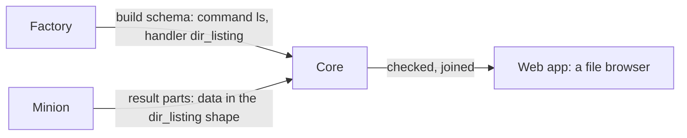

:::caution[Draft]
This page records an agreed design that is not built yet. Today a command's
`data` has no declared shape: core stores it through JSON (losing byte
strings and exact integers), joins the parts by a generic rule, and the web
app guesses a file table from an `entries` key that only BOB's minion sends.
When this lands, the page drops this aside and its status in the
[contracts table](../overview/#contracts-in-this-section) changes.
:::

A task's [`data`](../minion-messages/#items) is structured output: a
directory's entries, a process list, a screenshot. Core cannot show or check
it without knowing its shape, and each factory naming its own shapes would
give every factory's `ls` a different view. So **core defines result
handlers**: named shapes, the same for every factory, each with a documented
contract and a view of its own in the web app. A factory picks one for a
command by naming it in its build schema, and its minion sends `data` in that
shape.



A handler describes what a task of the command takes (its params, as far as
core needs them) and what its `data` is. It says nothing about how the minion
gets it: one minion lists a directory with `readdir`, another with
`FindFirstFile`, a third through a shell.

## Naming a handler

A command names its handler in the [build schema](../minion-build/#commands):

```json
{
  "id": "ls",
  "label": "List a directory",
  "handler": "dir_listing",
  "params": [
    { "key": "path", "type": "string", "label": "Path", "default": "." }
  ]
}
```

- `handler` is optional. A command without one shows its output, and its
  `data` only as raw JSON.
- A handler's id matches `^[a-z][a-z0-9_]{0,62}$`. Any number of a schema's
  commands may name the same handler (`ls` and `ls_hidden`).
- At registration core checks each command against its handler's
  [params contract](#params) and refuses the schema when one does not
  meet it, as it refuses an invalid schema (`validation_failed`).
- A handler core does not know (a factory newer than core) is accepted: its
  commands show their `data` as raw JSON, as if they named none.

## How core keeps data

A result part's `data` is CBOR, as everything in a
[message](../minion-messages/#message) is. Core keeps it **as it came**: the
part's `data` bytes, stored untouched beside the part, never converted to
JSON or to Mongo's BSON. Byte strings stay bytes, integers stay exact, and
what the minion sent can always be given back.

Core decodes the CBOR when it needs it:

- once as the part comes, to [check it](#what-core-does-with-it) against the
  command's handler;
- when the task's data is read: to join the parts and give the result to the
  web app (only the task an operator looks at; the browser keeps it a while).

A **download** gives the parts' `data` exactly as the minion sent them:
`GET /api/v1/minion-tasks/{id}/data`, a CBOR sequence
([RFC 8742](https://www.rfc-editor.org/rfc/rfc8742),
`application/cbor-seq`), one item per part in `seq` order. Like the
[output download](../minion-messages/#to-build), it takes a member of the
operation.

### As JSON, for the web app

The web app reads JSON (GraphQL), so the data it shows is converted on the
way out, by one mapping:

| CBOR | JSON |
|---|---|
| map (text keys only, as the protocol allows) | object |
| array | array |
| text | string |
| integer within ±2^53 | number |
| integer beyond ±2^53 | string of its decimal digits |
| float | number; `NaN` and the infinities as the strings `"NaN"`, `"Infinity"`, `"-Infinity"` |
| `true`, `false`, `null`; `undefined` | `true`, `false`, `null`; `null` |
| byte string | `{"$bytes": "<base64>"}` |

Tags never come: the protocol's [CBOR rules](../minion-messages/#cbor-rules)
refuse them.

A handler's view does not go through this mapping for the fields it knows:
it decodes them into their types (a `dir_listing`'s `modified` is seconds,
shown as a date). The mapping is what the raw JSON toggle, the task's JSON,
and the data of commands without a handler show.

## What core does with it

For a command with a handler, core:

1. **Checks each result part's `data`** against the handler's shape as it
   comes, by decoding it into the handler's types. A part that does not fit is still kept, so nothing is lost, but the
   task is flagged with the first problem found, and the web app shows that
   task's `data` as raw JSON with the problem above it. The minion gets no
   error: it delivered the part, and only its factory can fix the shape.
2. **Joins the parts by the handler's rule** ([dir_listing's](#parts)), in
   `seq` order, instead of the generic one.
3. **Shows it with the handler's view**, with the raw JSON a toggle away.

Some rules hold for every task, with a handler or without:

- **The done part is the last.** A part that comes after the task ended
  (done, failed, or cancelled) is ignored and logged: it changes neither the
  task's state nor its output. The one exception is a part the task lacks
  before its done part, resent late: it is kept, and fills the gap.
- **Output and data share one budget**, 4 MiB per task. Past it, parts are
  still acknowledged but their output and data are dropped, and the task is
  marked truncated.
- **Missing parts are flagged.** When the done part is `seq` *n* but fewer
  than *n* + 1 parts are kept, the task is marked incomplete. A minion resends
  a part until it is acknowledged, so this means parts lost for good.

## Handlers

| Handler | What `data` is | View |
|---|---|---|
| [`dir_listing`](#dir_listing) | One directory's entries | A file browser: open a folder, go up |

More come as commands need them (a process list, a screenshot, a file
transfer); each gets a section here first.

## dir_listing

One directory's entries, for a command that lists a directory on the host:
`ls`, `dir`, `list`, whatever the factory calls it.

### Params

The command must declare a param `path` of type `string`: the directory to
list, as the host writes paths. It may be required or have a default (`.`);
without either, the minion lists its working directory. The command may take
other params (`all`, to show hidden entries); core passes them through as
they are.

Core relies on `path` to [open a folder](#view): it runs the same command
again with `path` set to the folder's.

### Data

In CBOR, described in CDDL as in [Minion Messages](../minion-messages/#items).
The protocol package has it as Go types (`protocol.DirListing`,
`protocol.DirEntry`), which a minion in Go encodes as they are:

```cddl
dir-listing = {
  path: tstr,           ; the directory listed, absolute, as the host writes
                        ;   it: "/usr/bin", "C:\\Users\\ann"
  sep: "/" / "\\",      ; the host's path separator
  ? parent: tstr,       ; the parent directory; left out at a root
  entries: [* entry],   ; may be empty
}

entry = {
  name: tstr,           ; the entry's name in the directory, never empty,
                        ;   without a separator
  type: "dir" / "file" / "link" / "other",
  ? size: uint,         ; bytes; files (a link: the link's own size)
  ? modified: int,      ; unix seconds, as a task's datetime args; negative
                        ;   before 1970
  ? mode: tstr,         ; as the host shows it: "-rw-r--r--", "drwx------",
                        ;   or Windows attributes "A--H-"
  ? owner: tstr,
  ? group: tstr,
  ? target: tstr,       ; a link's target, as the link holds it
  ? hidden: bool,       ; hidden by the host's own rule (a dot name, the
                        ;   Windows hidden attribute)
}
```

- `.` and `..` are not entries.
- `type` is the entry itself, not what a link points to: a link to a folder
  is a `link` with its `target`. `other` is anything else (a device, a socket,
  a pipe). A later version may add types; a reader shows one it does not
  know as `other`.
- The minion sends entries in any order; the view sorts them.
- A key this page does not list is ignored, so a later version can add
  optional keys (see [Changing a handler](#changing-a-handler)). A factory's
  own fields go under `x`, as in a `hello`.
- A directory the minion cannot list is not a listing: the task ends
  `ok: false` with the reason in `err`, and no `data`.

For example, the first part of an `ls` of `/home/ann/Downloads`, in CBOR's
diagnostic notation:

```cddl
{
  "path": "/home/ann/Downloads",
  "sep": "/",
  "parent": "/home/ann",
  "entries": [
    {"name": "reports", "type": "dir", "modified": 1793347920, "mode": "drwxr-xr-x"},
    {"name": "notes.txt", "type": "file", "size": 1832, "modified": 1793438413, "mode": "-rw-r--r--"},
    {"name": "latest", "type": "link", "target": "reports/2026-10", "mode": "lrwxrwxrwx"}
  ]
}
```

That part is 237 bytes of CBOR; the same values as JSON take 315.

### Parts

A large directory does not fit one message (at most 65 536 elements in an
item's `data`, 768 KiB in a message), so the minion splits it:

- The **first part** (`seq` 0) carries `path`, `sep`, `parent` and the first
  entries.
- **Later parts** carry `entries` only. A later part with `path`, `sep` or
  `parent` is a problem (rule 1 above).
- The **done part** may carry entries or none.

Core joins them into one listing: `path`, `sep` and `parent` from the first
part, the entries of every part appended in `seq` order.

### View

The web app shows a listing as a file browser:

- The **path** at the top, as breadcrumbs: each folder in it opens that
  folder. The root is the path's start up to its first separator (`/`, `C:\`,
  or `\\server\share\` for a Windows share).
- **Up** opens `parent`, and is not there at a root.
- The **entries** as a table, folders first, then by name: an icon by type,
  then name, size, modified (in the app's format), mode, owner. A link shows
  its target next to its name.
- **Opening a folder** (a click on a `dir` entry, or on a `link`, which may
  lead to one) runs the command again on the session with `path` set to
  `path` + `sep` + the entry's name, its other args as they were. It is a new
  task like any other: it goes in the list, and the console shows it.
  Opening a folder takes an operator and an open session, as any task does;
  a viewer browses what is already listed.

The Data tab's toggle shows the joined listing as raw JSON instead.

## Changing a handler

A handler only grows: a later version may add optional keys to its `data` or
its entries, never remove one, change its meaning, or make it required. Core
ignores keys it does not know, so a minion newer than core still fits.
A change that cannot be made that way is a new handler (`dir_listing_v2`),
and the old one stays for the minions already built.

## Design notes

- **Why core's handlers, not each factory's own shapes.** A factory could
  declare a schema for its `data` and the web app draw a generic table from
  it. But a generic table cannot know that a row is a folder to open, a
  process to kill, or an image to show, and every factory's `ls` would look
  different. A handler is a shared contract: one shape, one view, the same
  for every factory, and core can act on it (open a folder) because it knows
  what it is.
- **Why keep a part that does not fit.** Refusing it would make the minion
  resend it forever, or drop it and leave a hole in the listing. Keeping it
  and flagging the task keeps what came, shows it as JSON, and tells the
  operator, and through them the factory's author, what is wrong.
- **Why data stays CBOR.** Converting it on arrival (to JSON, as today, or to
  BSON) loses what CBOR has and they do not: byte strings, integers beyond
  2^53 or beyond int64. It also would not save work: Mongo keeps BSON
  and the web app reads JSON, so a view converts either way, and decoding
  CBOR is one step where reading back BSON as JSON is two. Kept as it came,
  data can be checked strictly against a handler's types and given back
  exactly. What it gives up is querying inside `data` in Mongo, which
  nothing does.
- **Why `sep` and `parent` from the minion.** Paths are the host's. Core
  cannot tell a Windows path from a Unix one with a backslash in a name, nor
  where a root ends on a share, so the minion says how its paths join and
  where up leads.
