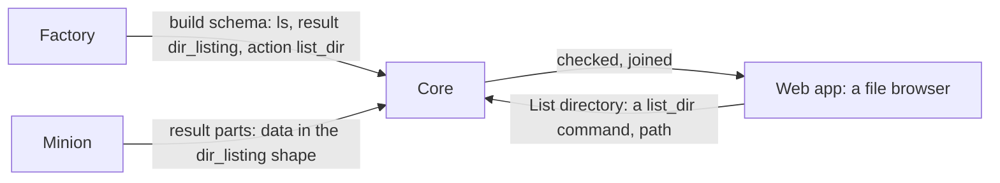

A build command can say two things about itself, each by naming one of
core's own:

- its **result**: what its task's [`data`](../minion-messages/#items) is
  (`dir_listing`). Core checks the data against the result's shape, joins
  its parts by the result's rule, and the web app shows it with the
  result's view;
- its **action**: what core can ask it to do itself (`list_dir`). Core
  runs it from a view's menu, a button, or a crumb, with the action's params
  alone.



They are apart because they part ways: a `find` returns a listing (result
`dir_listing`) but is no way to list a folder (no action); a `download`
belongs in a file's menu (action `download_file`) but gives no listing. Both
say nothing about how the minion does it: one lists a directory with
`readdir`, another with `FindFirstFile`, a third through a shell.

Results and actions are **core's vocabulary**, the same for every factory,
each with a contract on this page. A factory picks from them only.

## Naming them

A command names them in the [build schema](../minion-build/#commands):

```json
{
  "id": "ls",
  "label": "List a directory",
  "result": "dir_listing",
  "action": "list_dir",
  "params": [
    { "key": "path", "type": "string", "label": "Path", "default": "." }
  ]
}
```

- Both are optional. A command with no result shows its output, and its
  `data` only as raw JSON; one with no action is never run by core on its
  own.
- Only names core knows: one it does not (`dir_listng`, or one from a
  newer protocol than core's) **refuses the schema** at registration
  (`validation_failed`), naming the command and the names core knows.
  factory-core runs the same check before it starts, so the factory's
  developer sees it at once.
- An **action's params**: the action names its own (`list_dir`: `path`),
  each of a type, and the command must take them. **Every other param the
  command takes must have a default** (required or not): core runs it with
  the action's params alone, and the rest take their defaults. A param that
  is optional without a default is refused too: the default says what the
  minion does without it.
- An **action's result**: the action names the result its commands must
  have, so what core does with the task next works (`list_dir` needs
  `dir_listing`: the folder listed opens in the file browser). An action
  may name none (`delete_path`): its commands then name none either.
- Any number of a schema's commands may name the same result, or the same
  action (an `ls` by system call and an `ls_sh` through a shell).

## The vocabulary

| Result | What `data` is | View |
|---|---|---|
| [`dir_listing`](#dir_listing) | One directory's entries | A file browser |
| [`file_download`](#file_download) | A file the minion sent core: which one | A file card: progress, check, Download |
| [`file_upload`](#file_upload) | A file core sent the minion: where it went | The upload's progress, then where and whether it checked out |
| [`file_stream`](#file_stream) | A file the minion streamed: which one, how big | Download and a curl line, the stream's progress |
| [`dir_walk`](#dir_walk) | Where a walk through a directory stands (its listings go to the file browser) | Its progress, Open in File Browser |

| Action | Core gives | Needs result | Run from |
|---|---|---|---|
| [`list_dir`](#list_dir) | `path` (string) | `dir_listing` | a listing's Up, crumbs and List directory; Browse files |
| [`download_file`](#download_file) | `path` (string) | `file_download` | a listing's file: Download |
| [`upload_file`](#upload_file) | `path` (string), `file` (file), `overwrite` (bool) | `file_upload` | a listing's folder: Upload here |
| [`upload_stream`](#upload_stream) | `path` (string), `stream` (stream), `overwrite` (bool) | `file_upload` | a listing's folder: Upload here |
| [`delete_path`](#delete_path) | `path` (string), `recursive` (bool) | none | a listing's entry: Delete |
| [`stream_file`](#stream_file) | `path` (string) | `file_stream` | a listing's file: Stream |
| [`walk_dir`](#walk_dir) | `path` (string) | `dir_walk` | a listing's or the file browser's folder: Walk from here |

More come as commands need them (a process list, a screenshot); each gets
a section here first, and a release of the protocol and core.

## Running an action

A factory may give several commands one action, and a build carries the ones
its operator picked. Which one core runs:

- **From a view's item** (List directory on a folder): the session's
  commands with the action, the view's own command first when it has the
  action, in a submenu when there are more than one. The view's own command
  keeps its other args; another runs with the action's params alone.
- **From a view's own navigation** (Up, a crumb): the view's own command
  when it has the action, else the session's first with it.
- **Afresh** (Browse files): the one the operator picked for the session,
  while the session has it; otherwise the first in the factory's order: a
  factory lists the command it prefers for an action first. With more than
  one, the web app says which will run and lets the operator pick another,
  remembered for the session in their browser.

## How core keeps data

A result part's `data` is CBOR, as everything in a
[message](../minion-messages/#message) is. Core keeps it **as it came**: the
part's `data` bytes, stored untouched beside the part, never converted to
JSON or to Mongo's BSON. Byte strings stay bytes, integers stay exact, and
what the minion sent can always be given back.

Core decodes the CBOR when it needs it:

- once as the part comes, to [check it](#what-core-does-with-a-result)
  against the command's result;
- when the task's data is read: to join the parts and give the result to the
  web app (only the task an operator looks at; the browser keeps it a while).

A **download** gives the parts' `data` exactly as the minion sent them:
`GET /api/v1/minion-tasks/{id}/data`, a CBOR sequence
([RFC 8742](https://www.rfc-editor.org/rfc/rfc8742),
`application/cbor-seq`), one item per part in `seq` order. Like the
[output download](../minion-messages/#to-build), it takes a member of the
operation.

### As JSON, for the web app

The web app reads JSON (GraphQL), so the data it shows is converted on the
way out, by one mapping:

| CBOR | JSON |
|---|---|
| map (text keys only, as the protocol allows) | object |
| array | array |
| text | string |
| integer within ±2^53 | number |
| integer beyond ±2^53 | string of its decimal digits |
| float | number; `NaN` and the infinities as the strings `"NaN"`, `"Infinity"`, `"-Infinity"` |
| `true`, `false`, `null`; `undefined` | `true`, `false`, `null`; `null` |
| byte string | `{"$bytes": "<base64>"}` |

Tags never come: the protocol's [CBOR rules](../minion-messages/#cbor-rules)
refuse them.

A result's view does not go through this mapping for the fields it knows:
it decodes them into their types (a `dir_listing`'s `modified` is seconds,
shown as a date). The mapping is what the raw JSON toggle, the task's JSON,
and the data of commands without a result show.

## What core does with a result

For a command with a result, core:

1. **Checks each result part's `data`** against the result's shape as it
   comes, by decoding it into the result's types. A part that does not fit
   is still kept, so nothing is lost, but the task is flagged with the first
   problem found, and the web app shows that task's `data` as raw JSON with
   the problem above it. The minion gets no error: it delivered the part,
   and only its factory can fix the shape.
2. **Joins the parts by the result's rule** ([dir_listing's](#parts): its
   entries appended; [dir_walk's](#dir_walk): the latest part), in `seq`
   order, instead of the generic one.
3. **Shows it with the result's view**, with the raw JSON a toggle away.

A task keeps the result its command had when it was queued.

Some rules hold for every task, with a result or without:

- **The done part is the last.** A part that comes after the task ended
  (done, failed, or cancelled) is ignored and logged: it changes neither the
  task's state nor its output. The one exception is a part the task lacks
  before its done part, resent late: it is kept, and fills the gap.
- **Output and data share one budget**, 4 MiB per task. Past it, parts are
  still acknowledged but their output and data are dropped, and the task is
  marked truncated.
- **Missing parts are flagged.** When the done part is `seq` *n* but fewer
  than *n* + 1 parts are kept, the task is marked incomplete. A minion resends
  a part until it is acknowledged, so this means parts lost for good.

## dir_listing

One directory's entries: the result of a command that lists a directory on
the host (`ls`, `dir`, `list`, whatever the factory calls it), or of one that
finds files and gives them the same way.

The minion does not send it as `data`: it sends what it read as a
[listing](../minion-messages/#listings) (`ls` on its result parts), which
core also keeps in the machine's [file browser](../file-browser/), and core
makes the task's `data` from the task's first listing (`id` 0). For the
task's view, its actions and every reader of its data, nothing else
changes.

### Data

The data core makes, in CBOR, described in CDDL as in [Minion
Messages](../minion-messages/#items). The protocol package has it as Go
types (`protocol.DirListing`, `protocol.DirEntry`); a listing's pieces carry
the same entries:

```cddl
dir-listing = {
  path: tstr,           ; the directory listed, absolute, as the host writes
                        ;   it: "/usr/bin", "C:\\Users\\ann"
  sep: "/" / "\\",      ; the host's path separator
  ? parent: tstr,       ; the parent directory; left out at a root
  entries: [* entry],   ; may be empty
}

entry = {
  name: tstr,           ; the entry's name in the directory, never empty,
                        ;   without a separator
  type: "dir" / "file" / "link" / "other",
  ? size: uint,         ; bytes; files (a link: the link's own size)
  ? modified: int,      ; unix seconds, as a task's datetime args; negative
                        ;   before 1970
  ? mode: tstr,         ; as the host shows it: "-rw-r--r--", "drwx------",
                        ;   or Windows attributes "A--H-"
  ? owner: tstr,
  ? group: tstr,
  ? target: tstr,       ; a link's target, as the link holds it
  ? hidden: bool,       ; hidden by the host's own rule (a dot name, the
                        ;   Windows hidden attribute)
}
```

- `.` and `..` are not entries.
- `type` is the entry itself, not what a link points to: a link to a folder
  is a `link` with its `target`. `other` is anything else (a device, a socket,
  a pipe). A later version may add types; a reader shows one it does not
  know as `other`.
- The minion sends entries in any order; the view sorts them.
- A key this page does not list is ignored, so a later version can add
  optional keys (see [Changing the vocabulary](#changing-the-vocabulary)). A factory's
  own fields go under `x`, as in a `hello`.
- A directory the minion may not read is a listing with `err` and no
  entries (core marks the folder in the file browser), and the task ends
  `ok: false` with the reason in `err`; core makes no `data` of it. One that
  is not a directory at all is no listing: just the failed task.

For example, the data core makes of an `ls` of `/home/ann/Downloads`, in
CBOR's diagnostic notation:

```cddl
{
  "path": "/home/ann/Downloads",
  "sep": "/",
  "parent": "/home/ann",
  "entries": [
    {"name": "reports", "type": "dir", "modified": 1793347920, "mode": "drwxr-xr-x"},
    {"name": "notes.txt", "type": "file", "size": 1832, "modified": 1793438413, "mode": "-rw-r--r--"},
    {"name": "latest", "type": "link", "target": "reports/2026-10", "mode": "lrwxrwxrwx"}
  ]
}
```

That part is 237 bytes of CBOR; the same values as JSON take 315.

### Parts

A large directory does not fit one message, so its listing comes in pieces
([Listings](../minion-messages/#listings)), several to a result part or one
over several. Core makes each result part's `data` from the first listing's
pieces on it:

- The listing's **first piece** (`part` 0), with `path`, `sep`, `parent`
  and the first entries, comes on the task's **first result part** (`seq`
  0): that part's data names the directory.
- **Later pieces**, on later parts, give data of `entries` only.
- The **done part** may carry pieces or none.

Core joins the parts' data into one listing as before: `path`, `sep` and
`parent` from the first part, the entries of every part appended in `seq`
order. The listing's data counts toward the task's 4 MiB; what goes into
the file browser does not.

### View

The web app shows a listing as a file browser:

- The **path** at the top, as breadcrumbs. The root is the path's start up
  to its first separator (`/`, `C:\`, or `\\server\share\` for a Windows
  share).
- **Up**, to `parent`; not there at a root.
- The **entries** as a table, folders first, then by name: an icon by type,
  then name, size, modified (in the app's format), mode, owner. A link shows
  its target next to its name.
- An entry's **actions are in its context menu** (a right click), not on a
  click: a click runs nothing. The menu copies the entry's path or name, and
  on a `file` offers **Download** ([`download_file`](#download_file)): the
  session's commands with it, a submenu when there are several, run with
  the file's path alone.
- On a `file`, **Stream** ([`stream_file`](#stream_file)): as
  Download, the session's commands with it, with the file's path alone.
- On a `dir` entry, and for the listed folder itself (a button by the
  crumbs), **Upload here…** ([`upload_file`](#upload_file)). It opens a
  dialog: the file (a picker: the file goes to core at once, with its
  progress), its destination (the folder + `sep` + the file's name, until
  the operator edits it) and **Overwrite** (off; the dialog says so when
  the listing already has an entry of that name). Upload runs the command
  with those three; the button by the crumbs uses the session's first
  `upload_file` command. With [`upload_stream`](#upload_stream) commands
  too, Upload here is a submenu: the session's `upload_file` and
  `upload_stream` commands, each its own dialog. A stream's file may be
  picked (it goes from the browser), or not: it goes with curl, and the
  path must name the file.
- On any entry, **Delete…** ([`delete_path`](#delete_path)): a
  confirmation first, always, with the entry's full path, and for a
  folder a **Delete everything in it** box (`recursive`). The listing stays
  as it was listed; re-list the folder to see it gone.
- Up, a crumb, and an entry's **List directory** (on a `dir` entry or a
  `link`, which may lead to one) run [`list_dir`](#list_dir) on that
  folder, as [Running an action](#running-an-action) says. Without a
  `list_dir` command in the session, or for a viewer, the listing is read,
  not browsed.

The Data tab's toggle shows the joined listing as raw JSON instead.

Every result's view works this way: an item's actions in its context menu,
each the session's commands with an action, a submenu when there are
several.

## list_dir

Lists a directory: what Up, a crumb, List directory and Browse files run.

- **Core gives** `path`, a `string`: the directory to list, as the host
  writes paths; `path` + `sep` + an entry's name for a folder in a listing,
  `parent` for Up. The command may require it or default it (`.`); Browse
  files gives none, so the command's default (or the minion's working
  directory) is listed.
- **Needs result** `dir_listing`.
- The command may take other params, each with a default (`all`, default
  `false`, to show hidden entries).

## file_download

A file the minion sent core in a [file transfer](../minion-messages/#file-transfers):
the result of a command that downloads a file from the host. Core keeps the
file itself; the task's `data`, in one part at its end, says which one:

```cddl
file-download = {
  xfer: bstr .size 16,  ; the transfer the file came in
  path: tstr,           ; the file's path on the host
  size: uint,
  sha256: bstr .size 32,
}
```

The protocol package has it as `protocol.FileDownload`, read and checked by
`protocol.ReadFileDownload`. A task's file shows from its first chunk, before
the data: GraphQL gives it as the task's `file`.

### View

The task's File tab has four views:

- **Overview**, centred in the pane:
  - the file's kind, name, size and type;
  - while it comes, how much has arrived, with a progress bar;
  - then whether it checked out against its size and SHA-256 (or why not);
  - once kept, **Download** (`GET /api/v1/minion-files/{id}`, the bytes as
    they came);
  - its details: path, exact size, type, SHA-256 (to copy) and state.
- **Preview**, for a kept file of a type the wiki previews: pictures, PDF,
  video and audio, and documents converted into a sandboxed frame (Word,
  Excel, HTML, Markdown, CSV, JSON, YAML, scripts, text). It uses the same
  renderers as wiki attachments.
- **Hex**, read-only. It shows offset, hex and text columns, and reads the
  file in 64 KiB blocks as they come into sight. It handles files of any
  size, and offers:
  - go to offset;
  - select with the mouse or the arrow keys (Shift extends);
  - copy as hex or as text;
  - read the bytes at the caret as integers.
- **Strings**: the printable strings in it, from core
  (`minionFileStrings`), with their offsets. You can search them, set the
  shortest length and pick the encoding. Double-click one to show it in Hex.

The toggle shows the task's data as raw JSON.

## download_file

Sends a file to core: what a listing's file's **Download** runs.

- **Core gives** `path`, a `string`: the file to send, `path` + `sep` + the
  entry's name for a file in a listing.
- **Needs result** `file_download`.
- The command's minion sends the file in a
  [transfer](../minion-messages/#file-transfers) for the task, and ends the
  task with the `file_download` data once core has it all.

## file_upload

A file core sent the minion in a [transfer](../minion-messages/#core-sending-a-file):
the result of a command that puts a file on the host. The task's `data`, in
one part at its end, says where the file went and what the minion wrote:

```cddl
file-upload = {
  xfer: bstr .size 16,  ; the transfer it came in
  path: tstr,           ; where it is on the host, as the host writes it
  size: uint,
  sha256: bstr .size 32,
}
```

The protocol package has it as `protocol.FileUpload`, read and checked by
`protocol.ReadFileUpload`. It is the data of a [stream](#upload_stream)
too. Core checks `size` and `sha256` against the file it sent (a
stream's: the bytes it passed on, hashed as they went): data that does not match shows as a problem, as data that does not
fit its result does. The upload's progress shows from the task's start,
before the data: GraphQL gives it as the task's `upload`. That holds the
file (name, size, SHA-256), how far the minion has acked, and the
transfer's state: waiting for the minion's first ack, sending, done, failed
or cancelled.

### View

The task's Upload tab, laid out like a downloaded file's Overview (two
columns, centred):

- the file's kind, name and size, and where it goes: the data's `path` once
  it came, the `path` arg until then;
- while it goes, a progress bar of what the minion has acked, the rate and
  the time left; before the minion's first ack, "Waiting for the minion";
- at its end, whether it checked out (the minion's size and SHA-256 against
  core's), or why it failed;
- its details: source name, size, SHA-256 (to copy), destination, state,
  when it started and ended.

A stream's shows its uploader too: "Waiting for an uploader" (with
a file picker and the curl command), how far the uploader is and the
minion is, and, after the uploader went away, "Paused", with a **Resume**:
pick the file again, or the curl command from where core is.

The toggle shows the task's data as raw JSON.

## upload_file

Puts a file on the host: what a listing's **Upload here…** runs.

- **Core gives**:
  - `path`, a `string`: where the file goes, the folder + `sep` + the
    file's name for one uploaded from a listing;
  - `file`, a `file`: the [task file](#task-files) to send;
  - `overwrite`, a `bool`: whether a file already at `path` is replaced.
    When it is `false`, such a file fails the task with "exists", and
    nothing is sent.
- **Needs result** `file_upload`.
- A `path` that is a folder that exists puts the file in it under its own
  name (the arg's `name`), so a path typed in the console may name the
  folder alone.
- The command's minion gets the file in a
  [transfer from core](../minion-messages/#core-sending-a-file). It writes
  it to a temporary file next to `path`, moves that into place once its
  size and SHA-256 check out, and ends the task with the `file_upload` data.

### Task files

The operator uploads the file to core before the task is queued, with
`POST /api/v1/minion-files`: a multipart body with `operationId` first,
then `file`, at most `MINION_FILE_MAX_SIZE` (2 GiB by default). Core reads
it as it streams (an operator of the operation; the role is checked before
the file is taken) straight into the minion files bucket, never holding it
whole, and answers with its id, name, size, SHA-256 and content type.
nginx passes this one path through unbuffered, with a body limit of its
own above the 2 GiB.

- A `file` arg names one of the operation's task files, checked against the
  param's `accept` and `max_size` when the task is queued.
- One upload can serve several tasks (one command fired at several
  sessions).
- A task file is kept **while a task that names it has not ended**. When
  the last one ends (done, failed or stopped), the file is dropped. One that
  no task names is dropped a day after its upload.
- So **Run again** on an upload that ended asks for the file again.

## upload_stream

Puts a file of any size on the host, streamed from its uploader through
core, with nothing kept.

- **Core gives** `path` (a `string`, as for
  [`upload_file`](#upload_file)), `stream` (a `stream`: the file's name;
  without one, the path's last part names it) and `overwrite` (a `bool`).
- **Needs result** `file_upload`.
- The command's minion gets the file [streamed from
  core](../minion-messages/#streaming-a-file-to-a-minion), writes it to a
  temporary file next to `path`, and moves it into place once its size and
  SHA-256 check out.

### Uploading a stream

`PUT /api/v1/minion-streams/{task}`: the body is the file, or a part of it.

- A part says where it is: `Content-Range: bytes N-M/total`. A body without
  one is the whole file, from 0. Core takes a part only from where it is:
  any other gets `409`, with `Upload-Offset` saying where. `HEAD` says it
  too (`Upload-Offset`, `Upload-Length` once known). The first part, or the
  whole, says the size (`total`, or `Content-Length`).
- Core reads the body as the minion takes it: while its buffer is full, the
  uploader waits.
- One uploader at a time: **the newest wins**, as for a download.
- Auth: the session cookie, or a **signed link** for that one stream (as
  for [downloading a stream](#downloading-a-stream)).

From the console the browser sends the picked file in parts of 8 MiB, one
after the other, and after a failure goes on from core's offset by itself.
With none picked, the view gives `curl -T <file> '<link>'`; after a drop,
**Resume** gives `curl -C <offset> -T <file> '<link>'` with core's offset
filled in. (curl's `-C -` finds the offset for downloads only.)

## delete_path

Removes a file, a link or a folder on the host: what a listing's
**Delete…** runs.

- **Core gives** `path`, a `string`: the entry to remove, `path` + `sep` +
  the entry's name for one in a listing; and `recursive`, a `bool`: a
  folder that is not empty goes with everything in it. Without it, such a
  folder stays and the task fails, saying so.
- **No result.** An action needs no result when nothing comes back for core
  to show: the task's output says what went (`removed /tmp/x (file)`), and
  its commands name no result either.
- A link goes itself, never what it points to. A command should refuse a
  filesystem's root (`/`, `C:\`), whatever `recursive` says: BOB's `rm`
  does.

## dir_walk

A walk through a directory and the folders under it: the result of a command
that lists many folders in one task (BOB's `walk`). What it read goes to
core as [listings](../minion-messages/#listings), one a folder, into the
machine's [file browser](../file-browser/) as they come; its `data` only says
where the walk stands:

```cddl
dir-walk = {
  root: tstr,           ; the directory walked, absolute, as the host writes it
  folders: uint,        ; folders listed so far
  entries: uint,        ; their entries
  ? unread: uint,       ; folders it could not read (each a listing with err)
  ? skipped: uint,      ; folders it did not enter: deeper than it goes, past
                        ;   its limit, on another file system, hidden
  ? current: tstr,      ; the folder it is reading; left out once it ended
  ? x: { * tstr => any },
}
```

- **Every part says it whole**, `root` included, and core shows the latest
  (`DirWalk`, `ReadDirWalk` in the protocol package). A minion sends one as
  the walk goes (BOB's every 2 seconds) and one at its end.
- **How it walks is the command's**: BOB's goes breadth first (the top
  levels first), never follows a link, and stays on its file system and
  (unless asked not to) goes into hidden folders; `depth` and `max_folders`
  limit it when set, none by default. It reads on only while few of its pieces wait to be
  sent, so a walk goes as fast as the channel takes it and does not crowd
  out other tasks.
- **Its view** shows the folder walked, the folders and entries so far, how
  many it could not read or did not enter, and the folder it is reading,
  with **Open in File Browser** at the folder walked.

## walk_dir

Walks a folder and those under it: what **Walk from here** runs, on a
listing's folder, and in the file browser on a folder or the folder shown.

- **Core gives** `path`, a `string`: the folder to walk. How deep and how
  far are the command's own params, with defaults: BOB's `depth` and
  `max_folders` are 0, no limit, so a walk goes until it has read
  everything under the folder, or is stopped from its task.
- **The result is a `dir_walk`.** The file browser shows the walk's folders
  as their listings come, the folder walked marked "walking…".

## file_stream

A file the minion [streamed](../minion-messages/#streaming-a-file) to
whoever downloaded it: the result of a command that sends a file of any
size, with nothing kept in core. The task's `data`, in one part at its end
(when the downloader had every byte), says which file:

```cddl
file-stream = {
  xfer: bstr .size 16,
  path: tstr,            ; the file's path on the host
  size: uint,
  ? sha256: bstr .size 32,  ; when the minion read it whole, in order
}
```

The stream shows from the minion's announcement, before the data: GraphQL
gives it as the task's `stream`: the file's name and size, how far the
minion has sent and the downloader has, and the stream's state: waiting
for a downloader, streaming, paused (its downloader went away, or is
slow), done, or cancelled.

### Downloading a stream

`GET /api/v1/minion-streams/{task}`: to a browser or curl, a download like
any other.

- It answers at once with `Content-Length` (the size the minion
  announced), `Content-Disposition` (the file's name), `Accept-Ranges:
  bytes` and a strong `ETag`; the bytes follow as the minion sends them.
- `Range: bytes=N-` resumes from N: `206 Partial Content`, as a browser's
  Resume and `curl -C -` ask. `If-Range` with the `ETag` is honoured.
- Before the minion has announced the file, a request waits for it (an
  hour at most, then `503`); once the stream's task ended, `410 Gone`. A
  range past the end is `416`.
- One downloader at a time: **the newest wins**. A second request takes the
  stream from its own `Range`, and the first is cut, so a retry whose old
  connection core has not yet seen die works.
- Auth: the session cookie (the view's Download button), or a **signed
  link** (`?sig=…`) for that one stream, valid while the stream lasts and
  24 hours at most: the view's **Copy curl** gives
  `curl -C - -o <name> '<link>'`, which resumes when run again.

### View

The task's Stream tab, laid out as a file's Overview:

- the file's kind, name, size and path on the host;
- **Download**, and **Copy curl**;
- the state: "Waiting for a downloader", or the downloader's progress (a
  bar, the rate, the time left), "Paused" when it went away;
- **Stop** (the task's own): ends the stream;
- its details: path, size, SHA-256 once the data says it, state, when it
  started and ended.

## stream_file

Streams a file to whoever downloads it: what a listing's file's **Stream**
runs.

- **Core gives** `path`, a `string`: the file to stream, `path` + `sep` +
  the entry's name for a file in a listing.
- **Needs result** `file_stream`.
- The command's minion [streams](../minion-messages/#streaming-a-file) the
  file for the task, and ends the task with the `file_stream` data once its
  downloader has every byte.

## Changing the vocabulary

A result only grows: a later version may add optional keys to its `data` or
its entries, never remove one, change its meaning, or make it required. Core
ignores keys it does not know, so a minion newer than core still fits. An
action may only gain optional params. A change that cannot be made that way
is a new name (`dir_listing_v2`), and the old one stays for the minions
already built.

## Design notes

- **Why core's vocabulary, not each factory's own shapes.** A factory could
  declare a schema for its `data` and the web app draw a generic table from
  it. But a generic table cannot know that a row is a folder to open, a
  process to kill, or an image to show, and every factory's `ls` would look
  different. A result is a shared contract: one shape, one view, the same
  for every factory, and core can act on it because it knows what it is.
- **Why a result and an action, not one name.** They were one (a
  "handler") until they parted ways: what a command's data is, and what
  core may run it for, are two promises, one about its output and one about
  its inputs. A `find` keeps the file browser without being offered for
  List directory; a `download` can be in a file's menu with no view of its
  own.
- **Why refuse a name core does not know.** Accepting it and showing raw
  data would hide a typo until an operator wonders why a listing is JSON.
  Refusing it names the problem when the factory starts. The cost is a
  factory built against a newer protocol than its core: refused, with the
  reason, until core is updated.
- **Why keep a part that does not fit.** Refusing it would make the minion
  resend it forever, or drop it and leave a hole in the listing. Keeping it
  and flagging the task keeps what came, shows it as JSON, and tells the
  operator, and through them the factory's author, what is wrong.
- **Why data stays CBOR.** Converting it on arrival (to JSON, as today, or to
  BSON) loses what CBOR has and they do not: byte strings, integers beyond
  2^53 or beyond int64. It also would not save work: Mongo keeps BSON
  and the web app reads JSON, so a view converts either way, and decoding
  CBOR is one step where reading back BSON as JSON is two. Kept as it came,
  data can be checked strictly against a result's types and given back
  exactly. What it gives up is querying inside `data` in Mongo, which
  nothing does.
- **Why `sep` and `parent` from the minion.** Paths are the host's. Core
  cannot tell a Windows path from a Unix one with a backslash in a name, nor
  where a root ends on a share, so the minion says how its paths join and
  where up leads.
