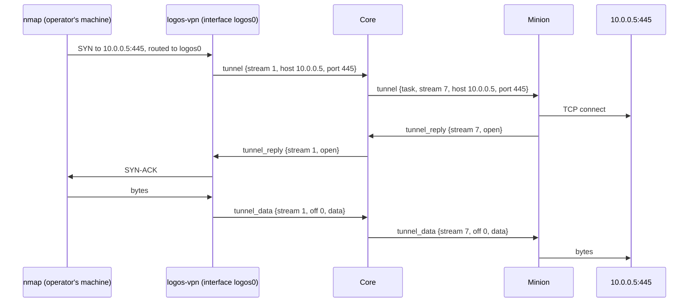

:::note[Released]
Wave 4 of the tunnels' [Future cases](../minion-messages/tunnels/#future-cases),
released 2026-11-08: protocol v0.44.0, BOB v0.31.0 (ICMP, and its half of
the timing, [change 9](../minion-messages/tunnels/#9-timing-that-follows-the-link)),
core, and `logos-vpn` v0.1.1 (v0.1.0's tag released no binaries). Not yet run on a real network: the user
tests it once a machine with networks of its own is at hand.
:::

A `tunnel` whose front is **`vpn`** routes an operator's machine into the
minion's networks: every tool on it reaches the tunnel's **routes**
(`10.0.0.0/24`) as if the machine stood there, with no proxy to set, nmap's
SYN scan and `ping` among them, which no SOCKS proxy carries. A small client
of core's, **`logos-vpn`**, runs on the operator's machine while it is
needed: it adds a network interface with the tunnel's routes, ends each
connection, UDP flow and ping that goes there in a TCP/IP stack of its own,
and carries each to core over core's own HTTPS address. Core opens each as a
stream of the task, as its SOCKS proxy does, and the minion opens it on its
host as any other: for TCP and UDP the minion needs nothing new.



## Connecting a machine

**One command.** The task's **VPN** tab has **Connect a machine**, for an
operator of the operation: a command to run on the machine to route, with a
key made for the operator who asked.

```sh
sudo logos-vpn https://logos.example.com lgv_…
```

On Windows the same runs in an elevated PowerShell (`logos-vpn.exe …`). The
address is the web app's, as the operator opened it: `https://`, or `http://`
to a loopback address alone (a dev stack, an SSH forward). Beside it, the tab
gives the client for each system, from core ([The client](#the-client)).

**What it does.** The client connects with the key, gets the tunnel's
routes, adds an interface (`logos0` on Linux, a `utun` on macOS, a Wintun
adapter on Windows) with a route through it for each, and says what it
added:

```text
logos-vpn: connected to logos.example.com as alice: task 3f9a… (session 12)
logos-vpn: logos0: 10.0.0.0/24, 10.0.5.0/24
logos-vpn: 192.168.1.0/24 left out: this machine reaches it through wlan0
```

From then on every tool on the machine reaches those networks. Nothing else
changes: the rest of its traffic goes where it went.

**Disconnecting.** Ctrl-C takes the routes and the interface away and tells
core. Core ends a client too, saying why, and the client takes them away and
exits: on the task's Stop or end, a **Disconnect** on the VPN tab, or its
operator no longer an operator of the operation.

**The key** is one operator's, for one task: the client's streams are that
operator's. Unused, it lapses 10 minutes after it was made; used, it is that
client's alone until the client disconnects, and then no one's: the command
run again needs a new key (Connect a machine again). A machine keeps nothing
that reaches core once its client exits.

**Shared by the operation**, as a port is ([The tunnel
commands](../minion-messages/tunnels/#the-tunnel-commands)): any operator of
the operation connects any number of machines to a VPN tunnel, each with a
key of their own. Their streams share the task's `max_streams`, its cap and
its Stop, each saying whose machine it came from.

## The front

A `tunnel`'s `front` gains `vpn`. It is core's, as every front is: no factory
release, no minion built again ([Design
notes](../minion-messages/tunnels/#design-notes)). Core's params with it:

| Core's | With front `vpn` |
|---|---|
| `routes` | required, `vpn`'s alone: the networks the client routes, CIDRs, IPv4 or IPv6 (`10.0.0.0/24`, `fd00:1::/64`), 1 to 64 (a `string_list`). Refused as the task is queued: a default route (`0.0.0.0/0`, `::/0`), loopback, link-local and multicast networks. Changed while the tunnel runs (the VPN tab; `setMinionTunnelRoutes`), as the cap is: connected clients take the change at once. |
| `port` | none: clients come over core's own address, so a VPN tunnel takes no operational port. `port` applies with `socks`, `http`, `forward` and `terminal`. |
| `source` | as the other fronts': the address of the minion's host its TCP streams go from. More options. |
| `stop_idle`, `cap` | as any front's. A connected client holds `stop_idle`'s clock, as an open stream does. More options. |

| The command's | |
|---|---|
| `timeout`, `max_streams` | as a SOCKS proxy's: how long the minion waits for a connect, and how many streams at once, over all of the tunnel's clients. BOB's `timeout` applies with `vpn` too. |
| `opens` | `tcp`; `udp` for UDP flows; `icmp` for pings ([ICMP](#icmp), new). What the command does not open, the client answers prohibited ([On the machine](#on-the-machine)). |

On the console: `tunnel vpn 10.0.0.0/24,10.0.5.0/24`, the routes one word,
comma-separated.

## On the machine

The client's interface hands each packet routed to it to a TCP/IP stack in
the client (gVisor's, as ligolo-ng's proxy has one), which ends each flow
there and carries it as a stream. The client's `tunnel` names an address
alone, never a name: what it sees are packets.

**TCP: a stream a connection, its handshake the minion's.** A SYN to a
routed address opens a stream to it. The client answers the SYN only once
the minion's reply comes, by what it says, so a scan reads each port as the
minion's host sees it:

| The minion's `result` | The tool sees |
|---|---|
| 0 open | the handshake completes |
| 1 refused | a reset: closed |
| 2 host unreachable | ICMP host unreachable |
| 3 network unreachable | ICMP network unreachable |
| 4 timed out, or no reply in time | nothing: its SYN goes unanswered (filtered) |
| 5 not allowed: `max_streams` open | nothing: the tool sends its SYN again, and a stream that ended since makes room |
| 9 denied | ICMP communication administratively prohibited |
| 6, 7, or one the client does not know | a reset |

Then the connection's bytes go as the stream's, within its window, a FIN its
`eof` and a reset its `reset`, as a SOCKS client's do.

**UDP: an association a source.** The first datagram from a port of the
machine to a routed address opens an association (a `tunnel` with `udp`):
every datagram from that port goes in it, to whatever routed address it
names, and what answers comes back to that port. One with no datagram either
way for 2 minutes ends (`TunnelUDPIdle`), as a NAT forgets a flow. What a
destination answers with ICMP (a port unreachable) is not carried: a UDP
scan reads a closed port as `open|filtered`.

**ICMP: pings.** An echo request to a routed address goes in the client's
ICMP stream ([ICMP](#icmp)), one for all its pings: the minion pings from its
host, and what answers (an echo reply, an unreachable, a time exceeded)
comes back as the machine would have had it. The client numbers the echoes
itself and maps each answer back to the tool's identifier and sequence. No
traceroute: a datagram's TTL is not carried.

**Prohibited, not faked.** UDP or a ping through a command that does not
open it is answered at once with ICMP communication administratively
prohibited, which a tool reads as filtered.

**No answers of its own.** A TCP packet that belongs to no connection
(nmap's ACK ping) gets no reply: a stack's own reset would make every
address look alive.

**Nothing comes in.** The client's stack takes only what its machine
started: a packet that answers nothing is dropped, and core opens no stream
toward the client (the link's streams are all the client's, as a task's are
all one side's). A VPN tunnel routes the machine in, never the minion's side
out to it: that is a reverse port forward's, to one destination the operator
picks.

**Routes left out.** A network one of the machine's interfaces is on (its
own LAN, another VPN's), or one that holds core's address (the client's own
link would go into the tunnel), the client leaves out, saying so: the
machine's own networks stay its own. A route the system will not add is
left out the same way.

**No DNS.** The client changes no resolver. A name inside the minion's
networks resolves by a server there (`dig @10.0.0.1`, `nmap --dns-servers
10.0.0.1`), its queries a flow as any other ([Open
questions](#open-questions)).

**The link lost.** The client keeps its interface, its routes and its
connections, so nothing meant for the minion's networks leaks out the
machine's default route, and connects again (1 s, doubling to 30 s). Within
2 minutes nothing is lost: each side sends again from the other's last ack
([The link](#the-link)). Past them it resets its connections, takes the
routes away and exits, saying why.

**Its systems**: Linux, macOS and Windows, amd64 and arm64, run as root or an
administrator, as any VPN client is: an interface and routes are the
system's.

## The link

The client talks to core over a **WebSocket** on core's own address, as the
web terminal does: `GET /api/v1/vpn`, the key its bearer (`Authorization:
Bearer lgv_…`), behind nginx's own location for it. The key alone signs it
in: no cookie, so no origin to check. No new service, port or hostname.

**Text frames are JSON**, the link's own words:

- the client's `{"hello":{"link","version","os","arch","machine","instance"}}`,
  first and again on each reconnect: `link` the link's version (1,
  `protocol.VPNLink`), `instance` a random number the client takes as it
  starts (32 hex digits), which ties the key to it;
- core's `{"welcome":{"task","session","operation","user","client","routes","max_streams","opens"}}`,
  back to each hello (`client` its name, as its streams say it); `{"routes":[…]}`
  each time they change; `{"end":"why"}` as it ends the client;
- the client's `{"bye":true}` as it disconnects, so core ends it at once
  rather than wait for it.

**Binary frames are tunnel items**
([Streams](../minion-messages/tunnels/#streams)), a CBOR array of them, 512
KiB and 256 items a frame at most (`protocol.VPNFrame`): `tunnel`, `tunnel_reply`, `tunnel_data`, `tunnel_ack`,
`tunnel_close` and `tunnel_datagram`, as a minion's messages carry them,
their `task` the VPN tunnel's. The client opens every stream of the link,
numbered from 1, and core answers. Their rules are the minion's streams'
(offsets, windows, half closes, every item safe to send twice), so a link
that drops and comes back loses nothing; while it lasts nothing needs
sending again, and acks keep the windows moving.

**Two legs.** For each stream of the client's, core opens one of its own
toward the minion, numbered as its others are (a thousand at a time), and
relays between them, each leg with its own acks and window: the minion never
learns there is a client. Core refuses, with the reply's result, a stream to
an address outside the tunnel's routes (9, denied) or of a kind the command
does not open (7, unsupported); the others get the minion's result.

**Closes** past the WebSocket's own say why core did not take a client, as
the terminal's do: 4000 refused (a key unknown, lapsed or used; a task that
is no running VPN tunnel; its operator no longer an operator of the
operation; the tunnel's 16 clients connected already), 4001 a hello core
does not take (another link version, or one that does not read: the reason
says where core's client is).

## Core's side

- **A client is the task's while connected**, in core's memory as its
  streams are: its operator, machine, system and version, the address it
  came from and when, its routes and those it left out, its streams counted
  and its bytes each way. Its streams say `vpn: alice@kali` as their client,
  as a web terminal's say `web: alice`.
- **Checked as it goes**: the operator's role at each hello and every
  minute; each stream's address against the routes; `max_streams` and the
  cap over all of the task's streams, every client's together.
- **Ended** by the task's Stop or end, a Disconnect, the role lost, or the
  client's `bye`: core sends `end`, closes the socket, and resets the
  client's streams on both legs. A client whose link dropped is kept 2
  minutes, its streams open, then ended.
- **A restart** drops the links, and a client connects again within its 2
  minutes, with its key (core keeps which instance took it). Streams do not
  outlive a restart: the client's are answered `no such stream` (close
  reason 3), their connections reset, and the routes stay.
- **Keys** (`vpn_keys`): each one's id and the hash of its secret, as API
  keys are kept; its task, operation and operator; when it was made and when
  it lapses; the instance that took it. They go with their task.

## The minion's side

Nothing new for TCP and UDP: the streams of a SOCKS proxy, to an address and
a port, or a UDP association. Pings take ICMP, below. BOB's half of the
timing ([change 9](../minion-messages/tunnels/#9-timing-that-follows-the-link))
goes in the same wave, no item changed.

### ICMP

An **icmp stream** (`kind` 5), where the command opens `icmp`: opened as a
UDP association is, with a `tunnel` that names no host and no port; its
datagrams are ICMP messages to and from any host.

```cddl
tunnel_datagram = {     ; of an icmp stream
  0: 26,                ; t: tunnel_datagram
  1: task-id,           ; task
  2: uint,              ; stream: the icmp stream's
  3: uint,              ; seq: as any datagram's
  4: tstr,              ; host: core → minion the address to ping; minion →
                        ;   core the address that answered (the host, or a
                        ;   router for an unreachable or a time exceeded)
  5: 0,                 ; port: none
  6: bstr,              ; data: the ICMP message, from its type on
}
```

- **Echo requests alone go out**: type 8 (128 to an IPv6 address), with its
  sequence and payload. The identifier is the minion's socket's, whatever
  the item says.
- **What answers comes back**: an echo reply (0; IPv6's 129), or an error
  for an echo the minion sent (destination unreachable 3, time exceeded 11;
  IPv6's 1 and 3): its first 8 bytes, then that echo's (type, code,
  checksum, identifier, sequence), with no IP header. The client builds the
  packet its machine expects from it.
- **From an unprivileged socket** where the host allows one (Linux's ping
  sockets, as `net.ipv4.ping_group_range` lets the minion's group; macOS's;
  Windows' `IcmpSendEcho`), else a raw one when the minion runs as root.
  With neither, the open is answered denied (9). BOB's: errors come back
  where its socket delivers them (a raw socket's, Windows'; Linux's ping
  sockets deliver none), and Windows pings IPv4 alone.
- **As UDP is**: no acks, no resending; a datagram that does not fit is
  dropped. The client's stream, and so core's, ends after 2 minutes with no
  datagram either way, as an association does.
- **`opens` gains `icmp`**, which core checks as it checks the others. A
  minion that does not know kind 5 answers it unsupported (7): an open is
  [read strictly](../minion-messages/tunnels/#streams).

## What core keeps and shows

- **The task's VPN tab**, as a proxy's Proxy tab: its routes, changed there
  while it runs; **Connect a machine** (the command, a new key each time,
  and the client for each system); the clients connected, live (operator,
  machine, system, address, since when, routes left out, streams, bytes),
  each with **Disconnect**; the cap; and the task's streams, as the Proxy tab
  lists them, each with its client.
- **Nothing of it stored** but the keys: clients are in memory while
  connected, streams while the task runs, and the task keeps what its tunnel
  came to, as any tunnel's.
- **The operation's Ports** lists VPN tunnels beside its ports and its
  minions': the routes, the clients connected, the streams. They take no
  port.

## The client

- **Its own repository**, `logos-vpn`, a Go program: wireguard-go's `tun`
  package for the interface on each system (Wintun on Windows: its signed
  `wintun.dll` inside the executable, written beside it as it starts),
  gVisor's TCP/IP stack, and the protocol module (`logos-golang-protocol`)
  for the tunnel items and their CBOR, as minions take them. It shares the
  protocol, as minions do, and nothing else of core's.
- **Its command**: `logos-vpn [-interface name] [-mtu n] <core address>
  <key>`, the key from `LOGOS_VPN_KEY` when the line leaves it out (so it
  stays out of the machine's process list). The interface (`logos0` on
  Linux, a free `utun` on macOS, `logos-vpn` on Windows) gets addresses of
  its own, `198.18.255.1` and `fdc0:6c6f:676f:7300::1` (a benchmarking
  range and a unique local prefix, which no target network uses as its
  own), and the routes go through it with the system's own tools (`ip`;
  `ifconfig` and `route`; `netsh`). The interface going, at the client's
  end, takes them with it.
- **Its stack**: TCP alone goes into gVisor's stack, which ends each
  connection; UDP datagrams and echo requests are read off the interface
  and written back as packets of their own (an echo reply with the
  machine's identifier and sequence, an ICMP error quoting the machine's
  packet), so the stack never answers a ping, or a stray segment, itself.
- **Served by core**: the clients (Linux, macOS and Windows; amd64 and
  arm64), from a `logos-vpn` release, at `GET
  /api/v1/vpn/client/{os}-{arch}` (from `VPN_CLIENT_DIR`, `/app/vpn-clients`
  by default: `logos-vpn-{os}-{arch}`, `.exe` on Windows), for anyone signed
  in, which the VPN tab links. A hello of another link version is refused
  (4001), saying where core's is. Core's image carries the release
  `core/vpn-client.version` names (`scripts/fetch-vpn-clients.sh` at the
  image's build: every binary checked against the release's `SHA256SUMS`,
  all six required, or the build fails); the dev image fetches the same
  into `/opt/vpn-clients`. A new `logos-vpn` release is that one line. In
  the release chain it goes after the protocol, before core.

## Limits

| | |
|---|---|
| Routes a VPN tunnel takes | 1 to 64 |
| A key, unused | 10 minutes |
| Clients of a VPN tunnel at once | 16 |
| A binary frame | 512 KiB and 256 items, a CBOR array (`protocol.MaxVPNFrame`, `MaxVPNFrameItems`); a text frame 64 KiB |
| A client's link lost, before core ends it and the client gives up | 2 minutes; the client tries again from 1 s, doubling to 30 s |
| The operator's role, checked | at each hello, and every minute |
| A UDP association, or the ICMP stream, with no datagram either way | 2 minutes (`TunnelUDPIdle`), the client closing it; core's backstop, 3 |
| The client's hello, once its link opened | 10 s |
| A link that says nothing (core pings every 30 s) | 90 s |
| Streams open at once | the command's `max_streams`, over all of the tunnel's clients |

## Open questions

- **Following an operation**: one client for every VPN tunnel of one
  operation, their routes coming and going with them (`logos-vpn
  --operation`), never two operations at once. Per tunnel alone for now.
- **DNS inside the routes**: the client pointing the machine's resolver at a
  server in the minion's networks for some domains (`corp.local` at
  `10.0.0.1`), a param of the tunnel's.
- **A core whose certificate the machine does not trust** (a self-signed
  one): the command carrying its fingerprint (`--pin sha256:…`), from
  core's settings.
- **A full tunnel** (a default route: all of the machine's traffic out of
  the minion's host): refused now; the client's own link to core would have
  to stay out of it.
- **ICMP errors for UDP**: a destination's port unreachable carried back (a
  key of `tunnel_datagram`), so a UDP scan reads a closed port as closed.

## Design notes

**A client of core's, not WireGuard or Tailscale.** Three ways were weighed
(2026-11-08). A WireGuard peer in core: a config to import for each tunnel,
again each time its routes change, and a UDP port open to core. Headscale
(Tailscale's control server, self-hosted) with nodes of core's: a machine
joins once and routes come and go, but it stays joined, so every
operation's routes are on it at once (a sweep meant for one engagement
reaches another's), whoever takes core's host reaches every operator's
machine that is online, a company's Tailscale on the machine has to give way
(one tailnet at a time), and it is a service, a hostname and a port of its
own; while its strength, machines reaching each other directly, goes unused,
every packet going through core. A client of core's: one command a tunnel,
the machine routed only while it runs and only into that tunnel's networks,
over core's own address. Its cost is a client to keep for three systems.

**The handshake waits for the minion.** A stack that completed every
handshake at once, and connected after, would show a scan every port open.
The SYN's answer is the minion's host's, so the client holds it.

**The client answers nothing of its own.** A reset for a stray packet, an
echo reply, or a refusal the minion did not give would make addresses look
alive and ports look closed. What the client cannot carry it answers
prohibited, which a tool reads as filtered, not as a host's answer.

**Routes stay while the link is down.** Taken away, what the tools meant for
the minion's networks would go out the machine's default route, to its own
network or the internet: a leak, and out of scope. They go when the client
exits.

**The tunnel items on the link.** A multiplexer of its own (yamux, as
ligolo-ng has) would have carried the flows too, and lost them all with the
connection. The items carry what a flow needs (an open and its result,
ordered bytes in windows, half closes, datagrams), are read strictly, and
outlive a dropped connection: one stream contract on both legs, and one
codec, the protocol's.

**A key per connect.** A key works once, for one task, within 10 minutes,
and is its client's while it runs: a machine keeps no account, no standing
key, nothing that reaches core once its client exits.
