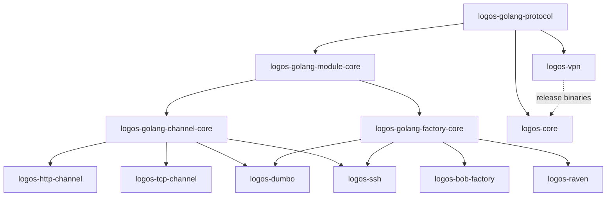

Logos is thirteen repositories in the [LogosCore](https://github.com/LogosCore)
organization on GitHub: the protocol package, three SDKs, the modules built
on them, core, the VPN client and these docs. Each Go repository is a Go
module of its own (BOB's has a second one, its minion's). Most repositories
carry a README (what the repository is, how to run it) and a `CLAUDE.md`
(its layout, commands and conventions); the protocol has a README alone,
and core's root a `CLAUDE.md` alone.

## The repositories

| Repository | What it holds | Requires (Logos modules) | Ships |
|---|---|---|---|
| [logos-golang-protocol](https://github.com/LogosCore/logos-golang-protocol) | The contracts in Go (package `protocol`): the minion messages and their numbers, the AMQP envelope, what modules declare (management manifests, connection and build schemas), the build operations, and the validators core and the modules check with | nothing | A Go module, by `v*` tags |
| [logos-golang-module-core](https://github.com/LogosCore/logos-golang-module-core) | The SDK every module uses: the control-plane session (register, heartbeat, deregister, reconnect), management, the live log tail, logging, and trusting core's TLS certificate | protocol | A Go module, by `v*` tags |
| [logos-golang-channel-core](https://github.com/LogosCore/logos-golang-channel-core) | The channel SDK: `channel.Run`, the sync client, connection sockets and the control link | module-core, protocol | A Go module (path `…/v3`), by `v*` tags |
| [logos-golang-factory-core](https://github.com/LogosCore/logos-golang-factory-core) | The factory SDK: `factory.Run`, the `Builder` and `Job`, `factorytest`, and the factory link for [codecs](../../contracts/minion-messages/codecs/) | module-core, protocol | A Go module, by `v*` tags |
| [logos-http-channel](https://github.com/LogosCore/logos-http-channel) | The reference channel: HTTP requests (`reverse-call`) and WebSockets (`reverse-persistent`) | channel-core, module-core, protocol | An image, `ghcr.io/logoscore/logos-http-channel`, on `v*` tags |
| [logos-tcp-channel](https://github.com/LogosCore/logos-tcp-channel) | The TCP channel: it dials minions that listen (`bind-persistent`) and takes minions that dial it (`reverse-persistent`, `reverse-call`) | channel-core, module-core, protocol | An image, `ghcr.io/logoscore/logos-tcp-channel`, on `v*` tags |
| [logos-bob-factory](https://github.com/LogosCore/logos-bob-factory) | BOB, the reference factory, and its minion: Linux and Windows programs compiled for each build from `minion/`, a Go module of its own | factory-core, module-core, protocol; its minion the protocol alone | `v*` tags. It has no workflows: its image is built from its `Dockerfile` (the dev stack builds it) |
| [logos-dumbo](https://github.com/LogosCore/logos-dumbo) | Dumbo: a factory of PHP pages (`bind-call` minions) and the channel that calls them | channel-core, factory-core, module-core, protocol | One image for both, `ghcr.io/logoscore/logos-dumbo`, on `v*` tags |
| [logos-ssh](https://github.com/LogosCore/logos-ssh) | [The SSH module](../../modules/ssh/): an [agentless](../../contracts/agentless-channels/) channel that acts as the minion of the servers it logs in to, and its factory | channel-core, factory-core, module-core, protocol | One image for both, `ghcr.io/logoscore/logos-ssh`, on `v*` tags |
| [logos-raven](https://github.com/LogosCore/logos-raven) | Raven, a test factory for codecs: PowerShell scripts that speak a codec of their own (PowerShell's CLIXML), which Raven translates for core | factory-core, module-core, protocol | An image, `ghcr.io/logoscore/logos-raven`, on `v*` tags |
| [logos-vpn](https://github.com/LogosCore/logos-vpn) | The VPN client an operator runs ([VPN Front](../../contracts/vpn-front/)), and its installers | protocol | On each `v*` tag, a GitHub release: six binaries (Linux, macOS and Windows, amd64 and arm64), `install.sh`, `install.ps1` and `SHA256SUMS` |
| [logos-core](https://github.com/LogosCore/logos-core) | Core (`core/`, Go), the web app (`frontend/`, React), the wiki's collaboration server (`hocuspocus/`), and `deploy/`: core's nginx front, the Helm chart, the dev Keycloak's realm | protocol; its images carry a logos-vpn release | On pushes to `main` that change them: the images `ghcr.io/logoscore/logos-core`, `logos-frontend`, `logos-hocuspocus` and `logos-nginx`, and the Helm chart (`oci://ghcr.io/logoscore/charts`) |
| [logos-docs](https://github.com/LogosCore/logos-docs) | This site | nothing | The site, on GitHub Pages, on pushes to `main` |

A module's image is built for `linux/amd64` and `linux/arm64` and tagged
with its version, `sha-<commit>` and `latest`; core's images with `main`,
`sha-<commit>` and `latest`. Core's image carries the logos-vpn release that
`core/vpn-client.version` names: core serves those binaries and installers to
operators.

## Dependency order

An arrow points from a repository to the ones that require it. Every module
also requires module-core and the protocol directly.

So a change reaches the repositories in layers, and a release goes in the
same order ([Releasing](../changing-the-protocol/#releasing)):

1. `logos-golang-protocol`.
2. `logos-golang-module-core`, and what requires the protocol alone:
   `logos-vpn` and `logos-core`.
3. `logos-golang-channel-core` and `logos-golang-factory-core`.
4. The modules: `logos-http-channel`, `logos-tcp-channel`,
   `logos-bob-factory`, `logos-dumbo`, `logos-ssh`, `logos-raven`.

Core comes a layer after logos-vpn when it takes a new logos-vpn release.
The docs require nothing.

## Tags and main

- **Tagged**: the protocol, the SDKs, the modules and logos-vpn. A release
  is an annotated `v*` tag on `main` (`vMAJOR.MINOR.PATCH`, its message
  `v0.51.0: <the commit's subject>`). What one repository requires of
  another, in its `go.mod`, is a tag; a module's image and logos-vpn's
  binaries are built from one.
- **Main only**: `logos-core` and `logos-docs` have no tags. A push to `main`
  is their release: it builds core's images (those whose part changed) and
  deploys the site.
- Most versions are `v0`; channel-core and the HTTP channel are `v3`, their
  module paths ending in `/v3`. The protocol takes a minor version for every
  change to the wire or a schema
  ([Bumps](../changing-the-protocol/#bumps)), and [Protocol
  Releases](../../contracts/protocol-releases/) lists what each one brought.

On 2026-11-12:

| Repository | Latest tag | Requires the protocol |
|---|---|---|
| `logos-golang-protocol` | v0.51.0 | |
| `logos-golang-module-core` | v0.3.2 | v0.50.0 |
| `logos-golang-channel-core` | v3.9.2 | v0.50.0 |
| `logos-golang-factory-core` | v0.4.1 | v0.50.0 |
| `logos-http-channel` | v3.10.0 | v0.50.0 |
| `logos-tcp-channel` | v0.3.0 | v0.50.0 |
| `logos-bob-factory` | v0.36.0 | v0.51.0 (its minion too) |
| `logos-dumbo` | v0.5.0 | v0.50.0 |
| `logos-ssh` | v0.8.0 | v0.50.0 |
| `logos-raven` | v0.2.0 | v0.50.0 |
| `logos-vpn` | v0.2.2 | v0.48.2 |
| `logos-core` | `main` (carries logos-vpn v0.2.2) | v0.51.0 |

## Which repository to change

| To change | Change | And then |
|---|---|---|
| A minion message: an item, a key, a value | its contract page, then `logos-golang-protocol` ([Changing the Protocol](../changing-the-protocol/)) | core, and every minion that speaks it |
| What modules declare (a management manifest, a connection or build schema), the AMQP envelope, a build operation | its contract page, then `logos-golang-protocol` | core, which checks it, and the SDKs and modules that use it |
| How a module registers, heartbeats, serves management or the log tail, or trusts core's certificate | `logos-golang-module-core` | channel-core, factory-core and the modules take the tag |
| A channel's plumbing: the sync call, connection sockets, the control link | `logos-golang-channel-core` | the channels |
| A factory's plumbing: running builds, the `Job`, `factorytest`, the factory link | `logos-golang-factory-core` | the factories |
| A transport | its channel: `logos-http-channel` (HTTP, WebSocket), `logos-tcp-channel` (TCP), `logos-dumbo` (calls to PHP pages), `logos-ssh` (SSH) | a new transport is a new channel ([Writing a Channel](../../guides/writing-a-channel/)) |
| What a minion does | its factory's repository: BOB's `minion/`, Dumbo's `cmd/dumbo-factory/page.php`, the SSH channel's `internal/minion`, Raven's `cmd/raven-factory/raven.ps1` | the minions share only the protocol ([Architecture Rules](../architecture-rules/), [Writing a Minion](../../guides/writing-a-minion/)) |
| Sessions, tasks, builds, targets, credentials, the APIs (GraphQL, REST, MCP) | `logos-core`, `core/` | the web app, when it shows them |
| The web app | `logos-core`, `frontend/` | |
| The wiki's live editing | `logos-core`, `hocuspocus/` | |
| Core's front (nginx's routes and certificates) or the Helm chart | `logos-core`, `deploy/nginx/`, `deploy/helm/logos/` | |
| The VPN client or its installers | `logos-vpn` | core's `core/vpn-client.version` names the new tag |
| These pages | `logos-docs` ([Writing the Docs](../writing-the-docs/)) | |
