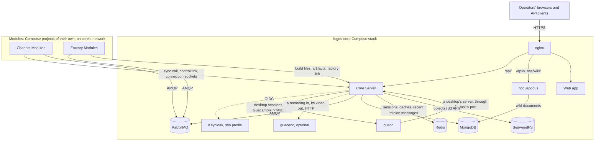

This page maps the infrastructure services that support the Logos platform: what each one does, why it was chosen, and what connects to it.

For architectural rationale see the [Architecture](../architecture/). For core server responsibilities see [Core Responsibilities](../core-responsibilities/).

## Infrastructure Topology



## RabbitMQ — Message Bus

- **Role**: the control plane between core and every module:
  - module lifecycle (register, heartbeat, deregister: module → core);
  - management, configuration, actions and the live log tail (core → module);
  - builds (`factory.build` and `.cancel`: core → factory; `.progress` and
    `.result`: factory → core);
  - live log batches;
  - core's lifecycle events.

  It does **not** carry minion traffic, which takes the data plane's
  [three paths](../contracts/channel-core-connections/#three-paths). Core does
  not start without the broker.
- **Why RabbitMQ**: mature AMQP broker with exchange/queue routing patterns suited to module-type-based message routing.
- **Connections**: Core Server, Channel Modules, Factory Modules, all over AMQP.
  Today they share one broker account. Per-module accounts and queue
  permissions are planned.

See [AMQP Routing Conventions](../contracts/amqp-conventions/) for the queues and exchanges.

## MongoDB — Persistence Layer

- **Role**: core's durable storage. The module side:

  | Collection | Holds |
  |---|---|
  | `module_registry` | registered channel and factory instances, their lifecycle state, their declared schemas and icons |
  | `module_instance_config`, `module_instance_config_changes` | each managed instance's desired configuration, and its change history |
  | `module_action_invocations` | the actions operators invoked, and how they ended |
  | `operation_channel_endpoints` | each operation's channel endpoints |
  | `build_files`, `builds`, `minions` | build uploads, build records, and the minions successful builds created |
  | `minion_stagings`, `minion_sessions`, `minion_targets` | minion processes staging, their sessions, and `bind` minions' targets |
  | `minion_tasks`, `minion_task_parts`, `minion_files` | tasks, what they returned, and the files minions sent |
  | `fs_entries`, `fs_listings` | the [file browser](../contracts/file-browser/)'s view of each machine |
  | `operational_ports`, `minion_listeners` | [tunnels](../contracts/minion-messages/tunnels/)' ports on core, and minions' listeners |
  | `operational_port_uses`, `operational_port_heat` | what each session took operational ports for, and how many times each port was taken |

  Next to them: users, operations and their members, login sessions (an
  insert-only record of who signed in; live sessions are in Redis), API keys,
  the wiki, findings (hosts, credentials, hashes) and the operators' tasks
  board.
- **Why MongoDB**: schema-flexible document model maps well to semi-structured audit/event data. Supports evolving MVP contracts without rigid schema migrations.
- **Connections**: Core Server, and hocuspocus for the wiki documents it edits.
  Modules never reach the database.

:::note
MongoDB stores the **desired** configuration of each managed module instance
(`module_instance_config`), its change history and action invocations. The
module itself persists nothing: it applies what core sends at registration and
on every change, and reports what it applied. See
[Module Management](../contracts/module-management/). Module logs are never
stored in core.
:::

:::note
MongoDB resolves the database engine decision listed as pending in the
[Architecture](../architecture/#pending-decisions).
:::

## Redis — Sessions and Caches

- **Role**: the live state core keeps fast, and can lose:
  - login sessions: refresh tokens and each user's live sessions (required:
    core does not start without Redis);
  - caches, for which Redis may also be disabled;
  - the ids of minion messages seen in the last 24 hours, and the replies
    core gave in the last 10 minutes
    ([Freshness and replay](../contracts/minion-messages/wire-format/#freshness-and-replay));
  - the chunks of a file a minion streams, on their way to the downloader;
  - the sync registration gate's cache of registered instances.
- **Connections**: Core Server only.

## SeaweedFS — Blob Storage

- **Role**: object storage behind an S3-compatible API, by bucket:
  - `wiki-images`, `wiki-files`: what operators attach to the wiki;
  - `skills`: AI agent skill bundles operators publish;
  - `logos-builds`: files uploaded for builds, and build artifacts;
  - `minion-files`: the files minions send core (a download, or a stream kept
    as it passed);
  - `desktop-recordings`: the desktops' and the terminals' recordings,
    each in parts as core kept it
    ([Recordings](../contracts/minion-messages/tunnels/#recordings)).
- **Volumes**: each bucket keeps its objects in volumes of its own, and a
  volume server has room for about one volume per size limit of a volume
  in its free disk: per GB, as the Compose file's image and the Helm
  chart cap a volume at 1 GB. A bucket grows one volume at a time
  (`WEED_MASTER_VOLUME_GROWTH_COPY_1=1` on the master, in the Compose
  file and the Helm chart's values). SeaweedFS's default of 7 would have
  the six buckets take 49 volumes before they hold anything: on a small
  disk the bucket written last would fail every write ("no free volumes
  left"). A bucket that cannot grow needs free disk on the volume server.
- **Watched and maintained** on the admins' Storage page: what each
  bucket holds, the slots left, reclaiming deleted files' space, and the
  retention cleanups of recordings. Core reads the master's API for it
  (`SEAWEEDFS_MASTER_URL`), a minute apart ([Storage](../storage/)).
- **Why SeaweedFS**: lightweight, self-hosted, S3-compatible API. Avoids external cloud dependencies and keeps binary blobs out of the document database.
- **Connections**: Core Server alone reads and writes. A factory never
  reaches it: a build's files and its artifact go through core, which
  streams them from and into `logos-builds` (the links each `factory.build`
  carries: [Minion Build](../contracts/minion-build/#build-files)). Core
  then reads the artifact back to check its size and SHA-256.

## nginx — Core's front

- **Role**: the entrypoint for operators and modules: TLS (and HTTP/2) on
  443, plain HTTP on 80, and routes:
  - `/api/` (the APIs, and the channels' sync call) → core;
  - the WebSockets, each with its upgrade and a day's timeouts: the wiki
    (`/api/v1/ws/wiki/` → hocuspocus), GraphQL subscriptions, the VPN
    link, a task's terminal, and the modules' own: a channel's control
    link (`/api/channel/link`) and connection sockets
    (`/api/channel/connection`), a factory's factory link
    (`/api/factory/link`);
  - task files and minion streams, unbuffered and without nginx's body
    limit;
  - `/` → the web app.
- **The image**: `ghcr.io/logoscore/logos-nginx`, built from
  `logos-core/deploy/nginx` and published with every change there (tags
  `latest`, `main`, `sha-<commit>`). The routes live with core's code
  (`deploy/nginx/locations.conf`), so a new route reaches every deployment
  with the image; the dev stack runs the same image. Set by environment:

  | Variable | Default | |
  |---|---|---|
  | `LOGOS_BACKEND` | `core:8002` | core, `host:port` |
  | `LOGOS_FRONTEND` | `frontend:80` | the web app |
  | `LOGOS_HOCUSPOCUS` | `hocuspocus:1234` | the wiki's collaboration server |
  | `LOGOS_SERVER_NAME` | `_` (any) | the names the servers answer to, and a generated certificate is for |
  | `LOGOS_HTTP` | `serve` | plain HTTP serves the app (`serve`), or redirects to HTTPS (`redirect`); `/healthz` answers either way |
  | `LOGOS_TLS_CERT`, `LOGOS_TLS_KEY` | `/etc/nginx/certs/tls.crt`, `tls.key` | the certificate to serve |
  | `LOGOS_TLS_PIN` | `auto` | whether clients pin the certificate: `auto` when no authority the image knows signs it (a self-signed one), `always`, `never` |

- **Certificates**: the one mounted at `LOGOS_TLS_CERT` and `LOGOS_TLS_KEY`.
  Without one, the image makes a self-signed certificate for
  `LOGOS_SERVER_NAME` and localhost, valid ten years, in
  `/etc/nginx/logos-certs`: mount a volume there to keep it across
  containers. Either way it logs the certificate's SHA-256 fingerprint at
  start, ready for modules' `LOGOS_CORE_CERT_SHA256` ([How modules reach
  core](#how-modules-reach-core)).
- **Pins**: a certificate clients pin (`LOGOS_TLS_PIN`), the HTTPS server
  tells core on every `/api/` request: `X-Logos-Cert-SHA256` (its
  fingerprint) and `X-Logos-Cert-Pin` (its public key's, `sha256//…`, as
  curl's `--pinnedpubkey` takes it), never a client's own. Core's
  `/status` gives them back as `front_cert`, and the VPN's Connect a
  machine lines pin them ([Installing](../contracts/vpn-front/#installing)).
  Plain HTTP says none.
- **More**: `*.conf` files mounted in `/etc/nginx/logos-extra` are included
  in both servers (locations of a deployment's own); `/etc/nginx/conf.d`
  takes whole servers.
- **Kubernetes**: the Helm chart's Ingress instead (ingress-nginx), whose
  WebSocket upgrades need no configuration.

## How modules reach core

A module reaches core two ways: over AMQP, through RabbitMQ (registration,
management, builds), and over HTTP(S), at core's base URL (its environment's
`LOGOS_CORE_BASE_URL`, by convention): the
channels' sync call, control link and connection sockets; a factory's
build files and artifacts (every factory's: the links a build carries are
paths on that URL) and its factory link. That URL is core itself
(`http://logos-core-dev:8002` from a module on the dev stack's network), or
its front over HTTPS. Nothing else
of core's stack is reached: a module on another host needs core's URL and
its RabbitMQ, no store.

When core or its RabbitMQ restarts, a module registers again on its own
(module-core's `module.Run`): it reconnects to the broker with backoff, and
since every call to core has a deadline, a register or
`heartbeat_grace_misses` heartbeats in a row with no answer start a new
session ([A module core does not
answer](../contracts/module-lifecycle/#moduleheartbeat)). Nothing waits on the
data plane: while core is away a channel answers its minions as it answers any
failure, and closes a minion's WebSocket with core's socket, so the minion
reconnects.

A front whose certificate no system trusts (a self-signed one) takes one of
three settings, the same in every module (module-core's `coretls`, used by
channel-core and factory-core for every request to core):

| Setting | The module trusts |
|---|---|
| `LOGOS_CORE_CA_FILE` | the certificates in this PEM file, beside the system's: core's own self-signed certificate, or the authority that issued it. Still verified, the host name included: the certificate must name the host in the URL. |
| `LOGOS_CORE_CERT_SHA256` | exactly the certificate with this SHA-256 fingerprint (hex, colons allowed, as openssl and the front's log print it), whatever signed it and whatever name it carries. Nothing to copy to each module. |
| `LOGOS_CORE_TLS_INSECURE=true` | any certificate: none is verified, and anyone between the module and core can read and change what passes. Logged as a warning at start. |

One at a time: the first set of insecure, the fingerprint, the CA file
decides. A setting that does not read stops the module at start
(factory-core checks it in `factory.Run`), or fails every request to core,
saying which (channel-core's clients).

## hocuspocus — Wiki Collaboration

- **Role**: the real-time collaboration server behind the wiki editor
  (WebSocket). It reads and writes wiki documents in MongoDB itself.

## guacd — Desktops

- **Role**: Apache Guacamole's proxy daemon, which draws the tunnels'
  [desktop fronts](../contracts/minion-messages/tunnels/#desktops) (RDP, VNC,
  SSH, Telnet) for the web app. Core opens each desktop's session there and
  relays it to the web app's Guacamole client over the desktop's socket;
  guacd speaks the protocol to the desktop's server through core's
  operational port for its task, which reaches the server through the
  minion.
- **Configuration**: core's `GUACD_ADDRESS` (`guacd:4822`) and
  `GUACD_CORE_HOST`, the name guacd reaches core's operational ports at on
  their network (`core-dev` in the development stack). Without them core
  offers no desktop front; guacd needs no settings of its own.
- **Reach**: core alone: guacd is never published, and holds nothing.
  Credentials go from core to guacd on their network, in its connect.
  Core reaches guacd at guacd's own address (Helm: a headless Service),
  the one guacd connects to the operational ports from, by which a
  tunnel's streams list names each desktop's connections by its
  operator.
  guacd records nothing either: core records each desktop as it relays it
  ([Recordings](../contracts/minion-messages/tunnels/#recordings)).
- **Image**: `logos-guacd` (`logos-core/deploy/guacd`), guacamole-server,
  patched (an RDP desktop's workstation name and client OS, its
  time zone reaching the server, and a connection abandoned as its user
  leaves) and with the time
  zones (`tzdata`), built by Apache's own
  Dockerfile against **FreeRDP 3**, every library
  pinned (`versions.env`), published by CI as `ghcr.io/logoscore/logos-guacd`
  (the tag core runs is in its Compose file and Helm values). Not the
  official `guacamole/guacd`: its FreeRDP 2 makes guacd abort an RDP connection
  whose desktop is resized during a paint (a desktop following the web app
  to full screen and back), which upstream fixed for FreeRDP 3.8 and later
  alone (GUACAMOLE-2078).
- **Version**: the release the web app's vendored Guacamole client is
  (`frontend/src/vendor/guacamole`): change them together.

## guacenc — Recording videos (optional)

- **Role**: makes a video of each desktop's recording once it ended
  ([Recordings](../contracts/minion-messages/tunnels/#recordings)), a tenth
  to a fiftieth of its size: `guacenc`, guacamole-server's own, draws it,
  and ffmpeg encodes it as H.264 in MP4. Core sends it a recording and
  stores the video it answers with; one at a time.
- **Configuration**: core's `GUACENC_URL` (`http://guacenc:4823`): the
  development stack sets it (empty in `.env` turns it off), and the Helm
  chart when `guacenc.enabled` (on by default; `guacenc.tmpSize` the room a
  recording takes while it encodes).
  **Optional**: without it core converts nothing, and every recording
  stays as it was recorded, played by Guacamole's player. With it set but
  the encoder away, recordings wait, playable as they are, and core asks
  again later; once it answers, those left are converted, the oldest
  first.
- **Reach**: core alone, as guacd; it keeps nothing past a conversion.
- **Image**: `logos-guacd`'s own, with ffmpeg in it, run with another
  command (`guacenc-worker`, a small HTTP worker of `logos-core/deploy/guacd`):
  one image, so the recorder and the renderer are always the same
  guacamole-server. Its own container, not guacd's: an encoding takes a
  core of CPU while it runs, and live desktops keep theirs.

## Keycloak — Single Sign-On (optional)

- **Role**: a development identity provider for OIDC login, under the Compose
  `sso` profile. Core accepts any OIDC provider; without one, operators sign in
  with a local password.

## Deployment

- **Docker Compose** (`logos-core/docker-compose.yml`) runs the development
  stack: core (`core-dev`, rebuilt as its code changes), the web app,
  hocuspocus, guacd, guacenc and nginx (the `development` profile), RabbitMQ, MongoDB, Redis,
  SeaweedFS (master, volume, filer and S3 gateway), and Keycloak (the `sso`
  profile). [Development Stack](../contributing/development-stack/) runs it.
- **Modules** are not part of it. Each module repository has a Compose project
  of its own, which joins core's network (`logos-core_logos`). Its instance
  registers with core when it starts.
- **Kubernetes**: a Helm chart (`logos-core/deploy/helm/logos`, with a kind
  configuration for local clusters) deploys core, its stores, guacd, guacenc (when enabled) and RabbitMQ.
  Modules are not in it.

### Built-in process marks

A deployment's own marks on processes by name, which every user sees in
process lists ([Task Results and
Actions](../contracts/task-results-and-actions/#process_list), Marks) until
they clear one or set their own. Core reads them once, at start, from
`/etc/logos/builtin-process-marks.json`, a file the deployment mounts:
without one, or with an empty one, there are none. The file is a JSON array
of marks:

```json
[
  { "name": "lsass.exe", "color": "red-strong", "icon": "ShieldAlert" },
  { "name": "sshd", "color": "blue-soft", "emoji": "🔑" },
  { "name": "explorer.exe", "color": "ghost" }
]
```

| Field | |
|---|---|
| `name` | The processes' name, 1 to 255 bytes, matched whatever its case (`LSASS.EXE` is `lsass.exe`). One mark a name. |
| `color` | A color, `<hue>-<strength>`: a hue of `red`, `orange`, `amber`, `yellow`, `lime`, `green`, `teal`, `cyan`, `blue`, `indigo`, `violet` or `pink`, a strength of `soft`, `medium` or `strong`. Or a style in its place: `haxor`, `rainbow`, `amber-crt`, `synthwave`, `glitch`, `on-fire`, `gold` or `ghost`. |
| `icon` | A [lucide](https://lucide.dev/icons/) icon's name as the web app writes it (`ShieldAlert`), or `si:<slug>` for a brand's (`si:github`). |
| `emoji` | The emoji itself (`"🔑"`), not its code points. |

A mark has a `name` and at least one of the others, and an icon or an
emoji, not both. The web app's mark dialog gives each value in its
tooltips.

- **Docker Compose**: a bind mount on core's service, the file readable by
  core's user (uid 10001: mode `0644` is):

  ```yaml
  services:
    core:
      volumes:
        - ./builtin-process-marks.json:/etc/logos/builtin-process-marks.json:ro
  ```

- **Helm**: the marks as a list in `core.builtinProcessMarks`, the same
  fields in YAML; the chart writes them to a ConfigMap mounted at that path.
- **A change** takes effect when core restarts (the chart rolls its pod).
- **Core logs** how many marks it read, at start. A file that does not read,
  or is not a JSON array of marks, gives none, logged as an error, and core
  starts all the same. A mark that does not check, or a second one for a
  name, is left out and logged as a warning, with its place in the array;
  the others are used.
- **Users' own marks and clearings stay**, whatever the file says: a user who
  cleared a mark the file then drops, and later has again, still sees none.

## Observability

Nothing is collected centrally yet:

- Module logs are relayed live to an operator who watches them, and never
  stored ([Module Logs](../contracts/module-logs/)).
- Core publishes lifecycle events on `logos.events` that nothing consumes.
- The sync reply returns the request's W3C `traceparent` header.

Distributed tracing of the data plane was designed (the OpenTelemetry SDK in
the channel and core, an OpenTelemetry Collector gateway, Grafana Tempo storing
traces in SeaweedFS, Grafana) and is planned. None of it runs.

## Service Communication Summary

| From | To | Protocol | Purpose |
|---|---|---|---|
| Operators, API clients | nginx | HTTPS | Web app, GraphQL, REST, MCP |
| Core Server | RabbitMQ | AMQP | Lifecycle, management, log tail, builds, lifecycle events |
| Channel Modules | RabbitMQ | AMQP | Lifecycle RPC, serving management and the log tail, log batches |
| Factory Modules | RabbitMQ | AMQP | The same, and builds |
| Channel Modules | Core Server (or its front) | HTTP(S) | Minion sync (`POST /api/channel/sync`); WebSockets: the control link, connection sockets |
| Factory Modules | Core Server (or its front) | HTTP(S) | WebSocket: the factory link, for a factory that translates its minions' codec |
| Core Server | MongoDB | MongoDB wire protocol | Persistence |
| hocuspocus | MongoDB | MongoDB wire protocol | Wiki documents |
| Core Server | guacd | Guacamole protocol (TCP 4822) | Desktop sessions, relayed to the web app |
| guacd | Core Server's operational ports | RDP, VNC, SSH, Telnet | A desktop's server, through its task's port and minion |
| Core Server | guacenc | HTTP (4823) | A desktop's recording in, its video out |
| Core Server | Redis | RESP | Sessions, caches, recent minion messages, stream chunks |
| Core Server | SeaweedFS | HTTP (S3-compatible) | Object storage |
| Core Server | SeaweedFS's master and volume servers | HTTP (9333, 8080), gRPC (19333) | The Storage page: volumes, slots, disks, adding a volume (HTTP); reclaiming space, one volume at a time (the master's gRPC) |
| Factory Modules | Core Server (or its front) | HTTP(S) | Build files in, artifacts out (`/api/factory/builds/`) |
