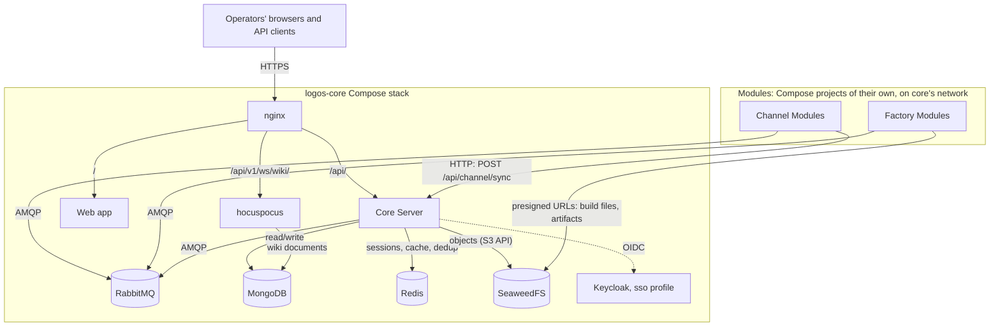

This page maps the infrastructure services that support the Logos platform: what each one does, why it was chosen, and what connects to it.

For architectural rationale see the [Architecture](../architecture/). For core server responsibilities see [Core Responsibilities](../core-responsibilities/).

## Infrastructure Topology

## RabbitMQ — Message Bus

- **Role**: the control plane between core and every module:
  - module lifecycle (register, heartbeat, deregister: module → core);
  - management, configuration, actions and the live log tail (core → module);
  - builds (`factory.build` and `.cancel`: core → factory; `.progress` and
    `.result`: factory → core);
  - live log batches;
  - core's lifecycle events.

  It does **not** carry minion traffic, which flows through the HTTP sync
  endpoint. Core does not start without the broker.
- **Why RabbitMQ**: mature AMQP broker with exchange/queue routing patterns suited to module-type-based message routing, and dead-lettering for reliability.
- **Connections**: Core Server, Channel Modules, Factory Modules, all over AMQP.
  Today they share one broker account. Per-module accounts and queue
  permissions are planned.

See [AMQP Routing Conventions](../contracts/amqp-conventions/) for the queues and exchanges.

## MongoDB — Persistence Layer

- **Role**: core's durable storage. The module side:

  | Collection | Holds |
  |---|---|
  | `module_registry` | registered channel and factory instances, their lifecycle state, their declared schemas and icons |
  | `module_instance_config`, `module_instance_config_changes` | each managed instance's desired configuration, and its change history |
  | `module_action_invocations` | the actions operators invoked, and how they ended |
  | `operation_channel_endpoints` | each operation's channel endpoints |
  | `build_files`, `builds`, `minions` | build uploads, build records, and the minions successful builds created |

  Next to them: users, operations and their members, login sessions (an
  insert-only record of who signed in; live sessions are in Redis), API keys,
  the wiki, findings (hosts, credentials, hashes) and the operators' tasks
  board.
- **Why MongoDB**: schema-flexible document model maps well to semi-structured audit/event data. Supports evolving MVP contracts without rigid schema migrations.
- **Connections**: Core Server, and hocuspocus for the wiki documents it edits.
  Modules never reach the database.

:::note
MongoDB stores the **desired** configuration of each managed module instance
(`module_instance_config`), its change history and action invocations. The
module itself persists nothing: it applies what core sends at registration and
on every change, and reports what it applied. See
[Module Management](../contracts/module-management/). Module logs are never
stored in core.
:::

:::note
MongoDB resolves the database engine decision listed as pending in the
[Architecture](../architecture/#pending-decisions).
:::

## Redis — Sessions and Caches

- **Role**: the live state core keeps fast, and can lose:
  - login sessions: refresh tokens and each user's live sessions (required:
    core does not start without Redis);
  - caches, for which Redis may also be disabled;
  - the data plane's de-duplication of minion messages by `message_id`, for
    24 hours;
  - the sync registration gate's cache of registered instances.
- **Connections**: Core Server only.

## SeaweedFS — Blob Storage

- **Role**: object storage behind an S3-compatible API, by bucket:
  - `wiki-images`, `wiki-files`: what operators attach to the wiki;
  - `skills`: AI agent skill bundles operators publish;
  - `logos-builds`: files uploaded for builds, and build artifacts.
- **Why SeaweedFS**: lightweight, self-hosted, S3-compatible API. Avoids external cloud dependencies and keeps binary blobs out of the document database.
- **Connections**: Core Server reads and writes. A factory holds no
  credentials: each build hands it presigned URLs, GET for the files the build
  names and PUT for its artifact, valid until the build's deadline. Core then
  reads the artifact back to check its size and SHA-256.

## nginx — Entry Point

- **Role**: the operators' entrypoint. In development it serves TLS on 8443
  and plain HTTP on 8080, and routes:
  - `/api/` (the APIs, and the channels' sync endpoint) → core;
  - `/api/v1/ws/wiki/` → hocuspocus;
  - `/` → the web app.

## hocuspocus — Wiki Collaboration

- **Role**: the real-time collaboration server behind the wiki editor
  (WebSocket). It reads and writes wiki documents in MongoDB itself.

## Keycloak — Single Sign-On (optional)

- **Role**: a development identity provider for OIDC login, under the Compose
  `sso` profile. Core accepts any OIDC provider; without one, operators sign in
  with a local password.

## Deployment

- **Docker Compose** (`logos-core/docker-compose.yml`) runs the stack: core,
  the web app and hocuspocus (the `development` profile), nginx, RabbitMQ,
  MongoDB, Redis, SeaweedFS (master, volume, filer and S3 gateway), and
  Keycloak (the `sso` profile).
- **Modules** are not part of it. Each module repository has a Compose project
  of its own, which joins core's network (`logos-core_logos`). Its instance
  registers with core when it starts.
- **Kubernetes**: a Helm chart (`logos-core/deploy/helm/logos`, with a kind
  configuration for local clusters) deploys core and its stores. It does not
  deploy RabbitMQ yet.

## Observability

Nothing is collected centrally yet:

- Module logs are relayed live to an operator who watches them, and never
  stored ([Module Logs](../contracts/module-logs/)).
- Core publishes lifecycle events on `logos.events` that nothing consumes.
- The sync reply echoes the request's `meta.trace_id`.

Distributed tracing of the data plane was designed (the OpenTelemetry SDK in
the channel and core, an OpenTelemetry Collector gateway, Grafana Tempo storing
traces in SeaweedFS, Grafana) and is planned. None of it runs.

## Service Communication Summary

| From | To | Protocol | Purpose |
|---|---|---|---|
| Operators, API clients | nginx | HTTPS | Web app, GraphQL, REST, MCP |
| Core Server | RabbitMQ | AMQP | Lifecycle, management, log tail, builds, lifecycle events |
| Channel Modules | RabbitMQ | AMQP | Lifecycle RPC, serving management and the log tail, log batches |
| Factory Modules | RabbitMQ | AMQP | The same, and builds |
| Channel Modules | Core Server | HTTP | Minion sync (`POST /api/channel/sync`) |
| Core Server | MongoDB | MongoDB wire protocol | Persistence |
| hocuspocus | MongoDB | MongoDB wire protocol | Wiki documents |
| Core Server | Redis | RESP | Sessions, caches, sync de-duplication |
| Core Server | SeaweedFS | HTTP (S3-compatible) | Object storage |
| Factory Modules | SeaweedFS | HTTP (presigned URLs) | Build files in, artifacts out |
