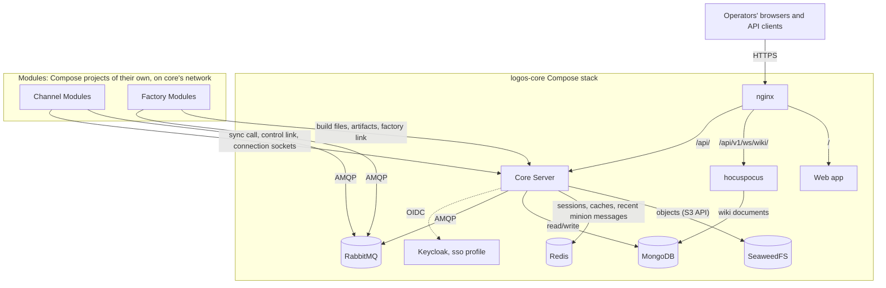

This page maps the infrastructure services that support the Logos platform: what each one does, why it was chosen, and what connects to it.

For architectural rationale see the [Architecture](../architecture/). For core server responsibilities see [Core Responsibilities](../core-responsibilities/).

## Infrastructure Topology

## RabbitMQ — Message Bus

- **Role**: the control plane between core and every module:
  - module lifecycle (register, heartbeat, deregister: module → core);
  - management, configuration, actions and the live log tail (core → module);
  - builds (`factory.build` and `.cancel`: core → factory; `.progress` and
    `.result`: factory → core);
  - live log batches;
  - core's lifecycle events.

  It does **not** carry minion traffic, which takes the data plane's
  [three paths](../contracts/channel-core-connections/#three-paths). Core does
  not start without the broker.
- **Why RabbitMQ**: mature AMQP broker with exchange/queue routing patterns suited to module-type-based message routing.
- **Connections**: Core Server, Channel Modules, Factory Modules, all over AMQP.
  Today they share one broker account. Per-module accounts and queue
  permissions are planned.

See [AMQP Routing Conventions](../contracts/amqp-conventions/) for the queues and exchanges.

## MongoDB — Persistence Layer

- **Role**: core's durable storage. The module side:

  | Collection | Holds |
  |---|---|
  | `module_registry` | registered channel and factory instances, their lifecycle state, their declared schemas and icons |
  | `module_instance_config`, `module_instance_config_changes` | each managed instance's desired configuration, and its change history |
  | `module_action_invocations` | the actions operators invoked, and how they ended |
  | `operation_channel_endpoints` | each operation's channel endpoints |
  | `build_files`, `builds`, `minions` | build uploads, build records, and the minions successful builds created |
  | `minion_stagings`, `minion_sessions`, `minion_targets` | minion processes staging, their sessions, and `bind` minions' targets |
  | `minion_tasks`, `minion_task_parts`, `minion_files` | tasks, what they returned, and the files minions sent |
  | `fs_entries`, `fs_listings` | the [file browser](../contracts/file-browser/)'s view of each machine |
  | `operational_ports`, `minion_listeners` | [tunnels](../contracts/minion-messages/tunnels/)' ports on core, and minions' listeners |

  Next to them: users, operations and their members, login sessions (an
  insert-only record of who signed in; live sessions are in Redis), API keys,
  the wiki, findings (hosts, credentials, hashes) and the operators' tasks
  board.
- **Why MongoDB**: schema-flexible document model maps well to semi-structured audit/event data. Supports evolving MVP contracts without rigid schema migrations.
- **Connections**: Core Server, and hocuspocus for the wiki documents it edits.
  Modules never reach the database.

:::note
MongoDB stores the **desired** configuration of each managed module instance
(`module_instance_config`), its change history and action invocations. The
module itself persists nothing: it applies what core sends at registration and
on every change, and reports what it applied. See
[Module Management](../contracts/module-management/). Module logs are never
stored in core.
:::

:::note
MongoDB resolves the database engine decision listed as pending in the
[Architecture](../architecture/#pending-decisions).
:::

## Redis — Sessions and Caches

- **Role**: the live state core keeps fast, and can lose:
  - login sessions: refresh tokens and each user's live sessions (required:
    core does not start without Redis);
  - caches, for which Redis may also be disabled;
  - the ids of minion messages seen in the last 24 hours, and the replies
    core gave in the last 10 minutes
    ([Freshness and replay](../contracts/minion-messages/wire-format/#freshness-and-replay));
  - the chunks of a file a minion streams, on their way to the downloader;
  - the sync registration gate's cache of registered instances.
- **Connections**: Core Server only.

## SeaweedFS — Blob Storage

- **Role**: object storage behind an S3-compatible API, by bucket:
  - `wiki-images`, `wiki-files`: what operators attach to the wiki;
  - `skills`: AI agent skill bundles operators publish;
  - `logos-builds`: files uploaded for builds, and build artifacts;
  - `minion-files`: the files minions send core (a download, or a stream kept
    as it passed).
- **Why SeaweedFS**: lightweight, self-hosted, S3-compatible API. Avoids external cloud dependencies and keeps binary blobs out of the document database.
- **Connections**: Core Server alone reads and writes. A factory never
  reaches it: a build's files and its artifact go through core, which
  streams them from and into `logos-builds` (the links each `factory.build`
  carries: [Minion Build](../contracts/minion-build/#build-files)). Core
  then reads the artifact back to check its size and SHA-256.

## nginx — Core's front

- **Role**: the entrypoint for operators and modules: TLS (and HTTP/2) on
  443, plain HTTP on 80, and routes:
  - `/api/` (the APIs, and the channels' sync call) → core;
  - the WebSockets, each with its upgrade and a day's timeouts: the wiki
    (`/api/v1/ws/wiki/` → hocuspocus), GraphQL subscriptions, the VPN
    link, a task's terminal, and the modules' own: a channel's control
    link (`/api/channel/link`) and connection sockets
    (`/api/channel/connection`), a factory's factory link
    (`/api/factory/link`);
  - task files and minion streams, unbuffered and without nginx's body
    limit;
  - `/` → the web app.
- **The image**: `ghcr.io/logoscore/logos-nginx`, built from
  `logos-core/deploy/nginx` and published with every change there (tags
  `latest`, `main`, `sha-<commit>`). The routes live with core's code
  (`deploy/nginx/locations.conf`), so a new route reaches every deployment
  with the image; the dev stack runs the same image. Set by environment:

  | Variable | Default | |
  |---|---|---|
  | `LOGOS_BACKEND` | `core:8002` | core, `host:port` |
  | `LOGOS_FRONTEND` | `frontend:80` | the web app |
  | `LOGOS_HOCUSPOCUS` | `hocuspocus:1234` | the wiki's collaboration server |
  | `LOGOS_SERVER_NAME` | `_` (any) | the names the servers answer to, and a generated certificate is for |
  | `LOGOS_HTTP` | `serve` | plain HTTP serves the app (`serve`), or redirects to HTTPS (`redirect`); `/healthz` answers either way |
  | `LOGOS_TLS_CERT`, `LOGOS_TLS_KEY` | `/etc/nginx/certs/tls.crt`, `tls.key` | the certificate to serve |
  | `LOGOS_TLS_PIN` | `auto` | whether clients pin the certificate: `auto` when no authority the image knows signs it (a self-signed one), `always`, `never` |

- **Certificates**: the one mounted at `LOGOS_TLS_CERT` and `LOGOS_TLS_KEY`.
  Without one, the image makes a self-signed certificate for
  `LOGOS_SERVER_NAME` and localhost, valid ten years, in
  `/etc/nginx/logos-certs`: mount a volume there to keep it across
  containers. Either way it logs the certificate's SHA-256 fingerprint at
  start, ready for modules' `LOGOS_CORE_CERT_SHA256` ([How modules reach
  core](#how-modules-reach-core)).
- **Pins**: a certificate clients pin (`LOGOS_TLS_PIN`), the HTTPS server
  tells core on every `/api/` request: `X-Logos-Cert-SHA256` (its
  fingerprint) and `X-Logos-Cert-Pin` (its public key's, `sha256//…`, as
  curl's `--pinnedpubkey` takes it), never a client's own. Core's
  `/status` gives them back as `front_cert`, and the VPN's Connect a
  machine lines pin them ([Installing](../contracts/vpn-front/#installing)).
  Plain HTTP says none.
- **More**: `*.conf` files mounted in `/etc/nginx/logos-extra` are included
  in both servers (locations of a deployment's own); `/etc/nginx/conf.d`
  takes whole servers.
- **Kubernetes**: the Helm chart's Ingress instead (ingress-nginx), whose
  WebSocket upgrades need no configuration.

## How modules reach core

A module reaches core two ways: over AMQP, through RabbitMQ (registration,
management, builds), and over HTTP(S), at core's base URL (its environment's
`LOGOS_CORE_BASE_URL`; the HTTP channel's `LOGOS_SYNC_BASE_URL`): the
channels' sync call, control link and connection sockets; a factory's
build files and artifacts (every factory's: the links a build carries are
paths on that URL) and its factory link. That URL is core itself
(`http://logos-core-dev:8002` from a module on the dev stack's network), or
its front over HTTPS. Nothing else
of core's stack is reached: a module on another host needs core's URL and
its RabbitMQ, no store.

A front whose certificate no system trusts (a self-signed one) takes one of
three settings, the same in every module (module-core's `coretls`, used by
channel-core and factory-core for every request to core):

| Setting | The module trusts |
|---|---|
| `LOGOS_CORE_CA_FILE` | the certificates in this PEM file, beside the system's: core's own self-signed certificate, or the authority that issued it. Still verified, the host name included: the certificate must name the host in the URL. |
| `LOGOS_CORE_CERT_SHA256` | exactly the certificate with this SHA-256 fingerprint (hex, colons allowed, as openssl and the front's log print it), whatever signed it and whatever name it carries. Nothing to copy to each module. |
| `LOGOS_CORE_TLS_INSECURE=true` | any certificate: none is verified, and anyone between the module and core can read and change what passes. Logged as a warning at start. |

One at a time: the first set of insecure, the fingerprint, the CA file
decides. A setting that does not read stops the module at start (the HTTP
channel), or fails every request to core saying which (the others).
Released in module-core v0.3.0, channel-core v3.9.0, factory-core v0.3.1,
and every module built on them.

## hocuspocus — Wiki Collaboration

- **Role**: the real-time collaboration server behind the wiki editor
  (WebSocket). It reads and writes wiki documents in MongoDB itself.

## Keycloak — Single Sign-On (optional)

- **Role**: a development identity provider for OIDC login, under the Compose
  `sso` profile. Core accepts any OIDC provider; without one, operators sign in
  with a local password.

## Deployment

- **Docker Compose** (`logos-core/docker-compose.yml`) runs the development
  stack: core (`core-dev`, rebuilt as its code changes), the web app,
  hocuspocus and nginx (the `development` profile), RabbitMQ, MongoDB, Redis,
  SeaweedFS (master, volume, filer and S3 gateway), and Keycloak (the `sso`
  profile). [Development Stack](../contributing/development-stack/) runs it.
- **Modules** are not part of it. Each module repository has a Compose project
  of its own, which joins core's network (`logos-core_logos`). Its instance
  registers with core when it starts.
- **Kubernetes**: a Helm chart (`logos-core/deploy/helm/logos`, with a kind
  configuration for local clusters) deploys core, its stores and RabbitMQ.
  Modules are not in it.

## Observability

Nothing is collected centrally yet:

- Module logs are relayed live to an operator who watches them, and never
  stored ([Module Logs](../contracts/module-logs/)).
- Core publishes lifecycle events on `logos.events` that nothing consumes.
- The sync reply returns the request's W3C `traceparent` header.

Distributed tracing of the data plane was designed (the OpenTelemetry SDK in
the channel and core, an OpenTelemetry Collector gateway, Grafana Tempo storing
traces in SeaweedFS, Grafana) and is planned. None of it runs.

## Service Communication Summary

| From | To | Protocol | Purpose |
|---|---|---|---|
| Operators, API clients | nginx | HTTPS | Web app, GraphQL, REST, MCP |
| Core Server | RabbitMQ | AMQP | Lifecycle, management, log tail, builds, lifecycle events |
| Channel Modules | RabbitMQ | AMQP | Lifecycle RPC, serving management and the log tail, log batches |
| Factory Modules | RabbitMQ | AMQP | The same, and builds |
| Channel Modules | Core Server (or its front) | HTTP(S) | Minion sync (`POST /api/channel/sync`); WebSockets: the control link, connection sockets |
| Factory Modules | Core Server (or its front) | HTTP(S) | WebSocket: the factory link, for a factory that translates its minions' codec |
| Core Server | MongoDB | MongoDB wire protocol | Persistence |
| hocuspocus | MongoDB | MongoDB wire protocol | Wiki documents |
| Core Server | Redis | RESP | Sessions, caches, recent minion messages, stream chunks |
| Core Server | SeaweedFS | HTTP (S3-compatible) | Object storage |
| Factory Modules | Core Server (or its front) | HTTP(S) | Build files in, artifacts out (`/api/factory/builds/`) |
