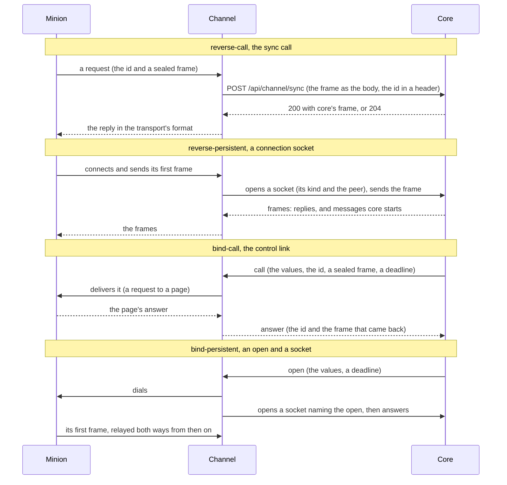

A channel carries minions' messages between a transport and core: HTTP
requests, a WebSocket, a TCP port, a page on a web server, an SSH server.
This guide goes from nothing to a registered channel that carries messages,
in Go, with channel-core (`logos-golang-channel-core`, v3) on top of
module-core. It assumes [Implementing a Module](../../implementing-a-module/):
registering, heartbeats, management, the live log tail and shutdown are
every module's, and are explained there.

The contracts a channel implements are the [Minion Connection
Schema](../../contracts/minion-connection/), [HTTP
Sync](../../contracts/channel-core-sync/) and
[Connections](../../contracts/channel-core-connections/); each step below
links to the part it comes from.

## What a channel does

A minion and core talk in sealed frames, each sent under an id: the
minion's build's, the temporary id staging gave it, or its session's. A
channel takes each frame and its id out of its transport, hands them to
core, and puts core's frames back into its transport. It never opens one:
core is the minion's peer, and the channel sees ciphertext only. An
[agentless](../../contracts/agentless-channels/) channel, which acts as the
minion itself, is the one exception.

How the transport carries a frame and its id is the channel's own: the
HTTP channel puts the id inside the ciphertext, at an offset a byte in
front says; the TCP channel sends a length, the id, then the frame. That
format is between the channel and the minions that speak it; core sees
only what the channel hands it.

### The three paths

A channel reaches core three ways, and opens each itself: core never
connects to a channel.

| Path | Opened | Carries | Kinds |
|---|---|---|---|
| The sync call, `POST /api/channel/sync` | a request per message | a message the minion started, as the raw body; core's reply as the response | `reverse-call` |
| The control link, `GET /api/channel/link`, a WebSocket | one per channel instance, kept open | core's `call` and `open` requests, each answered by its id | `bind-call`, and opening `bind-persistent` |
| A connection socket, `GET /api/channel/connection`, a WebSocket | one per minion connection that stays open | the connection's frames, both ways | `reverse-persistent`, `bind-persistent` |



### What core requires and returns

| Path | Core requires | Core returns |
|---|---|---|
| Sync call | `Content-Type: application/octet-stream`; a body, not empty, at most core's `CHANNEL_SYNC_MAX_SIZE` (16 MiB by default); `Logos-Message-Id`, a new UUIDv4 for each request; `Logos-Build-Id`, the id the message is sent under; both lowercase UUIDs; `Logos-Channel-Instance`, a registered instance; optionally `Logos-Peer-Address` and `traceparent` | 200 with core's reply, 204 with none; 400, 403, 409, 413, 415, 422, 500 or 503 ([Response](../../contracts/channel-core-sync/#response)) |
| Control link | `Logos-Channel-Instance` of a registered channel instance at the handshake; then exactly one `answer` per `call` or `open`, by its request id | `call` and `open` frames, any number at once ([Formats](../../contracts/channel-core-connections/#the-control-link-and-connection-sockets-formats)) |
| Connection socket | `Logos-Channel-Instance` of a registered instance, `Logos-Connection-Kind`, `Logos-Open-Request` for `bind-persistent`, `Logos-Peer-Address` when the channel knows it; then binary frames `{1: id, 2: sealed frame}` | frames of the same form: a reply to every message the minion starts, and the messages core starts (tasks, cancels, a stream's go) |

- **Core's handling is its own.** A request that times out at the channel,
  or a socket that closes, does not cut short what core does with a
  message (2 minutes at most).
- **A message sent again is the minion's.** Core knows a message by the
  minion's own message id, sealed inside it, never by `Logos-Message-Id`,
  which only names the request in logs. A message seen again gets the reply
  it got (for 10 minutes, a reply of at most 64 KiB); past that it is a
  replay: a 409 on the sync call, nothing over a socket.
- **A reply is relayed as it is**: a 200 body unchanged, a 204 as the
  transport says "nothing" (the HTTP channel answers the packed id alone,
  the TCP channel a frame of the id alone).
- **Over a socket, every message the minion starts gets a reply**, an empty
  sealed message when core has nothing to say. A message that answers one
  of core's (`re`) gets none.

### Always and never

**Always:**

- **Relay frames byte for byte**, each with the id it is sent under: take
  them out of the transport and put them back, nothing more.
- **Close the socket when the minion's connection ends**, or stops
  answering the channel's own liveness check, and **close the minion's
  connection when the socket closes**: core restarted or closed it, or a
  send failed. Core's pings reach the channel, not the minion: an open
  socket is the channel saying the minion is there.
- **Answer each request on the link exactly once**: with a minion's
  message, with what else answered, or with a failure. channel-core sends
  the one answer a Handler or an Opener returns.
- **Return when the context ends.** A Handler's ends at core's deadline
  and when the link drops; an Opener's at the open's deadline. The link
  reopens only once every one has returned.
- **Treat a 409 or a 422 like any failure**, as every status but 200 and
  204: the minion gets what any failure gets (the HTTP channel's plain 404),
  so neither it nor a stranger learns why. Log the status.
- **Drain before deregistering**: refuse new work, let what is in flight
  finish or close it, then stop the control-plane session. Core refuses an
  unregistered instance's traffic (403).
- **Check the values core sends** before using them: core checked them
  against the schema, but they come over the wire.
- **Say the peer only when the channel knows it** without a lookup of its
  own: the address dialed, or the one a minion came from; through a proxy,
  the target's host when it is an IP address, else none.
- **Give every process its own instance id** (`CHANNEL_ID`): core keys
  registrations by instance id alone, across module types.

**Never:**

- **Open, read or re-encode a frame**, unless the kind is agentless.
- **Reopen a socket to core on its own** for a minion connection that
  stays: only a message the minion sealed ties a socket to its session, so
  core could not push over the new socket until the minion spoke again.
  Close the minion's connection instead; its first message on the next one
  opens the next socket.
- **Keep a socket open for a connection the channel cannot tell is alive.**
- **Log keys, credentials or a target's secret values**, nor report them
  back: a call's `Keys` and `Credentials` are for that call only
  ([Credentials](../../contracts/credentials/#what-a-module-gets)).

## Choosing connection kinds

A kind is who dials and how long the connection lasts ([Connection
kinds](../../module-types/#connection-kinds)). What the transport's two
ends can do decides which kinds a channel carries:

| The transport | Kind | Core can send | Path |
|---|---|---|---|
| The minion reaches the channel and waits for one answer: an HTTP request, a DNS query, a TCP connection per exchange | `reverse-call` | in the reply, when the minion next comes | the sync call |
| The minion reaches the channel and stays: a WebSocket, a TCP connection | `reverse-persistent` | at any time while it is open | a connection socket |
| The channel reaches the minion with one request, which it answers: a page on a web server | `bind-call` | at any time: core calls | the link's `call` |
| The channel reaches a minion that listens, and stays: a TCP listener, an SSH server | `bind-persistent` | at any time while it is open, which core asks for | the link's `open`, then a connection socket |

A channel declares each kind it carries in its connection schema, each
with fields of its own; the built channels carry one to three. Then, per
kind, what its transport needs said
([The schema](../../contracts/minion-connection/#the-schema)):

| Flag | When | Read |
|---|---|---|
| `max_message` | The transport carries less than 768 KiB a message. It counts the plaintext as sent: the sealed frame adds 51 to 66 bytes, and the transport the 16-byte id and its own encoding. | [Limits](../../contracts/minion-messages/wire-format/#limits) |
| `max_call` | `bind-call`: a call takes longer, or should take less, than 2 minutes. 1 s to 1 h; core caps it at 10 minutes. | [When core calls](../../contracts/channel-core-connections/#bind-call-minions-when-core-calls) |
| `max_open` | `bind-persistent`: a dial and a login take longer than 30 seconds. 1 s to 1 h, capped at 10 minutes; core waits as long again for the minion's first word. | [Opening and closing](../../contracts/channel-core-connections/#bind-persistent-connections-opening-and-closing) |
| `agentless` | A `bind` kind whose channel is the minion: nothing runs on the target, and core gives the channel the keys of each call's and open's id. | [Agentless Channels](../../contracts/agentless-channels/) |
| `delegated_only` | Only delegates carry the kind: minions serving its transport on their hosts, where the channel cannot reach. Core sends the channel's instances no call or open of it. Never with `agentless`. | [Delegation](../../contracts/minion-messages/delegation/#who-declares-what) |

## The program

A channel runs three things side by side: the control-plane session
(`channel.Run`), its transport's listeners for the reverse kinds, and the
control link (`linkclient.Run`) for the bind kinds. Condensed from the TCP
channel's `cmd/tcp-channel/main.go`, which has all three:

```go
package main

import (
	"context"
	"log"
	"log/slog"
	"os"
	"os/signal"
	"syscall"
	"time"

	"github.com/logoscore/logos-golang-channel-core/v3/pkg/channel"
	"github.com/logoscore/logos-golang-channel-core/v3/pkg/linkclient"
	"github.com/logoscore/logos-golang-module-core/pkg/lifecycle"
	"github.com/logoscore/logos-golang-module-core/pkg/logging"
	"github.com/logoscore/logos-golang-module-core/pkg/logstream"
	"github.com/logoscore/logos-golang-module-core/pkg/module"

	"example.com/logos-foo-channel/internal/config"
	"example.com/logos-foo-channel/internal/connection"
	"example.com/logos-foo-channel/internal/relay"
)

var version = "dev" // -ldflags "-X main.version=..."

func main() {
	cfg, err := config.LoadFromEnv(".env") // the environment first, a .env file for the rest
	if err != nil {
		log.Fatalf("config: %v", err)
	}
	var level slog.LevelVar
	logs := logstream.New(cfg.ChannelID)
	logger, err := logging.New(cfg.LogFormat, os.Stderr, &level, logs)
	if err != nil {
		log.Fatalf("logging: %v", err)
	}
	slog.SetDefault(logger)

	ctx, stop := signal.NotifyContext(context.Background(), syscall.SIGINT, syscall.SIGTERM)
	defer stop()
	r := relay.New(cfg.CoreBaseURL, cfg.ChannelID)

	// The control-plane session, on a context of its own: it ends last.
	regCtx, stopReg := context.WithCancel(context.Background())
	regDone := make(chan struct{})
	go func() {
		defer close(regDone)
		schema := connection.Schema()
		err := channel.Run(regCtx, channel.Config{
			Config: module.Config{
				AMQPURL: cfg.RabbitMQURL,
				Identity: lifecycle.Identity{ModuleType: channel.ModuleType, ModuleName: "foo",
					Instance: cfg.ChannelID, Version: version},
				// Management and Logs: see Implementing a Module.
			},
			Connection: &schema,
		})
		if err != nil {
			fatal("control plane", "err", err) // an invalid config or schema: nothing ran
		}
	}()

	// Minions that dial the channel (the reverse kinds).
	listenCtx, stopListening := context.WithCancel(context.Background())
	if err := r.Listen(listenCtx, cfg.Listen); err != nil {
		fatal("listen", "err", err)
	}

	// The control link (the bind kinds): core's calls and opens.
	linkCtx, stopLink := context.WithCancel(context.Background())
	linkDone := make(chan struct{})
	go func() {
		defer close(linkDone)
		err := linkclient.Run(linkCtx, linkclient.Options{BaseURL: cfg.CoreBaseURL, Instance: cfg.ChannelID,
			Handler: r.Call, Opener: r.Open, OnState: r.SetLinkUp})
		if err != nil {
			fatal("control link", "err", err) // no Handler, or a base URL that does not read
		}
	}()

	<-ctx.Done()
	r.SetDraining(true) // new calls and opens fail at once
	stopListening()     // no new minion connections
	r.CloseAll()        // the open ones close, their sockets with them
	stopLink()          // the link's calls end with their contexts
	select {
	case <-linkDone:
	case <-time.After(5 * time.Second):
	}
	stopReg() // deregister, last
	<-regDone
}

// fatal logs at error level and exits: log.Fatal would log at info once
// slog.SetDefault has run.
func fatal(msg string, args ...any) {
	slog.Error(msg, args...)
	os.Exit(1)
}
```

- **`channel.Run`** registers with the connection schema
  (`Config.Connection`), heartbeats, reconnects, and deregisters when its
  context ends. It returns an error only for an invalid config, at once:
  it runs `protocol.ValidateConnectionSchema` on the schema before it
  connects.
- **`linkclient.Run`** keeps the link open until its context ends. Core
  refuses the link (403) until the instance is registered; the client
  logs that at debug and tries again, from 1 second doubling to 30. It
  returns an error only for options it cannot use: no `Handler`, or a base
  URL that is not `http(s)://host[:port]`.
- **A channel with no bind kind runs no link** (the HTTP channel); one with
  no reverse kind listens for no minions (the Dumbo channel).
- **`OnState`** says when the link opens and drops: the TCP, Dumbo and SSH
  channels show it as a status value, `link_up`, beside the counters of
  their management ([Wiring](../../implementing-a-module/#wiring)).

### Shutdown order

1. **No new work**: draining makes new calls and opens fail at once
   (`LinkFailOther`, "the channel is draining"), and the listeners stop.
2. **What is open closes or finishes**: the persistent connections close,
   their sockets with them (core shows them not connected, and opens them
   again as their policy says once a channel is back); an HTTP server's
   `Shutdown` lets requests waiting on core finish (the HTTP channel waits
   `CORE_SYNC_TIMEOUT` and 5 seconds).
3. **The link stops**: the calls in flight end with their contexts, and
   core counts them failed. The reference channels wait a while for
   `linkclient.Run` to return: 5 seconds, the Dumbo channel its call
   timeout and 5 more.
4. **The control-plane session stops last**, and deregisters: core takes
   no traffic from an unregistered instance.

### Environment

The reference channels read their settings from the environment, and a
`.env` file (`--config`, `.env` by default) fills in what the environment
does not set:

| Variable | Default in the reference channels | Meaning |
|---|---|---|
| `CHANNEL_ID` | `tcp-main`, `dumbo-main`, `http-main` | The instance id: one per process, unique across every module's instances. |
| `LOGOS_CORE_BASE_URL` | `http://localhost:8002` | Core's base URL, `http(s)://host[:port]`: the sync call, the link and the sockets go under it. This name is the convention; the HTTP channel's own is `LOGOS_SYNC_BASE_URL`. |
| `LOGOS_CORE_CA_FILE`, `LOGOS_CORE_CERT_SHA256`, `LOGOS_CORE_TLS_INSECURE` | none: the system's trust | How channel-core's clients trust core's certificate over HTTPS: module-core's `coretls`, which `syncclient`, `connclient` and `linkclient` use when given no client of their own ([How modules reach core](../../core-infrastructure/#how-modules-reach-core)). |
| `RABBITMQ_HOST`, `RABBITMQ_PORT`, `RABBITMQ_USER`, `RABBITMQ_PASSWORD`, `RABBITMQ_VHOST` | `localhost`, `5672`, `guest`, `guest`, `/` | Core's RabbitMQ, for the control plane. |
| `LOG_FORMAT` | `json` | `json` or `text`, on stderr. |
| `CORE_SYNC_TIMEOUT` | `30s` | `reverse-call`: how long a sync call waits for core. Keep it below the minions' `request_timeout` (40 s in the HTTP and TCP channels' schemas), or a minion gives up on a reply on its way. |

The environment holds what core must not change: how to reach core and the
broker, the log format. What core may change while the channel runs is a
management property, its starting value often from the environment (the
Dumbo and SSH channels' `call_timeout`, from `CALL_TIMEOUT`).

## The connection schema in Go

The schema says, for each kind, what a minion is built with and what an
operator fills in for each target. It is a `protocol.ConnectionSchema`.
Condensed from the Dumbo channel's `internal/connection/connection.go`:

```go
// Package connection declares the channel's connection schema.
package connection

import "github.com/logoscore/logos-golang-protocol/protocol"

// Version is the built-in fields' version: raise it when minions built
// against the current fields would read new ones wrongly. Target fields
// change without it: nothing is built from them.
const Version = 1

// Schema is the connection schema declared at registration.
func Schema() protocol.ConnectionSchema {
	return protocol.ConnectionSchema{
		SchemaVersion: protocol.ConnectionSchemaV2, // "2"
		Version:       Version,
		Kinds: map[string]protocol.ConnectionKind{
			protocol.KindBindCall: {
				// Built into the page: how the channel calls it.
				Fields: []protocol.FieldSpec{{
					Key: "method", Num: 1, Type: protocol.FieldEnum, Label: "Method", Default: "POST",
					Options: []protocol.EnumOption{{Value: "POST"}, {Value: "PUT"}, {Value: "PATCH"}},
				}},
				// Filled in for each target: where the page is.
				Target: []protocol.FieldSpec{
					{Key: "url", Num: 2, Type: protocol.FieldURL, Label: "Page URL", Required: true,
						Pattern: `^https?://[^\s]+$`, MaxLength: 2048},
					{Key: "host_header", Num: 3, Type: protocol.FieldString, Label: "Host header", MaxLength: 255},
					{Key: "proxy", Num: 4, Type: protocol.FieldURL, Label: "Proxy", MaxLength: 2048},
				},
			},
		},
	}
}
```

- **`SchemaVersion`** is `protocol.ConnectionSchemaV2`, `"2"`: core refuses
  any other.
- **`Version`**, from 1, covers the built-in fields. Raise it when minions
  built against the previous fields would read the new ones wrongly: a
  field removed, renamed or given another meaning, in any kind. An optional
  field added needs none. Raising it stops new builds through the channel
  until factories list the new version ([Making it
  usable](#making-it-usable)).
- **`Kinds`** is keyed by the kind (`protocol.KindReverseCall`, …), and each
  kind lists its fields in full: two kinds that share a field each declare
  it, and may say what it means for each.
- **Each kind has at least one field**, in `Fields` (built into a minion,
  and what an endpoint keeps) or `Target` (what an operator gives each
  target; `bind` kinds only), at most 32 of each. A key appears once in a
  kind, across both: a call or an open brings them in one map.
- **Every field has a `Num`**, 1 to 65535: one numbering per schema,
  across its kinds and targets. A number names one key, and a key has the
  same number wherever it appears: the TCP channel's `host` is 1 as a
  reverse kind's field and as its `bind-persistent` target's. A number is
  its field's for good: a new field takes one never used, and a removed
  field's is never given again. Minions read their settings by these
  numbers ([Field numbers](../../contracts/minion-connection/#field-numbers)).
- **Field types** are a management manifest's, and `credential` and
  `credential_list` too (their `Accept` naming the credential types), which
  a manifest refuses. Not `file`, nor `When` and `Advanced`.

Test it as core will:

```go
package connection

import (
	"testing"

	"github.com/logoscore/logos-golang-protocol/protocol"
)

// The schema is one core takes: channel.Run and core run the same check.
func TestSchema(t *testing.T) {
	s := Schema()
	if err := protocol.ValidateConnectionSchema(s); err != nil {
		t.Fatal(err)
	}
	if p := protocol.ValidateTargetValues(s, protocol.KindBindCall, map[string]any{"url": "https://h/a.php"}); p != nil {
		t.Fatalf("a target with its URL: %v", p)
	}
	if p := protocol.ValidateTargetValues(s, protocol.KindBindCall, map[string]any{}); p["url"] == "" {
		t.Fatalf("a target without its URL: %v", p)
	}
}

// Minions read their settings by these numbers: each stays its field's.
func TestFieldNumbers(t *testing.T) {
	want := map[string]int{"method": 1, "url": 2, "host_header": 3, "proxy": 4}
	for kind, k := range Schema().Kinds {
		for _, f := range append(append([]protocol.FieldSpec{}, k.Fields...), k.Target...) {
			if f.Num != want[f.Key] {
				t.Errorf("%s: %s is %d, want %d", kind, f.Key, f.Num, want[f.Key])
			}
		}
	}
}
```

`ValidateConnectionValues` does for a kind's fields what
`ValidateTargetValues` does for its target's: the checks core makes on an
endpoint and on a target.

## One kind at a time

Condensed from the reference channels: the TCP channel's `internal/relay`
for three kinds, the Dumbo channel's `internal/caller` for `bind-call`.
They use channel-core's `syncclient`, `connclient` and `linkclient`, and the
protocol:

```go
import (
	"github.com/logoscore/logos-golang-channel-core/v3/pkg/connclient"
	"github.com/logoscore/logos-golang-channel-core/v3/pkg/linkclient"
	"github.com/logoscore/logos-golang-channel-core/v3/pkg/syncclient"
	"github.com/logoscore/logos-golang-protocol/protocol"
)
```

`ReadFrame` and `WriteFrame` stand for the transport's framing,
`readTarget` for reading the values core sends, `failure` for sorting an
error into a failure kind, and `remoteIP` for the IP address at the other
end of a connection: each is a few lines in those repos.

### `reverse-call`: the sync call

A minion's request brings one sealed frame and its id. The channel makes
one sync call with them and answers with core's reply
([HTTP Sync](../../contracts/channel-core-sync/)):

```go
// exchange is one reverse-call exchange: the minion's message through the
// sync call, core's reply back. r.sync is syncclient.NewHTTPClient(coreURL, nil).
func (r *Relay) exchange(id, sealed []byte, peer string) ([]byte, error) {
	ctx, cancel := context.WithTimeout(context.Background(), r.syncTimeout) // CORE_SYNC_TIMEOUT
	defer cancel()
	out, err := r.sync.Sync(ctx, protocol.InboundMinionMessage{
		MessageID:       protocol.NewID(), // a new one for every request
		BuildID:         uuidString(id),   // the id the message is sent under
		ChannelInstance: r.instance,
		PeerAddress:     peer, // "" when the transport has none
		Data:            sealed,
	})
	if err != nil {
		return nil, err // 403, 409, 413, 422, 5xx or no answer: all one failure
	}
	return out.Data, nil // empty: core had nothing to say (its 204)
}

// uuidString is a raw id as the sync call's headers carry it.
func uuidString(b []byte) string {
	return fmt.Sprintf("%x-%x-%x-%x-%x", b[0:4], b[4:6], b[6:8], b[8:10], b[10:16])
}
```

- `syncclient.NewHTTPClient(coreURL, nil)` uses module-core's `coretls`
  client. `Sync` returns an error for any status but 200 and 204, and
  checks that the reply names the id it was sent.
- `PeerAddress` is where the minion came from, or, behind a proxy the
  channel trusts, the client it forwarded for (the HTTP channel's
  `TRUSTED_PROXIES`).
- An empty reply is core's 204: answer the minion with the id alone, in
  whatever form the transport has for "nothing".
- Every error is one failure to the minion: the HTTP channel answers a
  plain 404, the TCP channel closes the connection without a reply.
- A channel with its own HTTP client reads core's response with
  `syncclient.ReadReply` instead (the HTTP channel).

### `reverse-persistent`: a socket per connection

A minion connects and stays. Its first frame opens the connection's socket
to core (`connclient.Dial`, the kind `reverse-persistent`, the minion's
address as `Peer`), then frames go both ways until either side closes,
which closes the other
([Lifetime and presence](../../contracts/channel-core-connections/#reverse-persistent-connections-lifetime-and-presence)):

```go
// accept carries a connection a minion opened: its first frame opens the
// connection's socket to core.
func (r *Relay) accept(ctx context.Context, mc net.Conn) {
	defer mc.Close()
	_ = mc.SetReadDeadline(time.Now().Add(30 * time.Second)) // a dialer that says nothing goes
	id, sealed, err := ReadFrame(mc)
	if err != nil {
		return
	}
	_ = mc.SetReadDeadline(time.Time{})
	core, err := connclient.Dial(ctx, connclient.Options{BaseURL: r.coreURL, Instance: r.instance,
		Kind: protocol.KindReversePersistent, Peer: remoteIP(mc)})
	if err != nil {
		return // the minion dials again
	}
	defer core.Close()
	if err := core.Send(ctx, protocol.ConnFrame{ID: id, Data: sealed}); err != nil {
		return
	}
	go pipe(mc, core)
	for { // minion → core, until the minion's connection ends
		id, sealed, err := ReadFrame(mc)
		if err != nil || core.Send(ctx, protocol.ConnFrame{ID: id, Data: sealed}) != nil {
			return
		}
	}
}

// pipe carries core's frames to the minion (replies and what core starts),
// and closes the minion's connection when core's socket closes. Receive
// also reads the pongs of the socket's pings: one goroutine stays in it.
func pipe(mc net.Conn, core *connclient.Conn) {
	defer mc.Close()
	for {
		f, err := core.Receive(context.Background())
		if err != nil {
			return
		}
		_ = mc.SetWriteDeadline(time.Now().Add(30 * time.Second))
		if WriteFrame(mc, f.ID, f.Data) != nil {
			return
		}
	}
}
```

- **One socket per minion connection**, opened at its first frame: core
  ties the socket to a session by that message. A socket no open session
  uses for 2 minutes is closed by core.
- **Stay in `Receive`** for as long as the socket is open: it reads core's
  frames, and the pongs of `connclient`'s pings. A socket nobody reads
  closes at its next ping.
- **When core's socket closes, close the minion's connection.** The minion
  connects again, and its first message ties a new socket to its session.
- **Bound the connections** open at once, and refuse one past the bound
  (the TCP channel's `MAX_CONNECTIONS`).

### `bind-call`: a Handler

Core calls. The link brings a `linkclient.Call` (the values, the id, the
sealed frame, the deadline) to the channel's `Handler`, which delivers it
and returns what came back
([When core calls](../../contracts/channel-core-connections/#bind-call-minions-when-core-calls)).
Condensed from the Dumbo channel's `internal/caller`:

```go
// Call is the control link's Handler: it delivers the sealed message to the
// page the values name and says what came back.
func (r *Relay) Call(ctx context.Context, c linkclient.Call) linkclient.Answer {
	if r.Draining() {
		return linkclient.Fail(protocol.LinkFailOther, "the channel is draining")
	}
	t, err := readTarget(c.Values) // core checked them, but they come over the wire
	if err != nil {
		return linkclient.Fail(protocol.LinkFailOther, "%s", err)
	}
	ctx, cancel := context.WithTimeout(ctx, r.timeout) // ctx already ends at core's deadline
	defer cancel()
	body := append(append(make([]byte, 0, 16+len(c.Data)), c.ID[:]...), c.Data...) // the page's format
	req, err := http.NewRequestWithContext(ctx, t.method, t.url, bytes.NewReader(body))
	if err != nil {
		return linkclient.Fail(protocol.LinkFailOther, "%s", err)
	}
	resp, err := r.client.Do(req)
	if err != nil {
		return failure(ctx, err) // unreachable, timeout, tls, other
	}
	defer resp.Body.Close()
	got, err := io.ReadAll(io.LimitReader(resp.Body, r.maxBody+1))
	if err != nil {
		return failure(ctx, err)
	}
	if resp.StatusCode == http.StatusOK && len(got) >= 16+protocol.MinFrameSize && int64(len(got)) <= r.maxBody {
		var id [16]byte
		copy(id[:], got)
		return linkclient.Answer{ID: &id, Data: got[16:], Status: resp.StatusCode}
	}
	// Something answered, not as the minion (a 404, a WAF's page).
	return linkclient.Answer{Status: resp.StatusCode, Excerpt: got}
}
```

An `Answer` says one of these:

| What came back | The `Answer` | The target |
|---|---|---|
| The minion's answer | `ID` and `Data`, taken out of the transport, with its `Status` | core opens it, and what it says decides ([Targets and sessions](../../contracts/channel-core-connections/#bind-call-minions-targets-and-sessions)) |
| Something else answered (a 404, a WAF's page) | `Status` and `Excerpt` (the SDK keeps the first 512 bytes) | not the minion |
| Nothing came back | `linkclient.Fail(kind, …)`: `LinkFailUnreachable` (DNS, refused, no route), `LinkFailTimeout`, `LinkFailTLS`, `LinkFailOther` | unreachable, retried |
| The target refused the channel | `LinkFailLogin` (the login given), `LinkFailHostKey` (not the host or certificate the values say) | refused: called again only on Check now or after an edit |

- `Peer`, on an answer that reached something: the address the call went
  to, when the channel knows it without a lookup of its own.
- `Credentials` are the credentials the values name, by id;
  `protocol.FieldCredentials` reads a field's. A channel that logs in says
  how each one it tried fared in the answer's `Logins`
  ([Logins](../../contracts/credentials/#logins)).
- The context ends at core's deadline: the kind's `max_call`, else 2
  minutes. A shorter timeout of the channel's own wins.

### `bind-persistent`: an Opener

Core opens. The link brings a `linkclient.Open` to the channel's `Opener`,
which dials, opens the connection's socket naming the open
(`OpenRequest`), starts the relay and answers
([Opening and closing](../../contracts/channel-core-connections/#bind-persistent-connections-opening-and-closing)).
Condensed from the TCP channel's `internal/relay`:

```go
// Open is the control link's Opener: it dials the minion, opens the
// connection's socket naming the open, starts the relay and answers.
func (r *Relay) Open(ctx context.Context, o linkclient.Open) linkclient.Answer {
	if r.Draining() {
		return linkclient.Fail(protocol.LinkFailOther, "the channel is draining")
	}
	t, err := readTarget(o.Values)
	if err != nil {
		return linkclient.Fail(protocol.LinkFailOther, "%s", err)
	}
	mc, err := (&net.Dialer{Timeout: t.timeout}).DialContext(ctx, "tcp", t.addr)
	if err != nil {
		return failure(ctx, err)
	}
	core, err := connclient.Dial(ctx, connclient.Options{BaseURL: r.coreURL, Instance: r.instance,
		Kind: protocol.KindBindPersistent, OpenRequest: o.Request, Peer: remoteIP(mc)})
	if err != nil {
		_ = mc.Close()
		return linkclient.Fail(protocol.LinkFailOther, "core did not take the connection's socket: %s", err)
	}
	go pipe(mc, core)
	go func() { // minion → core; either side closing closes the other
		defer core.Close()
		for {
			id, sealed, err := ReadFrame(mc)
			if err != nil || core.Send(context.Background(), protocol.ConnFrame{ID: id, Data: sealed}) != nil {
				return
			}
		}
	}()
	return linkclient.Answer{} // the socket is up
}
```

- **The answer comes once the socket is up**: an empty `Answer`, the
  request's id alone (with `Logins` when the channel tried credentials). A
  failure says why it could not: core shows the target unreachable and
  opens it again as its policy says, or refused for a login or a host key.
- **The socket says the peer** (`Peer`, its `Logos-Peer-Address`): the
  address dialed, or through a proxy the target's host when it is an IP
  address.
- **The minion speaks first**, within the open's time, and that is what
  connects the target. A channel whose minion keeps its own ids leaves the
  open's `Under`; one acting as the minion speaks under it
  ([Acting as the minion](../../contracts/agentless-channels/#acting-as-the-minion)).
- **The connection outlives the open**: its goroutines run on their own,
  not on the Opener's context.

### Handlers and Openers

What `linkclient` holds a channel to:

- **A `Handler` is required**, even without a `bind-call` kind:
  `linkclient.Run` refuses options without one. A channel with no
  `bind-call` kind passes one that fails every call (the TCP channel).
  Without an `Opener`, every open is answered with a failure.
- **A `Handler` returns when its context ends**: at core's deadline, and
  when the link drops. The link opens again only once every call and open
  in progress has returned, so one that ignores its context leaves the
  channel without a link, and nothing logs it. Close the transport on
  `ctx.Done()`, and bound any wait that closing cannot end.
- **An `Opener` starts the relay and returns once the socket is up.** Its
  context is the open's deadline (30 seconds unless the kind says
  `max_open`), which the link dropping does not end: the connection
  outlives the link. It must return by then all the same.
- **Calls and opens run each in a goroutine of its own**, at most
  `MaxCalls` at once (64 by default); one more is answered with a failure
  at once.
- **One `Answer` per request**, which channel-core sends by its request id.
  One that does not validate goes as a failure, saying why.
- **Core waits for an answer the request's deadline and 5 seconds more**;
  one that comes later is dropped, and the call counts as timed out. Core
  sends each call or open to the instance of the channel with the fewest
  requests waiting, so its instances share the work.

A kind declared `agentless` comes with the keys of its id: the channel
opens core's message and seals the minion's answer itself, as
[Agentless Channels](../../contracts/agentless-channels/#acting-as-the-minion)
describes, and `logos-ssh` does.

## Making it usable

A registered channel carries nothing until minions are built to reach it:

1. **A factory lists it.** Its build schema's `channels[]` names the
   channel (`module_name`), its number in a minion config (`num`), the
   connection schema `versions` its minions read, and the `kinds` they
   speak through it, each with the factory's own connection parameters
   ([The build schema](../../contracts/minion-build/#the-build-schema)). A
   kind is usable where both the channel and the factory's target carry
   it.
2. **That factory's minions speak its transport.** The format between a
   minion and the channel is the channel's: publish it in the channel's
   README, as the HTTP channel ([Wire
   format](https://github.com/LogosCore/logos-http-channel#wire-format))
   and the TCP channel (its README's Wire format section) do, so a factory
   can build minions that speak it ([Writing a
   Minion](../writing-a-minion/#each-channels-framing) has the built
   channels' framing from the minion's side). A delegate serving a kind
   speaks the same format from the channel's end ([Delegation](../../contracts/minion-messages/delegation/#who-declares-what)).
3. **The versions match.** Core uses the channel's latest schema, the
   highest `version` any of its instances declared, and refuses a build
   whose target does not list that version for the channel ("target …
   cannot connect through channel … version …"). Raising `version` stops
   new builds through the channel until factories add it.

Then, in core:

- **An endpoint**: on the Endpoints page, values for one kind's fields (an
  address minions dial, a way of calling), kept for reuse ([Channel
  endpoints](../../contracts/minion-connection/#channel-endpoints)).
- **A build**: a connection through the channel and a kind, its settings
  filled in from an endpoint ([Connections](../../contracts/minion-build/#connections)).
- **A target**, for a `bind` kind: on the build, or on the Sessions page,
  the channel's target fields for one deployment. Core then calls it or
  opens it ([Targets and sessions](../../contracts/channel-core-connections/#bind-call-minions-targets-and-sessions)).

## Testing

There is no test kit for channels (no `channeltest` package): the
reference channels test against short fakes of their own.

- **The schema**: `protocol.ValidateConnectionSchema` in a unit test, the
  check core makes at registration, with values an operator would give and
  the field numbers pinned ([above](#the-connection-schema-in-go)).
- **A Handler or an Opener** is a function: call it with a
  `linkclient.Call` or `linkclient.Open` and look at the `Answer`. The
  Dumbo channel calls its `Caller.Call` against an `httptest` page
  (`internal/caller/caller_test.go`), the TCP channel its `Relay.Open`
  against a listener of its own (`internal/relay/relay_test.go`).
- **Core's sockets**: an `httptest.Server` that takes
  `protocol.ConnectionPath`, checks the handshake's headers, accepts the
  WebSocket, and reads and writes `protocol.ConnFrame`s: the TCP channel's
  `fakeCore` and `reverseCore` (`internal/relay/relay_test.go`,
  `reverse_test.go`).
- **The sync call**: an `httptest.Server` on `protocol.SyncPath` that reads
  a request with `protocol.InboundFromHeaders` and answers with
  `OutboundMinionMessage.SetHeaders` (the HTTP channel's
  `internal/transport/http/httpserver/test_logos_core_test.go`), or the sync
  call behind an interface the test fakes (the TCP channel's `Sync` and
  `fakeSync`).
- **The link** is channel-core's, tested there against a fake core
  (`pkg/linkclient/linkclient_test.go`): a model for a test of a channel's
  own.
- **A channel acting as the minion** runs every item it sends through the
  protocol's checks, the ones core runs (`logos-ssh`'s
  `internal/agent/agent_test.go`, `checkItems`).

**End to end**, a channel needs a minion that speaks its transport. BOB's
minion ([`logos-bob-factory`](https://github.com/LogosCore/logos-bob-factory))
speaks the HTTP channel's `reverse-call` and `reverse-persistent` and the
TCP channel's three kinds: it is how those channels are run end to end,
and a model for the minion's side of a new transport, which needs a factory
that lists the channel and builds minions that speak it.

## Running against a dev core

Core's dev stack (`make services` in `logos-core`) runs core as
`logos-core-dev` and RabbitMQ as `logos-rabbitmq`, on the Docker network
`logos-core_logos`. A channel joins that network and reaches both by name:

| Setting | On the dev stack |
|---|---|
| `LOGOS_CORE_BASE_URL` | `http://logos-core-dev:8002` |
| `RABBITMQ_HOST`, `RABBITMQ_PORT` | `logos-rabbitmq`, `5672` |
| `RABBITMQ_USER`, `RABBITMQ_PASSWORD` | core's `.env`: `RABBITMQ_DEFAULT_USER` (`logos`) and `RABBITMQ_DEFAULT_PASS` |

The TCP channel's `docker-compose.yml` is a model: it joins
`logos-core_logos` as an external network, publishes the ports minions
dial, and maps `host.docker.internal` to the host, so a minion running on
the machine is reached by that name.

1. **Start the channel** and open the **Modules** page: the instance shows
   registered, and the channel's page its connection schema, each field
   with its number. A channel that reports `link_up` shows its link there.
2. **Create an endpoint** for a kind, **build** a minion through it with a
   factory that lists the channel, and for a `bind` kind **add a target**
   on the build.
3. **Run the minion**, and watch its session open.

### Troubleshooting

| What shows | Why |
|---|---|
| `channel: invalid connection schema: …` at start, and the process exits | The schema fails `protocol.ValidateConnectionSchema`: the message names the kind and the field. |
| No instance on the Modules page | The channel has not registered: RabbitMQ is unreachable or refuses its credentials. module-core logs each failure at warn and tries again, from 1 second doubling to 30. |
| The sync call answers 403, `channel not registered` | The instance is not registered yet, or is deregistered, dead or blocked. |
| The link stays down, with nothing at info | Core refuses the link (403) until the instance is registered as a channel; `linkclient` logs that at debug, and tries again. |
| 503, `registry unavailable` | Core cannot read its module registry, and refuses everything until it can. |
| A socket's handshake gets 400 | A header is missing, the kind is neither `reverse-persistent` nor `bind-persistent`, or a `bind-persistent` socket names no open. |
| A socket's handshake gets 409 | It names an open core no longer waits for, or one another socket took. |
| A target shows *No channel* | No instance of the channel has its control link open. |
| A target shows *Not the minion* | The answer was not the minion's: under another id, not opening with its keys, or answering another call. For an open: another build's minion spoke, or nothing did within the open's time. |
| A target shows *Unreachable*: "the channel's control link dropped during the call" | The link dropped with the call in flight: the channel stopped, or a ping went unanswered. |
| A build is refused: "target … cannot connect through channel … version …" | The factory's build schema does not list the channel's current schema version. |
| After core restarts, a `bind` channel never links again, and logs nothing | A Handler or an Opener that does not return: the link waits for it. SIGQUIT makes a Go program print every goroutine's stack (`docker kill -s QUIT <container>`): one waits in the transport, and `linkclient`'s `runOnce` in `WaitGroup.Wait`. |
| Two processes run with one `CHANNEL_ID` | Core knows one instance: the newer control link replaces the older, which core closes. Give each process its own id. |

## The reference channels

| Repo | Module | Kinds | The best example of |
|---|---|---|---|
| [logos-tcp-channel](https://github.com/LogosCore/logos-tcp-channel) | `tcp` | `bind-persistent`, `reverse-persistent`, `reverse-call` | The smallest whole channel: `internal/relay` holds an Opener, both reverse kinds and the fake cores that test them; `cmd/tcp-channel/main.go` runs all three parts. |
| [logos-dumbo](https://github.com/LogosCore/logos-dumbo) | `dumbo`, with its factory | `bind-call` | A Handler (`internal/caller`): the failure kinds, the peer, something else answering; a schema of the right size (`internal/connection/connection.go`). |
| [logos-http-channel](https://github.com/LogosCore/logos-http-channel) | `http` | `reverse-call`, `reverse-persistent` | A transport with an HTTP server of its own: the sync call through its own client and `syncclient.ReadReply`, a WebSocket per minion over `connclient`, trusted proxies for the peer, drain and connection limits in its management, its wire format in its README. |
| [logos-ssh](https://github.com/LogosCore/logos-ssh) | `ssh`, with its factory | `bind-call`, `bind-persistent`, both agentless | A channel acting as the minion: the keys and the acting task a call or an open brings, credentials and logins, `OpenFrame` and `SealFrame` ([The SSH Module](../../modules/ssh/)). |

BOB ([logos-bob-factory](https://github.com/LogosCore/logos-bob-factory))
is the factory whose minion speaks the HTTP and TCP channels' kinds.
