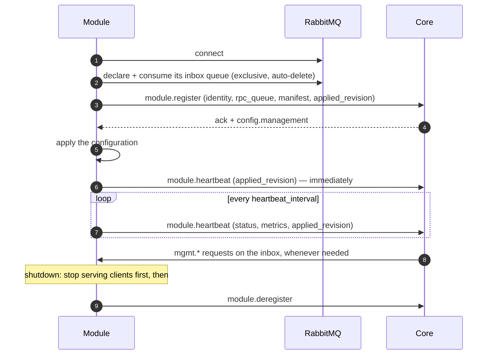

This page is the practical companion to the [contracts](../contracts/overview/):
what a module has to do to live on the control plane, and how the Go SDKs do
it: [`logos-golang-module-core`](https://github.com/logoscore/logos-golang-module-core)
for every module type, and
[`logos-golang-channel-core`](https://github.com/logoscore/logos-golang-channel-core)
on top of it for channels, and `logos-golang-factory-core` for factories. The
[HTTP channel](https://github.com/logoscore/logos-http-channel) is the worked
example throughout.

## What every module does

In any language, a module's control-plane session goes like this:



1. **Connect and consume your inbox first.** Declare
   `logos.<module-type>.rpc.<instance>` (exclusive, auto-delete), bind it to
   the RPC exchange with your `instance`, and start consuming **before**
   registering: core may call you as soon as it acknowledges.
2. **Register** with your identity, the inbox name as `rpc_queue`, and your
   [manifest](../contracts/module-management/#the-manifest) if you are
   manageable. `instance` must be unique per running process; `module_name` is
   your fixed kind (`http`, `telegram`, …). A channel also declares its
   [connection schema](../contracts/minion-connection/) under `connection`, a
   factory its [build schema](../contracts/minion-build/#the-build-schema)
   under `build`.
3. **Apply `config.management` from the reply** before serving. It is also
   when `restart` properties take effect.
4. **Heartbeat right away**, then every `heartbeat_interval_seconds`, with
   `healthy` or `degraded`, your status values in `metrics`, and your
   `applied_revision`. Miss three beats and core declares you dead.
5. **Serve `mgmt.*` requests** from the inbox: apply configuration, run
   actions, report state — and the log tail if you declare `logs`. Reply to
   `reply_to` with the request's `correlation_id`.
6. **On `unknown_instance`** (core lost your registration), register again.
7. **On `instance_blocked`**, an operator blocked this instance: core refuses
   its registrations until the block is lifted. Keep asking, slowly, and log
   the reason core gives.
8. **On losing the broker connection**, reconnect with back-off and start over
   from step 1. Registering again is a takeover, not an error.
9. **On shutdown**, stop accepting work, let in-flight work finish while still
   registered, and only then **deregister**. Long-lived client connections
   (WebSockets, streams) need closing explicitly: a server's own shutdown
   usually does not wait for them. Close them gently — answer what is in
   flight, then "going away" — before deregistering.

The last point matters on the data plane: core answers a sync request from an
instance that is not registered with `403`. A module that deregisters before
its in-flight requests finish fails them. It matters for builds too: core fails
a build still running on an instance that is no longer registered.

Then each type does its own job: a channel relays minion traffic to core's
[sync endpoint](../contracts/channel-core-sync/), and a factory serves
`factory.build` and `factory.build.cancel` on its inbox and reports progress
and results to core ([Minion Build](../contracts/minion-build/)).

## With the Go SDKs

The SDKs implement all of the above. A module writes only what is specific to
it. They are layered by module type:

| SDK | For | Holds |
|---|---|---|
| `logos-golang-module-core` | every module type | The control plane: session, lifecycle, management, log tail, logging. |
| `logos-golang-channel-core` (v3) | channels | `channel.Run` (the session as a channel, with the [connection schema](../contracts/minion-connection/)) and the channel data-plane helpers (profiles, transforms, sync client). |
| `logos-golang-factory-core` | factories | `factory.Run` (the session as a factory, declaring the [build schema](../contracts/minion-build/) and serving its builds), the `Builder` and `Job` a factory builds with, and `factorytest` to run a builder in its tests. It adds a [builds section](../contracts/minion-build/#managing-a-factory) to the factory's management. See [Writing a factory](#writing-a-factory). Unreleased: v0.1.0 comes with the next release. |

The module-core packages:

| Package | Gives you |
|---|---|
| `pkg/module` | `module.Run`: the whole session — connect, inbox, register, heartbeat, deregister, reconnect with back-off (1 s doubling to 30 s; an instance an operator [blocked](../contracts/module-lifecycle/#operators) asks again every 30 s and logs why), session events logged through `slog`. `Config.Handlers` adds a module type's own operations to the inbox, and `Config.Core` lets the module call core itself. |
| `pkg/mgmt` | `mgmt.Server`: validates your manifest, serves `mgmt.config.apply` / `action.invoke` / `state.get` (validation, stale revisions, `restart` handling, action timeouts and dedupe, secret redaction), and refuses an action whose [conditions](../contracts/module-management/#action-conditions) do not hold (`action_unavailable`). `mgmt.Router` serves the inbox: management next to a module type's operations. `Server.Extend` lets a type SDK add a section of its own to a module's manifest. |
| `pkg/logstream` | `logstream.Hub`: the [live log tail](../contracts/module-logs/) — recent-record buffer, leased streams, rate limit, publishing. |
| `pkg/logging` | `logging.New`: an `slog` logger writing JSON (or text) at a managed level, teed into the hub; `logging.Headers` for HTTP request headers. |
| `pkg/lifecycle` | The register / heartbeat / deregister client that `module.Run` drives. `Identity` carries what the module says about itself, including an optional [icon](../contracts/module-lifecycle/#moduleregister) and its light-theme drawing. `WithRegisterField` adds what a module type declares at registration. `CoreClient` calls core over the current session; an error reply comes back as a `coreerrors.Error` with core's code. |
| `pkg/errors` | `coreerrors.Error`: a code and a message. A `Config.Handlers` operation that returns `coreerrors.New(protocol.CodeBusy, …)` replies with that code; any other error replies `internal_error`. |

A channel calls `channel.Run` from channel-core instead of `module.Run`. It sets
module_type `channel` and declares `Config.Connection` at registration. A
factory calls `factory.Run` from factory-core: module_type `factory`, its build
schema declared under `build`, `factory.build` / `factory.build.cancel`
served on the inbox, and the builds section added to its management.

`Logs` is served only together with `Management`: a module that core does not
manage cannot be tailed either. A factory passes its own `Management` and
`Logs` as a channel does; without management of its own it still has the
builds section, so `Logs` works either way.

### Wiring

Condensed from the HTTP channel's `main.go`:

```go
// Logging: stderr at the managed level, teed into the live tail.
var level slog.LevelVar
logs := logstream.New(cfg.ChannelID)
logger, err := logging.New(cfg.LogFormat, os.Stderr, &level, logs)
if err != nil {
    log.Fatal(err)
}
slog.SetDefault(logger)

// Management: your manifest, how to apply it, your actions and status.
srv, err := mgmt.New(manifest)
if err != nil {
    log.Fatal(err) // the manifest is invalid
}
srv.OnApply(func(ctx context.Context, live map[string]any) error {
    // map the effective values onto your runtime config
    return nil
})
srv.Action("drain", func(ctx context.Context, params map[string]any, actor *protocol.Actor) (any, error) {
    handler.SetDraining(true)
    return map[string]any{"draining": true}, nil
})
srv.Status(func() map[string]any {
    return map[string]any{"requests_total": handler.Stats().RequestsTotal}
})

// The control-plane session. Give it a context of its own, so it outlives
// the shutdown signal until your servers have drained.
regCtx, stopReg := context.WithCancel(context.Background())
regDone := make(chan struct{})
go func() {
    defer close(regDone)
    schema := connection.Schema()
    err := channel.Run(regCtx, channel.Config{
        Config: module.Config{
            AMQPURL: cfg.RabbitMQURL,
            Identity: lifecycle.Identity{
                ModuleType: channel.ModuleType,
                ModuleName: "http",
                Instance:   cfg.ChannelID,
                Version:    version,
            },
            Management: srv,
            Logs:       logs, // declares the "logs" capability
        },
        Connection: &schema, // the minion connection schema
    })
    if err != nil {
        log.Fatal(err) // an invalid config: nothing was served
    }
}()

<-ctx.Done()            // SIGTERM
httpServer.Shutdown(…)  // drain clients while still registered
stopReg()               // then deregister,
<-regDone               // and wait until it is done
```

`channel.Run` returns an error only for an invalid config, at once; otherwise
it runs until its context ends, deregisters, and returns nil.

`OnApply` receives the full set of **live** values each time — apply them as a
whole. It may be called concurrently with your request handling, so keep the
runtime config behind an atomic swap or a lock.

### What stays in the module

The SDKs are plumbing only, with one exception: factory-core runs a factory's
builds, so it also serves their management (the builds section). Anything that
depends on what a module *is* belongs in the module:

- the manifest — which properties, actions and status values exist;
- what applying a value means, and what an action does (`drain` returns 404
  to every HTTP client; another channel might stop polling instead);
- the structure of its log records.

## The HTTP channel as an example

| Kind | Declared |
|---|---|
| Properties | `max_body_bytes` (bytes, live), `log_level` (enum `debug` / `info` / `warn` / `error`, live) |
| Actions | `drain` (high risk), `resume`, `check_core` (probes core's sync endpoint) |
| Status values | request / success / failure / core-error / rejected / too-large counters, last core error and its time, `draining` |
| Capabilities | `logs` |
| Connection schema | `base_url`, TLS, headers and timing parameters for minions (see [Minion Connection Schema](../contracts/minion-connection/#http-channel-version-2)), declared through `channel.Config.Connection` |

Besides plain requests it accepts **WebSockets** on any path: each binary
frame is one message in the same packed format, relayed to core as a sync
like a request (core does not tell the two apart), with a few messages in flight
per connection and the same minion UUID answered in order. Its manifest adds
connection limits, ping and idle settings, connection counters and a
`close_connections` action; drain also closes open connections.

Its environment holds what core must not change: how to reach core
(`LOGOS_SYNC_BASE_URL`, `CORE_SYNC_TIMEOUT`), the broker credentials, the log
format, and which proxies to trust for client addresses. Each request is
logged once, as one structured line.

## Writing a factory

A factory is a `Builder` handed to `factory.Run`. Condensed from BOB's
`main.go` (BOB, `logos-bob-factory`, is the reference factory: it builds
dummy minions, JSON files that describe what they were built with):

```go
ctx, stop := signal.NotifyContext(context.Background(), syscall.SIGINT, syscall.SIGTERM)
defer stop()

schema := buildSchema // a protocol.BuildSchema: channels, fields, targets, commands
err := factory.Run(ctx, factory.Config{
    Config: module.Config{
        AMQPURL:    amqpURL,
        Identity:   lifecycle.Identity{ModuleName: "bob", Instance: instance, Version: version},
        Management: mgmtSrv, // the factory's own; factory-core adds the builds section
        Logs:       logs,
    },
    Build:               &schema,
    Builder:             b,
    MaxConcurrentBuilds: 4,
})
if err != nil {
    log.Fatal(err) // an invalid config or build schema
}
```

`factory.Run` sets module_type `factory`, refuses an invalid schema, and runs
until `ctx` ends. Then it cancels the running builds, waits up to
`ShutdownGrace` (10 s) for their results to reach core, and deregisters, so a
factory hands it its signal context directly. Its `Config` also takes
`HTTPClient` for downloads and uploads (no timeout needed: each transfer ends
with its build's deadline). `MaxConcurrentBuilds` defaults to 1 and is where the
live `max_concurrent_builds` property starts. `Handlers` may not take the build
operations.

### The builder

```go
// Steps is the plan for one build, before it starts: core shows it as the
// build's pipeline. Optional (Planner); without it a build has one step, "Build".
func (b *bob) Steps(req protocol.BuildRequest) []protocol.BuildStep {
    var steps []protocol.BuildStep
    if id, _ := req.Values["badge"].(string); id != "" {
        steps = append(steps, stepBadge) // a step that will not run is left out
    }
    return append(steps, stepRender, stepUpload)
}

func (b *bob) Build(ctx context.Context, job *factory.Job) (factory.Result, error) {
    if f, ok := job.File("badge"); ok {
        job.Step(stepBadge.ID, "checking the badge")
        if _, err := job.ReadFile(ctx, f); err != nil { // size and SHA-256 checked
            return factory.Result{}, factory.Fail("badge_unreadable", err.Error())
        }
    }
    job.Step(stepRender.ID, "")
    body, name := render(job.Request) // what the minion is
    job.Step(stepUpload.ID, "")
    if err := job.UploadArtifact(ctx, name, "application/json", bytes.NewReader(body)); err != nil {
        return factory.Result{}, err
    }
    return factory.Result{Warnings: []string{"a dummy minion: it describes a minion and runs nothing"}}, nil
}
```

The `Job` is one build:

| | |
|---|---|
| `Request`, `Target` | The `factory.build` request, already checked against the schema, and the target being built. `Values` holds every field with a value or a default. |
| `HasCommand(id)` | Whether the minion is built with a command: the operator picked it, or the target requires it. Build in exactly the request's `commands`, or fail the build. |
| `Step(id, message)` | Report the step of the plan the build is on. It never blocks: a newer report replaces one not sent yet, and a step outside the plan is dropped (and logged once). |
| `Log()`, `Logf` | The build log, sent with the result; core keeps its last 64 KiB. |
| `File(key)`, `ReadFile`, `Download` | The file a `file` field names, read into memory (small files) or saved to disk, its size and SHA-256 checked. |
| `UploadArtifact` | Spools the artifact to a temporary file, refuses one over `max_size`, and uploads it with its length; its size and SHA-256 go into the result. |

`Build` must return when `ctx` ends: the build was cancelled, ran out of time,
or the factory is stopping. Key material, secret values and files never go to
logs, progress or the build log.

### Results and failures

A build that returns without an error and with its artifact uploaded
succeeded. An error fails it: `factory.Fail(code, message)` with a code of the
factory's own (`^[a-z0-9][a-z0-9_.-]{0,62}$`), and any other error as
`build_failed`. factory-core reports these codes itself:

| Code | When |
|---|---|
| `build_failed` | The builder returned an error without a code. |
| `no_artifact` | It returned without uploading an artifact. |
| `artifact_too_large` | The artifact is over the request's `max_size`. |
| `invalid_result` | The result broke the contract's limits; the message says how. |
| `timeout` | The deadline passed during the build. |
| `shutdown` | The factory stopped during the build. |
| `panic` | The builder panicked. |

The SDK takes care of the rest of the contract: it validates each request
(`validation_failed`, `unsupported_version`), refuses builds over the limit or
while draining (`busy`), accepts a repeated request with the same plan without
building again (remembering a build for an hour past its deadline), stops a
build when core cancels it or answers its progress with `not_found`, and
sends the result until core replies or the deadline passes (each attempt
10 s, retries from 1 s doubling to 30 s). It adds the
[builds section](../contracts/minion-build/#managing-a-factory) to the
factory's management; the factory's own manifest cannot use its keys.

### Testing a builder

`factorytest` runs a builder in process, without core or a broker, through the
same checks, plan, `Job` and result as `factory.Run`:

```go
store := factorytest.NewStore(t) // serves files and takes artifacts over HTTP
badge := store.File(protocol.NewID(), "badge.png", "image/png", png)
out := factorytest.Run(t, buildSchema, &bob{}, store, protocol.BuildRequest{
    Target: "dummy", Platform: "any/any", SchemaVersion: 1,
    Values: map[string]any{"badge": badge.ID},
    Files:  map[string]protocol.BuildFile{badge.ID: badge},
    // …commands and connections, as core sends them
})
// out.Steps, out.Progress, out.Result: what core would have received.
// out.Artifact: the bytes uploaded.
```

It fills in what core adds when the request leaves it out (a minion id, the
upload URL and `max_size`, a deadline a minute away), and fails the test when
the request does not fit the schema. `factorytest.Build` returns only the
result and the artifact.

### BOB

| Kind | Declared |
|---|---|
| Build schema | Targets `dummy` and `dummy-lite` (`json`, `any/any`); fields `greeting`, `kill_date` (`datetime`), `punches` (`enum_list`) and `badge` (`file`, images up to 256 KiB); HTTP connection parameters `method` and `path_prefix` (`format: "path"`); commands `sleep` and `exit` (required), `hello` and `ls` (default), `download`, and `shell` (`dummy` only) |
| Properties | `build_delay` and `fail_builds` (to try slow and failing builds), `log_level` |
| Actions | `say_hello` |
| Builds section | added by factory-core, `max_concurrent_builds` starting at 4 |
| Capabilities | `logs` |

## Design notes

- **Shared plumbing, layered by type.** Every module needs the same session
  handling, management server and log tail. Putting them in module-core means
  a new module only writes its own job and its manifest, and fixes to the
  plumbing reach every module. What only one type needs (a channel's
  connection schema, a factory's builds) goes in that type's SDK, never in
  module-core.
- **Plumbing only in the SDK.** Channel-specific behaviour, even when common
  (most channels can be paused somehow), stays in the module: only the module
  knows what pausing means for its transport. module-core and channel-core
  never add actions or properties of their own. factory-core's builds section
  is the one exception, since only the SDK runs the builds.
- **Deregister last.** The control-plane session gets a context of its own and
  is stopped after the data plane has drained, because core gates sync traffic
  on registration.
- **Logs are structured at the source.** Modules log with `slog`; JSON on
  stderr for aggregators, and the same records — structure intact — for core's
  live tail.
