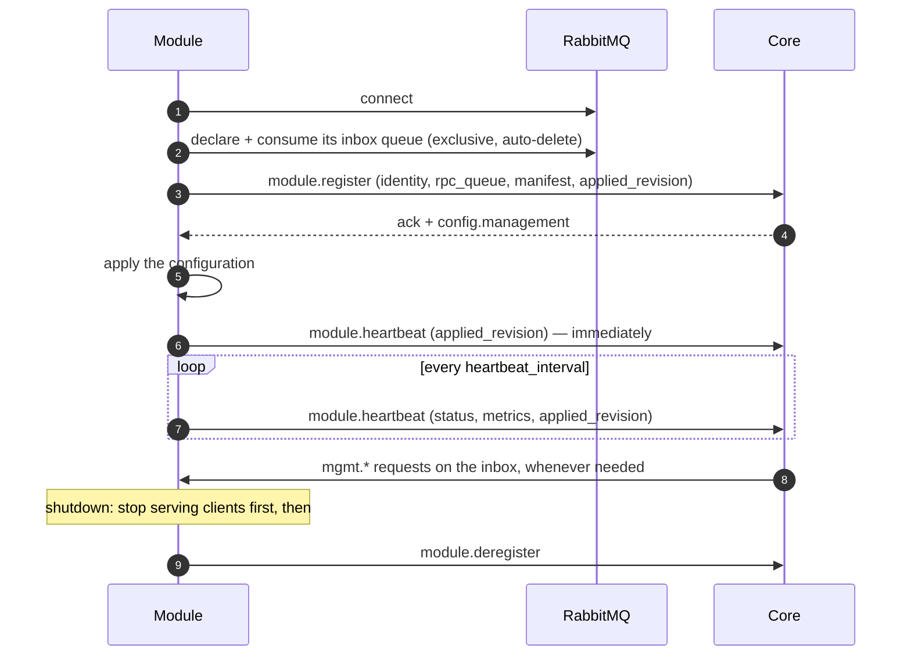

This page is the practical companion to the [contracts](../contracts/overview/):
what a module has to do to live on the control plane, and how the Go SDKs do
it: [`logos-golang-module-core`](https://github.com/logoscore/logos-golang-module-core)
for every module type, and
[`logos-golang-channel-core`](https://github.com/logoscore/logos-golang-channel-core)
on top of it for channels, and `logos-golang-factory-core` for factories. The
[HTTP channel](https://github.com/logoscore/logos-http-channel) is the worked
example throughout.

## What every module does

In any language, a module's control-plane session goes like this:



1. **Connect and consume your inbox first.** Declare
   `logos.<module-type>.rpc.<instance>` (exclusive, auto-delete), bind it to
   the RPC exchange with your `instance`, and start consuming **before**
   registering: core may call you as soon as it acknowledges.
2. **Register** with your identity, the inbox name as `rpc_queue`, and your
   [manifest](../contracts/module-management/#the-manifest) if you are
   manageable. `instance` must be unique per running process; `module_name` is
   your fixed kind (`http`, `telegram`, …).
3. **Apply `config.management` from the reply** before serving. It is also
   when `restart` properties take effect.
4. **Heartbeat right away**, then every `heartbeat_interval_seconds`, with
   `healthy` or `degraded`, your status values in `metrics`, and your
   `applied_revision`. Miss three beats and core declares you dead.
5. **Serve `mgmt.*` requests** from the inbox: apply configuration, run
   actions, report state — and the log tail if you declare `logs`. Reply to
   `reply_to` with the request's `correlation_id`.
6. **On `unknown_instance`** (core lost your registration), register again.
7. **On losing the broker connection**, reconnect with back-off and start over
   from step 1. Registering again is a takeover, not an error.
8. **On shutdown**, stop accepting work, let in-flight work finish while still
   registered, and only then **deregister**. Long-lived client connections
   (WebSockets, streams) need closing explicitly: a server's own shutdown
   usually does not wait for them. Close them gently — answer what is in
   flight, then "going away" — before deregistering.

The last point matters on the data plane: core answers a sync request from an
instance that is not registered with `403`. A module that deregisters before
its in-flight requests finish fails them.

## With the Go SDKs

The SDKs implement all of the above. A module writes only what is specific to
it. They are layered by module type:

| SDK | For | Holds |
|---|---|---|
| `logos-golang-module-core` | every module type | The control plane: session, lifecycle, management, log tail, logging. |
| `logos-golang-channel-core` (v3) | channels | `channel.Run` (the session as a channel, with the [connection schema](../contracts/minion-connection/)) and the channel data-plane helpers (profiles, transforms, sync client). |
| `logos-golang-factory-core` | factories | `factory.Run` (the session as a factory, declaring the [build schema](../contracts/minion-build/) and serving its builds), the `Builder` and `Job` a factory builds with, and `factorytest` to run a builder in its tests. Unreleased, like the draft contract it implements. |

The module-core packages:

| Package | Gives you |
|---|---|
| `pkg/module` | `module.Run`: the whole session — connect, inbox, register, heartbeat, deregister, reconnect with back-off (1 s doubling to 30 s), session events logged through `slog`. `Config.Handlers` adds a module type's own operations to the inbox, and `Config.Core` lets the module call core itself. |
| `pkg/mgmt` | `mgmt.Server`: validates your manifest, serves `mgmt.config.apply` / `action.invoke` / `state.get` (validation, stale revisions, `restart` handling, action timeouts and dedupe, secret redaction). `mgmt.Router` serves the inbox: management next to a module type's operations. |
| `pkg/logstream` | `logstream.Hub`: the [live log tail](../contracts/module-logs/) — recent-record buffer, leased streams, rate limit, publishing. |
| `pkg/logging` | `logging.New`: an `slog` logger writing JSON (or text) at a managed level, teed into the hub; `logging.Headers` for HTTP request headers. |
| `pkg/lifecycle` | The register / heartbeat / deregister client that `module.Run` drives. `WithRegisterField` adds what a module type declares at registration. `CoreClient` calls core over the current session. |

A channel calls `channel.Run` from channel-core instead of `module.Run`. It sets
module_type `channel` and declares `Config.Connection` at registration. A
factory calls `factory.Run` from factory-core: module_type `factory`, its build
schema declared under `build`, and `factory.build` / `factory.build.cancel`
served on the inbox.

### Wiring

Condensed from the HTTP channel's `main.go`:

```go
// Logging: stderr at the managed level, teed into the live tail.
var level slog.LevelVar
logs := logstream.New(cfg.ChannelID)
logger, err := logging.New(cfg.LogFormat, os.Stderr, &level, logs)
if err != nil {
    log.Fatal(err)
}
slog.SetDefault(logger)

// Management: your manifest, how to apply it, your actions and status.
srv, err := mgmt.New(manifest)
if err != nil {
    log.Fatal(err) // the manifest is invalid
}
srv.OnApply(func(ctx context.Context, live map[string]any) error {
    // map the effective values onto your runtime config
    return nil
})
srv.Action("drain", func(ctx context.Context, params map[string]any, actor *protocol.Actor) (any, error) {
    handler.SetDraining(true)
    return map[string]any{"draining": true}, nil
})
srv.Status(func() map[string]any {
    return map[string]any{"requests_total": handler.Stats().RequestsTotal}
})

// The control-plane session. Give it a context of its own, so it outlives
// the shutdown signal until your servers have drained.
regCtx, stopReg := context.WithCancel(context.Background())
schema := connection.Schema()
go channel.Run(regCtx, channel.Config{
    Config: module.Config{
        AMQPURL: cfg.RabbitMQURL,
        Identity: lifecycle.Identity{
            ModuleType: channel.ModuleType,
            ModuleName: "http",
            Instance:   cfg.ChannelID,
            Version:    version,
        },
        Management: srv,
        Logs:       logs, // declares the "logs" capability
    },
    Connection: &schema, // the minion connection schema
})

<-ctx.Done()            // SIGTERM
httpServer.Shutdown(…)  // drain clients while still registered
stopReg()               // then deregister
```

`OnApply` receives the full set of **live** values each time — apply them as a
whole. It may be called concurrently with your request handling, so keep the
runtime config behind an atomic swap or a lock.

### What stays in the module

The SDKs are plumbing only. Anything that depends on what a module *is*
belongs in the module:

- the manifest — which properties, actions and status values exist;
- what applying a value means, and what an action does (`drain` returns 404
  to every HTTP client; another channel might stop polling instead);
- the structure of its log records.

## The HTTP channel as an example

| Kind | Declared |
|---|---|
| Properties | `max_body_bytes` (bytes, live), `log_level` (enum `debug` / `info` / `warn` / `error`, live) |
| Actions | `drain` (high risk), `resume`, `check_core` (probes core's sync endpoint) |
| Status values | request / success / failure / core-error / rejected / too-large counters, last core error and its time, `draining` |
| Capabilities | `logs` |
| Connection schema | `base_url`, TLS, headers and timing parameters for minions (see [Minion Connection Schema](../contracts/minion-connection/#http-channel-version-2)), declared through `channel.Config.Connection` |

Besides plain requests it accepts **WebSockets** on any path: each binary
frame is one message in the same packed format, relayed to core as a sync
like a request (`source.transport: "websocket"`), with a few messages in flight
per connection and the same minion UUID answered in order. Its manifest adds
connection limits, ping and idle settings, connection counters and a
`close_connections` action; drain also closes open connections.

Its environment holds what core must not change: how to reach core
(`LOGOS_SYNC_BASE_URL`, `CORE_SYNC_TIMEOUT`), the broker credentials, the log
format, and which proxies to trust for client addresses. Each request is
logged once, as one structured line.

## Design notes

- **Shared plumbing, layered by type.** Every module needs the same session
  handling, management server and log tail. Putting them in module-core means
  a new module only writes its own job and its manifest, and fixes to the
  plumbing reach every module. What only one type needs (a channel's
  connection schema, a factory's builds) goes in that type's SDK, never in
  module-core.
- **Plumbing only in the SDK.** Channel-specific behaviour, even when common
  (most channels can be paused somehow), stays in the module: only the module
  knows what pausing means for its transport. The SDK never adds actions or
  properties of its own.
- **Deregister last.** The control-plane session gets a context of its own and
  is stopped after the data plane has drained, because core gates sync traffic
  on registration.
- **Logs are structured at the source.** Modules log with `slog`; JSON on
  stderr for aggregators, and the same records — structure intact — for core's
  live tail.
