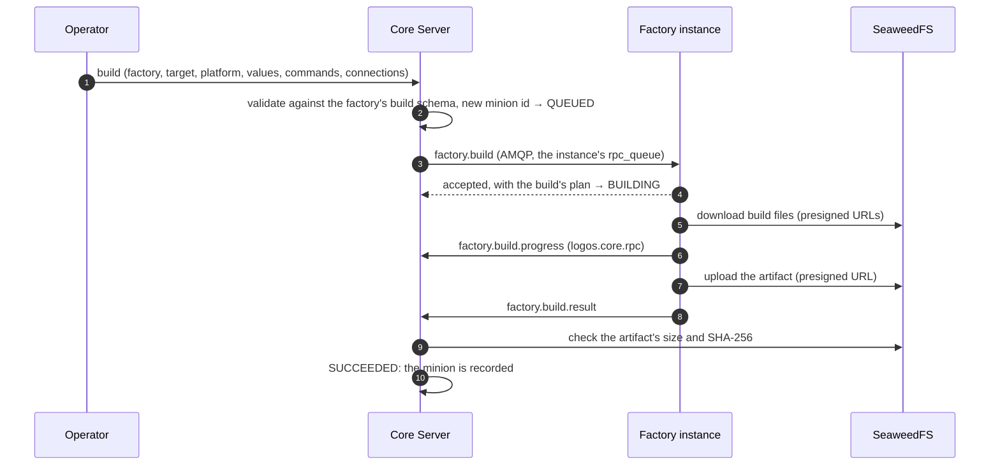
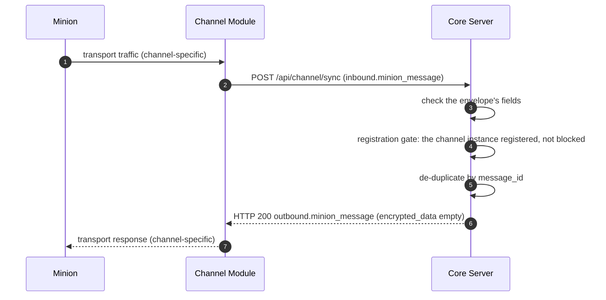
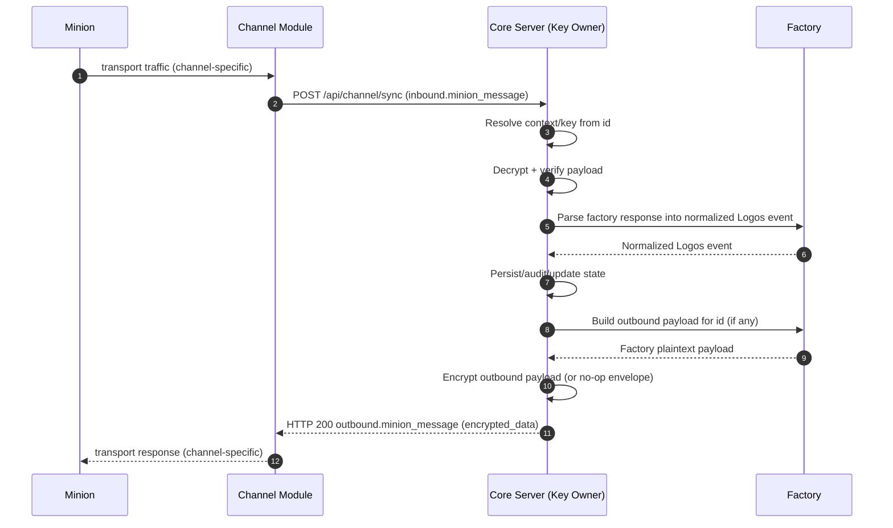

End-to-end flows across the major components: how a minion comes to exist,
what happens to its traffic today, and where the design takes it.

## A Minion Is Built

An operator builds a minion in an operation; a factory instance builds it. The
build's `minion_id` is the minion's `id` on the data plane from then on.

Every channel the minion is built to reach has registered with core already:
its connection settings follow the channel's
[minion connection schema](../contracts/minion-connection/). See
[Minion Build](../contracts/minion-build/).

## The Minion's Traffic Today

Core does not look at the payload yet: it holds no minion keys, and there is
no tasking to send. Every valid message gets an empty reply. See
[Channel ↔ Core: HTTP Sync](../contracts/channel-core-sync/).

## The Target

Once payload crypto and the factory command contract are written, core opens
each message and answers with the minion's pending tasks:

## Notes

- `minion ↔ core Server` is the logical protocol conversation.
- Channel is a transport relay — it delivers canonical envelopes and remains plaintext-blind.
- Factories are separate processes. Today they talk to core only about builds,
  over AMQP, and to the object store through presigned URLs. In the target they
  also translate between the minion's language and Logos events, on plaintext
  core gives them.
- How a channel extracts `id` + `encrypted_data` from its transport, or embeds
  the response back, is the channel's implementation detail. Core only sees the
  canonical envelopes defined in [Channel ↔ Core: HTTP Sync](../contracts/channel-core-sync/).
