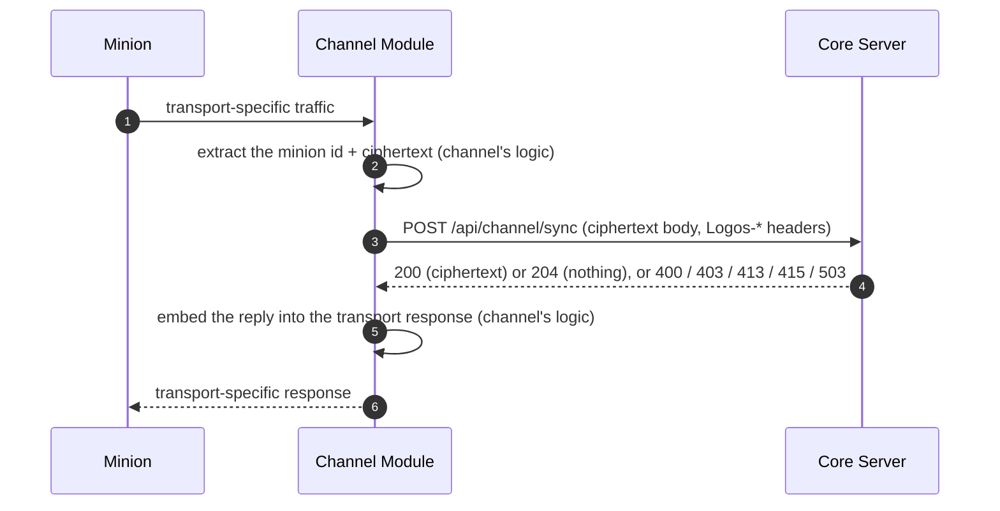

This page documents the **channel-to-core data-plane flow** — how a minion's
traffic reaches core and how core's response gets back.

## Envelope-Centric View

The core Server defines one contract surface for all channel modules: one HTTP
call per minion message, the ciphertext as the raw body and the minion id in a
header. How a channel module receives
traffic from a minion, what transport it uses, and how it extracts or embeds
fields is **the channel's concern and out of scope for core**.

Core sees only:

1. A request to `POST /api/channel/sync`: the minion's ciphertext as the body.
2. Core's reply in the HTTP response: ciphertext for the minion (200), or
   nothing (204).

## What Core Requires

A well-formed request with:

- The body: the minion's ciphertext, never inspected by the channel. Not
  empty, and within core's size limit (413 otherwise).
- `Logos-Minion-Id` — the minion's id: its build's `minion_id`.
- `Logos-Channel-Instance` — the channel instance sending it, which must be
  registered and not blocked (403 otherwise; 503 when core cannot read its
  registry). The id is the channel's word: there is no authentication yet.
- `Logos-Message-Id` — unique per request. Core answers an id it has seen
  within 24 hours with a no-op.

A malformed request gets 400, a body that is not `application/octet-stream`
415. See [Channel ↔ Core: HTTP Sync](../contracts/channel-core-sync/) for the
full contract.

## What Core Returns

A reply with the same `Logos-Minion-Id`, and:

- **200** with ciphertext for the minion as the body, or
- **204** when nothing is pending. Today it is always 204: core has no tasking
  to send yet.

It returns the request's `traceparent` when it had one.

## Channel Boundaries

- Channel does **not** decrypt payload plaintext.
- Channel does **not** execute core business logic.
- Channel does **not** own factory semantics.
- How a channel maps transport fields to/from the canonical envelope is an
  implementation detail invisible to core.
