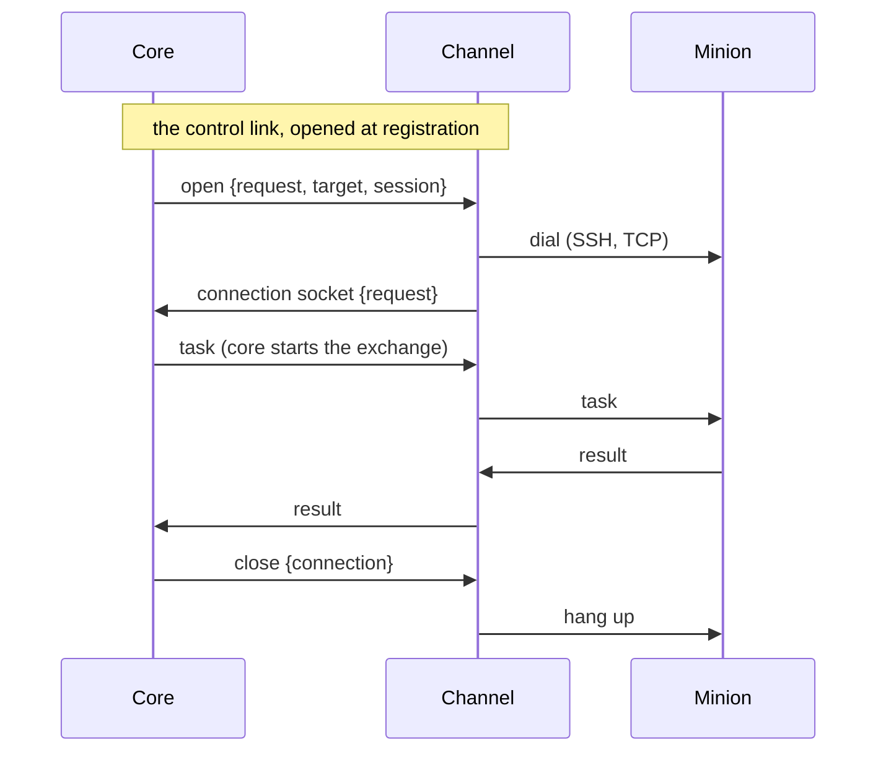

Logos has two kinds of modules: **channels**, which carry minions' messages
to and from core, and **factories**, which build minions.

## 1) Channel Modules

Channel modules carry a minion's messages between the minion and core over a
transport: HTTP, WebSocket, SSH, DNS, whatever the channel speaks. A channel
never decrypts: what it carries is sealed, and core is the minion's real
peer.

### Responsibilities

- Carry minion messages over its transport, in the [connection
  kinds](#connection-kinds) it supports, and pass them to core and back
  without reading them.
- Extract the build id and its ciphertext from the transport (channel-defined
  logic).
- Register with core on startup via [Module Lifecycle](../contracts/module-lifecycle/),
  declaring its [minion connection schema](../contracts/minion-connection/): the
  settings a minion is given to reach it, which operators keep as endpoints and
  fill in for each connection of a build.
- Handle transport-specific concerns (polling cadence, retries, rate limits).

### Connection kinds

A minion's connection differs in two ways: **who dials**, and **how long it
lasts**.

| | One exchange per connection (`call`) | The connection stays open (`persistent`) |
|---|---|---|
| **The minion dials the channel** (`reverse`) | `reverse-call`: HTTP requests, polled | `reverse-persistent`: a WebSocket the minion keeps open |
| **The channel dials the minion** (`bind`) | `bind-call`: a request to a page on a web server (a PHP script) | `bind-persistent`: SSH, or TCP to a listening minion |

The names are the ones operators know from reverse and bind shells. They
decide who can start an exchange, and when core can reach the minion:

| Kind | Opened by | Who starts exchanges | Core can send |
|---|---|---|---|
| `reverse-call` | the minion | the minion; core only answers | when the minion next checks in |
| `reverse-persistent` | the minion | both | while the connection is open |
| `bind-call` | the channel, when core asks | core; the minion only answers | whenever core calls |
| `bind-persistent` | the channel, when core asks | both | while the connection is open, which core can ask for |

Built today: `reverse-call`. The HTTP channel's WebSocket is persistent for
the minion, but the channel relays each of its frames to core as one sync
call, so to core it is still `reverse-call`: core answers, never starts.

### Channel ↔ core

:::caution[Draft]
An agreed design, not built: the control link, the connection sockets and
the kinds' declarations below.
:::

A channel reaches core three ways, each for what it suits:

| Path | One per | Carries | For |
|---|---|---|---|
| The [sync call](../contracts/channel-core-sync/) (built) | message | one minion message and core's reply, over HTTP | `reverse-call` |
| The **control link**, a WebSocket | channel instance | core's requests to the channel: call a target, open a connection, close one | `bind-call`, and opening `bind-persistent` |
| A **connection socket**, a WebSocket | minion connection | the connection's messages, both ways | `reverse-persistent`, `bind-persistent` |

The channel opens all of them: core never connects to a channel, which may
sit somewhere core cannot reach.

**The control link.** Each channel instance opens one when it registers, and
opens it again whenever it drops. Over it core asks, and the channel answers
each request by its id:

- **`call`**: deliver this sealed message to a target (a page's URL) and
  return the minion's sealed answer, within a deadline, or why it could not.
- **`open`**: open a `bind-persistent` connection to a target, for a session.
  The channel dials, then opens the connection's socket (below), naming the
  request; or it answers why it could not.
- **`close`**: close a connection.

It carries requests, not a minion's traffic: one link per instance is enough,
and nothing waits behind a large transfer.

**Connection sockets.** The channel opens one per minion connection that
stays open:

- for `reverse-persistent`, when the minion's connection brings its first
  message (the channel learns its build id from it);
- for `bind-persistent`, once it has dialed the target `open` named.

Each binary frame is one message: the [sync call](../contracts/channel-core-sync/)'s
values (message id, the id it is sent under, the peer) and the ciphertext,
raw. Both sides send on it whenever they have something: core starts
exchanges (tasks, `cancel`) as well as answering. The socket is the
connection: while it is open, core shows the session **connected**; when
either side closes it, the connection is gone. If only the socket drops (core
restarts), the channel opens a new one for the minion's connection, which
does not notice.

One socket per connection rather than one for everything: each gets TCP's own
flow control, a slow minion or a large transfer holds up nobody else, and a
socket that drops takes one connection with it. Their number is the number
of connections open at once, hundreds to a few thousand.

**Declaring kinds.**

- A channel declares at registration the kinds it supports. The `bind` kinds
  also need **target fields**: where to reach a minion (a page's URL; a host,
  a port and credentials), which operators fill in for a session once the
  minion is in place, not when it is built.
- A factory declares, for each target and channel of its [build
  schema](../contracts/minion-build/), the kinds its minions support: a PHP
  page only `bind-call`; BOB's minion `reverse-call` and `reverse-persistent`.
  A build's connection names the kind it uses.

**What it changes for core:**

- **Pushing.** Core sends on a connection through one interface (send to a
  session), whatever holds it; core runs as [one
  instance](../architecture/#one-core-instance).
- **Tasks unasked.** Through a call a minion takes tasks only with
  `get_tasks`. On a persistent connection `get_tasks` with `max` becomes an
  allowance: core sends tasks as they are queued, while fewer than `max` it
  sent are unfinished.
- **Presence.** A persistent connection shows when it opens and closes; a
  `bind-call` minion is reached when core calls, so "lost" means calls fail,
  not that check-ins stopped.
- **Replays.** A minion need not guard against core's exchanges replayed: a
  captured core message sent to it again would run its tasks again. It may,
  by remembering recent message ids.

### To decide

- **Sessions for `bind-call` minions.** A page that keeps nothing between
  requests cannot stage (it would have to keep the keys staging gives it), so
  core creates its session ahead of time, under the build's own keys, when an
  operator enters its target: a **premade session**. How its `hello` reaches
  core, when core starts every exchange.
- **When core calls a `bind-call` minion**: on a new task or `cancel`, on a
  schedule (to collect results of long tasks), on demand; and what it does
  when a call fails.
- **The control link's and the connection socket's formats**: the frames,
  the request ids, `open`'s answer and its deadline, authentication (the
  [channel authentication](../contracts/channel-core-sync/) planned for the
  sync call).
- **Target fields**: how the connection schema declares them, and where
  operators enter them for a session.
- **Who opens `bind-persistent` and when**: an operator for the session, core
  on a new task, or both; and what closes it (the operator, an idle timeout).
- **Kinds in the build schema** and in a build's connections.

### What core requires from a channel

A well-formed sync request from an instance that is registered and not
blocked: core answers an unregistered, dead or blocked instance with 403. How
a channel receives traffic, what transport it uses, and how it extracts the
canonical fields is the channel's implementation detail. Core defines the
contract in [Channel ↔ Core: HTTP Sync](../contracts/channel-core-sync/).

### Examples

- HTTP(S) and WebSocket: `logos-http-channel`, the reference channel. It
  accepts any method on any path (`reverse-call`), and WebSocket connections
  whose binary frames are messages (`reverse-persistent` once core takes
  connection sockets).
- DNS, SSH or GitHub channels: possible, none built yet.

### Notes

- Keep transport logic isolated from business/tasking logic.
- Channel modules are blind to minion plaintext by design.
- Channel role is envelope delivery, not Logos semantics.
- The real protocol peer is core Server, not the channel module.
- Enforce per-channel authentication and abuse controls.
- Expose channel health and queue lag metrics.

## 2) Factory Modules

Factory modules build minions. They define minion families and lifecycle behavior.

### Responsibilities

Built:

- Declare what can be built in a [build schema](../contracts/minion-build/)
  at registration: targets and their platforms, the build parameters, the
  channel kinds the minions speak with the factory's own connection parameters
  for each, and the commands the minions can be built with.
- Build minions on core's request (`factory.build`): report the build's plan
  and progress, upload the artifact to the URL core gives, and report the
  result.
- Build in the commands the operator picked, and no others.
- Planned, with the [connection kinds](#connection-kinds): declare which
  kinds its minions support, per target and channel.

Planned, with the factory command contract:

- Preprocess operator/core commands into minion-specific wire format.
- Postprocess raw minion responses into structured events/results.
- Version the command contract per minion family.

### Examples

- BOB (`logos-bob-factory`), the reference factory: it builds dummy minions, a
  JSON description of what the minion would be built with.
- Go, .NET or Python factories: possible, none built yet.

### Optional Translator Hooks

:::note[Not built]
A design for the factory command contract: no factory implements hooks yet,
and core sends factories no minion traffic.
:::

By default, the preprocess/postprocess responsibilities above map directly
between the normalized Logos model and the minion wire format. A factory that
wants a **custom language for its minions** may optionally implement translator
hooks to insert its own intermediate representation:

- `translate_outbound` — convert a normalized Logos command intent into the
  factory's custom minion language before it is serialized to wire format.
- `translate_inbound` — convert a raw minion response in the factory's custom
  language back into the normalized Logos result schema.

Hooks are an implementation detail **owned entirely by the factory** — they are
not a separate module or deployable. Factories that need no custom language
simply omit them and rely on the default direct mapping.

Guidance for factories that implement them:

- Translator hooks run inside the factory, a core-side processing layer that
  operates on already-decrypted plaintext. They never cross the channel trust
  boundary and never touch payload crypto.
- Keep hooks deterministic and test-heavy.
- Make the mapping explicit; avoid hidden heuristic behavior in critical paths.
- Version the custom language alongside the factory's command contracts.

### Notes

- Keep factory-specific command grammar encapsulated.
- Version command contracts per factory.
- Declare the commands its minions can be built with (the build schema's
  `commands`); operators pick each build's, and the minion has those.

## Cross-Cutting Module Requirements

All module types should:

- Register with core on startup and heartbeat for liveness via the [Module Lifecycle](../contracts/module-lifecycle/) contract. A blocked instance is refused until an operator unblocks it; the SDK keeps asking, at its longest backoff.
- Declare what operators can manage on them in a [management manifest](../contracts/module-management/), and serve the [live log tail](../contracts/module-logs/).
- Send an icon at registration, shown with the module in the web app.
- Communicate through RabbitMQ channels using versioned message schemas.
- Include correlation IDs for traceability across services.
- Be independently deployable/replaceable in Docker Compose stacks.
- Emit structured logs and health signals.
- Support graceful shutdown and idempotent processing where possible.

Crypto boundary rules:

- Minion payload crypto (`encrypt/decrypt/verify/sign`) belongs to core Logos services.
- Channel modules must be plaintext-blind and process only routing metadata + encrypted blobs.

## Contracts

The wire-level contracts these modules use are specified in the
[Contracts](../contracts/overview/) section:

1. Base message envelope and versioning — [AMQP Message Envelope](../contracts/amqp-envelope/).
2. Exchange/queue naming convention — [AMQP Routing Conventions](../contracts/amqp-conventions/).
3. Data-plane envelope — [Channel ↔ Core: HTTP Sync](../contracts/channel-core-sync/).
4. Lifecycle — [Module Lifecycle](../contracts/module-lifecycle/).
5. Management — [Module Management](../contracts/module-management/) and the
   [live log tail](../contracts/module-logs/).
6. What minions are given to reach a channel — [Minion Connection Schema](../contracts/minion-connection/).
7. Builds — [Minion Build](../contracts/minion-build/).

For building a module against them, see [Implementing a Module](../implementing-a-module/):
`logos-golang-module-core` for every module, with `logos-golang-channel-core`
for a channel and `logos-golang-factory-core` for a factory.

Still open: the channel's connection kinds beyond `reverse-call` ([draft
above](#channel--core)), and module packaging/lifecycle policy.
